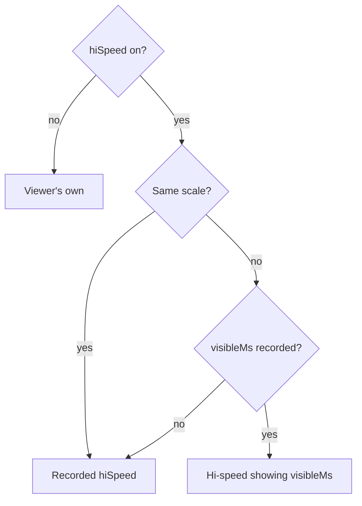
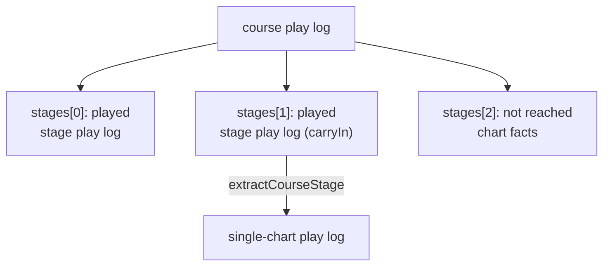

[Japanese version](./playlog.ja.md)

# Play log (play history) specification

This document describes the be-music play log ("playlog") — the play-history file recorded during gameplay — and
the tools that re-derive LR2 / beatoraja / IIDX results from it.

## Design principle: an input replay, not a result log

A playlog is deliberately **not** a list of judgments. Its canonical payload is:

1. **`chart`** — the resolved chart that actually scrolled past the player: post-`#RANDOM` control flow, post
   lane-shuffle (RANDOM / MIRROR / S-RANDOM), post DP-flip. Long notes are stored as single objects with a
   `timeUs` / `endTimeUs` pair, mines carry their resolved gauge damage, and the raw `#TOTAL` / `#RANK` /
   `#DEFEXRANK` metadata is preserved so each ruleset can apply its own defaults. `chart.sha256` stamps the
   SHA-256 of the source chart FILE bytes so a log can be matched back to its chart by content, and `chart.md5`
   the MD5 of the same bytes, the key LR2 and LR2IR use.
   Two Be-Music Fingerprints (`bmfp0:…`, see [fingerprint-spec.md](./fingerprint-spec.md)) identify the chart by
   what is played rather than by the file bytes, so logs of one chart still match after keysound / BGA / metadata
   edits, re-saves, or a BMS ↔ bmson conversion. `chart.chartFingerprint` covers every `#RANDOM` / `#SWITCH`
   branch, so every play of one chart shares it whatever it rolled — the key to group plays of a chart.
   `chart.playFingerprint` covers the branches this play rolled. The two are equal for a chart without control
   flow. Lane options (RANDOM / MIRROR / S-RANDOM, DP FLIP) are part of neither — they are recorded in `play`.
   The recorder computes both from the source chart (`recordPlaylog.sourceChart`, the chart as loaded; the engine
   uses the chart it was given when the host passes none) and `play.randomDraws`, with the chart's extension
   (`PlayerOptions.laneModeExtension`) as the lane-mode input. A host that resolves `#RANDOM` or rewrites lanes on
   the chart before handing it to the engine — the browser player resolves every chart and the beatoraja scene
   bakes DP FLIP into it — passes the source chart, or the chart fingerprint is omitted and the play fingerprint
   would describe the host's working copy. Either field is omitted when it cannot be computed; logs without them
   still parse.
   `chart.reversalTimeUs` (present only for charts whose negative `#BPMxx` reverses the scroll) records the LR2
   reverse-scroll reversal instant R: the simulator judges later inputs on the mirrored clock `2R - timeUs`, never
   sweeps misses past R, and ends a run that leaves scorable notes unjudged with the gauge at 0, exactly as the
   engine did (see [`bms-spec.md`](./bms-spec.md) "Negative BPM").
2. **`inputs`** — every raw key press / release that reached a playable lane, as
   `{ seq, timeUs, action: 'down' | 'up', channels }`, with the key `tokens` when the host named them and
   `inferred: true` on an `up` the engine inferred because the input reported no releases (a terminal without the
   kitty keyboard protocol): the instant it took the key as let go. `inferred` is diagnostic only; replays and
   simulators read such an `up` like any other. Inputs are never converted into judgments, never assigned
   to a note id, and phantom presses (the ones that fire LR2 empty POORs) are kept. The sort key is always
   `(timeUs, seq)` — `seq` disambiguates same-microsecond events.
3. **`play`** — the settings that affect scoring: mode (manual / auto), auto scratch, the selected gauge, the
   lane-arrangement options that produced the resolved chart, the live judge-window ruleset (`judgeRuleset`,
   absent = `'lr2'`), the debug judge-window override, an ESC flag (`aborted`, with `abortedAtUs`: the chart time the judge had settled
   through when the play was aborted, where re-simulations and replays stop instead of missing the rest of the chart),
   `endOnFailure` (the play ended the moment its survival gauge emptied; absent on logs from before that, which kept
   judging), `tempo` (the play tempo, `PlayerOptions.speed`, when it was not 1: the chart, its audio and the clock ran
   `tempo` times as fast; judgments and input times stay in chart time, so a re-simulation ignores it and a replay plays
   back at it; absent = 1, and on a log re-recorded from a replay, whose speed only sets how fast it is re-driven; such a
   practice play is not ranked; it is the tempo at the start, and `tempoChanges` lists `{ timeUs, tempo }` changes
   during the play, any of which other than 1 also makes it practice; a host changes the tempo with the
   `{ kind: 'tempo' }` input command, recorded at the chart time the engine applied it, and a replay follows the changes
   when its host passes them as `PlayerOptions.replayTempoChanges`), `view` and `viewChanges` (what the player saw:
   the hi-speed, the hi-speed fix, the visible time in ms and each side's lane cover as fractions of the lane height —
   `sudden`, `hidden`, `lift` — at the start, then every change in chart time; a host sends changes as
   `{ kind: 'view' }` input commands; judgments do not depend on them, and a replay or ghost reproduces as much of them
   as its viewer picks, `PlaylogViewReplay`), `course` for a course stage (its kind, the course's gauge set and judge constraint, and `carryIn`: the
   gauge value, course combo and course max combo the previous stage left), and `randomDraws`: the play's `#RANDOM` /
   `#SETRANDOM` / `#SWITCH` / `#SETSWITCH` outcomes as a `RandomDraws` value (`@be-music/chart`), one
   `{ command, range, value }` entry per such line of the chart in file order. They are the
   `PlayerOptions.randomDraws` the engine played with: every host draws once per play (`resolvePlayChart` in
   `@be-music/player`) and hands the same draws to the engine, which records them. With the chart file,
   `resolveBmsControlFlowWithDraws(json, play.randomDraws)` rebuilds the chart that was played (it rejects draws that
   were not drawn for that chart), so a verifier can recompute `chart.playFingerprint`. `parsePlaylog` rejects an
   entry no control-flow line could have made. It is omitted for charts without control flow.

Judgments, EX-SCORE, combo, and gauge values live only in **`results`** — a regenerable cache keyed by ruleset id
(`native` holds the engine's own result at record time). Every entry has the same shape: `noteCount` is the ruleset's
judgment count (a charge note counts twice), `djLevel` is always set, `score` only under a ruleset with a money score
(LR2), `gauge.final` is the unrounded gauge value and `gauge.failedMidPlay` marks a survival gauge that hit bottom. The
engine and the simulators reach the same entry for the same inputs. Because the canonical data is the input stream, a
later fix to any ruleset re-scores every previously recorded play without re-recording anything.

Timestamps are integer microseconds relative to chart zero (the same t = 0 the engine's note timing uses).

The TypeScript types, serializer, and defensive parser live in
[`packages/player/src/playlog/format.ts`](../packages/player/src/playlog/format.ts) (`@be-music/player/playlog`).
The recommended file suffix is `.bmplay.json`.

## Recording

Recording is engine-owned so every host (browser LR2 / beatoraja scenes, and any future TUI adoption) shares one
implementation. `PlayerOptions.onPlaylogRecorded` enables it: the engine snapshots its prepared chart, records
every judged press (`lane-input`) and release (`kitty-state` release) with `pressedAt`-corrected chart-relative
timestamps — for input without releases, the releases it inferred ([Input without key releases](#input-without-key-releases)) — counts empty POORs for the native cache, and hands the assembled `BeMusicPlaylog` to the callback right
before `autoPlay` / `manualPlay` resolves — including the ESC (aborted) exit. `PlayerOptions.recordPlaylog` carries
the host-declared settings the engine cannot know (selected gauge, lane-shuffle labels, DP flip, freeform
`native` extras, and the source chart the fingerprints are computed from). The `#RANDOM` / `#SWITCH` draws come from
`PlayerOptions.randomDraws`, which the engine needs anyway.

The engine stamps each press and release as it drains it: the playback clock read then, moved back by the age of the
event's `pressedAt` on the wall clock, and never earlier than the input it drained before. The playback clock follows
the audio clock, which moves a render quantum at a time, while the wall clock moves smoothly, so an input drained just
after another could otherwise read older than it. Inputs reach the engine in the order they happened, so the floor only
takes out that jitter: a short tap no longer records its release before its press.

Every log also carries a top-level **`recorder`** that identifies the software that recorded it:
`{ name, version, build, engine, platform }`. The host declares the application fields through
`recordPlaylog.recorder` (the browser player sends `name: 'be-music-web'`, the demo's package version, the short
source commit as `build`, and `platform: 'web'`), and the recorder always fills `engine` with the
`@be-music/player` version that ran the play. The values are self-reported: they help tell which build wrote a log
when a recording bug turns up, and are never a basis for trusting a log. Logs written before the field existed omit
it.

In the browser player:

- Every play screen (`createPlayScene`) hands the recorded log to `on.finish(result, playlog)`, and
  `waitForPlaylog()` waits for the log of a play that was left.
- The demo auto-downloads the log as `<title>-<timestamp>.bmplay.json` when the result scene mounts, controlled by
  the **Auto-save play history** checkbox in the Debug Menu's **Library & records** folder (OFF by default). Play-log options are latched at song start
  and cannot change mid-play — the controls are disabled while a song is playing, and the values in effect when
  the song started govern that play.
- The Debug Menu's **Play options** folder covers the recorded play settings: auto play, judge windows
  (LR2 / beatoraja / IIDX), gauge, Random 1P/2P, DP flip, and auto scratch. Where the LR2 select scene's
  PLAY OPTION panel has a counterpart, the two surfaces two-way sync. Its **Replay / ghost** subfolder picks what a
  replay reproduces of the recorded view ([What the player saw](#what-the-player-saw)).

### Input without key releases

A terminal without the kitty keyboard protocol sends a key as one press and then, while it is held, as repeated
presses; it never reports a release. The input runtime says before the play whether its input reports releases
(`PlayerInputRuntime.reportsKeyReleases`):

- the browser's input runtime always declares it;
- the TUI declares it once the terminal has answered the kitty keyboard protocol (or Windows' win32-input-mode) in an
  earlier play of the same process;
- otherwise the engine detects it, from the first `kitty-state` command.

A play whose input declares its releases is judged as key-state input from its first key. Otherwise, until the input
reports a release (a `kitty-state` command), the engine infers when each key came up and feeds the judge, and the
play log, ordinary presses and releases:

- a press on a lane that is up is a key going down (a `down`);
- the lane stays down for a grace after each press: 380 ms after the press that hits a long note's head (a terminal's
  repeat delay), 120 ms after any other, in the play's clock at the tempo it started at;
- a press on a lane that is down is the held key repeating when the lane's long note is held, or when it is the key of
  a long note it already let go before that note's end with no note in reach: it keeps the lane down and is not
  recorded; otherwise it is a new press (a key mashed faster than the grace) and is recorded as a `down`;
- a press on a lane that is up that is the key of a long note it already let go, still repeating, is no press at all;
- once a lane's grace lapses with no repeat, its key comes up at that instant: an `up` marked `inferred: true`, judged
  there (the ruleset's release rules, beatoraja's release margin included), whenever the engine notices.

The judge then sees exactly the inputs the log records, so a replay and the re-simulation under the play's ruleset
reach the live play's result (`driver-drift.test.ts` checks long notes in every mode, key repeat, mashing and mines
under each ruleset). The judge itself takes key-state input only: a lane is down from its press to its release.

A log written before the engine inferred releases holds every press of such a play, key repeats included, and no
release at all. A replay reads such a log as it is, as the simulators do: each key stays down from its press to the end
of the play, and every key repeat is a press of its own. The replay and the simulators agree on such a log, but can
judge it differently from how it was played ([Fidelity notes](#fidelity-notes)); a log recorded now carries its
releases, and the live play, its replay and the simulators agree.

## Compat rulesets

**The player has no judge logic of its own.** Every live play runs under one of three compat rulesets —
`'lr2'` (the default), `'beatoraja'`, or `'iidx'` — selected with `PlayerOptions.judgeRuleset`, and the ruleset
owns the whole decision surface:

- judge windows, signed and per context (key vs scratch, note vs long-note end), including LR2's `#EXRANKxx`
  timeline
- which note a press resolves against (`lowest` / `combo` / `duration` / `score`) and LR2's multi-BAD collector
- long-note style: LR2 plays every long note as an LN, beatoraja honours the chart's `#LNMODE`, IIDX charges
  everything — charge modes judge the head and the tail separately
- the empty-POOR window and whether it breaks the combo
- the gauge line-up and its curve, TOTAL default, guts softening, and clear rule
- the score formula and the EX-SCORE denominator

The same tables drive the live engine and the play-log simulator, and an equivalence suite
([`equivalence.test.ts`](../packages/player/src/playlog/equivalence.test.ts)) replays one recorded input stream
through both and requires them to agree judge for judge. The selected ruleset is recorded as `play.judgeRuleset`
and replays re-apply it automatically.

Gauge selection is separate (`PlayerOptions.gauge`) and spelled in LR2's names — `GROOVE` / `EASY` / `HARD` /
`DEATH` — which each ruleset maps onto its own line-up (`GROOVE` is beatoraja's `NORMAL`, `DEATH` its `HAZARD`,
and IIDX has no HAZARD so `DEATH` folds onto `EX-HARD`).

`bms-player` exposes both as `--ruleset <lr2|beatoraja|iidx>` and `--gauge <GROOVE|EASY|HARD|DEATH>`.

## Replay playback

Dropping a `*.bmplay.json` file onto the browser player starts replay playback when the matching song is loaded
(dropping the song folder together with the log works too — the songs load first). Matching prefers the chart-file
hash (`chart.sha256` — stable across sessions and file moves), then the recorded `play.native.chartPath`, then a
title + artist fallback for older logs.

Replay re-drives the recorded input stream deterministically inside the shared engine
(`PlayerOptions.replayInputs`): every event fires at its exact chart-relative microsecond timestamp, live lane
input is ignored (ESC / pause / hi-speed keep working), and no new play-log is recorded for the run. Because the
log stores the resolved note arrangement, the chart prepare re-applies the recorded channels onto the freshly
loaded chart (`applyPlaylogArrangement`) instead of re-rolling RANDOM / MIRROR — so shuffled plays replay exactly.
The chart's `#RANDOM` / `#SWITCH` lines are resolved with the log's `play.randomDraws`, so a replay plays the
recorded branches: the browser's core gameplay scene resolves with them itself (`resolvePlayChart(chart,
{ randomDraws })`), and a host that lets the engine resolve the source chart passes them as
`PlayerOptions.randomDraws` next to `replayInputs`. Draws that were not drawn for the loaded chart, and a log without
them whose new draw rolls differently from the recorded run, cannot be re-aligned: the replay fails with a status
message instead of playing a mismatched chart. Replay always runs on the LR2 / default gameplay path regardless of
which skin family recorded the log.

A replay of an ESC-aborted log stops where the play was aborted, as the re-simulations do: the host passes
`play.abortedAtUs` as `PlayerOptions.replayAbortedAtUs`, and the engine judges up to that chart time and ends the replay
there as an ESC, with the live play's result. A replay of an AUTO-played log passes its (empty) inputs as
`replayInputs` too, so it is a replay as well: it follows `replayTempoChanges`, and neither kind of replay records the
tempo it is re-driven at.

## What the player saw

`play.view` and `play.viewChanges` record the view, apart from what was judged, in units every scene shares:

| field          | unit                                                                                                                                                                                                                   |
| -------------- | ---------------------------------------------------------------------------------------------------------------------------------------------------------------------------------------------------------------------- |
| `hiSpeed`      | The scroll multiplier the scene drew with, on its own scale, HS-FIX folded in.                                                                                                                                         |
| `hiSpeedScale` | The scale `hiSpeed` is on: `be-music` (built-in and LR2 scenes, `PIXELS_PER_BEAT × hiSpeed` design pixels per beat) or `beatoraja` (a lane is four beats at 1). Absent means the viewer's own.                         |
| `hsFix`        | The HS-FIX mode the scene scrolled under (`OFF`, `MAXBPM`, …), on every scene.                                                                                                                                         |
| `visibleMs`    | How long a note stays visible below SUDDEN+, in whole ms (the white number; × 0.6 is the green number), at the chart's main BPM (below) and without `#SCROLL` / `#SPEED`.                                              |
| `covers`       | Per play side with lanes, fractions (0 to 1) of the lane height: `sudden` from the top, `hidden` just above the judgement line, `lift` how far the judgement line is raised. The built-in and LR2 scenes draw no LIFT. |

The beatoraja scene's HIDDEN cover is a ratio of the lane above the lift, so it records `ratio × (1 − lift)`.

**`visibleMs` and LIFT.** Every scene records `visibleMs` as beatoraja's white number, which leaves LIFT out. LR2 has no LIFT, so beatoraja decides it. beatoraja's [`LaneRenderer`](https://github.com/exch-bms2/beatoraja/blob/c2ed5db1a46145ed10790c3872f717e95b59db9d/src/bms/player/beatoraja/play/LaneRenderer.java#L321-L330) scrolls a note across the lane above the lifted judgement line at a speed scaled to that lane (`rxhs = (hu - hl) * hispeed * speed`, `hl` raised by the lift), so LIFT shortens the lane but not the time a note takes to cross it. The white number it shows is `region * (1 - lanecover)` with `region = 240000 / nbpm / hispeed / speed / nscroll`, and no lift term (`currentduration`, lines 321-330). Its fixed hi-speed modes solve the same formula for the hi-speed (`resetHispeed`, [lines 206-210](https://github.com/exch-bms2/beatoraja/blob/c2ed5db1a46145ed10790c3872f717e95b59db9d/src/bms/player/beatoraja/play/LaneRenderer.java#L206-L210)). The scene model computes it once: `resolveWhiteNumber` for a lane of a given length in beats at hi-speed 1 (four on the beatoraja scene, the lane laid out over `PIXELS_PER_BEAT` on the built-in and LR2 scenes), and `resolveHiSpeedForWhiteNumber` back. The built-in and LR2 scenes draw no LIFT, so their white number is the time a note shows.

**The main BPM.** `visibleMs` is taken at the chart's main BPM, the BPM the most judged notes sit at (`resolveChartMainBpm` in `@be-music/chart`). It is beatoraja's: [`LaneRenderer.init`](https://github.com/exch-bms2/beatoraja/blob/c2ed5db1a46145ed10790c3872f717e95b59db9d/src/bms/player/beatoraja/play/LaneRenderer.java#L130-L152) adds up [`TimeLine.getTotalNotes()`](https://github.com/exch-bms2/jbms-parser/blob/8108cd54a19275810e1f5d2c9586f008eb6db95e/src/bms/model/TimeLine.java#L139-L156) (taps, long-note heads, and CN / HCN tails; no mines or invisible notes) per timeline BPM, keeps the BPM with the most and pegs HS-FIX `MAINBPM` to it, and the white and green numbers at the main BPM read the same value ([`IntegerPropertyFactory`](https://github.com/exch-bms2/beatoraja/blob/c2ed5db1a46145ed10790c3872f717e95b59db9d/src/bms/player/beatoraja/skin/property/IntegerPropertyFactory.java#L541-L560), lines 541-560). LR2 defines no main BPM to follow (its skin numbers give only the highest, lowest and current BPM), so beatoraja decides it. Every family's play screen takes the one main BPM that HS-FIX `AVERAGE` pegs the hi-speed to, so the BPM a log's `visibleMs` is taken at no longer depends on the family that played it. Ties go to the BPM reached first, where beatoraja follows its hash-map order; a chart without notes takes its start BPM.

**Older logs.** Before this rule the built-in and LR2 screens took the BPM held longest, and the beatoraja screen counted mines and every long-note end as well. On a chart where these disagree (BPM gimmicks, or a long stretch at another BPM with few notes), an older log's `visibleMs` differs from what a play records now, so replaying it on another hi-speed scale may scroll at a slightly different hi-speed. A replay on the scale it was recorded on draws the recorded `hiSpeed` and is unaffected, and so is the judging.

Scenes record the view at a fixed precision (`roundPlaylogView`): `hiSpeed` on a 1/1000 grid, `visibleMs` in whole ms and each cover part to 4 decimals, so float noise (`0.09999999999999999` for a cover of 0.1) neither lands in the log nor counts as a change.

**Recording.** Every gameplay scene (built-in, LR2, beatoraja) passes the view at the start as `recordPlaylog.view` and samples the view every frame. `createPlaylogViewCoalescer` turns the samples into changes: only the fields that changed (`diffPlaylogView`, the full cover of a side whose cover changed), at most one every 100 ms, so a wheel spin or a held key records a few changes, not one per frame. The scene sends each change as a `{ kind: 'view', change }` input command, and the engine stamps it with the chart time it drains the command at. On the built-in and LR2 scenes the hi-speed changes during a play (the arrow keys, a host's `setHiSpeed`); the covers are fixed per play, and the first change carries `visibleMs` once the lanes are laid out. On the beatoraja scene the hi-speed, lane cover, lift and HIDDEN cover all change (the arrow keys, PageUp / PageDown, the wheel, Home / End, H / J / K where no lane of the chart takes them, and the skin's cover buttons 330-332), from the play options' covers at the start.

**Replay.** A replay shows the recorded view along the playhead: `resolvePlaylogViewAt` at the playhead's chart time, then `resolveReplayView` against the viewer's own settings with the viewer's `PlaylogViewReplay` (`tempo`, `hiSpeed`, `covers` for SUDDEN+ / HIDDEN+, `lift`; all on by default). What a toggle leaves off stays the viewer's own. The hi-speed follows `resolveReplayHiSpeed`:



On the same scale (or a log without `hiSpeedScale`) the replay draws the recorded hi-speed as it was drawn, HS-FIX included, and does not apply the viewer's HS-FIX on top. Across scales a hi-speed number means another speed, so the replay works out the hi-speed that shows the recorded visible time with its own lane and the SUDDEN+ it shows (`resolveHiSpeedForWhiteNumber`, over the built-in and LR2 lanes laid out or the beatoraja lane of four beats). Replays run on every family's play screen. The beatoraja one draws the LIFT, so it shows the recorded one (with HIDDEN+ set over the lane above it, so the cover draws the recorded fraction of the lane); the built-in and LR2 screens draw none, so the `lift` toggle has nothing to show there; the `tempo` toggle governs the recorded tempo (`play.tempo`, `play.tempoChanges`). The browser player has no ghost display yet; a ghost would read the view the same way.

## Re-deriving LR2 / beatoraja / IIDX results

`simulatePlaylog(playlog, { ruleset })` (from `@be-music/player/playlog`) replays the input stream through one
ruleset; `simulatePlaylogRulesets(playlog)` runs all three. Each ruleset differs in judge windows, note selection,
long-note semantics, empty-POOR behavior, and gauge tables — the constants are documented per source in
[`packages/player/src/ruleset/definitions.ts`](../packages/player/src/ruleset/definitions.ts):

| aspect                  | LR2 (`lr2/0`)                                     | beatoraja (`beatoraja/0`)                                   | IIDX (`iidx/0`)                                                |
| ----------------------- | ------------------------------------------------- | ----------------------------------------------------------- | -------------------------------------------------------------- |
| source                  | lr2oraja / OpenLR2                                | beatoraja master                                            | community measurements (iidx.org)                              |
| windows (NORMAL-rank)   | ±18/±40/±100/±200 ms                              | ±15/±45/±112.5/late 210 · early 165 ms (7K, judgerank 75 %) | ±16.67/±33.33/±116.67/±250 ms                                  |
| rank scaling            | LR2 anchor interpolation, BAD fixed               | linear × judgerank, MS fixed                                | none                                                           |
| note selection          | Lowest + multi-BAD chain                          | Combo (default; duration / lowest / score selectable)       | Lowest                                                         |
| long notes              | all LN (deferred single judgment)                 | per-note LN / CN / HCN                                      | all CN (HCN gauge when mode 3)                                 |
| empty POOR window       | early-only 1000 ms                                | late 150 / early 500 ms (7K)                                | unmeasured — beatoraja window used                             |
| empty POOR breaks combo | no                                                | 5K / PMS only                                               | no                                                             |
| money score             | `(4·PG + 2·GR + GD) × 50000 / notes`              | —                                                           | — (abolished in BISTROVER)                                     |
| gauges                  | lr2oraja LR2 tables (death 2 %, guts < 32 % ×0.6) | beatoraja native tables                                     | iidx.org tables (a-value recovery, ≤ 30 % half damage on HARD) |

EX-SCORE is PGREAT × 2 + GREAT × 1 everywhere; DJ LEVEL uses the IIDX ninths table. Charge-note rulesets count a
long note's head and tail as two judgment notes (`result.noteCount` reports each ruleset's denominator).

### Fidelity notes

- The LR2 ruleset follows lr2oraja, cross-checked against the OpenLR2 transcription; where the two disagree
  (missed-POOR threshold for LN heads, HAZARD table) the lr2oraja behavior is used.
- IIDX internals are not public. The judge windows, gauge tables, and DJ LEVEL boundaries are current community
  consensus; the empty-POOR window and CN release windows are unmeasured and use beatoraja's values as stand-ins,
  and the HCN gauge tick uses a fixed 200 ms interval instead of IIDX's measured 16th-note interval. Expect
  close — not bit-exact — reproduction.
- beatoraja niceties not modeled: PMS's one-empty-POOR-per-note rule, the PMS 200 ms charge-release margin, and
  per-mode gauge tables other than SEVENKEYS (the 7K gauge constants are used for every mode).
- Because the playlog stores the resolved chart, `#RANDOM` and lane-shuffle differences between players never
  affect re-simulation.
- A play from input without key releases records the releases the engine inferred ([Input without key
  releases](#input-without-key-releases)), so it replays and re-simulates as it was judged. Logs recorded before
  that have only `down` inputs for it: a replay and the re-simulations hold every key from its press on and take
  every repeat as a new press, and can judge such a log differently from how it was played.
- Logs recorded before the engine stamped each input no earlier than the one before it can hold a short tap (a touch
  tap, typically) whose release is a few hundred µs before its press. A replay and the re-simulations read the release
  first and hold the lane down from the press to its next release, so a mine on the lane meanwhile goes off and a long
  note tapped that way is held on.

## Course play logs

A course run is recorded as one **course play log** (`format: 'be-music-course-playlog'`, `*.bmcourse.json`). It holds the course (`name`, `kind`, `constraints`, `trophies`, and `release: false` for a course whose runs must not be ranked) and one entry per stage, in order:

- a stage the run reached is `{ played: true, playlog }`, that stage's own complete play log. Its `play.course` carries the course kind and constraints and `carryIn`, the state the previous stage left, so `extractCourseStage(log, index)` returns a log that replays and re-simulates on its own;
- a stage the run never reached (after a failed one) is `{ played: false, facts }`: the chart facts a ruleset needs to count its notes, and, when known, the chart's file hashes (`sha256`, `md5`) and its chart fingerprint (`chartFingerprint`, as a played stage's `chart.chartFingerprint` would be). The fingerprint is optional, so older logs still parse, but a run without it cannot be keyed or ranked.



`simulateCoursePlaylog(log, { ruleset })` re-derives the course result. Each stage after the first starts from the state the **simulated** previous stage left, not the recorded `carryIn`, and the course stops at the first stage whose gauge emptied, as the live run did. A stage given up with ESC (`play.aborted`) fails the course whatever its gauge, as LR2 records a run given up mid-course. The result (`PlaylogCourseResult`) sums the stages played: judgments, fast / slow, EX-SCORE. It counts notes over every stage, adds every note the run never judged to the BP (`missCount`), takes the course-wide max combo and the last stage's gauge, and resolves the course lamp and the trophy (see [Courses and dan certification](./course.md)). `createCoursePlaylog` assembles the log from the stage logs a host recorded and caches the engine's own course result as `results.native`, lamped under the judge ruleset the stages were played on. `resolveCoursePlayedRuleset(log)` names that ruleset (a NONSTOP run's is its stitched play's), or `undefined` when the stages differ: the Leaderboard ranks the run under it and a host keeps the run's best record under it. A single result's lamp is `resolveRulesetResultLamp(result, ruleset)`, and the lamps, the course lamp rule and BP are the vocabulary of `@be-music/player/ruleset` (`resolveClearLamp`, `resolveCourseClearLamp`, `resolveMissCount`).

**Course identity.** `computeCourseFingerprint({ kind, constraints, stageChartFingerprints })` keys a course as `bmcourse0:<sha256>` ([fingerprint-spec.md §8](./fingerprint-spec.md#8-course-fingerprint)) over its kind, its constraints (normalized as `normalizeCourseConstraints` reads them, then sorted) and its stages' chart fingerprints in order; a NONSTOP course also adds its connections between the stages (the one listed after the last stage joins nothing and is dropped) and its placement mode (`intended` or `lr2`), since they decide the stitched chart that is played. The name and the trophies are left out. So the same course read from a `.lr2crs`, a beatoraja course file or a difficulty table gets one key whenever its charts match, and a random course, once drawn, is keyed like a fixed one. `computeCoursePlaylogFingerprint(log)` reads the stage fingerprints from the log (played and unreached stages alike, so failed runs are keyed too) and is `undefined` when one is missing. `checkCoursePlaylogEligibility(log)` is the course counterpart of `checkPlaylogEligibility`: every played stage must pass the single-play check (being a course stage of this course kind is required here, not refused), the played stages must come first, and the assists of every stage flag the run. Only the last played stage may be aborted: that is a run given up with ESC, which counts as a failed one.

**NONSTOP runs.** An LR2 NONSTOP course is played as one stitched chart (see [Courses and dan certification](./course.md#nonstop-courses)), so its course log adds `nonstop`. `buildNonstopCoursePlaylog` (`@be-music/player/course`) writes such a log from the stitched play:

- `nonstop.playlog`: the play of the stitched chart, as recorded. It is what was judged, and `simulateCoursePlaylog` takes the course result from it: its judgments, gauge and max combo, with BP counting every note it never judged.
- `nonstop.connections` and `nonstop.placement`: how the chart was stitched.
- `nonstop.stitch`: the version of the stitching rules the chart was built by (`NONSTOP_STITCH_VERSION`), so the stitched chart is rebuilt the same way after the rules change. Logs from before it was recorded leave it out and read as version 1. It is not part of the course fingerprint: a fix to the stitching keeps the course's board.
- `nonstop.stages`: where each stage sat in the play (`offsetUs`, its window `windowStartUs` / `windowEndUs`, its FIT `rate`), and the `#RANDOM` / `#SWITCH` draws its chart was resolved with before stitching (`randomDraws`, as `play.randomDraws` records a single play's; absent for a chart without control flow). With the stage charts, the draws rebuild the stitched chart.
- `nonstop.noteStages`: the stage of each note of the play, by note id (`resolveNonstopNoteStages` reads it from the stitched chart's per-stage keys).

`stages` still holds one entry per stage. Each reached stage is cut out of the play by `splitNonstopPlaylog`:

- its notes are timed from the stage's own zero, at the FIT-stretched speed it was played at (`play.course.rate` records the stretch);
- a press goes to the stage of the nearest note on its lanes, and a release with its press;
- `play.course.carryIn` is the state the stitched play was in when the stage began (the play simulated up to the stage's window).

- its `chart.chartFingerprint` names the stage's chart, as an unreached stage's `chartFingerprint` does, so the course is keyed like any other.

So `extractCourseStage` still gives a single-chart log that replays on its own; at the seams its judgments can differ from the stitched play.

`checkCoursePlaylogEligibility` checks a NONSTOP run on its stitched play: it must pass the single-play check (auto play is refused; an ESC abort is a failed run), carry `play.course.kind: 'nonstop'`, and its `nonstop.stages` must cover every stage of the course. Every stage must still name its chart. The result carries the stitched play's fingerprints as `nonstop`, and `stages` is empty: the stages were not played on their own, so a verifier rebuilds them from their charts (`prepareNonstopCourse` with the recorded draws, the course's constraints and the recorded connections, placement and stitching rules, then `resolveNonstopRun`; see [Courses and dan certification](./course.md#nonstop-courses) and [Leaderboard design](./leaderboard.md#61-course-rankings)).

## CLI

`@be-music/player-tui` ships a second binary, `bms-playlog`:

```bash
pnpm playlog -- results/Song-2026-08-17T10-00-00-000Z.bmplay.json
```

```
RULESET        EX     RATE     DJ   PG     GR     GD    BD    PR    EPR   FAST   SLOW   COMBO  SCORE   GAUGE
be-music/native 1180  83.10%  AA   ...
lr2/0          1180   83.10%   AA   ...                                          ...    140000  96.0% GROOVE CLEAR
beatoraja/0    1174   82.68%   AA   ...
iidx/0         1102   77.61%   AA   ...
```

Options: `--ruleset=lr2,beatoraja,iidx|all`, `--gauge=<id>` (ruleset-scoped gauge override),
`--algorithm=combo|duration|lowest|score` (beatoraja note selection), `--json`.

## Versioning

`format: "be-music-playlog"`, `version: 0`. Revision `0` is the development revision: the format is still being
defined and may change incompatibly without `version` moving. The first stable revision will be `1`. Logs stamped
`version: 1` before the format was marked unstable have the same shape and still parse, as revision `0`. Unknown extra
fields are ignored on parse so minor additions stay readable. Ruleset result ids carry their own revision (`lr2/0`
etc.).

Revision `0` is the development revision: the rulesets are still being aligned with their sources, so their rules
may change between releases without a bump, and a `/0` result cached by one release can differ from what a later
release computes. `1` will be the first stable revision; from then on a corrected ruleset bumps its revision and
simply re-simulates existing files. Releases before the development revision wrote `/1` ids.

Only the current revision of each ruleset is implemented. A log whose cached `results` carry an older id still parses
(the ids are kept as written), and re-simulating or replaying it applies the current rules; there is no compatibility path that
replays the old ones, so its numbers can change. The cache is never authoritative, so such entries are simply stale.

| Revision                         | Change                                                                                                                                                                                                                                                                                                                                                                                                                            |
| -------------------------------- | --------------------------------------------------------------------------------------------------------------------------------------------------------------------------------------------------------------------------------------------------------------------------------------------------------------------------------------------------------------------------------------------------------------------------------- |
| `lr2/0`, `beatoraja/0`, `iidx/0` | Development revision (see above). Since `/1`, mines follow the ruleset's rule: the `lr2` / `iidx` simulators add LR2's press-inside-PGREAT and window-entry legs; under `beatoraja` only a key down as the mine crosses detonates it (engine). Negative-BPM charts follow LR2's reverse scroll: inputs past the reversal are judged on the mirrored clock, mines there stay frozen, and a run left with notes unjudged is FAILED. |
