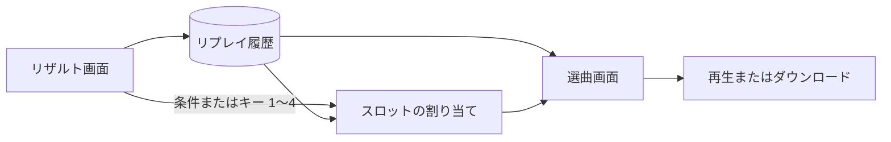
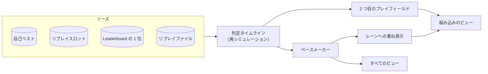
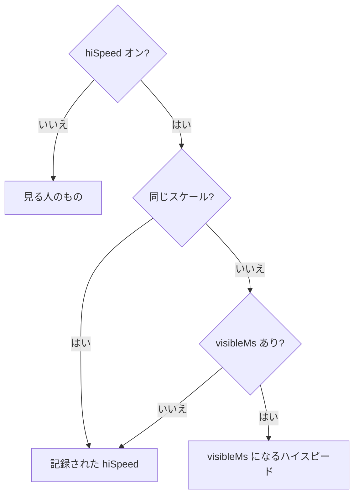

[English version](./replay-browser.md)

# ブラウザーのリプレイ再生・履歴・ゴースト

[リプレイ形式と再シミュレーション](./replay.ja.md)

目次

- [リプレイ再生](#リプレイ再生)
- [リプレイスロット](#リプレイスロット)
- [ゴースト](#ゴースト)
- [プレイヤーが見ていたもの](#プレイヤーが見ていたもの)

## リプレイ再生

`*.bmplay.json` をドロップするとリプレイを再生します。譜面フォルダーも一緒にドロップできます。プレイヤーは譜面ファイルのハッシュ（`chart.sha256`）、記録したパス（`play.native.chartPath`）の順に照合します。古いリプレイではタイトルとアーティスト名でも探します。見つからなければ選曲画面に戻り、必要な譜面をダイアログに表示します。

リプレイは共有エンジン内で記録済み入力列を決定論的に再駆動します（`PlayerOptions.replayInputs`）。各イベントは
記録された譜面相対マイクロ秒の時刻ちょうどで発火し、ライブのレーン入力は無視され（ESC / ポーズ / ハイスピは
有効）、リプレイ実行では新しいリプレイを記録しません。ログは解決済みの最終配置を保存しているため、譜面準備
では RANDOM / MIRROR を引き直す代わりに記録済みチャンネルを再適用します（`applyReplayArrangement`）— つまり
シャッフルされたプレイも正確にリプレイできます。新しい MIRROR/RANDOM は、空レーンを含む確定したモード全体の鍵盤を対象とし、スクラッチとホイールは固定します。旧方式で記録した配置も保存済みのチャンネルを再生し、修正後のシャッフルで解釈し直しません。

譜面の `#RANDOM` / `#SWITCH` 行はログの
`play.randomDraws` で解決するので、リプレイは記録時の枝を遊びます。ブラウザのプレイセッション（`session/play/play-chart.ts`）は自分で
その draws を使って解決し（`resolvePlayChart(chart, { randomDraws })`）、元の譜面をエンジンに解決させるホストは
`replayInputs` と一緒に `PlayerOptions.randomDraws` として渡します。読み込んだ譜面のために引かれていない draws や、
draws のないログで新しく引いた分岐が記録時と異なる場合は再整列できないため、食い違った譜面を遊ぶ代わりに
ステータス表示でエラーになります。リプレイは記録時のスキンファミリーに関わらず、
そのときのゲームプレイのファミリー自身のプレイ画面で再生されます。

ESC で中断したログのリプレイは、再シミュレーションと同じく中断した所で止まります。ホストは `play.abortedAtUs` を
`PlayerOptions.replayAbortedAtUs` として渡し、エンジンはその譜面時刻まで判定してから、ESC としてリプレイを
終えます。結果はライブのプレイと同じです。AUTO で遊んだログのリプレイも（空の）入力を `replayInputs` として渡すので、
これもリプレイです。`replayTempoChanges` に従い、どちらのリプレイも再生したテンポを記録しません。

ブラウザーのリプレイは `PlayScene.seek(seconds)` または ← / →（5 秒）でシークできます。同じエンジンが記録された入力を先頭から再適用し、判定・ゲージ・コンボ・保持中のロングノート・記録されたテンポ・表示設定を目標位置に復元します。一時停止中は停止したままで、中断したリプレイでは記録された終了位置より先へ進めません。記録されたテンポと表示設定を優先するかは引き続き Replay / ghost オプションで決まります。シークしても新しいリプレイは記録しません。コースのステージや NONSTOP でシークすると、[ADR 0016](./adr/0016-seek-play-loop-command.ja.md) に従いコース全体を練習扱いにします。後続ステージもリプレイを記録せず、コースのリプレイは出力できません。

手動シークは `PlaySceneOptions.allowSeek: 'practice'` で有効にします。最初のシークでリプレイの記録を破棄します。目標より前に始まるノートはロングノートの終端も含めて得点なしで消化済みにし、スコア・コンボ・ゲージをプレイ開始時の値に戻します。一時停止中は停止したままです。結果には `practice: true` が付き、ベスト記録・Leaderboard 送信・リプレイ自動保存の対象外になります。プレイヤーでは単曲とコースのステージで手動シークを有効にします。コース進行はリプレイ記録とは独立したステージ結果から引き継ぎます。

[PRACTICE](./play-options.ja.md#practice) のプレイもリプレイを記録しません。`PlayerOptions.practice` があるあいだエンジンはログを作らないので、保存も自動保存も送信もしません。範囲はエンジンに譜面の時刻（ミリ秒の `practice.startMs` と `practice.endMs`）として渡します。譜面の表示で選んだ小節の、最初の小節の小節線から最後の小節を閉じる小節線までです（`@be-music/player-ui` の `chartScoreRangeTimes`）。小節を選んでいなければ譜面全体です。これまでに記録したリプレイは変わりません。どれも PRACTICE の範囲を持っていません。

## リプレイスロット

Be-Music は、完了した手動プレイやコースのリプレイをブラウザー内の履歴に保存します。譜面とコースにはそれぞれ4つのスロットがあり、各スロットに履歴から1件を割り当てられます。複数のスロットで同じリプレイを選べます。

- **履歴の閲覧。** 選曲画面の「リプレイ履歴」を開くと、選択中の譜面やコースのリプレイを新しい順にスクロールできます。「すべての譜面・コースを表示」で全履歴を閲覧できます。各項目は再生、`.bmplay.json` または `.bmcourse.json` 形式でのダウンロード、削除ができます。再生には元の譜面やコースの全ステージの譜面が必要です。再生によるスコア記録やランキングへの送信はありません。
- **保存対象。** リプレイが記録された手動プレイは、ベスト記録に反映されない場合も履歴に残ります。コースは1回のランとして保存します。AUTO、リプレイ再生、練習は対象外です。「Auto-save replays」設定ではファイルの自動ダウンロードを切り替えます。
- **スロットの条件。** Options → Library & records → **Replay slots** で各スロットの条件を選べます。対象のリザルトが開くと、beatoraja の `ReplayAutoSaveConstraint` に従って、プレイ前のベスト記録と比較します。既定は EX スコア更新、クリアランプ更新、BP 更新、最新の対象プレイです。リザルトのカード、数字キー 1〜4、beatoraja のリプレイボタンでも割り当てられます。スロットを空にしてもリプレイは履歴に残ります。履歴から削除すると、そのリプレイを選んでいたスロットも空になります。
- **保存と移行。** IndexedDB の `be-music-replays` データベースは、メタデータとスロットの割り当てを `replaySlots` に、gzip 圧縮したリプレイを `replaySlotData` に保存します。譜面やコースの識別にはフィンガープリントを使います。NONSTOP ではつなぎ方と配置も含みます。保存形式のリビジョン 1 では、既存スロットのリプレイを履歴に移し、割り当てとデータのキーを引き継ぎます。
- **容量の上限。** 履歴の上限は圧縮後で 500 MiB です。空き容量が必要になると、スロットで選択されていないリプレイを古い順に削除します。容量が足りない場合やブラウザーが書き込みを拒否した場合は、ステータス行に表示します。
- **スキンの操作。** beatoraja の選曲スキンでは、バーが変わるとリプレイがある最初のスロットを選びます。4 または6番目のレーンキー（F）で次のスロットを選び、V で再生します。スキンのリプレイボタンでも各スロットを再生できます。ほかの選曲スキンではリプレイのパネルからスロットを操作できます。履歴パネルはすべての選曲スキンで利用できます。
- **音。** LR2 にも beatoraja にもリプレイを保存したときの音はないので、保存しても何も鳴らしません。beatoraja のテーマの `resultclose` / `course_close` は、リザルトがフェードアウトを始めるときに鳴ります（[player-web.ja.md](./player-web-scenes.ja.md#リザルト画面)）。

## ゴースト

ゴーストは、記録されたプレイを今のプレイの横に見せるものです。ブラウザーのプレイヤーは、1 つを選ぶ前に比べられるよう、いくつかの形を並べて作っています（[#418](https://github.com/nulltask/be-music/issues/418)、[#934](https://github.com/nulltask/be-music/issues/934)）。それぞれは **ソース**（どのリプレイを再生するか）と **見せ方**（どう見せるか）の組で、別々に選べます。

- **オプション。** Options ダイアログ → Play options → **Replay / ghost**:
  - **Ghost** でソースを選びます。OFF（既定）、OWN BEST、REPLAY SLOT 1-4、LEADERBOARD TOP、REPLAY FILE です。
  - **Ghost mode** で見せ方を選びます。SECOND PLAYFIELD（既定）、PACEMAKER、PACEMAKER + LANES です。
  - **Ghost status** は、カーソルのバーで選んだゴーストを見せられるか、見せられない理由を示します。見せ方が組み込みスキン専用、譜面に 2 つ目のプレイフィールドの余地がない、ソースにその譜面のリプレイがない、のいずれかです。
  - **Ghost replay file…** で REPLAY FILE 用の `*.bmplay.json` を選びます。この訪問の間だけ保持し、記録された譜面のゴーストにだけなります。

  どれも曲の開始時に確定し、プレイ中は無効です。Ghost と Ghost mode はコースのバーでも無効です。リプレイ、コースのステージ、NONSTOP のランではゴーストを見せません。

- **ソース。**
  - OWN BEST は、その譜面のリプレイスロットのうち EX スコアが最も高いもの（同点なら新しい保存）です。スロット 1 の既定の条件がこれを更新し続けます。
  - REPLAY SLOT n は、その譜面のそのスロットです。
  - LEADERBOARD TOP は、プレイを判定するルールセットでの、その譜面の Leaderboard ランキング（アシストなし）の 1 位のリプレイです。`GET /api/v0/charts/:chartFingerprint/leaderboard?limit=1` の後に `GET /api/v0/scores/:id/replay` で取ります。Leaderboard にない譜面や、読めないリプレイではゴーストなしで遊びます。
  - REPLAY FILE は、選んだファイルがその譜面で記録されたものならそれです。

  プレイは読み込み中にソースを読み、譜面は BGA と同じくそれを待ちます。

- **タイムライン。** リプレイを、記録されたルールセットでリプレイシミュレーターにかけ直します（`@be-music/player-engine/replay` の `resolveReplayJudgmentTimeline`）。判定を付けた順に、レーン、ノート、時刻、その時点のコンボ、EX スコア、ゲージを並べます。時計も乱数も読まないので、同じリプレイからはいつも同じゴーストになります。
- **2 つ目のプレイフィールド**（SECOND PLAYFIELD、組み込みスキンのみ）。シングルプレイ譜面では、今のフィールドとゴーストのフィールドを、中央の BGA を挟んで独立したプレイヤーとして並べます（`twoPlayer: true`）。レーン順は 7 KEY なら 14 KEY、5 KEY なら 10 KEY を使い、ゴーストは 2P のレーンに置きます。通常の DP 譜面は共通のプレイフィールドのままです。ゴーストのノートはリプレイ自身のもの（そのレーンオプション）で、シミュレーションが決着させた秒に消えます。今のプレイのハイスピードで流れるので、ゴーストのノートと対応する今のノートは同時に判定ラインに届きます。キービームとボムは記録された押下と判定に従い、判定は 2P 側に表示し、スコア、コンボ、ゲージは 2 人目の HUD に表示します。後ろへシークすると巻き戻り、前へ飛ぶと途中の演出を再生せずに追いつきます。余地があるのは、バトルモードなしの 5 / 7 KEY のシングルプレイ譜面だけです。
- **ペースメーカー**（PACEMAKER、すべての種類、どの譜面でも）。ゴーストは自分のフィールドを持ちません。今のプレイが判定したのと同じ数のノートを判定した時点（空 POOR は数えません）のリプレイの位置に立ちます。LR2 や beatoraja のゴーストと同じ進め方なので、今のプレイヤーのハイスピード、カバー、タイミングに左右されません。プレイのターゲットになります。
  - 組み込みスキンのスコアグラフでは、ソースにちなんだ名前（MY GHOST、SLOT n、TOP、FILE）のペースメーカーのバーになり、TARGET の差はこれに対して数えます。
  - LR2 スキンでは、数値 151（今のターゲット EX）と 153（EX との差）、バーグラフ 14 / 15（今と譜面全体のターゲット）として読みます。
  - beatoraja スキンでは、数値 121-123（譜面全体のターゲット EX とそのレート）として読みます。
- **レーンへの重ね表示**（PACEMAKER + LANES、組み込みスキンのみ、どの譜面でも）。ペースメーカーに加えて、リプレイに記録された押下を自分のレーンの上に中抜きの紫のビームで、判定を判定ラインのすぐ上に判定の色の短いバーで描きます。輪郭とバーだけでレーンを塗りつぶさないので、自分のビーム、ボム、ノートは読みやすいままです。リプレイのレーンはリプレイ自身のものなので、別の RANDOM で記録されたゴーストは今のノートとは別のレーンを押します。
- **しないこと。** ゴーストは音を鳴らさず、入力も受けません（そのレーンへのタッチはどこにも届きません）。今のプレイの判定、ベスト記録、リプレイの記録、リプレイスロット、Leaderboard への送信はゴーストを見ません。エンジンには今のノートだけを渡します。
- **残る点。** ゴーストは見る人のルールセットではなく、リプレイに記録されたルールセットで再シミュレーションします。2 つ目のプレイフィールドは記録されたハイスピードとカバーを使わず、ロングノートの押しっぱなしも見せません。タッチモードでも 2 つ目のプレイフィールドは 10 / 14 KEY を組み合わせたレーンモデルを使い、`twoPlayerSideInset` のあるステージでは BGA を挟んで独立したレーンを配置します。ペースメーカーとレーンへの重ね表示は今のプレイの配置のままです。

## プレイヤーが見ていたもの

`play.view` と `play.viewChanges` は判定とは別に、どのシーンでも共通の単位で表示設定を記録します。

| フィールド     | 単位                                                                                                                                                                                                 |
| -------------- | ---------------------------------------------------------------------------------------------------------------------------------------------------------------------------------------------------- |
| `hiSpeed`      | シーンが描画に使ったスクロール倍率。そのシーン自身のスケールで、HS-FIX を掛けた値で表します。                                                                                                        |
| `hiSpeedScale` | `hiSpeed` のスケール。`be-music`（組み込みと LR2 のシーン。1 拍あたり `PIXELS_PER_BEAT × hiSpeed` デザインピクセル）か `beatoraja`（1 のときレーンが 4 拍）。省略時は見る人のスケール。              |
| `hsFix`        | シーンがスクロールに使った HS-FIX モード（`OFF`、`MAXBPM` など）。どのシーンも記録します。                                                                                                           |
| `visibleMs`    | ノートが SUDDEN+ の下に見えている時間（整数 ms。白数字で、× 0.6 が緑数字）。譜面のメイン BPM（後述）で、`#SCROLL` / `#SPEED` を除いた値です。                                                        |
| `covers`       | レーンのあるプレイサイドごとに、レーンの高さに対する割合（0〜1）。`sudden` は上から、`hidden` は判定ラインのすぐ上、`lift` は判定ラインを持ち上げる量。組み込みと LR2 のシーンは LIFT を描きません。 |

beatoraja のシーンの HIDDEN カバーはリフトより上のレーンに対する比率なので、`比率 × (1 − lift)` を記録します。

**`visibleMs` と LIFT。** どのシーンも `visibleMs` を beatoraja の白数字として記録し、LIFT は差し引きません。LR2 には LIFT がないため、beatoraja に従います。beatoraja の [`LaneRenderer`](https://github.com/exch-bms2/beatoraja/blob/c2ed5db1a46145ed10790c3872f717e95b59db9d/src/bms/player/beatoraja/play/LaneRenderer.java#L321-L330) は、持ち上げた判定ラインより上のレーンを、そのレーンに合わせた速さでノートが流れるように描きます（`rxhs = (hu - hl) * hispeed * speed`。`hl` はリフトの分だけ上がります）。そのため LIFT はレーンを短くしますが、ノートがレーンを流れきる時間は変えません。表示する白数字は `region * (1 - lanecover)` で、`region = 240000 / nbpm / hispeed / speed / nscroll` です。リフトの項はありません（`currentduration`、321〜330 行）。ハイスピード固定のモードも同じ式をハイスピードについて解きます（`resetHispeed`、[206〜210 行](https://github.com/exch-bms2/beatoraja/blob/c2ed5db1a46145ed10790c3872f717e95b59db9d/src/bms/player/beatoraja/play/LaneRenderer.java#L206-L210)）。シーンモデルはこれを一か所で計算します。`resolveWhiteNumber` はハイスピード 1 で指定した拍数の長さのレーンについて求め（beatoraja のシーンでは 4 拍、組み込みと LR2 のシーンでは配置したレーンを `PIXELS_PER_BEAT` で割った拍数）、`resolveHiSpeedForWhiteNumber` はその逆です。組み込みと LR2 のシーンは LIFT を描かないので、その白数字はノートが見えている時間そのものです。

**メイン BPM。** `visibleMs` は譜面のメイン BPM、つまり判定するノートが最も多く置かれた BPM（`@be-music/chart-model` の `resolveChartMainBPM`）で求めます。これは beatoraja の値です。[`LaneRenderer.init`](https://github.com/exch-bms2/beatoraja/blob/c2ed5db1a46145ed10790c3872f717e95b59db9d/src/bms/player/beatoraja/play/LaneRenderer.java#L130-L152) はタイムラインの BPM ごとに [`TimeLine.getTotalNotes()`](https://github.com/exch-bms2/jbms-parser/blob/8108cd54a19275810e1f5d2c9586f008eb6db95e/src/bms/model/TimeLine.java#L139-L156)（通常ノート、ロングノートの始点、CN / HCN の終点。地雷と不可視ノートは数えない）を足し合わせ、最も多い BPM を HS-FIX `MAINBPM` の基準にします。メイン BPM での白数字と緑数字も同じ値を読みます（[`IntegerPropertyFactory`](https://github.com/exch-bms2/beatoraja/blob/c2ed5db1a46145ed10790c3872f717e95b59db9d/src/bms/player/beatoraja/skin/property/IntegerPropertyFactory.java#L541-L560)、541〜560 行）。LR2 には従うべきメイン BPM の定義がない（スキンの数値は最高・最低・現在の BPM だけ）ため、beatoraja に従います。どの種類のプレイ画面も、HS-FIX `AVERAGE` がハイスピードを合わせるのと同じメイン BPM を使うので、ログの `visibleMs` を求める BPM は遊んだ種類によって変わりません。同数のときは先に現れる BPM を選びます（beatoraja はハッシュマップの順序）。ノートのない譜面は開始 BPM を使います。

**古いログ。** この規則より前は、組み込みと LR2 の画面は最も長く続いた BPM を使い、beatoraja の画面は地雷とロングノートの終点もすべて数えていました。これらが食い違う譜面（BPM のギミックや、ノートの少ない別の BPM が長く続く譜面）では、古いログの `visibleMs` は今のプレイが記録する値と異なります。そのため別のハイスピードの尺度で再生すると、わずかに違うハイスピードで流れることがあります。記録したときと同じ尺度での再生は記録した `hiSpeed` で描くので影響を受けず、判定にも影響はありません。

シーンは表示設定を決まった精度で記録します（`roundReplayView`）。`hiSpeed` は 1/1000 刻み、`visibleMs` は整数 ms、カバーの各値は小数 4 桁です。浮動小数点の誤差（0.1 のカバーが `0.09999999999999999` になるなど）はログに残らず、変更にも数えません。

**選択したプレイオプション。** `play.options` に、参照元のオプション選択一式を記録します。AUTO 開始やコースによる RANDOM 無効化など、開始時の制約も反映します。途中の変更は、譜面時刻のマイクロ秒を使う `{ timeUs, values }` を `play.optionChanges` に記録し、同時刻の変更も順序を維持します。プリミティブ値と未知の参照元固有名を、型変換せずに往復できます。`resolveReplayOptionsAt` は巻き戻しシークを含め、その時点の値を復元します。ブラウザーでは記録した選択を再生に使い、プレイ中のハイスピード変更も実効値の `viewChanges` と併せて残します。動的な表示変更は値が変わったフレームごとに保持します。このスナップショットは任意の名前を実行する指示ではありません。再生の実効値は型付きの譜面・エンジン設定と表示・テンポの時系列が担います。スコアの採用・更新・ランキングの方針は、独立した Leaderboard 側の関心事です。判定タイミングの自動調整の `judgeTimingAutoAdjust` は方式（`"OFF"`、`"BEATORAJA"`、`"LR2-ON"`、`"LR2-SILENT"`）です。方式ができる前のリプレイは真偽値を持ち、読み手はそれを `"BEATORAJA"`（`true`）か `"OFF"` として読みます（`resolveJudgeTimingAutoAdjust`）。自動調整の各更新は `play.optionChanges` に `judgeTimingMs` として入ります（[プレイオプション](play-options.ja.md#判定タイミングと自動調整)を参照）。

**操作ボタン。** `play.controlInputs` には、レーンではない操作ボタン（START と SELECT）の押下と解放を、`inputs` と同じ譜面時刻で `{ seq, timeUs, action: 'down' | 'up', button, code }` として記録します。`button` はホストが名付けた論理ボタン（`'1P-start'`、`'2P-select'`）、`code` は物理キー（`KeyboardEvent.code`）です。診断用で、ボタンが何をしたかはその結果の側（`viewChanges` やプレイの終わり）に記録され、シミュレータは読みません。リプレイの再生では記録しません。

**記録。** すべてのプレイ画面（組み込み、LR2、beatoraja）は開始時の表示設定を `recordReplay.view` として渡し、毎フレーム表示設定を読み取ります。`createReplayViewCoalescer` がそれを変更にまとめます。変わったフィールドだけを持ち（`diffReplayView`。カバーが変わったサイドはそのカバー全体）、描画フレームごとに変わった値を記録します（`minIntervalMs: 0`）。素早く変更した値も再現できます。シーンは変更を `{ kind: 'view', change }` の入力コマンドとして送り、エンジンはそのコマンドを取り出した譜面時刻を付けます。組み込みと LR2 のシーンでプレイ中に変わるのはハイスピード（矢印キー、ホストの `setHiSpeed`）です。カバーはプレイごとに固定で、レーンが配置されると最初の変更が `visibleMs` を運びます。beatoraja のシーンではハイスピード、レーンカバー、リフト、HIDDEN カバーのすべてが変わります（矢印キー、PageUp / PageDown、ホイール、Home / End、譜面のレーンが使わないときの H / J / K、スキンのカバーボタン 330〜332）。開始時のカバーはプレイオプションのとおりです。

**リプレイ。** リプレイは記録された表示設定を再生位置に沿って表示します。再生位置の譜面時刻で `resolveReplayViewAt` を引き、見る人の `ReplayPlaybackOptions`（`tempo`、`hiSpeed`、SUDDEN+ / HIDDEN+ の `covers`、`lift`。既定ですべてオン）で見る人自身の設定と `resolveReplayView` を合わせます。オフにした項目は見る人自身の設定のままです。ハイスピードは `resolveReplayHiSpeed` に従います。

同じスケール（または `hiSpeedScale` のないログ）なら、記録されたハイスピードを HS-FIX 込みで描かれたとおりに使い、見る人の HS-FIX は重ねません。スケールが違うと同じ数値でも速さが違うため、記録された表示時間になるハイスピードを、自分のレーンと表示している SUDDEN+ から求めます（`resolveHiSpeedForWhiteNumber`。組み込みと LR2 では配置したレーン、beatoraja では 4 拍のレーン）。リプレイはどの種類のプレイ画面でも再生されます。beatoraja の画面は LIFT を描くので記録された LIFT を見せます（HIDDEN+ はその上のレーンに対して設定し、カバーは記録されたレーンの割合で描かれます）。組み込みと LR2 の画面は LIFT を描かないので、`lift` の切り替えはそこでは何も変えません。`tempo` の切り替えは記録されたテンポ（`play.tempo`、`play.tempoChanges`）を扱います。[ゴースト](#ゴースト)は記録された表示設定を読みません。そのフィールドは今のプレイのハイスピードで流れます。
