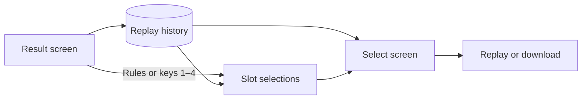
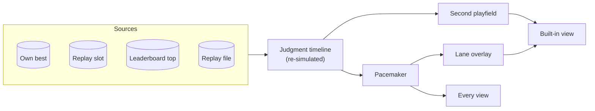
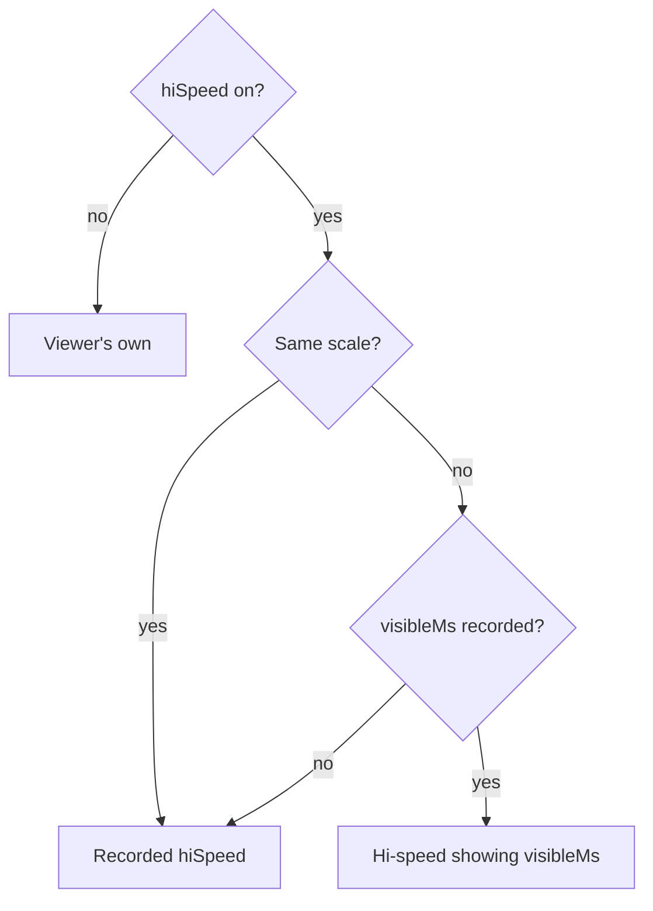

[Japanese version](./replay-browser.ja.md)

# Browser replay playback, history, and ghosts

[Replay format and simulation](./replay.md)

Table of contents

- [Replay playback](#replay-playback)
- [Replay slots](#replay-slots)
- [Ghost](#ghost)
- [What the player saw](#what-the-player-saw)

## Replay playback

Drop a `*.bmplay.json` file to replay it. You can drop the chart folder at the same time because the browser loads the charts first. The player looks for a chart-file hash match (`chart.sha256`), then tries the recorded path (`play.native.chartPath`). Older replays can fall back to title and artist. If no chart matches, Music Select opens a dialog naming the chart to load.

Replay re-drives the recorded input stream deterministically inside the shared engine
(`PlayerOptions.replayInputs`): every event fires at its exact chart-relative microsecond timestamp, live lane
input is ignored (ESC / pause / hi-speed keep working), and no new replay is recorded for the run. Because the
log stores the resolved note arrangement, the chart prepare re-applies the recorded channels onto the freshly
loaded chart (`applyReplayArrangement`) instead of re-rolling RANDOM / MIRROR — so shuffled plays replay exactly.
New MIRROR/RANDOM plays use the complete key set of the resolved mode, including empty lanes; scratch/wheel lanes stay fixed. Previously recorded subset arrangements still replay their stored channels and are never reinterpreted under the corrected shuffle.

The chart's `#RANDOM` / `#SWITCH` lines are resolved with the log's `play.randomDraws`, so a replay plays the
recorded branches: the browser's play session (`session/play/play-chart.ts`) resolves with them itself (`resolvePlayChart(chart,
{ randomDraws })`), and a host that lets the engine resolve the source chart passes them as
`PlayerOptions.randomDraws` next to `replayInputs`. Draws that were not drawn for the loaded chart, and a log without
them whose new draw rolls differently from the recorded run, cannot be re-aligned: the replay fails with a status
message instead of playing a mismatched chart. A replay plays on the gameplay family's own play screen, whichever
skin family recorded the log.

A replay of an ESC-aborted log stops where the play was aborted, as the re-simulations do: the host passes
`play.abortedAtUs` as `PlayerOptions.replayAbortedAtUs`, and the engine judges up to that chart time and ends the replay
there as an ESC, with the live play's result. A replay of an AUTO-played log passes its (empty) inputs as
`replayInputs` too, so it is a replay as well: it follows `replayTempoChanges`, and neither kind of replay records the
tempo it is re-driven at.

Browser replays can seek through `PlayScene.seek(seconds)` or ← / → (five seconds). The same engine re-drives recorded inputs from the start, restoring judgments, gauge, combo, held long notes, the recorded tempo and the view at the target. A paused replay stays paused, and a replay aborted early cannot seek past its recorded end. Replay / ghost options still decide whether recorded tempo and view settings override the viewer's. Seeking produces no new replay. A course-stage or NONSTOP seek makes the entire course practice under [ADR 0016](./adr/0016-seek-play-loop-command.md); later stages do not record replays, and the course cannot export a replay.

Manual seeking requires `PlaySceneOptions.allowSeek: 'practice'`. The first seek discards the replay recorder. Notes with heads before the target, including their long-note tails, are consumed without scoring; score, combo and gauge reset to their play-start values. A paused play stays paused. The result carries `practice: true` and cannot be saved as a best record, submitted to the Leaderboard or auto-saved as a replay. The player enables manual seeking for single charts and course stages. Course progression uses live stage outcomes independently of replay recording.

A [PRACTICE](./play-options.md#practice) play records no replay either: the engine builds no log while `PlayerOptions.practice` is set, so it is never saved, auto-saved or sent. Its range still reaches the engine as chart times, `practice.startMs` and `practice.endMs` in milliseconds: the bars picked on the chart's score, from the first bar's line to the line closing the last (`chartScoreRangeTimes` in `@be-music/player-ui`), or the whole chart with no bars picked. Replays recorded before are unchanged: none of them holds a PRACTICE range.

## Replay slots

Be-Music saves completed manual plays and course runs in local replay history. A chart or course has four slots that can each select one replay from that history. Several slots can select the same replay.

- **Browsing history.** Open Replay history on the select screen to scroll through the selected chart's or course's replays, newest first. Enable **Show all charts and courses** to browse the entire history. Each entry can be replayed, downloaded as `.bmplay.json` or `.bmcourse.json`, or deleted. Playback needs the original chart or all the course's stage charts loaded and leaves scores and ranking untouched.
- **What gets saved.** A completed manual play with a recorded replay enters history even if it does not keep a best record. A course enters history as a single run. AUTO, replay playback and practice are excluded. The **Auto-save replays** setting controls automatic file downloads.
- **Slot rules.** Options → Library & records → **Replay slots** gives each slot a rule. When an eligible result opens, the player compares it with the pre-play best record using beatoraja's `ReplayAutoSaveConstraint` behavior. The defaults select an EX score improvement, a clear lamp improvement, fewer BP and the latest eligible play. The result card, number keys 1–4 and beatoraja's replay buttons can assign the current eligible replay by hand. Clearing a slot keeps the replay in history. Deleting a history entry clears its slot selections.
- **Storage and migration.** The `be-music-replays` IndexedDB database stores metadata and slot selections in `replaySlots` and gzip-compressed files in `replaySlotData`. Metadata uses the chart or course fingerprint, including connections and placement for NONSTOP. Storage revision 1 converts each existing slot to a history entry with its existing selection and data key.
- **Size limit.** The history budget is 500 MiB of compressed replay data. The browser player evicts the oldest unselected entries to make room. If there is insufficient room or storage refuses a write, the status line reports the failure.
- **Skin controls.** Beatoraja select skins pick the first occupied slot when the bar changes. Use 4 or the sixth lane key (F) to switch slots, V to replay the selected slot, or a skin replay button to replay its slot. Other select skins offer slot controls in the replay panel. Every select skin offers the history panel.
- **Sounds.** Neither LR2 nor beatoraja plays a sound for saving a replay, so a save plays none. A beatoraja theme's
  `resultclose` / `course_close` sound plays as a result starts to fade out ([player-web.md](./player-web-scenes.md#the-result-screen)).

## Ghost

A ghost is a recorded play shown beside the live one. The browser player builds several kinds side by side so they can
be compared before one is chosen ([#418](https://github.com/nulltask/be-music/issues/418),
[#934](https://github.com/nulltask/be-music/issues/934)). Each is a **source** (which replay it plays) and a
**presentation** (how it shows), picked apart.

- **Options.** Options → Play options → **Replay / ghost**:
  - **Ghost** picks the source: OFF (default), OWN BEST, REPLAY SLOT 1-4, LEADERBOARD TOP or REPLAY FILE.
  - **Ghost mode** picks the presentation: SECOND PLAYFIELD (default), PACEMAKER, or PACEMAKER + LANES.
  - **Ghost status** says whether the bar under the cursor would show the pick, or why not: the mode needs the built-in
    skins, the chart has no room for a second playfield, or the source keeps no replay of the chart.
  - **Ghost replay file…** picks a `*.bmplay.json` for REPLAY FILE. It is held for the visit and is the ghost of the
    chart it was recorded on only.

  All are latched at song start and disabled during a play; Ghost and Ghost mode are also disabled on a course bar. A
  replay, a course stage and a NONSTOP run show no ghost.

- **Sources.**
  - OWN BEST is the chart's replay slot with the highest EX score (the latest save among equals), which the default rule
    of slot 1 keeps up to date.
  - REPLAY SLOT n is that slot of the chart.
  - LEADERBOARD TOP is the replay of the first run on the chart's Leaderboard ranking under the ruleset the play is
    judged by (unassisted plays): `GET /api/v0/charts/:chartFingerprint/leaderboard?limit=1`, then
    `GET /api/v0/scores/:id/replay`. A chart that is not on the Leaderboard, or a replay that cannot be read, plays
    without a ghost.
  - REPLAY FILE is the picked file, when it was recorded on the chart.

  The play reads the source while it loads; the chart waits for it as it waits for the BGA.

- **Timeline.** The replay is re-simulated under its own ruleset with the replay simulator
  (`resolveReplayJudgmentTimeline` in `@be-music/player-engine/replay`), which lists every judgment in the order it
  scores them, with its lane, its note, the time and the running combo, EX score and gauge. Nothing reads the clock or
  draws a random number, so the same replay always gives the same ghost.
- **Second playfield** (SECOND PLAYFIELD, built-in skins only). A single-play chart lays the live field and the ghost's
  out as independent players around a central BGA (`twoPlayer: true`). Lane ordering uses 14 KEY for 7 KEY charts and 10 KEY for 5 KEY charts, with the ghost on the 2P lanes; ordinary double-play charts keep their shared field. The
  ghost's notes are the replay's own (its lane options), and each goes at the second the simulation settled it. They
  scroll with the live play's hi-speed, so a ghost note and the live note it matches reach their judgment lines
  together. Its key beams and bombs follow its recorded presses and judgments, its judgment plate shows on the 2P side,
  and its score, combo and gauge show as the second player's HUD. A seek back rewinds it; a jump ahead catches it up
  without replaying the effects on the way. Only 5 / 7 KEY single-play charts without a battle mode have room for it.
- **Pacemaker** (PACEMAKER, every family, any chart). The ghost has no field of its own. It stands where the replay
  stood when it had judged as many notes as the live play has (empty POORs take none), as LR2 and beatoraja pace a
  ghost, so it holds whatever hi-speed, covers or timing the live player uses. It is the play's target:
  - the built-in skins' score graph shows it as the pacemaker bar, named after the source (MY GHOST, SLOT n, TOP, FILE),
    and the TARGET difference counts against it;
  - LR2 skins read it as numbers 151 (target EX now) and 153 (EX minus it) and bar graphs 14 / 15 (target now and over
    the chart);
  - beatoraja skins read numbers 121-123 (the target's EX score over the chart and its rate).
- **Lane overlay** (PACEMAKER + LANES, built-in skins only, any chart). The pacemaker, with the replay's recorded key
  presses drawn over the player's own lanes as hollow violet beams and its judgments as short bars in the judgment's
  colour just above the judgment line. They are outlines and bars, never filled lanes, so the player's own beams, bombs
  and notes stay readable. The replay's lanes are its own: a ghost recorded under another RANDOM presses other lanes
  than the live notes ask for.
- **What it never does.** The ghost plays no sound and takes no input (a touch on its lanes goes nowhere). The live
  play's judging, best record, replay recording, replay slots and Leaderboard submission do not see it: the engine is
  handed only the live notes.
- **Open points.** The ghost is re-simulated under the replay's recorded ruleset, not the viewer's. The second playfield
  ignores the recorded hi-speed and covers and shows no hold state for long notes. In touch mode the second playfield
  uses the combined 10 / 14 KEY lane model; on stages with `twoPlayerSideInset`, its independent banks remain separated around the BGA. The pacemaker and the lane overlay keep the live layout.

## What the player saw

`play.view` and `play.viewChanges` record the view, apart from what was judged, in units every scene shares:

| field          | unit                                                                                                                                                                                                                   |
| -------------- | ---------------------------------------------------------------------------------------------------------------------------------------------------------------------------------------------------------------------- |
| `hiSpeed`      | The scroll multiplier the scene drew with, on its own scale, HS-FIX folded in.                                                                                                                                         |
| `hiSpeedScale` | The scale `hiSpeed` is on: `be-music` (built-in and LR2 scenes, `PIXELS_PER_BEAT × hiSpeed` design pixels per beat) or `beatoraja` (a lane is four beats at 1). Absent means the viewer's own.                         |
| `hsFix`        | The HS-FIX mode the scene scrolled under (`OFF`, `MAXBPM`, …), on every scene.                                                                                                                                         |
| `visibleMs`    | How long a note stays visible below SUDDEN+, in whole ms (the white number; × 0.6 is the green number), at the chart's main BPM (below) and without `#SCROLL` / `#SPEED`.                                              |
| `covers`       | Per play side with lanes, fractions (0 to 1) of the lane height: `sudden` from the top, `hidden` just above the judgement line, `lift` how far the judgement line is raised. The built-in and LR2 scenes draw no LIFT. |

The beatoraja scene's HIDDEN cover is a ratio of the lane above the lift, so it records `ratio × (1 − lift)`.

**`visibleMs` and LIFT.** Every scene records `visibleMs` as beatoraja's white number, which leaves LIFT out. LR2 has no LIFT, so beatoraja decides it. beatoraja's [`LaneRenderer`](https://github.com/exch-bms2/beatoraja/blob/c2ed5db1a46145ed10790c3872f717e95b59db9d/src/bms/player/beatoraja/play/LaneRenderer.java#L321-L330) scrolls a note across the lane above the lifted judgement line at a speed scaled to that lane (`rxhs = (hu - hl) * hispeed * speed`, `hl` raised by the lift), so LIFT shortens the lane but not the time a note takes to cross it. The white number it shows is `region * (1 - lanecover)` with `region = 240000 / nbpm / hispeed / speed / nscroll`, and no lift term (`currentduration`, lines 321-330). Its fixed hi-speed modes solve the same formula for the hi-speed (`resetHispeed`, [lines 206-210](https://github.com/exch-bms2/beatoraja/blob/c2ed5db1a46145ed10790c3872f717e95b59db9d/src/bms/player/beatoraja/play/LaneRenderer.java#L206-L210)). The scene model computes it once: `resolveWhiteNumber` for a lane of a given length in beats at hi-speed 1 (four on the beatoraja scene, the lane laid out over `PIXELS_PER_BEAT` on the built-in and LR2 scenes), and `resolveHiSpeedForWhiteNumber` back. The built-in and LR2 scenes draw no LIFT, so their white number is the time a note shows.

**The main BPM.** `visibleMs` is taken at the chart's main BPM, the BPM the most judged notes sit at (`resolveChartMainBPM` in `@be-music/chart-model`). It is beatoraja's: [`LaneRenderer.init`](https://github.com/exch-bms2/beatoraja/blob/c2ed5db1a46145ed10790c3872f717e95b59db9d/src/bms/player/beatoraja/play/LaneRenderer.java#L130-L152) adds up [`TimeLine.getTotalNotes()`](https://github.com/exch-bms2/jbms-parser/blob/8108cd54a19275810e1f5d2c9586f008eb6db95e/src/bms/model/TimeLine.java#L139-L156) (taps, long-note heads, and CN / HCN tails; no mines or invisible notes) per timeline BPM, keeps the BPM with the most and pegs HS-FIX `MAINBPM` to it, and the white and green numbers at the main BPM read the same value ([`IntegerPropertyFactory`](https://github.com/exch-bms2/beatoraja/blob/c2ed5db1a46145ed10790c3872f717e95b59db9d/src/bms/player/beatoraja/skin/property/IntegerPropertyFactory.java#L541-L560), lines 541-560). LR2 defines no main BPM to follow (its skin numbers give only the highest, lowest and current BPM), so beatoraja decides it. Every family's play screen takes the one main BPM that HS-FIX `AVERAGE` pegs the hi-speed to, so the BPM a log's `visibleMs` is taken at no longer depends on the family that played it. Ties go to the BPM reached first, where beatoraja follows its hash-map order; a chart without notes takes its start BPM.

**Older logs.** Before this rule the built-in and LR2 screens took the BPM held longest, and the beatoraja screen counted mines and every long-note end as well. On a chart where these disagree (BPM gimmicks, or a long stretch at another BPM with few notes), an older log's `visibleMs` differs from what a play records now, so replaying it on another hi-speed scale may scroll at a slightly different hi-speed. A replay on the scale it was recorded on draws the recorded `hiSpeed` and is unaffected, and so is the judging.

Scenes record the view at a fixed precision (`roundReplayView`): `hiSpeed` on a 1/1000 grid, `visibleMs` in whole ms and each cover part to 4 decimals, so float noise (`0.09999999999999999` for a cover of 0.1) neither lands in the log nor counts as a change.

**Selected play options.** `play.options` records the complete selected source-option snapshot, with effective start restrictions applied (for example an AUTO start or a course that disables RANDOM). `play.optionChanges` holds `{ timeUs, values }` patches in chart microseconds; multiple edits at one timestamp keep their order. Primitive source values and unknown source-specific names round-trip without coercion. `resolveReplayOptionsAt` reconstructs the snapshot at the playhead, including after backward seeks. Browser replays restore the recorded options, and live hi-speed edits are recorded alongside the effective `viewChanges`. Dynamic view changes are retained on every changed frame. An option snapshot is not an instruction to execute arbitrary names: typed chart/engine fields and the view/tempo timelines remain authoritative for playback. Score acceptance, updates and ranking policy are separate Leaderboard concerns. The automatic judge timing's `judgeTimingAutoAdjust` is a mode (`"OFF"`, `"BEATORAJA"`, `"LR2-ON"`, `"LR2-SILENT"`); replays recorded before the modes hold a boolean, which readers take as `"BEATORAJA"` (`true`) or `"OFF"` (`resolveJudgeTimingAutoAdjust`), and its automatic steps sit in `play.optionChanges` as `judgeTimingMs` (see [Play options](play-options.md#judge-timing-and-automatic-adjustment)).

**Control buttons.** `play.controlInputs` lists the presses and releases of the control buttons that are not lanes, START and SELECT, as `{ seq, timeUs, action: 'down' | 'up', button, code }` on the chart clock of `inputs`: `button` is the logical button as the host names it (`'1P-start'`, `'2P-select'`) and `code` the physical key (`KeyboardEvent.code`). It is diagnostic only: what a button did is recorded where it lands (`viewChanges`, the play's end), and simulators don't read it. A replay played back records none.

**Recording.** Every play screen (built-in, LR2, beatoraja) passes the view at the start as `recordReplay.view` and samples the view every frame. `createReplayViewCoalescer` turns the samples into changes: only the fields that changed (`diffReplayView`, the full cover of a side whose cover changed), on every rendered frame where a value changed (`minIntervalMs: 0`), so rapid edits remain reproducible. The scene sends each change as a `{ kind: 'view', change }` input command, and the engine stamps it with the chart time it drains the command at. On the built-in and LR2 scenes the hi-speed changes during a play (the arrow keys, a host's `setHiSpeed`); the covers are fixed per play, and the first change carries `visibleMs` once the lanes are laid out. On the beatoraja scene the hi-speed, lane cover, lift and HIDDEN cover all change (the arrow keys, PageUp / PageDown, the wheel, Home / End, H / J / K where no lane of the chart takes them, and the skin's cover buttons 330-332), from the play options' covers at the start.

**Replay.** A replay shows the recorded view along the playhead: `resolveReplayViewAt` at the playhead's chart time, then `resolveReplayView` against the viewer's own settings with the viewer's `ReplayPlaybackOptions` (`tempo`, `hiSpeed`, `covers` for SUDDEN+ / HIDDEN+, `lift`; all on by default). What a toggle leaves off stays the viewer's own. The hi-speed follows `resolveReplayHiSpeed`:

On the same scale (or a log without `hiSpeedScale`) the replay draws the recorded hi-speed as it was drawn, HS-FIX included, and does not apply the viewer's HS-FIX on top. Across scales a hi-speed number means another speed, so the replay works out the hi-speed that shows the recorded visible time with its own lane and the SUDDEN+ it shows (`resolveHiSpeedForWhiteNumber`, over the built-in and LR2 lanes laid out or the beatoraja lane of four beats). Replays run on every family's play screen. The beatoraja one draws the LIFT, so it shows the recorded one (with HIDDEN+ set over the lane above it, so the cover draws the recorded fraction of the lane); the built-in and LR2 screens draw none, so the `lift` toggle has nothing to show there; the `tempo` toggle governs the recorded tempo (`play.tempo`, `play.tempoChanges`). A [ghost](#ghost) does not read the recorded view: its field scrolls with the live play's hi-speed.
