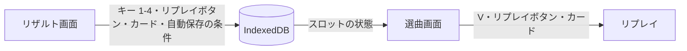
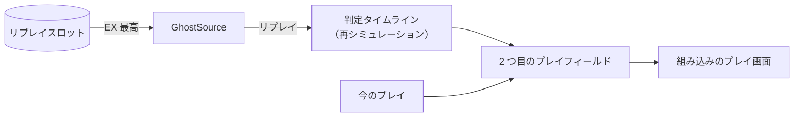
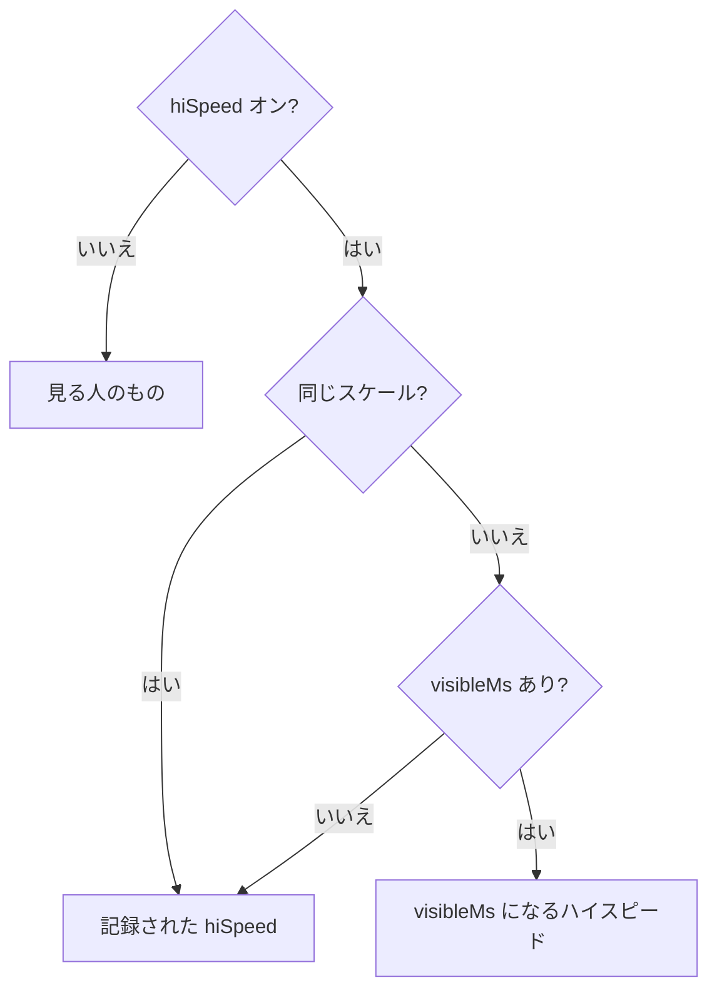
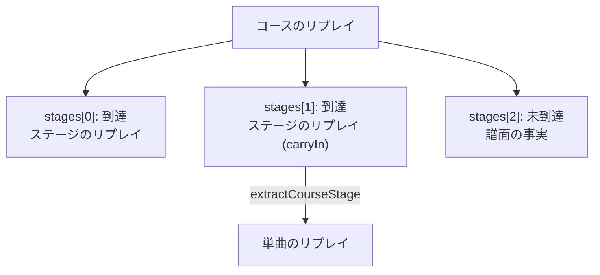
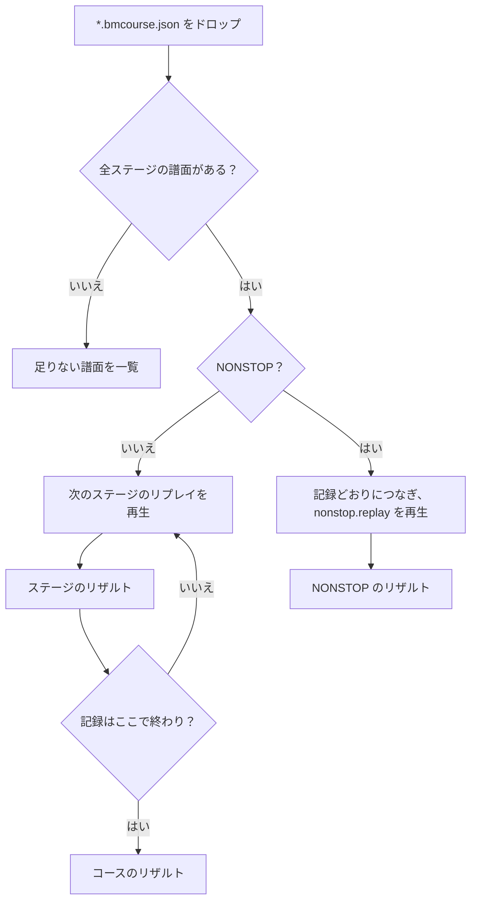

[English version](./replay.md)

# リプレイ（プレイ履歴）仕様

このドキュメントは be-music のリプレイ（ゲームプレイ中に記録されるプレイ履歴ファイル）と、そこから
LR2 / beatoraja / 名前を言ってはいけないあのゲームのリザルトを再現するツールについて説明します。

## 設計原則: 「結果ログ」ではなく「入力リプレイ」

リプレイは意図的に**判定結果の列ではありません**。正本となるデータは次の 3 つです。

1. **`chart`** — 実際に画面を流れた解決済み譜面。`#RANDOM` 制御構文の解決後、レーンシャッフル
   （RANDOM / MIRROR / S-RANDOM）と DP FLIP の適用後の最終配置です。ロングノートは `timeUs` / `endTimeUs`
   を持つ 1 オブジェクトとして保存し、地雷は解決済みのゲージダメージを持ち、`#TOTAL` / `#RANK` /
   `#DEFEXRANK` は生の値のまま保持します（各ルールセットが自分のデフォルト式を適用できるように）。
   `chart.sha256` には譜面**ファイル**の SHA-256 を刻印し、ログを内容ベースで元譜面と照合できます。
   `chart.md5` には同じバイト列の MD5（LR2 と LR2IR が使うキー）を刻印します。
   2 つの Be-Music Fingerprint（`bmfp0:…`、[fingerprint-spec.ja.md](./fingerprint-spec.ja.md) を参照）は、
   ファイルのバイト列ではなく遊ぶ内容で譜面を識別するので、キー音 / BGA / メタデータの編集、保存し直し、
   BMS ↔ bmson の変換を経ても同じ譜面のログどうしが一致します。`chart.chartFingerprint` はすべての
   `#RANDOM` / `#SWITCH` の枝を含むので、どの枝を引いたかに関わらず同じ譜面のプレイはすべて同じ値を持ちます
   （譜面ごとにプレイをまとめるキーです）。`chart.playFingerprint` はこのプレイで引いた枝を表します。制御構文の
   ない譜面では 2 つは等しくなります。レーンオプション（RANDOM / MIRROR / S-RANDOM、DP FLIP）はどちらにも
   含みません（これらは `play` に記録します）。記録処理はどちらも元の譜面（`recordReplay.sourceChart`、読み込んだ
   ままの譜面。ホストが渡さなければエンジンは受け取った譜面を使います）と `play.randomDraws` から、譜面の
   拡張子（`PlayerOptions.laneModeExtension`）をレーン構成の入力として求めます。エンジンに渡す前に `#RANDOM` を
   解決したりレーンを書き換えたりするホスト（ブラウザプレイヤーはすべての譜面を解決し、beatoraja シーンは DP FLIP
   を譜面に焼き込みます）は元の譜面を渡します。渡さなければ譜面 fingerprint は省かれ、プレイ fingerprint はホストの
   作業用コピーを表してしまいます。求められなかったフィールドは省きます。これらのフィールドの無いログもそのまま
   読み込めます。
   `chart.reversalTimeUs`（負の `#BPMxx` で逆スクロールする譜面でのみ存在）は LR2 逆スクロールの反転時刻 R です。
   シミュレータはエンジンと同じく、それ以降の入力を鏡映クロック `2R - timeUs` で判定し、R 以降の見逃し判定は行わず、
   スコア対象ノートを未判定のまま残したプレイはゲージ 0 で終えます（[`bms-spec.ja.md`](./bms-spec.ja.md)「負の BPM」
   を参照）。
2. **`inputs`** — プレイアブルレーンに届いた全ての生のキー押下・解放
   （`{ seq, timeUs, action: 'down' | 'up', channels }`。ホストがキーを名付けたときは `tokens`、入力が解放を
   伝えないため（kitty キーボードプロトコルのない端末）エンジンが推定した `up` には `inferred: true` が付きます。
   これはエンジンがキーを離したとみなした瞬間です。`inferred` は診断用で、リプレイとシミュレータは他の `up` と
   同じに読みます）。入力は判定へ変換せず、ノート ID への割り当ても
   行わず、空 POOR の原因になる「ノートに対応しない入力」もすべて残します。ソートキーは常に
   `(timeUs, seq)` で、`seq` が同時刻イベントの順序を確定します。
3. **`play`** — スコアに影響する設定。モード（manual / auto）、オートスクラッチ、選択ゲージ、最終配置を
   生んだレーンオプションのラベル、ライブ判定幅ルールセット（`judgeRuleset`、省略時 `'lr2'`）、デバッグ用
   判定幅オーバーライド、ESC 中断フラグ（`aborted`。`abortedAtUs` は中断時に判定が済んでいた譜面時刻で、
   再シミュレーションとリプレイは残りの譜面をミスにせずそこで止まります）、`endOnFailure`（サバイバル系ゲージが尽きた時点で
   プレイを終えたこと。これがなかった頃のログには付かず、最後まで判定を続けます）、`tempo`（プレイテンポ
   `PlayerOptions.speed`。1 以外のときだけ記録。譜面・音・クロックが `tempo` 倍の速さで進みます。判定と入力時刻は
   譜面時刻のままなので再シミュレーションには影響せず、リプレイはこのテンポで再生します。省略時 1。リプレイ
   （`replayInputs`）から記録し直したログにも付きません。その速さは再生の速さにすぎないためです。この練習用
   プレイはランキング対象外。これは開始時のテンポで、プレイ中の変更は `tempoChanges` に `{ timeUs, tempo }` として
   並びます。1 以外への変更が 1 つでもあれば練習用プレイです。ホストは入力コマンド `{ kind: 'tempo' }` でテンポを
   変え、エンジンが適用した譜面時刻で記録されます。リプレイはホストが変更を `PlayerOptions.replayTempoChanges` で
   渡すとそれに従います）、`view` と `viewChanges`（プレイヤーが見ていたもの。
   ハイスピード、ハイスピード固定、表示時間 ms、各サイドのレーンカバーをレーンの高さに対する割合で表した
   `sudden`・`hidden`・`lift` の開始時の値と、プレイ中の変更を譜面時刻で並べたもの。ホストは変更を
   `{ kind: 'view' }` の入力コマンドで送ります。判定はこれに依存せず、リプレイとゴーストは見る人が選んだ範囲を
   再現します。`ReplayPlaybackOptions`）、コースのステージなら `course`
   （コースの種類、ゲージ表と判定の制約、前のステージが残したゲージ値・コースのコンボ・コースの最大コンボを表す
   `carryIn`）、`randomDraws` です。`randomDraws` はこのプレイの `#RANDOM` /
   `#SETRANDOM` / `#SWITCH` / `#SETSWITCH` の結果を `RandomDraws`（`@be-music/chart-model`）として表したもので、
   譜面のそうした行ごとにファイル順で `{ command, range, value }` を 1 つ持ちます。これはエンジンが遊んだ
   `PlayerOptions.randomDraws` です。どのホストもプレイごとに 1 回だけ引き（`@be-music/player-engine` の
   `resolvePlayChart`）、同じ draws をエンジンに渡し、エンジンがそれを記録します。譜面ファイルがあれば
   `resolveBMSControlFlowWithDraws(json, play.randomDraws)` で遊んだ譜面を組み立て直せる（その譜面のために
   引かれていない draws は拒否します）ので、検証者は `chart.playFingerprint` を計算し直せます。どの制御行からも
   作られえない項目は `parseReplay` が拒否します。制御構文のない譜面では省きます。

判定数・EX スコア・コンボ・ゲージ値は **`results`**（ルールセット ID をキーとする再生成可能なキャッシュ。
`native` は記録時のエンジン自身の結果）にのみ存在します。どのエントリも同じ形で、`noteCount` はルールセットの
判定数（チャージノートは 2 と数える）、`djLevel` は常に入り、`score` はマネースコアを持つルールセット（LR2）の
ときだけ、`gauge.final` は丸めないゲージ値、`gauge.failedMidPlay` はサバイバルゲージが底を打ったことを表します。
同じ入力に対してエンジンとシミュレータは同じエントリになります。正本が入力列なので、後からルールセットを修正
しても、過去の全プレイを取り直しなしで再計算できます。

`results.*.minePoor` は `judge.poor` に含まれる LR2 の地雷被弾数です。判定ノートを消費せず、コンボも切りません。コース BP では判定済みノート数から地雷を除き、POOR として各被弾を1回数えます。エンジンのサマリーと結果スコアも同じ任意フィールドを持ちます。修正後の beta3 地雷規則を適用するには、旧キャッシュを再シミュレーションし、保存済みの派生記録を再集計します。

`results.*.fullCombo` は、beatoraja FIVEKEYS/PMS の空 POOR 後の終了時のフルコンボ可否を必要な場合に記録します。全ノート GOOD 以上も引き続き必要です。エンジンとシミュレータが現在のコンボから確定するため、最初のノートより前の空 POOR は、その後のフルコンボを妨げません。このフィールドのない旧キャッシュは判定数による互換動作を保つので、修正後のモード規則を適用するには再シミュレーションします。コース結果も可否を保持し、コース全体のコンボ条件と合わせて判定します。

**実際に効いたプレイオプション。** 選択時のスナップショット（`play.options`、[プレイヤーが見ていたもの](#プレイヤーが見ていたもの) を参照）とは別に、`play` は判定と譜面を決める型付きフィールドを持ち、オプションが OFF の間はそれぞれ省略されます。`judgeAlgorithm` と `customJudge`（beatoraja の判定アルゴリズムと CUSTOM JUDGE の倍率）、`gaugeAutoShift` と `bottomShiftableGauge`、`autoScratch1P` / `autoScratch2P`、変更内容を伴う譜面変更オプション — `longNoteModifier`・`longNoteRate`・`longNoteModifierChangeCount`、`mineModifier`・`mineModifierChangeCount`、`scrollModifier`・`scrollSection`・`scrollRate`・`scrollModifierTimeline`・`scrollModifierChanged`、`extraNoteDepth`・`extraNoteScratch`・`extraNoteChangeCount`、LR2 EXTRA MODE の `lr2ExtraMode`・`lr2ExtraLevel`・`lr2ExtraEffectiveLevel`・`lr2ExtraConvertedObjectCount`・`lr2ExtraTempo`、7 TO 9 の `sevenToNinePattern`・`sevenToNineType`・`sevenToNineThresholdBPM`・`sevenToNineApplied` — そしてバトル・変換モードの `battleMode`、元譜面の `battleSourceVariant`、`battleTempo`、`battleAssist1P` / `battleAssist2P`、`battleChangedObjectCount`、`battleDroppedObjectCount`、LR2 D-BATTLE の `dBattleScratch` です。`chart.notes` はこれらすべてを適用した後の譜面なので、リプレイやシミュレーションが再抽選することはありません。生成された LN の始点は `generatedLongNote: true`、生成された地雷は `silent: true` と解決済みの `damage`、移動したノートは `sourceChannel` を持ちます。`chart.headerBPM` と `chart.bpmRange` は、テンポで譜面を分類するオプションが読むヘッダ BPM と BPM の最小・最大を保持します。

**2 人プレイ。** 2 人プレイ（`play.battleMode: "TWO-PLAYER"`：LR2 の BATTLE、または名前を言ってはいけないあのゲームの 2 人プレイ）は、両プレイヤーの押下を 1 本の `inputs` に記録し、それぞれ自分の側のチャンネル（`1x` / `2x`）に載せます。`results.native` は 1P、`results.secondPlayer` は 2P の結果で、形は同じです。`play.gauge2P` は 2P のゲージです。ログの再シミュレーションは、ライブのプレイと同じく各サイドを個別に判定します。

時刻は譜面ゼロ基準の整数マイクロ秒です（エンジンのノート時刻と同じ t = 0）。

TypeScript 型・シリアライザ・防御的パーサは
[`packages/player-engine/src/replay/format.ts`](../packages/player-engine/src/replay/format.ts)（`@be-music/player-engine/replay`）
にあります。推奨拡張子は `.bmplay.json` です。

## 記録

記録はエンジン側が担い、全ホスト（ブラウザの LR2 / beatoraja シーン、将来の TUI 採用）が 1 つの実装を共有
します。`PlayerOptions.onReplayRecorded` を設定すると記録が有効になり、エンジンは prepared chart を
スナップショットし、判定対象の押下（`lane-input`）と解放（`kitty-state` release。解放を伝えない入力では
エンジンが推定した解放、[解放のない入力](#解放のない入力)）を `pressedAt` 補正済みの譜面相対時刻で記録し、空 POOR を native キャッシュ用にカウントし、`autoPlay` / `manualPlay` の解決直前
（ESC 中断時を含む）に組み上がった `BeMusicReplay` をコールバックへ渡します。エンジンが知り得ない
ホスト側設定（選択ゲージ、レーンオプションのラベル、DP FLIP、自由形式の `native` 追加情報、fingerprint の
計算元になる元の譜面）は `PlayerOptions.recordReplay` で渡します。`#RANDOM` / `#SWITCH` の draws は、エンジンが
もともと必要とする `PlayerOptions.randomDraws` から取ります。

エンジンは押下と解放を、取り出したときに時刻づけします。そのときに読んだプレイクロックから、イベントの `pressedAt`
がウォールクロックでどれだけ前かを差し引いた時刻で、直前に取り出した入力より前にはしません。プレイクロックは
オーディオクロックに従い、オーディオクロックはレンダリングの単位ごとに進みますが、ウォールクロックはなめらかに
進みます。そのため、ある入力のすぐあとに取り出した入力が、それより古く読めることがありました。入力は起きた順に
エンジンへ届くので、この下限が取り除くのはそのずれだけです。短いタップが押下より前に解放を記録することは
なくなりました。

各ログはトップレベルに、記録したソフトウェアを表す **`recorder`**（`{ name, version, build, engine, platform }`）
を持ちます。アプリ側の項目はホストが `recordReplay.recorder` で宣言し（ブラウザプレイヤーは
`name: 'be-music-web'`、プレイヤーのパッケージバージョン、短縮したソースコミットを `build`、`platform: 'web'` として
渡します）、`engine` にはプレイを実行した `@be-music/player-engine` のバージョンを recorder が必ず書き込みます。値は
自己申告であり、記録側のバグが見つかったときにどのビルドが書いたログかを判別するための情報で、ログを信頼する
根拠にはしません。このフィールドが追加される前に書かれたログには含まれません。

ブラウザプレイヤーでは:

- どのプレイ画面（`createPlayScene`）も、記録したログを `on.finish(result, replay)` に渡します。途中で抜けたプレイのログは
  `waitForReplay()` で待ちます。
- プレイヤーはリザルトシーンのマウント時に `<タイトル>-<タイムスタンプ>.bmplay.json` を自動ダウンロードします。
  Debug Menu の **Library & records** フォルダにある **Auto-save play history** チェックボックス（デフォルト OFF）で制御します。リプレイ関連
  オプションは曲の開始時にラッチされ、曲の途中では変更できません — プレイ中はコントロールが disabled
  になり、曲開始時点の値がそのプレイに適用されます。
- Debug Menu の **Play options** フォルダが記録対象のプレイ設定（オートプレイ、ゲージ、Random 1P/2P、DP FLIP、
  オートスクラッチ）を持ちます。判定幅（LR2 / beatoraja / 名前を言ってはいけないあのゲーム）は **Developer** フォルダにあります。LR2 の選曲画面の
  PLAY OPTION パネルに対応項目がある設定は双方向に同期します。その中の **Replay / ghost** フォルダで、リプレイが
  記録された表示設定のどこまでを再現するかを選びます（[プレイヤーが見ていたもの](#プレイヤーが見ていたもの)）。

### 解放のない入力

kitty キーボードプロトコルのない端末は、キーを 1 回の押下として送り、押し続けているあいだは押下を繰り返し送ります。
解放は伝えません。入力が解放を伝えるかどうかは、入力ランタイムがプレイの前に宣言します
（`PlayerInputRuntime.reportsKeyReleases`）。

- ブラウザの入力ランタイムは、常に宣言します。
- TUI は、同じプロセスの以前のプレイで端末が kitty キーボードプロトコル（Windows では win32-input-mode）に応えていれば
  宣言します。
- それ以外では、エンジンが最初の `kitty-state` コマンドから判断します。

解放を伝えると宣言した入力のプレイは、最初のキーからキー状態の入力として判定します。それ以外では、入力が解放を
伝えるまで（`kitty-state` コマンドが来るまで）、エンジンは各キーを離した時刻を推定し、判定とリプレイに通常の
押下と解放を渡します。

- 離されているレーンへの押下は、キーが押されたことです（`down`）。
- レーンは押下のたびに猶予のあいだ押されたままです。ロングノートの始点を叩いた押下のあとは 380 ms（端末の
  リピートが始まるまでの遅れ）、それ以外は 120 ms で、プレイの開始時のテンポでのクロックで数えます。
- 押されているレーンへの押下は、そのレーンのロングノートを押し続けているとき、または離したロングノートの
  終わりより前で届くノートがないときは、押し続けているキーの繰り返しです。レーンは押されたままで、記録しません。
  それ以外は新しい押下（猶予より速い連打）で、`down` として記録します。
- 離されているレーンへの押下で、離したロングノートのキーの繰り返しであるものは、押下ではありません。
- レーンの猶予が繰り返しなしで切れると、その瞬間にキーが離されたことになります。`inferred: true` の付いた `up` で、
  エンジンがいつ気づいても、その時刻で判定します（ルールセットの解放の規則。beatoraja の解放の猶予も含みます）。

判定はログに記録したのと同じ入力を受けるので、リプレイとプレイのルールセットでの再シミュレーションはライブの
プレイと同じ結果になります（`driver-drift.test.ts` が、各ルールセットでロングノートの各モード、キーの繰り返し、
連打、地雷について確かめます）。判定そのものはキー状態の入力だけを受けます。レーンは押下から解放まで押されています。

エンジンが解放を推定するようになる前のログは、そうしたプレイのすべての押下（キーの繰り返しを含みます）を持ち、
解放をひとつも持ちません。リプレイはシミュレータと同じく、そうしたログをそのまま読みます。各キーは押下からプレイの
終わりまで押されたままで、キーの繰り返しはそれぞれ別の押下です。リプレイとシミュレータはそうしたログで一致しますが、
プレイしたときと判定が変わることがあります（[再現度に関する注意](#再現度に関する注意)）。いま記録するログは解放を
持つので、ライブのプレイ、リプレイ、シミュレータは一致します。

## 互換ルールセット

**このプレイヤーは独自の判定ロジックを持ちません。** すべてのライブプレイは 3 つの互換ルールセット
`'lr2'`（デフォルト）/ `'beatoraja'` / `'____'` のいずれかで動作し（`PlayerOptions.judgeRuleset`）、
判定に関わる決定はすべてルールセットが所有します。

- 判定幅（符号付き・文脈別: 鍵盤 / スクラッチ、通常ノート / ロングノート終端）。LR2 の `#EXRANKxx` タイムラインを含む
- 押下がどのノートを取るか（`lowest` / `combo` / `duration` / `score`）と LR2 のタップを前方へ再判定する連鎖
- ロングノートの扱い: LR2 はすべて LN、beatoraja は譜面の `#LNMODE` に従う、名前を言ってはいけないあのゲームはすべて CN。
  チャージ系は始点と終点を別々に判定します
- 空 POOR の窓と、コンボが切れるかどうか
- ゲージの種類とカーブ、TOTAL のデフォルト、guts 緩和、クリア判定
- スコア計算式と EX-SCORE の分母

同じテーブルがライブエンジンとリプレイシミュレータの両方を駆動し、等価性テスト
（[`equivalence.test.ts`](../packages/player-engine/src/replay/equivalence.test.ts)）が同一の記録入力列を両者に流して
判定が 1 つずつ一致することを要求します。選択値は `play.judgeRuleset` として記録され、リプレイは自動的に同じ
ルールセットを再適用します。

ゲージ選択は独立したオプション（`PlayerOptions.gauge`）で、LR2 の名前（`GROOVE` / `EASY` / `HARD` / `DEATH`）
で指定します。各ルールセットが自分のラインナップへ対応付けます（`GROOVE` は beatoraja の `NORMAL`、`DEATH` は
`HAZARD`。名前を言ってはいけないあのゲームに HAZARD 相当は無いため `DEATH` は `EX-HARD` に丸められます）。

`bms-player` では `--ruleset <lr2|beatoraja|____>` と `--gauge <GROOVE|EASY|HARD|DEATH>` で指定できます。

## リプレイ再生

`*.bmplay.json` ファイルをブラウザプレイヤーへドロップすると、対応する楽曲がロード済みの場合にリプレイ再生が
始まります（曲フォルダとログを同時にドロップしても動作します — 曲のロード後にリプレイが始まります）。
楽曲のマッチングは譜面ファイルのハッシュ（`chart.sha256` — セッションやファイル移動をまたいで安定）を最優先し、
次に記録された `play.native.chartPath`、どちらも無い古いログはタイトル＋アーティストで照合します。
どの譜面とも一致しなければ、選曲画面に戻り、読み込むべき譜面をダイアログで示します。

リプレイは共有エンジン内で記録済み入力列を決定論的に再駆動します（`PlayerOptions.replayInputs`）。各イベントは
記録された譜面相対マイクロ秒の時刻ちょうどで発火し、ライブのレーン入力は無視され（ESC / ポーズ / ハイスピは
有効）、リプレイ実行では新しいリプレイを記録しません。ログは解決済みの最終配置を保存しているため、譜面準備
では RANDOM / MIRROR を引き直す代わりに記録済みチャンネルを再適用します（`applyReplayArrangement`）— つまり
シャッフルされたプレイも正確にリプレイできます。新しい MIRROR/RANDOM は、空レーンを含む確定したモード全体の鍵盤を対象とし、スクラッチとホイールは固定します。旧方式で記録した配置も保存済みのチャンネルを再生し、修正後のシャッフルで解釈し直しません。

譜面の `#RANDOM` / `#SWITCH` 行はログの
`play.randomDraws` で解決するので、リプレイは記録時の枝を遊びます。ブラウザのプレイセッション（`session/play/play-chart.ts`）は自分で
その draws を使って解決し（`resolvePlayChart(chart, { randomDraws })`）、元の譜面をエンジンに解決させるホストは
`replayInputs` と一緒に `PlayerOptions.randomDraws` として渡します。読み込んだ譜面のために引かれていない draws や、
draws のないログで新しく引いた分岐が記録時と異なる場合は再整列できないため、食い違った譜面を遊ぶ代わりに
ステータス表示でエラーになります。リプレイは記録時のスキンファミリーに関わらず、
そのときのゲームプレイのファミリー自身のプレイ画面で再生されます。

ESC で中断したログのリプレイは、再シミュレーションと同じく中断した所で止まります。ホストは `play.abortedAtUs` を
`PlayerOptions.replayAbortedAtUs` として渡し、エンジンはその譜面時刻まで判定してから、ESC としてリプレイを
終えます。結果はライブのプレイと同じです。AUTO で遊んだログのリプレイも（空の）入力を `replayInputs` として渡すので、
これもリプレイです。`replayTempoChanges` に従い、どちらのリプレイも再生したテンポを記録しません。

ブラウザーのリプレイは `PlayScene.seek(seconds)` または ← / →（5 秒）でシークできます。同じエンジンが記録された入力を先頭から再適用し、判定・ゲージ・コンボ・保持中のロングノート・記録されたテンポ・表示設定を目標位置に復元します。一時停止中は停止したままで、中断したリプレイでは記録された終了位置より先へ進めません。記録されたテンポと表示設定を優先するかは引き続き Replay / ghost オプションで決まります。シークしても新しいリプレイは記録しません。コースのステージや NONSTOP でシークすると、[ADR 0016](./adr/0016-seek-play-loop-command.ja.md) に従いコース全体を練習扱いにします。後続ステージもリプレイを記録せず、コースのリプレイは出力できません。

手動シークは `PlaySceneOptions.allowSeek: 'practice'` で有効にします。最初のシークでリプレイの記録を破棄します。目標より前に始まるノートはロングノートの終端も含めて得点なしで消化済みにし、スコア・コンボ・ゲージをプレイ開始時の値に戻します。一時停止中は停止したままです。結果には `practice: true` が付き、ベスト記録・Leaderboard 送信・リプレイ自動保存の対象外になります。プレイヤーでは単曲とコースのステージで手動シークを有効にします。コース進行はリプレイ記録とは独立したステージ結果から引き継ぎます。

## リプレイスロット

ブラウザーのプレイヤーは、譜面ごとに 4 つ、コースごとに 4 つまでのリプレイをブラウザーに保存します。beatoraja が譜面とコースごとに 4 つのリプレイファイルを持つのと同じです（`PlayDataAccessor`）。リザルト画面がプレイをスロットに保存し、選曲画面がスロットのリプレイを再生します。スロットから再生したリプレイは、ドロップしたリプレイと同じく記録を残さず、ランキングにも送りません。



- **スロットの中身。** 譜面のスロットは譜面フィンガープリント（`chart.chartFingerprint`。フィンガープリントを計算できない譜面は `sha256:<ファイルハッシュ>`）、コースのスロットはコースフィンガープリント（`computeCourseReplayFingerprint`。NONSTOP コースはつなぎ方と配置を含みます）をキーにします。スロットはリプレイを `.bmplay.json` / `.bmcourse.json` のテキストのまま gzip で圧縮し、IndexedDB の `be-music-replays` データベース（プレイヤーの `be-music` とは別）の `replaySlotData` に保存します。`replaySlots` には小さな記録（タイトル、EX スコアとその率、ランプ、サイズ、保存日時）を並べて保存するので、画面はリプレイを読まずにスロットを一覧できます。スロットに保存すると、それまでの中身を置き換えます。
- **保存形式のリビジョン。** `be-music-replays` に保存する内容の形は、IndexedDB のバージョンとは別の保存形式のリビジョンで管理し、`meta` ストアに保存します。ページで初めて使うときに、保存済みのスロットをそのビルドのリビジョンにそろえます。今は 0 です。リビジョン 0 ではマイグレーションなしに形を変えることがあり、スロットの記録として読めなくなった保存済みのスロットはリプレイごと消します。リビジョン 1 以降は、上げるたびに 1 つ前のリビジョンからのマイグレーションを用意し、保存済みのスロットを 1 段ずつ移行します。移行で落としたスロットや、より新しいリビジョンの読めないスロットは消します。記録のないリプレイはどちらの場合も消します。
- **保存できるもの。** beatoraja の `MusicResult` / `CourseResult` がスコアを残せる PLAY だけを保存するのと同じく、ベスト記録が数えられる通常のプレイ（AUTO、リプレイ、練習ではないもの）と、コースの記録を残すコースのラン（EXPERT、GRADE、NONSTOP）だけを保存します。コースの各ステージのリザルトは何も保存せず、コースは 1 回のランとして保存します。保存できないリザルトでも、どのスロットにリプレイがあるかは表示します。
- **手動の保存。** リザルト画面のキー 1-4（beatoraja の `ControlKeys.NUM1`-`NUM4`）、beatoraja のリザルトスキンのリプレイボタン（19、316-318）、リプレイスロットのカードで、スロット 1-4 に保存します。入力が開いてから画面が出始めるまでの間だけです。各スロットにはリザルトごとに 1 回だけ保存します（beatoraja の `ReplayStatus.SAVED`）。
- **自動保存の条件。** Debug Menu → Library & records → **Replay slots** で、スロットごとに条件を決めます。リザルトが開いたとき、プレイ前のベスト記録と比べて適用します（beatoraja の `ReplayAutoSaveConstraint`）。保存しない、EX スコアの更新（または同点）、BP の更新（または同数）、最大コンボの更新（または同数）、クリアランプの更新（または同等）、いずれかの更新、常に、から選びます。初めてのプレイは、beatoraja が空のスコアを読むのと同じく、どの種類でも更新として数えます。beatoraja の既定はすべて「保存しない」ですが、be-music は既定で保存し、どのスロットにも何かが残るようにします。スロット 1 は EX スコアの更新、スロット 2 はクリアランプの更新、スロット 3 は BP の更新、スロット 4 は常に（最新のプレイ）です。「Auto-save play history」のダウンロードは別の機能で、変わりません。
- **容量の上限。** すべてのスロットで、圧縮後のリプレイの合計 500 MB を共有します。上限を超える保存では、EX スコア率（EX スコア ÷ その最大値）の低いリプレイから、同じ率なら古い保存から順に消します。保存しようとするリプレイ自身が上限を超えて残る中で最も低いときは保存せず、ステータス行でそう伝えます。ブラウザーが書き込みを拒んだとき（容量の上限、ストレージのブロック）は、すべてのスロットをそのままにして、そう伝えます。
- **再生。** beatoraja の選曲スキンでは、カーソルがバーに乗るとリプレイのある最初のスロットを選びます（beatoraja の `RESET_REPLAY`）。4 か 6 番目のレーンキー（F）で次のスロットに移り（`NEXT_REPLAY`）、7 番目のレーンキー（V）で再生します（`REPLAY`。リプレイのあるスロットがなければ通常どおり遊びます）。スキンのリプレイボタンはそれぞれのスロットを再生します。ほかの種類では、リプレイスロットのカードがバーのリプレイを Replay、Download、Delete とともに一覧します。
- **音。** LR2 にも beatoraja にもリプレイを保存したときの音はないので、保存しても何も鳴らしません。beatoraja のテーマの `resultclose` / `course_close` は、リザルトがフェードアウトを始めるときに鳴ります（[player-web.ja.md](./player-web.ja.md#リザルト画面)）。

## ゴースト

ゴーストは、記録されたプレイを今のプレイの横に見せるものです。ブラウザーのプレイヤーが最初に見せるのは自己ベストで、組み込みスキン（Native と canvas のスキン）で 2 つ目のプレイフィールドとして再生します。[#418](https://github.com/nulltask/be-music/issues/418) で挙げたほかの形（ペースメーカーだけ、記録された入力を自分のレーンに重ねるもの、自己ベスト以外のソース）はまだ作っていません。比べられるように、コードではソースと見せ方を分けて差し替えられるようにしています。



- **オプション。** Debug Menu → Play options → **Replay / ghost** → **Ghost** で、OFF（既定）か OWN BEST を選びます。曲の開始時に確定し、プレイ中は無効です。選曲画面では、カーソルのバーで見せられないときも無効にします。譜面のリプレイが保存されていない、LR2 や beatoraja の種類で描かれる、バーがコース、バトルモードがオン、5 / 7 KEY のシングルプレイ譜面ではない、のいずれかです。リプレイ、コースのステージ、NONSTOP のランではゴーストを見せません。
- **ソース。** 自己ベストは、その譜面のリプレイスロットのうち EX スコアが最も高いもの（同点なら新しい保存）です。スロット 1 の既定の条件がこれを更新し続けます。プレイは読み込み中にこれを読み、譜面は BGA と同じくこれを待ちます。リプレイのない譜面はゴーストなしで遊びます。
- **タイムライン。** リプレイを、記録されたルールセットでリプレイシミュレーターにかけ直します（`@be-music/player-engine/replay` の `resolveReplayJudgmentTimeline`）。判定を付けた順に、レーン、ノート、時刻、その時点のコンボ、EX スコア、ゲージを並べます。ゴーストのノートはリプレイ自身のもの（そのレーンオプション）で、シミュレーションが決着させた秒に消えます。時計も乱数も読まないので、同じリプレイからはいつも同じゴーストになります。
- **2 つ目のプレイフィールド。** シングルプレイ譜面では、今のフィールドとゴーストのフィールドを、ダブルプレイ譜面の 2 つの側のように並べます。7 KEY は 14 KEY、5 KEY は 10 KEY として配置し、ゴーストは 2P のレーンに置きます。ゴーストのノートは今のプレイのハイスピードで流れるので、ゴーストのノートと対応する今のノートは同時に判定ラインに届きます。キービームとボムは記録された押下と判定に従い、判定は 2P 側に表示し、スコア、コンボ、ゲージは 2 人目の HUD に表示します。後ろへシークすると巻き戻り、前へ飛ぶと途中の演出を再生せずに追いつきます。
- **しないこと。** ゴーストは音を鳴らさず、入力も受けません（そのレーンへのタッチはどこにも届きません）。今のプレイの判定、ベスト記録、リプレイの記録、リプレイスロット、Leaderboard への送信はゴーストを見ません。エンジンには今のノートだけを渡します。

## プレイヤーが見ていたもの

`play.view` と `play.viewChanges` は判定とは別に、どのシーンでも共通の単位で表示設定を記録します。

| フィールド     | 単位                                                                                                                                                                                                 |
| -------------- | ---------------------------------------------------------------------------------------------------------------------------------------------------------------------------------------------------- |
| `hiSpeed`      | シーンが描画に使ったスクロール倍率。そのシーン自身のスケールで、HS-FIX を掛けた値で表します。                                                                                                        |
| `hiSpeedScale` | `hiSpeed` のスケール。`be-music`（組み込みと LR2 のシーン。1 拍あたり `PIXELS_PER_BEAT × hiSpeed` デザインピクセル）か `beatoraja`（1 のときレーンが 4 拍）。省略時は見る人のスケール。              |
| `hsFix`        | シーンがスクロールに使った HS-FIX モード（`OFF`、`MAXBPM` など）。どのシーンも記録します。                                                                                                           |
| `visibleMs`    | ノートが SUDDEN+ の下に見えている時間（整数 ms。白数字で、× 0.6 が緑数字）。譜面のメイン BPM（後述）で、`#SCROLL` / `#SPEED` を除いた値です。                                                        |
| `covers`       | レーンのあるプレイサイドごとに、レーンの高さに対する割合（0〜1）。`sudden` は上から、`hidden` は判定ラインのすぐ上、`lift` は判定ラインを持ち上げる量。組み込みと LR2 のシーンは LIFT を描きません。 |

beatoraja のシーンの HIDDEN カバーはリフトより上のレーンに対する比率なので、`比率 × (1 − lift)` を記録します。

**`visibleMs` と LIFT。** どのシーンも `visibleMs` を beatoraja の白数字として記録し、LIFT は差し引きません。LR2 には LIFT がないため、beatoraja に従います。beatoraja の [`LaneRenderer`](https://github.com/exch-bms2/beatoraja/blob/c2ed5db1a46145ed10790c3872f717e95b59db9d/src/bms/player/beatoraja/play/LaneRenderer.java#L321-L330) は、持ち上げた判定ラインより上のレーンを、そのレーンに合わせた速さでノートが流れるように描きます（`rxhs = (hu - hl) * hispeed * speed`。`hl` はリフトの分だけ上がります）。そのため LIFT はレーンを短くしますが、ノートがレーンを流れきる時間は変えません。表示する白数字は `region * (1 - lanecover)` で、`region = 240000 / nbpm / hispeed / speed / nscroll` です。リフトの項はありません（`currentduration`、321〜330 行）。ハイスピード固定のモードも同じ式をハイスピードについて解きます（`resetHispeed`、[206〜210 行](https://github.com/exch-bms2/beatoraja/blob/c2ed5db1a46145ed10790c3872f717e95b59db9d/src/bms/player/beatoraja/play/LaneRenderer.java#L206-L210)）。シーンモデルはこれを一か所で計算します。`resolveWhiteNumber` はハイスピード 1 で指定した拍数の長さのレーンについて求め（beatoraja のシーンでは 4 拍、組み込みと LR2 のシーンでは配置したレーンを `PIXELS_PER_BEAT` で割った拍数）、`resolveHiSpeedForWhiteNumber` はその逆です。組み込みと LR2 のシーンは LIFT を描かないので、その白数字はノートが見えている時間そのものです。

**メイン BPM。** `visibleMs` は譜面のメイン BPM、つまり判定するノートが最も多く置かれた BPM（`@be-music/chart-model` の `resolveChartMainBPM`）で求めます。これは beatoraja の値です。[`LaneRenderer.init`](https://github.com/exch-bms2/beatoraja/blob/c2ed5db1a46145ed10790c3872f717e95b59db9d/src/bms/player/beatoraja/play/LaneRenderer.java#L130-L152) はタイムラインの BPM ごとに [`TimeLine.getTotalNotes()`](https://github.com/exch-bms2/jbms-parser/blob/8108cd54a19275810e1f5d2c9586f008eb6db95e/src/bms/model/TimeLine.java#L139-L156)（通常ノート、ロングノートの始点、CN / HCN の終点。地雷と不可視ノートは数えない）を足し合わせ、最も多い BPM を HS-FIX `MAINBPM` の基準にします。メイン BPM での白数字と緑数字も同じ値を読みます（[`IntegerPropertyFactory`](https://github.com/exch-bms2/beatoraja/blob/c2ed5db1a46145ed10790c3872f717e95b59db9d/src/bms/player/beatoraja/skin/property/IntegerPropertyFactory.java#L541-L560)、541〜560 行）。LR2 には従うべきメイン BPM の定義がない（スキンの数値は最高・最低・現在の BPM だけ）ため、beatoraja に従います。どの種類のプレイ画面も、HS-FIX `AVERAGE` がハイスピードを合わせるのと同じメイン BPM を使うので、ログの `visibleMs` を求める BPM は遊んだ種類によって変わりません。同数のときは先に現れる BPM を選びます（beatoraja はハッシュマップの順序）。ノートのない譜面は開始 BPM を使います。

**古いログ。** この規則より前は、組み込みと LR2 の画面は最も長く続いた BPM を使い、beatoraja の画面は地雷とロングノートの終点もすべて数えていました。これらが食い違う譜面（BPM のギミックや、ノートの少ない別の BPM が長く続く譜面）では、古いログの `visibleMs` は今のプレイが記録する値と異なります。そのため別のハイスピードの尺度で再生すると、わずかに違うハイスピードで流れることがあります。記録したときと同じ尺度での再生は記録した `hiSpeed` で描くので影響を受けず、判定にも影響はありません。

シーンは表示設定を決まった精度で記録します（`roundReplayView`）。`hiSpeed` は 1/1000 刻み、`visibleMs` は整数 ms、カバーの各値は小数 4 桁です。浮動小数点の誤差（0.1 のカバーが `0.09999999999999999` になるなど）はログに残らず、変更にも数えません。

**選択したプレイオプション。** `play.options` に、参照元のオプション選択一式を記録します。AUTO 開始やコースによる RANDOM 無効化など、開始時の制約も反映します。途中の変更は、譜面時刻のマイクロ秒を使う `{ timeUs, values }` を `play.optionChanges` に記録し、同時刻の変更も順序を維持します。プリミティブ値と未知の参照元固有名を、型変換せずに往復できます。`resolveReplayOptionsAt` は巻き戻しシークを含め、その時点の値を復元します。ブラウザーでは記録した選択を再生に使い、プレイ中のハイスピード変更も実効値の `viewChanges` と併せて残します。動的な表示変更は値が変わったフレームごとに保持します。このスナップショットは任意の名前を実行する指示ではありません。再生の実効値は型付きの譜面・エンジン設定と表示・テンポの時系列が担います。スコアの採用・更新・ランキングの方針は、独立した Leaderboard 側の関心事です。判定タイミングの自動調整の `judgeTimingAutoAdjust` は方式（`"OFF"`、`"BEATORAJA"`、`"LR2-ON"`、`"LR2-SILENT"`）です。方式ができる前のリプレイは真偽値を持ち、読み手はそれを `"BEATORAJA"`（`true`）か `"OFF"` として読みます（`resolveJudgeTimingAutoAdjust`）。自動調整の各更新は `play.optionChanges` に `judgeTimingMs` として入ります（[プレイオプション](play-options.ja.md#判定タイミングと自動調整)を参照）。

**記録。** すべてのプレイ画面（組み込み、LR2、beatoraja）は開始時の表示設定を `recordReplay.view` として渡し、毎フレーム表示設定を読み取ります。`createReplayViewCoalescer` がそれを変更にまとめます。変わったフィールドだけを持ち（`diffReplayView`。カバーが変わったサイドはそのカバー全体）、描画フレームごとに変わった値を記録します（`minIntervalMs: 0`）。素早く変更した値も再現できます。シーンは変更を `{ kind: 'view', change }` の入力コマンドとして送り、エンジンはそのコマンドを取り出した譜面時刻を付けます。組み込みと LR2 のシーンでプレイ中に変わるのはハイスピード（矢印キー、ホストの `setHiSpeed`）です。カバーはプレイごとに固定で、レーンが配置されると最初の変更が `visibleMs` を運びます。beatoraja のシーンではハイスピード、レーンカバー、リフト、HIDDEN カバーのすべてが変わります（矢印キー、PageUp / PageDown、ホイール、Home / End、譜面のレーンが使わないときの H / J / K、スキンのカバーボタン 330〜332）。開始時のカバーはプレイオプションのとおりです。

**リプレイ。** リプレイは記録された表示設定を再生位置に沿って表示します。再生位置の譜面時刻で `resolveReplayViewAt` を引き、見る人の `ReplayPlaybackOptions`（`tempo`、`hiSpeed`、SUDDEN+ / HIDDEN+ の `covers`、`lift`。既定ですべてオン）で見る人自身の設定と `resolveReplayView` を合わせます。オフにした項目は見る人自身の設定のままです。ハイスピードは `resolveReplayHiSpeed` に従います。



同じスケール（または `hiSpeedScale` のないログ）なら、記録されたハイスピードを HS-FIX 込みで描かれたとおりに使い、見る人の HS-FIX は重ねません。スケールが違うと同じ数値でも速さが違うため、記録された表示時間になるハイスピードを、自分のレーンと表示している SUDDEN+ から求めます（`resolveHiSpeedForWhiteNumber`。組み込みと LR2 では配置したレーン、beatoraja では 4 拍のレーン）。リプレイはどの種類のプレイ画面でも再生されます。beatoraja の画面は LIFT を描くので記録された LIFT を見せます（HIDDEN+ はその上のレーンに対して設定し、カバーは記録されたレーンの割合で描かれます）。組み込みと LR2 の画面は LIFT を描かないので、`lift` の切り替えはそこでは何も変えません。`tempo` の切り替えは記録されたテンポ（`play.tempo`、`play.tempoChanges`）を扱います。[ゴースト](#ゴースト)は記録された表示設定を読みません。そのフィールドは今のプレイのハイスピードで流れます。

## LR2 / beatoraja / 名前を言ってはいけないあのゲーム リザルトの再現

`@be-music/player-engine/replay` の `simulateReplay(replay, { ruleset })` が 1 ルールセットで入力列を再生し、
`simulateReplayRulesets(replay)` が 3 つ全てを実行します。判定幅・ノート選択・ロングノート仕様・
空 POOR・ゲージ表がルールセットごとに異なります。定数の出典は
[`packages/player-engine/src/ruleset/definitions.ts`](../packages/player-engine/src/ruleset/definitions.ts) に記載しています。

| 項目                  | LR2 (`lr2/0`)                                           | beatoraja (`beatoraja/0`)                                    | 名前を言ってはいけないあのゲーム (`____/0`)                      |
| --------------------- | ------------------------------------------------------- | ------------------------------------------------------------ | ---------------------------------------------------------------- |
| 出典                  | lr2oraja / OpenLR2                                      | beatoraja master                                             | コミュニティ実測 (https://iidx.org)                              |
| 判定幅（RANK NORMAL） | ±18/±40/±100/±200 ms                                    | ±15/±45/±112.5/late 210 · early 165 ms（7K, judgerank 75 %） | ±16.67/±33.33/±116.67/±250 ms                                    |
| ランクスケーリング    | LR2 アンカー補間、BAD 固定                              | judgerank 線形、空 POOR 窓固定                               | なし                                                             |
| ノート選択            | Lowest + multi-BAD 連鎖                                 | Combo（デフォルト。duration / lowest / score 選択可）        | Lowest                                                           |
| ロングノート          | 全て LN（終端確定の 1 判定）                            | ノートごとの LN / CN / HCN                                   | 全て CN（mode 3 は HCN ゲージ）                                  |
| 空 POOR 窓            | 早側のみ 1000 ms                                        | late 150 / early 500 ms（7K）                                | 未測定 — beatoraja の窓を代用                                    |
| 空 POOR でコンボ切断  | しない                                                  | 5K / PMS のみ                                                | しない                                                           |
| マネースコア          | `(4·PG + 2·GR + GD) × 50000 / notes`                    | —                                                            | —（BISTROVER で廃止）                                            |
| ゲージ                | lr2oraja LR2 表（2 % 未満即死、32 % 未満ダメージ ×0.6） | beatoraja ネイティブ表                                       | https://iidx.org 表（a 値回復、HARD は 30 % 以下でダメージ半減） |

EX スコアは全ルールセットで PGREAT × 2 + GREAT × 1、DJ LEVEL は 名前を言ってはいけないあのゲームの 9 分率です。チャージノート系の
ルールセットはロングノートの始点・終端を 2 判定ノートとして数えます（各ルールセットの分母は
`result.noteCount` が報告します）。

### 再現度に関する注意

- LR2 ルールセットは lr2oraja に従い、OpenLR2 の書き起こしと相互検証しています。両者が食い違う LN 頭の
  見逃し POOR 閾値は lr2oraja の挙動を採用しています。DEATH ゲージは lr2oraja の beatoraja 由来の `HAZARD_LR2` 表では
  なく LR2 本体に従います（回復なし、空 POOR は減少なし）。
- 名前を言ってはいけないあのゲームの内部仕様は非公開です。判定幅・ゲージ表・DJ LEVEL 境界は現在のコミュニティ実測の合意値であり、
  空 POOR 窓と CN 終端窓は未測定のため beatoraja の値を代用、HCN のゲージ tick は実測されている
  16 分音符間隔の代わりに固定 200 ms を使用しています。「ほぼ一致」は期待できますが、ビット単位の
  完全一致は保証されません。
- beatoraja は FIVEKEYS、SEVENKEYS、PMS、KEYBOARD のゲージ表とモード別のデフォルト TOTAL を使います。エンジンのフレームは PMS の最大値 120 を含む実際の範囲を持ち、リプレイの `gauge.final` と結果のゲージはその最大値に対する百分率です。PMS の「1 ノートにつき空 POOR 1 回」規則は未対応です。
- リプレイは解決済み譜面を保存するため、プレイヤー間の `#RANDOM` やレーンシャッフルの実装差は
  再シミュレーションに影響しません。
- 解放のない入力のプレイは、エンジンが推定した解放を記録するので（[解放のない入力](#解放のない入力)）、判定した
  とおりにリプレイ・再シミュレーションできます。それより前に記録したログには `down` しかないため、リプレイと
  再シミュレーションは各キーを押してからずっと押されたままとし、繰り返しをすべて新しい押下とみなすので、
  プレイしたときと判定が変わることがあります。
- エンジンが各入力を直前の入力より前に時刻づけしないようになる前に記録したログには、解放が押下より数百 µs 前に
  ある短いタップ（多くはタッチのタップ）が含まれることがあります。リプレイと再シミュレーションは解放を先に読み、
  そのレーンを押下から次の解放まで押したままとするので、その間にそのレーンを通る地雷は爆発し、そうしてタップした
  ロングノートは押し続けたことになります。

## コースのリプレイ

コース 1 回分は **コースのリプレイ**（`format: 'be-music-course-replay'`、`*.bmcourse.json`）1 つに記録します。コース（`name`、`kind`、`constraints`、`trophies`。順位付けしてはいけないコースには `release: false`）と、ステージごとのエントリを順に持ちます。

- 到達したステージは `{ played: true, replay }` で、そのステージ自身の完全なリプレイです。その `play.course` はコースの種類と制約、前のステージが残した状態 `carryIn` を持つので、`extractCourseStage(log, index)` が返すログは単体で再生・再シミュレーションできます。
- 到達しなかったステージ（失敗したステージより後）は `{ played: false, facts }` で、ルールセットがノート数を数えるのに必要な譜面の事実と、わかる場合は譜面ファイルのハッシュ（`sha256`、`md5`）と譜面フィンガープリント（`chartFingerprint`。遊んだステージの `chart.chartFingerprint` と同じもの）を持ちます。フィンガープリントは省略できるので古いログも読めますが、それがないプレイはコースを特定できず、ランキングに載りません。



`simulateCourseReplay(log, { ruleset })` はコースの結果を導き直します。2 ステージ目以降は、記録された `carryIn` ではなく、**シミュレーションした**前のステージが残した状態から始め、ライブのプレイと同じく、ゲージが尽きた最初のステージでコースを止めます。ESC で投げたステージ（`play.aborted`）は、LR2 がコースの途中で投げたプレイを記録するのと同じく、ゲージにかかわらずコースを落ちたものにします。結果（`ReplayCourseResult`）は、遊んだステージの判定・FAST / SLOW・EX スコアを合計します。ノート数は全ステージで数え、判定されなかったノートはすべて BP（`missCount`）に加え、コース全体の最大コンボと最後のステージのゲージを取り、コースのランプとトロフィーを決めます（[コースと段位認定](./course.ja.md) を参照）。`createCourseReplay` は、ホストが記録したステージのログからコースのログを組み立て、エンジン自身のコース結果を `results.native` としてキャッシュします。このランプは、ステージを判定したルールセットで決めます。`resolveCoursePlayedRuleset(log)` はそのルールセットを返し（NONSTOP では結合したプレイのもの）、ステージごとに違えば `undefined` を返します。リーダーボードはそのルールセットで順位を付け、ホストはそのルールセットの自己ベストに記録します。1 つの結果のランプは `resolveRulesetResultLamp(result, ruleset)` で、ランプ、コースのランプの規則、BP は `@be-music/player-engine/ruleset` の定義です（`resolveClearLamp`、`resolveCourseClearLamp`、`resolveMissCount`）。

**コースの識別。** `computeCourseFingerprint({ kind, constraints, stageChartFingerprints })` は、コースの種類、制約（`normalizeCourseConstraints` の読み方で正規化して並べ替えたもの）、各ステージの譜面フィンガープリントを順に並べたものから、コースを `bmcourse0:<sha256>` で表します（[fingerprint-spec.ja.md 8 章](./fingerprint-spec.ja.md#8-コース-fingerprint)）。NONSTOP コースは、ステージ間のつなぎ方（最後のステージの後に書かれたものは何もつながないので除きます）と配置モード（`intended` または `lr2`）も含めます。これらが実際に遊ぶ結合譜面を決めるからです。名前とトロフィーは含めません。そのため `.lr2crs`、beatoraja のコースファイル、難易度表のどれから読んだコースでも、譜面が同じなら同じキーになり、ランダムコースも抽選後は固定のコースと同じように扱われます。`computeCourseReplayFingerprint(log)` はログからステージのフィンガープリントを読み（遊んだステージも到達しなかったステージも読むので、失敗したプレイにもキーがつきます）、1 つでも欠けていれば `undefined` を返します。`checkCourseReplayEligibility(log)` は `checkReplayEligibility` のコース版です。遊んだステージはそれぞれ単曲と同じ確認を通る必要があり（ここではこのコースの種類のステージであることが拒否理由ではなく条件です）、遊んだステージが先に並び、どのステージのアシストもそのプレイの印になります。中断してよいのは最後に遊んだステージだけです。これは ESC で投げたプレイで、落ちたプレイとして数えます。

**NONSTOP のプレイ。** LR2 の NONSTOP コースは、つないだ 1 本の譜面として遊びます（[コースと段位認定](./course.ja.md#nonstop-コース) を参照）。そのため、コースのリプレイに `nonstop` を加えます。このログは `buildNonstopCourseReplay`（`@be-music/player-engine/course`）がつないだプレイから書きます。

- `nonstop.replay`：つないだ譜面のプレイの記録そのものです。判定されたのはこのプレイなので、`simulateCourseReplay` はコースの結果をここから出します。判定、ゲージ、最大コンボはこのプレイのもので、BP には判定されなかったノーツをすべて数えます。
- `nonstop.connections` と `nonstop.placement`：譜面をどうつないだか。
- `nonstop.stitch`：譜面をつないだ結合規則のバージョン（`NONSTOP_STITCH_VERSION`）。結合規則が変わっても、つないだ譜面を同じように作り直せるようにするためのものです。記録する前のログにはなく、バージョン 1 として読みます。コースのフィンガープリントには含めないので、結合処理を直してもそのコースのランキングは変わりません。
- `nonstop.stages`：各ステージがプレイのどこにあったか（`offsetUs`、担当区間 `windowStartUs` / `windowEndUs`、FIT の `rate`）と、つなぐ前にそのステージの譜面を解決した `#RANDOM` / `#SWITCH` の抽選結果（`randomDraws`。単曲の `play.randomDraws` と同じ形で、制御構文のない譜面では省きます）。ステージの譜面とこの抽選結果があれば、つないだ譜面を作り直せます。
- `nonstop.noteStages`：プレイの各ノーツがどのステージのものか（ノーツ id ごと）。`resolveNonstopNoteStages` が、つないだ譜面のステージ別のキーから求めます。

`stages` には、これまでどおりステージごとに 1 件ずつ入ります。到達したステージは、`splitNonstopReplay` がプレイから切り出します。

- ノーツはステージ自身の 0 からの時刻にし、遊んだときの FIT で変速した速さのままにします（`play.course.rate` に変速率を記録します）。
- 打鍵は同じレーンで最も近いノーツのステージに、離鍵はその打鍵と同じステージに振り分けます。
- `play.course.carryIn` は、そのステージが始まったときのプレイの状態です（ステージの担当区間の始まりまでプレイをシミュレーションして求めます）。

- `chart.chartFingerprint` にステージの譜面を記録します。到達しなかったステージの `chartFingerprint` と同じく、これでほかのコースと同じようにコースを特定できます。

このため `extractCourseStage` は、これまでどおり単体で再生できる単曲のログを返します。ただし、つなぎ目では判定がつないだプレイと違うことがあります。

`checkCourseReplayEligibility` は、NONSTOP のプレイをつないだプレイで確かめます。つないだプレイは単曲と同じ確認を通り（オートプレイは拒否し、ESC で投げたプレイは落ちたプレイとします）、`play.course.kind: 'nonstop'` を持ち、`nonstop.stages` がコースの全ステージを覆っている必要があります。各ステージは譜面を記録している必要があります。結果は、つないだプレイのフィンガープリントを `nonstop` に持ち、`stages` は空です。ステージは単体で遊んだものではないので、検証する側はステージの譜面から作り直します（記録した抽選結果、コースの制約、記録したつなぎ方・配置・結合規則で `prepareNonstopCourse` し、`resolveNonstopRun` を求めます。[コースと段位認定](./course.ja.md#nonstop-コース) と [リーダーボードの設計](./leaderboard.ja.md#61-コースのランキング) を参照）。

bmson を含む NONSTOP の `chart.judgeRank.stageRanks` は、`table: "bmson"`（生の `judge_rank`）と `table: "bms-exrank"`（生の `#DEFEXRANK`）も受け付け、時刻0の初期エントリーを持ちます。LR2 と beatoraja はこのステージ別の判定幅を適用します。省略可能な `chart.totalUnit` は TOTAL の単位を `absolute` または `percent` で指定します。通常のリプレイでは従来どおり `sourceFormat` から単位を決めます。

### コースのリプレイを再生する

ブラウザープレイヤーに `*.bmcourse.json` をドロップする（または **Open files** で選ぶ）と、記録されたプレイをそのコースとして再生します。LR2 と beatoraja がコースのリプレイを再生するのと同じです。LR2 beta3 はコースバーでスタートキーを 2 秒以上押し続けるか、スキンのボタン type 19 で始めます（OpenLR2 `LR2f.cpp` L11930-L11968、L10300-L10306）。beatoraja は REPLAY キーとリプレイのスロットで始めます。ここではファイルが入口ですが、再生は読み込んだログを受け取るので、ほかから読み込んだコースのリプレイ（Leaderboard）も同じように始められます。



- **全ステージの譜面が必要です。** 各ステージは、そのステージが示す譜面でライブラリと照合します（`listCourseReplayStageCharts`、`matchesCourseReplayStageChart`）。SHA-256 があればそれ、なければ MD5、それもなければ譜面フィンガープリントです。到達したステージもしなかったステージも同じ扱いで、LR2 の `coursePlayable` と beatoraja の `MusicSelector`（433-437）も、ステージの譜面が欠けたコースのリプレイは始めません。欠けていればダイアログで一覧を示し、何も始めません。
- **ステージは順に再生します。** 各ステージを、持ち込んだ状態（`play.course.carryIn`）とともにそれぞれのリプレイから、通常のコースの流れで再生します。コースの決定画面、各ステージのリザルト、最後にコースのリザルトです。LR2 がステージのリザルトを飛ばすのは AUTO のときだけでリプレイでは飛ばさず（`Main.cpp` M1280-M1310、M1376-M1379）、beatoraja も `CourseResult` の前に各ステージの `MusicResult`（179-212）を出します。AUTO で遊んだステージのリザルトは、通常の AUTO のプレイと同じく飛ばします。
- **記録されたプレイが止まったところで止まります**（`planCourseReplayPlayback`）。最初に投げ出した（`play.aborted`、通常のプレイと同じくそのままコースのリザルトへ進みます）か落ちた（記録されたゲージで `isCourseStageFailed` が判定）ステージのあと、なければ最後に遊んだステージのあとです。コースのリザルトは記録されたもの（`results.native`）です。
- **NONSTOP のプレイは 1 譜面として再生します。** LR2 が NONSTOP のコースを再生するのと同じです（`LR2f.cpp` L18116-L18117、`Main.cpp` M806）。記録どおりに（`nonstop.placement`、`nonstop.stitch`、各ステージの `randomDraws`）コースをつなぎ直し、`nonstop.replay` を再生します。
- **何も残しません。** コースのリプレイは、ステージやコースのベスト、ランプ、トロフィー、プレイ回数を更新せず、リプレイを保存せず、Leaderboard にも送りません。LR2 もリプレイのときはコースリザルトの保存から早く戻ります（`LR2f.cpp` L9599）。beatoraja の `CourseResult.updateScoreDatabase` はモードを確かめずに書くので、コースのリプレイでもプレイ回数やクリア回数が増えますが、be-music はこれに倣いません。
- **リザルトはリプレイであることを示します。** リプレイのプレイと、そこから続くすべてのリザルト（各ステージ、コース、NONSTOP）は `PlayResult.fromReplay` を持ち、LR2 スキンはプレイ画面とリザルト画面で REPLAY OFF（op 82）の代わりに REPLAY PLAYING（op 84）を点けます。LR2 も op 84 をリプレイの間ずっと点けたままにします（`LR2f.cpp` L4740-L4741）。
- 再生中の ESC は、ドロップしたリプレイと同じく再生を止めて選曲画面に戻ります。NONSTOP のリプレイでは F5 や R でもう一度再生します。

## CLI

`@be-music/player-terminal` は 2 つ目のバイナリ `bms-replay` を提供します。

```bash
pnpm replay -- results/Song-2026-08-17T10-00-00-000Z.bmplay.json
```

```
RULESET        EX     RATE     DJ   PG     GR     GD    BD    PR    EPR   FAST   SLOW   COMBO  SCORE   GAUGE
be-music/native 1180  83.10%  AA   ...
lr2/0          1180   83.10%   AA   ...                                          ...    140000  96.0% GROOVE CLEAR
beatoraja/0    1174   82.68%   AA   ...
????/0         1102   77.61%   AA   ...
```

オプション: `--ruleset=lr2,beatoraja,____|all`、`--gauge=<id>`（ルールセット固有のゲージ上書き）、
`--algorithm=combo|duration|lowest|score`（beatoraja のノート選択）、`--json`。

## バージョニング

`format: "be-music-replay"`、`version: 0`。リビジョン `0` は開発中のリビジョンです。形式はまだ定義中のため、
`version` を変えずに互換性のない変更が入ることがあります。最初の安定リビジョンは `1` になります。形式を不安定と
位置づける前に `version: 1` で書かれたログは同じ形なので、リビジョン `0` として引き続き読み込めます。未知の追加
フィールドはパース時に無視されるため、後方互換の追加は version を変えずに行えます。ルールセット結果 ID は独自の
リビジョン（`lr2/0` など）を持ちます。

リビジョン `0` は開発用のリビジョンです。ルールセットはまだ元の実装との突き合わせ中なので、規則がリビジョンを
上げずにリリース間で変わることがあり、あるリリースがキャッシュした `/0` の結果は後のリリースの計算と食い違う
ことがあります。最初の安定版のリビジョンは `1` になり、それ以降はルールセットの修正でリビジョンを上げて既存
ファイルを再計算するだけです。開発用のリビジョンより前のリリースは `/1` の ID を書いていました。

実装しているのは各ルールセットの最新リビジョンだけです。キャッシュされた `results` が古い ID を持つログもそのまま
パースでき（ID は書かれたまま保持します）、再計算やリプレイでは現在のルールが適用されます。古いルールで再生する互換経路は
ないため、数値が変わることがあります。キャッシュは正ではないので、そうしたエントリは単に古いものとして扱います。

| リビジョン                       | 変更                                                                                                                                                                                                                                                                                                                                                                                                                                                                                                                                                                                        |
| -------------------------------- | ------------------------------------------------------------------------------------------------------------------------------------------------------------------------------------------------------------------------------------------------------------------------------------------------------------------------------------------------------------------------------------------------------------------------------------------------------------------------------------------------------------------------------------------------------------------------------------------- |
| `lr2/0`、`beatoraja/0`、`____/0` | 開発用のリビジョン（上記）。`/1` から、地雷がルールセットの規則に従うようになりました。LR2beta3 は早い側の GREAT 境界の手前の押下・押したままの通過・地雷ごとの POOR/BP 1回加算を使います。暫定 `____` は左右対称 PGREAT と判定幅への保持進入を維持し、`beatoraja` では地雷の通過時にキーが押されている場合だけ爆発します（エンジン）。負の BPM の譜面は LR2 の逆スクロールに従い、反転より後の入力は鏡映したクロックで判定し、そこにある地雷は止まったままで、ノートを未判定のまま残したプレイは FAILED になります。`lr2` の DEATH ゲージは LR2 に従い、回復せず、空 POOR では減りません。 |

## 譜面の実効表示オプション

省略可能な `chart.chartOptions` は、元のプレイで受理した実効表示プログラムを記録します。version 1 の形は `{ version: 1, initial: { hiSpeed? }, cues: [{ timeUs, state: { hiSpeed? } }] }` です。各命令は完全な譜面側の状態であり、空の状態は強制速度を解除して保存されたユーザーの view へ戻します。時刻は非負の安全な整数マイクロ秒で、非減少順です。HI-SPEED は 0.25–100 の有限数とし、未知のプロファイルバージョンや状態フィールドを拒否します。version 2 は省略可能な状態フィールド `hidden`・`changeHS`・`crazySize`・`crazyWave` を加えます。値はそれぞれ [ADR 0032](./adr/0032-chart-authored-visual-families.ja.md) に挙げた ID です（例：`{ hidden: 'SUDDEN', changeHS: 'ACCEL' }`）。これらを持つ version 1 のプログラムは拒否するため、古い記録が後から実装した系列を有効にすることはありません。新しい記録は version 2 で書きます。

ホストは再生時に `PlayerOptions.chartOptionProgram` として渡します。browser はフィールドのない古い記録には空のプログラムを明示し、元の動作を維持します。既存の実効プロファイルへソース宣言を再解釈して追加しません。`play.options`・`play.view` とその変更には元のユーザー速度を保持し、強制表示は譜面プロファイルで再現します。譜面の値を永続的なユーザー設定へ書き込まず、解除時に正確なユーザー view を復元できます。シミュレーションは表示操作を無視し、スコア・入力 replay・fingerprint・記録可否は変えません。[ADR 0026](./adr/0026-chart-authored-display-options.ja.md)を参照してください。NONSTOP は合成した実効プログラムを記録します。切り出したステージの記録には所有する範囲だけを残し、ステージ offset を引きます。FIT を二重に適用せず、遊んだ先頭の状態を復元し、有限のステージ終了で解除します。切り詰めた未プレイの前方区間には、未観測の強制状態を作りません。

譜面指定の HDX LONGMODE は `chartOptions` ではなく、記録する譜面・ノートのモードに解決します。記録されたモード1も、新たに対応した元譜面の宣言より優先します。NONSTOP stitch バージョン3は内部 bmson のノート別種別で BMS の CN・HCN を保持し、過去のプレイにはバージョン1・2を引き続き使えます。[ADR 0027](./adr/0027-hdx-long-note-modes.ja.md) を参照してください。

CHART HEADER（AUTO）は AUTO 自体ではなく、実効 COUPLE・TWO-PLAYER・OFF として記録します。記録されたモードが未指定なら引き続き OFF です。二人用録画の `simulateReplay` は既定で1Pを計算し、`player: 2` で2Pとそのゲージを選びます。二人用録画は一人用オンライン送信の対象外（`two-player`）とし、二人分のローカル結果と共通 replay は保持します。[ADR 0028](./adr/0028-player-header-selection.ja.md) を参照してください。

## bmson TOTAL 0 の任意設定

プレイ設定 `bmsonTotalMode` の既定は `beatoraja`。`spec` は正規化済み百分率 TOTAL 0 で正の回復だけを抑制する。Browser の Play options に **bmson TOTAL 0**、Terminal に `--bmson-total-mode spec` を用意する。型付き replay 値を優先し、省略時は再生側の選択にかかわらず互換動作を保つ。影響を受ける手動プレイ・コースは `unranked: 'bmson-total'` として保存・シミュレーションし、通常のベスト記録・ランキングを更新しない。正の TOTAL で設定を選ぶだけなら従来どおり比較する。ダメージ・開始 HP・引継ぎ・chart fingerprint は変わらない。[ADR 0030](./adr/0030-bmson-zero-total.ja.md) を参照。
