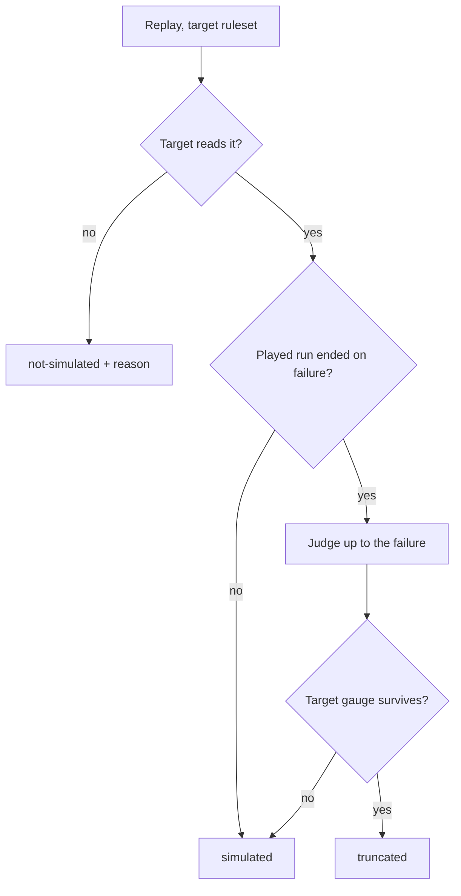
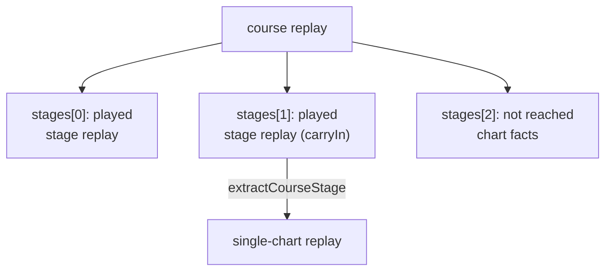
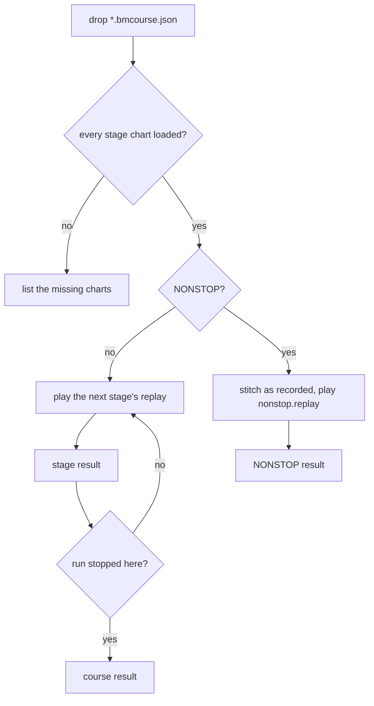

[Japanese version](./replay.ja.md)

# Replay (play history) specification

A Be-Music replay stores the chart as played, the player’s inputs and the settings in effect. The replay simulator uses those facts to reproduce the result or re-judge the play under another ruleset.

<details>
<summary>Table of contents</summary>

- [Related pages](#related-pages)
- [Design principle: an input replay, not a result log](#design-principle-an-input-replay-not-a-result-log)
  - [Input sources](#input-sources)
- [Recording](#recording)
  - [Input without key releases](#input-without-key-releases)
- [Compat rulesets](#compat-rulesets)
- [Re-deriving LR2 / beatoraja / That-Which-Must-Not-Be-Named results](#re-deriving-lr2--beatoraja--that-which-must-not-be-named-results)
  - [Re-judging under another ruleset](#re-judging-under-another-ruleset)
  - [Fidelity notes](#fidelity-notes)
- [Course replays](#course-replays)
  - [Playing a course replay back](#playing-a-course-replay-back)
- [CLI](#cli)
- [Versioning](#versioning)
- [Effective chart display options](#effective-chart-display-options)
- [Optional bmson zero-total policy](#optional-bmson-zero-total-policy)

</details>

## Related pages

- [Browser replay playback, history, and ghosts](./replay-browser.md)
  - <a name="replay-playback"></a>[Replay playback](./replay-browser.md#replay-playback)
  - <a name="replay-slots"></a>[Replay slots](./replay-browser.md#replay-slots)
  - <a name="ghost"></a>[Ghost](./replay-browser.md#ghost)
  - <a name="what-the-player-saw"></a>[What the player saw](./replay-browser.md#what-the-player-saw)

## Design principle: an input replay, not a result log

The replay format records the information needed to compute judgments again. Its canonical payload has three parts.

1. **`chart`** — the resolved chart that actually scrolled past the player: post-`#RANDOM` control flow, post
   lane-shuffle (RANDOM / MIRROR / S-RANDOM), post DP-flip. Long notes are stored as single objects with a
   `timeUs` / `endTimeUs` pair, mines carry their resolved gauge damage, and the raw `#TOTAL` / `#RANK` /
   `#DEFEXRANK` metadata is preserved so each ruleset can apply its own defaults. `chart.sha256` stamps the
   SHA-256 of the source chart FILE bytes so a log can be matched back to its chart by content, and `chart.md5`
   the MD5 of the same bytes, the key LR2 and LR2IR use.
   Two Be-Music Fingerprints (`bmfp0:…`, see [fingerprint-spec.md](./fingerprint-spec.md)) identify the chart by
   what is played rather than by the file bytes, so logs of one chart still match after keysound / BGA / metadata
   edits, re-saves, or a BMS ↔ bmson conversion. `chart.chartFingerprint` covers every `#RANDOM` / `#SWITCH`
   branch, so every play of one chart shares it whatever it rolled — the key to group plays of a chart.
   `chart.playFingerprint` covers the branches this play rolled. The two are equal for a chart without control
   flow. Lane options (RANDOM / MIRROR / S-RANDOM, DP FLIP) are part of neither — they are recorded in `play`.
   The recorder computes both from the source chart (`recordReplay.sourceChart`, the chart as loaded; the engine
   uses the chart it was given when the host passes none) and `play.randomDraws`, with the chart's extension
   (`PlayerOptions.laneModeExtension`) as the lane-mode input. A host that resolves `#RANDOM` or rewrites lanes on
   the chart before handing it to the engine — the browser player resolves every chart and the beatoraja scene
   bakes DP FLIP into it — passes the source chart, or the chart fingerprint is omitted and the play fingerprint
   would describe the host's working copy. Either field is omitted when it cannot be computed; logs without them
   still parse.
   `chart.reversalTimeUs` (present only for charts whose negative `#BPMxx` reverses the scroll) records the LR2
   reverse-scroll reversal instant R: the simulator judges later inputs on the mirrored clock `2R - timeUs`, never
   sweeps misses past R, and ends a run that leaves scorable notes unjudged with the gauge at 0, exactly as the
   engine did (see [`bms-spec.md`](./bms-spec.md) "Negative BPM").
2. **`inputs`** — every raw key press / release that reached a playable lane, as
   `{ seq, timeUs, action: 'down' | 'up', channels, source }`. `source` is required: it is the `id` of the physical
   input in the play's [input-source table](#input-sources) (`play.inputSources`), and it is authoritative — the judge
   and the simulators key a scratch hold by it (beatoraja's back-spin scratch and scratch LN rules), and hold lanes and
   route ANY KEY presses by it. An event may also carry the physical input in `code` when the host had one (a
   keyboard's `KeyboardEvent.code` such as `'KeyZ'` or `'ShiftLeft'`, or `'touch'` for a touch lane; diagnostic only),
   and `inferred: true` on an `up` the engine inferred because the input reported no releases (a terminal without the
   kitty keyboard protocol): the instant it took the key as let go. `inferred` is diagnostic only; replays and
   simulators read such an `up` like any other. A scratch press may carry `spin: 'cw' | 'ccw'`, the way it turned the
   turntable, for display (a replay's turntable animation); judging reads `source` (see
   [`player-spec.md`](./player-judgment.md#input-sources)). Inputs are never converted into judgments, never assigned
   to a note id, and phantom presses (the ones that fire LR2 empty POORs) are kept. The sort key is always
   `(timeUs, seq)` — `seq` disambiguates same-microsecond events.
3. **`play`** — the settings that affect scoring: mode (manual / auto), auto scratch, the selected gauge, the
   lane-arrangement options that produced the resolved chart, the live judge-window ruleset (`judgeRuleset`,
   absent = `'lr2'`), the debug judge-window override, an ESC flag (`aborted`, with `abortedAtUs`: the chart time the judge had settled
   through when the play was aborted, where re-simulations and replays stop instead of missing the rest of the chart),
   `endOnFailure` (the play ended the moment its survival gauge emptied; absent on logs from before that, which kept
   judging), `tempo` (the play tempo, `PlayerOptions.speed`, when it was not 1: the chart, its audio and the clock ran
   `tempo` times as fast; judgments and input times stay in chart time, so a re-simulation ignores it and a replay plays
   back at it; absent = 1, and on a log re-recorded from a replay, whose speed only sets how fast it is re-driven; such a
   practice play is not ranked; it is the tempo at the start, and `tempoChanges` lists `{ timeUs, tempo }` changes
   during the play, any of which other than 1 also makes it practice; a host changes the tempo with the
   `{ kind: 'tempo' }` input command, recorded at the chart time the engine applied it, and a replay follows the changes
   when its host passes them as `PlayerOptions.replayTempoChanges`), `view` and `viewChanges` (what the player saw:
   the hi-speed, the hi-speed fix, the visible time in ms and each side's lane cover as fractions of the lane height —
   `sudden`, `hidden`, `lift` — at the start, then every change in chart time; a host sends changes as
   `{ kind: 'view' }` input commands; judgments do not depend on them, and a replay or ghost reproduces as much of them
   as its viewer picks, `ReplayPlaybackOptions`), `course` for a course stage (its kind, the course's gauge set and judge constraint, and `carryIn`: the
   gauge value, course combo and course max combo the previous stage left), and `randomDraws`: the play's `#RANDOM` /
   `#SETRANDOM` / `#SWITCH` / `#SETSWITCH` outcomes as a `RandomDraws` value (`@be-music/chart-model`), one
   `{ command, range, value }` entry per such line of the chart in file order. They are the
   `PlayerOptions.randomDraws` the engine played with: every host draws once per play (`resolvePlayChart` in
   `@be-music/player-engine`) and hands the same draws to the engine, which records them. With the chart file,
   `resolveBMSControlFlowWithDraws(json, play.randomDraws)` rebuilds the chart that was played (it rejects draws that
   were not drawn for that chart), so a verifier can recompute `chart.playFingerprint`. `parseReplay` rejects an
   entry no control-flow line could have made. It is omitted for charts without control flow.

Judgments, EX-SCORE, combo, and gauge values live only in **`results`** — a regenerable cache keyed by ruleset id
(`native` holds the engine's own result at record time). Every entry has the same shape: `noteCount` is the ruleset's
judgment count (a charge note counts twice), `djLevel` is always set, `score` only under a ruleset with a money score
(LR2), `gauge.final` is the unrounded gauge value and `gauge.failedMidPlay` marks a survival gauge that hit bottom. The
engine and the simulators reach the same entry for the same inputs. Because the canonical data is the input stream, a
later fix to any ruleset re-scores every previously recorded play without re-recording anything.

`results.*.minePoor` counts LR2 mine hits already included in `judge.poor`. They never consume judgment notes or break combo. Course BP subtracts them from the judged-note count, then includes each hit once as POOR. The live summary and result score carry the same optional field. Re-simulate older caches and rebuild historical derived records to apply the corrected beta3 mine rules.

`results.*.fullCombo` optionally records final combo eligibility after an empty POOR in beatoraja FIVEKEYS/PMS. Every note must still be GOOD or better. The engine and simulator derive this from the running combo, so an empty POOR before the first note permits a later full combo. Legacy caches without the field use judgment counts; re-simulate them to apply the corrected mode rule. Course results preserve the eligibility and still require the course combo to cover every note.

### Input sources

`play.inputSources` (required) lists the physical inputs the play used, numbered by `id` in the order they first
appeared; every input event names one by its `source`. Keyboard keys, controller buttons, touch zones and the two
directions of a turntable share one model (#605, [ADR 0040](./adr/0040-replay-input-sources.md)):

```jsonc
"play": {
  "inputSources": [
    { "id": 0, "kind": "key", "device": "keyboard", "label": "shift-left" },
    { "id": 1, "kind": "key", "device": "keyboard", "label": "ctrl-left" },
    { "id": 2, "kind": "turntable", "device": "controller", "label": "tt", "direction": "up" },
    { "id": 3, "kind": "turntable", "device": "controller", "label": "tt", "direction": "down" },
    { "id": 4, "kind": "button", "device": "touch", "label": "z" }
  ],
  "analogScratch": { "algorithm": "be-music/1", "thresholdTicks": 2, "stopMs": 100 }
}
```

- `kind`: `key` and `button` are digital inputs; `turntable` is one rotation direction of a turntable, and requires a
  `direction` (`up` or `down`). A turntable is always two sources, whether the device reports an axis or two buttons.
- `device` is a coarse class only: `keyboard`, `controller` or `touch`. `label` is a normalised name (lowercase
  printable ASCII without whitespace, at most 32 characters): a keyboard key's first token (`'shift-left'`, `'z'`), a
  touch zone's lane key, or a controller's `b1` / `tt`. Labels never carry device-identifying data.
- `deviceName` (optional) is the device's own name as the host reported it: a browser's `Gamepad.id`, which often
  names the vendor and product ids. It is recorded only when the player opts in (the web player's "Record device names
  in replays", `ReplayRecordingOptions.includeDeviceNames`; off by default), and then goes wherever the replay goes,
  Leaderboard submissions included. Keyboards and touch report none. It is not part of the source's identity and
  judging never reads it, so the same play records the same `inputs` with or without it. A source keeps the name it
  was first seen with: another controller in the same slot later in the play is the same source. The recorder removes
  control characters, trims it and cuts it to 128 characters. No serial is ever recorded.
- Each physical key bound to a lane is its own source: a scratch lane's Shift, Ctrl and Space are three. Each lane's
  touch zone is one.
- `play.analogScratch` (optional) names the versioned algorithm, and its parameters, by which the host turned an analog
  turntable axis into presses and releases, for audit and display. The log records the resulting events, never raw
  axis samples, and the simulators never re-run the algorithm.

`parseReplay` rejects a table with duplicate ids, an unknown `kind` or `device`, a label that is not a normalised name,
a turntable source without a `direction` (or another source with one), a `deviceName` that is empty, longer than 128
characters, has control characters or surrounding spaces, and any input whose `source` the table does not hold. A log without `play.inputSources`, or whose inputs carry no `source` (the `tokens` of logs recorded before input
sources), is rejected rather than guessed: the format is still at revision 0 and older logs need not be read. Turning
a source into channels stays the host's job, and `channels` stays authoritative for lane selection.

**Effective play options.** Besides the selected snapshot (`play.options`, see [What the player saw](./replay-browser.md#what-the-player-saw)), `play` carries the typed fields that decide judging and the chart, each omitted while its option is off: `judgeAlgorithm` and `customJudge` (beatoraja's judgment algorithm and CUSTOM JUDGE rates); `gaugeAutoShift` and `bottomShiftableGauge`; `autoScratch1P` / `autoScratch2P`; `anyKey` (ANY KEY, whose `inputs` keep each key's own lane and are routed again on replay); the chart modifiers with what they changed — `longNoteModifier`, `longNoteRate` and `longNoteModifierChangeCount`, `mineModifier` and `mineModifierChangeCount`, `scrollModifier`, `scrollSection`, `scrollRate`, `scrollModifierTimeline` and `scrollModifierChanged`, `extraNoteDepth`, `extraNoteScratch` and `extraNoteChangeCount`, LR2 EXTRA MODE's `lr2ExtraMode`, `lr2ExtraLevel`, `lr2ExtraEffectiveLevel`, `lr2ExtraConvertedObjectCount` and `lr2ExtraTempo`, and 7 TO 9's `sevenToNinePattern`, `sevenToNineType`, `sevenToNineThresholdBPM` and `sevenToNineApplied`; and the battle and conversion modes — `battleMode`, the chart's own `battleSourceVariant`, `battleTempo`, `battleAssist1P` / `battleAssist2P`, `battleChangedObjectCount`, `battleDroppedObjectCount` and LR2 D-BATTLE's `dBattleScratch`. `chart.notes` is the chart after every one of them, so a replay or a simulation never rolls them again: a generated long-note head carries `generatedLongNote: true`, a generated mine `silent: true` with its resolved `damage`, and a moved note its `sourceChannel`. `chart.headerBPM` and `chart.bpmRange` keep the header BPM and the BPM extrema the options that classify a chart by its tempo read.

**Two players.** A two-player play (`play.battleMode: "COUPLE"` or `"TWO-PLAYER"`: LR2 BATTLE, or That-Which-Must-Not-Be-Named two-player play) records both players' presses in one `inputs` stream, each on its own side's channels (`1x` / `2x`). `results.native` is the 1P player's result and `results.secondPlayer` the 2P player's, of the same shape; `play.gauge2P` is the 2P player's gauge. Re-simulating the log judges each side on its own, as the live play did.

Timestamps are integer microseconds relative to chart zero (the same t = 0 the engine's note timing uses). How fine a recorded input really is depends on the input event's timestamp: browsers coarsen it, less on a cross-origin isolated page such as the deployed player (Chromium: 5 µs, otherwise 100 µs), and the input device's polling (8 ms at 125 Hz, 1 ms at 1000 Hz) usually bounds it first.

The TypeScript types, serializer, and defensive parser live in
[`packages/player-engine/src/replay/format.ts`](../packages/player-engine/src/replay/format.ts) (`@be-music/player-engine/replay`).
The recommended file suffix is `.bmplay.json`.

## Recording

Recording is engine-owned so every host (browser LR2 / beatoraja scenes, and any future TUI adoption) shares one
implementation. `PlayerOptions.onReplayRecorded` enables it: the engine snapshots its prepared chart, records
every judged press (`lane-input`) and release (`kitty-state` release) with `pressedAt`-corrected chart-relative
timestamps — for input without releases, the releases it inferred ([Input without key releases](#input-without-key-releases)) — counts empty POORs for the native cache, and hands the assembled `BeMusicReplay` to the callback right
before `autoPlay` / `manualPlay` resolves — including the ESC (aborted) exit. An ESC once every note is judged is not an abort: the host lets go of `holdAfterChart` early, and the play ends complete as soon as nothing is left to judge. `PlayerOptions.recordReplay` carries
the host-declared settings the engine cannot know (selected gauge, lane-shuffle labels, DP flip, freeform
`native` extras, and the source chart the fingerprints are computed from). The `#RANDOM` / `#SWITCH` draws come from
`PlayerOptions.randomDraws`, which the engine needs anyway.

The engine stamps each press and release as it drains it: the playback clock read then, moved back by the age of the
event's `pressedAt` on the wall clock, and never earlier than the input it drained before. The playback clock follows
the audio clock, which moves a render quantum at a time, while the wall clock moves smoothly, so an input drained just
after another could otherwise read older than it. Inputs reach the engine in the order they happened, so the floor only
takes out that jitter: a short tap no longer records its release before its press.

Every log also carries a top-level **`recorder`** that identifies the software that recorded it:
`{ name, version, build, engine, platform }`. The host declares the application fields through
`recordReplay.recorder` (the browser player sends `name: 'be-music-web'`, the player's package version, the short
source commit as `build`, and `platform: 'web'`), and the recorder always fills `engine` with the
`@be-music/player-engine` version that ran the play. The values are self-reported: they help tell which build wrote a log
when a recording bug turns up, and are never a basis for trusting a log. Logs written before the field existed omit
it.

In the browser player:

- Every play screen (`createPlayScene`) hands the recorded log to `on.finish(result, replay)`, and
  `waitForReplay()` waits for the log of a play that was left.
- The player auto-downloads the log as `<title>-<timestamp>.bmplay.json` when the result scene mounts, controlled by
  the **Auto-save replays** checkbox in the Options dialog's **Library & records** folder (OFF by default). Replay options are latched at chart start
  and cannot change mid-play — the controls are disabled while a chart is playing, and the values in effect when
  the chart started govern that play.

The [Options dialog](./player-web.md#options-dialog) controls the play settings. [What the player saw](./replay-browser.md#what-the-player-saw) defines the view a replay can reproduce.

### Input without key releases

A terminal without the kitty keyboard protocol sends a key as one press and then, while it is held, as repeated
presses; it never reports a release. The input runtime says before the play whether its input reports releases
(`PlayerInputRuntime.reportsKeyReleases`):

- the browser's input runtime always declares it;
- the TUI declares it once the terminal has answered the kitty keyboard protocol (or Windows' win32-input-mode) in an
  earlier play of the same process;
- otherwise the engine detects it, from the first `kitty-state` command.

A play whose input declares its releases is judged as key-state input from its first key. Otherwise, until the input
reports a release (a `kitty-state` command), the engine infers when each key came up and feeds the judge, and the
replay, ordinary presses and releases:

- a press on a lane that is up is a key going down (a `down`);
- the lane stays down for a grace after each press: 380 ms after the press that hits a long note's head (a terminal's
  repeat delay), 120 ms after any other, in the play's clock at the tempo it started at;
- a press on a lane that is down is the held key repeating when the lane's long note is held, or when it is the key of
  a long note it already let go before that note's end with no note in reach: it keeps the lane down and is not
  recorded; otherwise it is a new press (a key mashed faster than the grace) and is recorded as a `down`;
- a press on a lane that is up that is the key of a long note it already let go, still repeating, is no press at all;
- once a lane's grace lapses with no repeat, its key comes up at that instant: an `up` marked `inferred: true`, judged
  there (the ruleset's release rules, beatoraja's release margin included), whenever the engine notices.

The judge then sees exactly the inputs the log records, so a replay and the re-simulation under the play's ruleset
reach the live play's result (`driver-drift.test.ts` checks long notes in every mode, key repeat, mashing and mines
under each ruleset). The judge itself takes key-state input only: a lane is down from its press to its release.

A log written before the engine inferred releases holds every press of such a play, key repeats included, and no
release at all. A replay reads such a log as it is, as the simulators do: each key stays down from its press to the end
of the play, and every key repeat is a press of its own. The replay and the simulators agree on such a log, but can
judge it differently from how it was played ([Fidelity notes](#fidelity-notes)); a log recorded now carries its
releases, and the live play, its replay and the simulators agree.

## Compat rulesets

**The player has no judge logic of its own.** Every live play runs under one of four compat rulesets —
`'lr2'` (the default), `'beatoraja'`, `'____'`, or `'plugout'` ([ADR 0044](./adr/0044-plugout-ruleset.md)) — selected with `PlayerOptions.judgeRuleset`, and the ruleset
owns the whole decision surface:

- judge windows, signed and per context (key vs scratch, note vs long-note end), including LR2's `#EXRANKxx`
  timeline
- which note a press resolves against (`lowest` / `combo` / `duration` / `score`) and LR2's forward tap re-judge chain
- long-note style: LR2 plays every long note as an LN, beatoraja honours the chart's `#LNMODE`, That-Which-Must-Not-Be-Named charges
  everything — charge modes judge the head and the tail separately
- the empty-POOR window and whether it breaks the combo
- the gauge line-up and its curve, TOTAL default, guts softening, and clear rule
- the score formula and the EX-SCORE denominator

The same tables drive the live engine and the replay simulator, and an equivalence suite
([`equivalence.test.ts`](../packages/player-engine/src/replay/equivalence.test.ts)) replays one recorded input stream
through both and requires them to agree judge for judge. The selected ruleset is recorded as `play.judgeRuleset`
and replays re-apply it automatically.

Gauge selection is separate (`PlayerOptions.gauge`) and spelled in LR2's names — `GROOVE` / `EASY` / `HARD` /
`DEATH` — which each ruleset maps onto its own line-up (`GROOVE` is beatoraja's `NORMAL`, `DEATH` its `HAZARD`,
and That-Which-Must-Not-Be-Named has no HAZARD so `DEATH` folds onto `EX-HARD`).

`bms-player` exposes both as `--ruleset <lr2|beatoraja|____>` and `--gauge <GROOVE|EASY|HARD|DEATH>`.

## Re-deriving LR2 / beatoraja / That-Which-Must-Not-Be-Named results

`simulateReplay(replay, { ruleset })` (from `@be-music/player-engine/replay`) replays the input stream through one
ruleset; `simulateReplayRulesets(replay)` runs all three. Each ruleset differs in judge windows, note selection,
long-note semantics, empty-POOR behavior, and gauge tables — the constants are documented per source in
[`packages/player-engine/src/ruleset/definitions.ts`](../packages/player-engine/src/ruleset/definitions.ts):

| aspect                  | LR2 (`lr2/0`)                                     | beatoraja (`beatoraja/0`)                                   | That-Which-Must-Not-Be-Named (`____/0`)                                |
| ----------------------- | ------------------------------------------------- | ----------------------------------------------------------- | ---------------------------------------------------------------------- |
| source                  | lr2oraja / OpenLR2                                | beatoraja master                                            | community measurements (https://iidx.org)                              |
| windows (NORMAL-rank)   | ±18/±40/±100/±200 ms                              | ±15/±45/±112.5/late 210 · early 165 ms (7K, judgerank 75 %) | ±16.67/±33.33/±116.67/±250 ms                                          |
| rank scaling            | LR2 anchor interpolation, BAD fixed               | linear × judgerank, MS fixed                                | none                                                                   |
| note selection          | Lowest + multi-BAD chain                          | Combo (default; duration / lowest / score selectable)       | Lowest                                                                 |
| long notes              | all LN (deferred single judgment)                 | per-note LN / CN / HCN                                      | all CN (HCN gauge when mode 3)                                         |
| empty POOR window       | early-only 1000 ms                                | late 150 / early 500 ms (7K)                                | unmeasured — beatoraja window used                                     |
| CN release window       | —                                                 | per-mode long-note end table                                | only PGREAT inside ±200 ms, BAD to +220 / −280 ms (bounds provisional) |
| empty POOR breaks combo | no                                                | 5K / PMS only                                               | no                                                                     |
| money score             | `(4·PG + 2·GR + GD) × 50000 / notes`              | —                                                           | — (abolished in BISTROVER)                                             |
| gauges                  | lr2oraja LR2 tables (death 2 %, guts < 32 % ×0.6) | beatoraja native tables                                     | https://iidx.org tables (a-value recovery, ≤ 30 % half damage on HARD) |

EX-SCORE is PGREAT × 2 + GREAT × 1 everywhere; DJ LEVEL uses the That-Which-Must-Not-Be-Named ninths table. Charge-note rulesets count a
long note's head and tail as two judgment notes (`result.noteCount` reports each ruleset's denominator).

### Re-judging under another ruleset

`simulateReplay` judges whatever it is given. `rejudgeReplay(replay, { ruleset })` (`rejudgeReplayRulesets` for
several rulesets, `rejudgeCourseReplay` for a course replay) applies [ADR 0019](./adr/0019-source-qualified-option-values.md)'s rules
first and answers one of three outcomes; the Leaderboard and `bms-replay` use it.



- **not-simulated**, with a reason (`findReplayNotSimulatedReason`): `gauge` when the bare gauge is not one the target
  defines (`P-ATTACK` under beatoraja, `EX-HARD` or `ASSIST-EASY` under LR2, `DEATH` under ???? outside a course); it is
  never mapped to a lookalike. `custom-judge` when the replay used CUSTOM JUDGE, which stays beatoraja's. Gauge
  auto-shift is no reason: it is carried, along the target's own gauge ladder ([Play options](./play-options-modifiers.md#gauge-auto-shift)).
  The played ruleset always simulates its own gauge. A source-qualified gauge (`play.gauge: "lr2:P-ATTACK"`) is no
  reason either: every ruleset re-judges it on that source's gauge, ladder and course gauges, and the result names the
  source in `gauge.source` ([ADR 0019](./adr/0019-source-qualified-option-values.md)).
- **truncated**: the play ended where its survival gauge emptied (`play.endOnFailure`), and the target's gauge would have
  survived that point. The run is judged only up to it (`stoppedAtUs`, where the played ruleset's gauge emptied): no input
  is synthesized and no later note is missed. A course is truncated the same way when its played run stopped at a failed
  stage the target's gauge survives. A truncated result is not ranked.
- **simulated**: everything else, including a target whose gauge empties by the same point.

`SimulateReplayOptions.onFailure` hears the chart time of the judgment that first empties a survival gauge. Tracked in [#933](https://github.com/nulltask/be-music/issues/933).

### Fidelity notes

- The LR2 ruleset follows lr2oraja, cross-checked against the OpenLR2 transcription; where the two disagree on the
  missed-POOR threshold for LN heads, the lr2oraja behavior is used. The DEATH gauge follows LR2 itself (no recovery,
  an empty POOR costs nothing), not lr2oraja's beatoraja-derived `HAZARD_LR2` table.
- That-Which-Must-Not-Be-Named internals are not public. The judge windows, gauge tables, and DJ LEVEL boundaries are current community
  consensus [C]; the empty-POOR window and CN release windows are unmeasured and provisional: they borrow beatoraja's
  miss window and SEVENKEYS long-note end windows, which are evidence of beatoraja [V], not of this game ([#1189](https://github.com/nulltask/be-music/issues/1189)),
  and the HCN gauge tick uses a fixed 200 ms interval instead of That-Which-Must-Not-Be-Named's measured 16th-note interval. Expect
  close — not bit-exact — reproduction.
- beatoraja uses separate FIVEKEYS, SEVENKEYS, PMS and KEYBOARD gauge tables and mode-specific default TOTAL. Engine frames carry raw gauge bounds, including PMS maximum 120; replay `gauge.final` and result gauges are percentages of that maximum. PMS's one-empty-POOR-per-note rule remains unmodeled.
- Because the replay stores the resolved chart, `#RANDOM` and lane-shuffle differences between players never
  affect re-simulation.
- A play from input without key releases records the releases the engine inferred ([Input without key
  releases](#input-without-key-releases)), so it replays and re-simulates as it was judged. Logs recorded before
  that have only `down` inputs for it: a replay and the re-simulations hold every key from its press on and take
  every repeat as a new press, and can judge such a log differently from how it was played.
- Logs recorded before the engine stamped each input no earlier than the one before it can hold a short tap (a touch
  tap, typically) whose release is a few hundred µs before its press. A replay and the re-simulations read the release
  first and hold the lane down from the press to its next release, so a mine on the lane meanwhile goes off and a long
  note tapped that way is held on.

## Course replays

A course run is recorded as one **course replay** (`format: 'be-music-course-replay'`, `*.bmcourse.json`). It holds the course (`name`, `kind`, `constraints`, `trophies`, and `release: false` for a course whose runs must not be ranked) and one entry per stage, in order:

- a stage the run reached is `{ played: true, replay }`, that stage's own complete replay. Its `play.course` carries the course kind and constraints and `carryIn`, the state the previous stage left, so `extractCourseStage(log, index)` returns a log that replays and re-simulates on its own;
- a stage the run never reached (after a failed one) is `{ played: false, facts }`: the chart facts a ruleset needs to count its notes, and, when known, the chart's file hashes (`sha256`, `md5`) and its chart fingerprint (`chartFingerprint`, as a played stage's `chart.chartFingerprint` would be). The fingerprint is optional, so older logs still parse, but a run without it cannot be keyed or ranked.



`simulateCourseReplay(log, { ruleset })` re-derives the course result. Each stage after the first starts from the state the **simulated** previous stage left, not the recorded `carryIn`, and the course stops at the first stage whose gauge emptied, as the live run did. A stage given up with ESC (`play.aborted`) fails the course whatever its gauge, as LR2 records a run given up mid-course. The result (`ReplayCourseResult`) sums the stages played: judgments, fast / slow, EX-SCORE. It counts notes over every stage, adds every note the run never judged to the BP (`missCount`), takes the course-wide max combo and the last stage's gauge, and resolves the course lamp and the trophy (see [Courses and dan certification](./course.md)). `createCourseReplay` assembles the log from the stage logs a host recorded and caches the engine's own course result as `results.native`, lamped under the judge ruleset the stages were played on. `resolveCoursePlayedRuleset(log)` names that ruleset (a NONSTOP run's is its stitched play's), or `undefined` when the stages differ: the Leaderboard ranks the run under it and a host keeps the run's best record under it. A single result's lamp is `resolveRulesetResultLamp(result, ruleset)`, and the lamps, the course lamp rule and BP are the vocabulary of `@be-music/player-engine/ruleset` (`resolveClearLamp`, `resolveCourseClearLamp`, `resolveMissCount`).

**Course identity.** `computeCourseFingerprint({ kind, constraints, stageChartFingerprints })` keys a course as `bmcourse0:<sha256>` ([fingerprint-spec.md §8](./fingerprint-spec.md#8-course-fingerprint)) over its kind, its constraints (normalized as `normalizeCourseConstraints` reads them, then sorted) and its stages' chart fingerprints in order; a NONSTOP course also adds its connections between the stages (the one listed after the last stage joins nothing and is dropped) and its placement mode (`intended` or `lr2`), since they decide the stitched chart that is played. The name and the trophies are left out. So the same course read from a `.lr2crs`, a beatoraja course file or a difficulty table gets one key whenever its charts match, and a random course, once drawn, is keyed like a fixed one. `computeCourseReplayFingerprint(log)` reads the stage fingerprints from the log (played and unreached stages alike, so failed runs are keyed too) and is `undefined` when one is missing. `checkCourseReplayEligibility(log)` is the course counterpart of `checkReplayEligibility`: every played stage must pass the single-play check (being a course stage of this course kind is required here, not refused), the played stages must come first, and the assists of every stage flag the run. Only the last played stage may be aborted: that is a run given up with ESC, which counts as a failed one.

**NONSTOP runs.** An LR2 NONSTOP course is played as one stitched chart (see [Courses and dan certification](./course.md#nonstop-courses)), so its course log adds `nonstop`. `buildNonstopCourseReplay` (`@be-music/player-engine/course`) writes such a log from the stitched play:

- `nonstop.replay`: the play of the stitched chart, as recorded. It is what was judged, and `simulateCourseReplay` takes the course result from it: its judgments, gauge and max combo, with BP counting every note it never judged.
- `nonstop.connections` and `nonstop.placement`: how the chart was stitched.
- `nonstop.stitch`: the version of the stitching rules the chart was built by (`NONSTOP_STITCH_VERSION`), so the stitched chart is rebuilt the same way after the rules change. Logs from before it was recorded leave it out and read as version 1. It is not part of the course fingerprint: a fix to the stitching keeps the course's board.
- `nonstop.stages`: where each stage sat in the play (`offsetUs`, its window `windowStartUs` / `windowEndUs`, its FIT `rate`), and the `#RANDOM` / `#SWITCH` draws its chart was resolved with before stitching (`randomDraws`, as `play.randomDraws` records a single play's; absent for a chart without control flow). With the stage charts, the draws rebuild the stitched chart.
- `nonstop.noteStages`: the stage of each note of the play, by note id (`resolveNonstopNoteStages` reads it from the stitched chart's per-stage keys).

`stages` still holds one entry per stage. Each reached stage is cut out of the play by `splitNonstopReplay`:

- its notes are timed from the stage's own zero, at the FIT-stretched speed it was played at (`play.course.rate` records the stretch);
- a press goes to the stage of the nearest note on its lanes, and a release with its press;
- `play.course.carryIn` is the state the stitched play was in when the stage began (the play simulated up to the stage's window).

- its `chart.chartFingerprint` names the stage's chart, as an unreached stage's `chartFingerprint` does, so the course is keyed like any other.

So `extractCourseStage` still gives a single-chart log that replays on its own; at the seams its judgments can differ from the stitched play.

`checkCourseReplayEligibility` checks a NONSTOP run on its stitched play: it must pass the single-play check (auto play is refused; an ESC abort is a failed run), carry `play.course.kind: 'nonstop'`, and its `nonstop.stages` must cover every stage of the course. Every stage must still name its chart. The result carries the stitched play's fingerprints as `nonstop`, and `stages` is empty: the stages were not played on their own, so a verifier rebuilds them from their charts (`prepareNonstopCourse` with the recorded draws, the course's constraints and the recorded connections, placement and stitching rules, then `resolveNonstopRun`; see [Courses and dan certification](./course.md#nonstop-courses) and [Leaderboard design](./leaderboard.md#61-course-rankings)).

Mixed bmson NONSTOP replays also accept `table: "bmson"` (raw `judge_rank`) and `table: "bms-exrank"` (raw `#DEFEXRANK`) in `chart.judgeRank.stageRanks`, with an initial entry at time zero. LR2 and beatoraja apply these stage windows. NONSTOP replays from stitching rule version 4 also carry `table: "bms-exrank-change"`, a stage's own `#EXRANKxx` change (channel `A0`, `#DEFEXRANK` units), which only LR2 applies, as for a chart alone. Optional `chart.totalUnit` selects `absolute` or `percent` for TOTAL; ordinary replays continue to derive the unit from `sourceFormat`. `chart.sourceFormat` is `bms`, `bmson` or `lrx`; an LRX chart reads its rank and TOTAL as a BMS chart does. A note marked `uncounted: true` is an LRX chain note that starts its lane: every ruleset judges it, and only `plugout` leaves it out of the note count, as plugout does.

### Playing a course replay back

Dropping a `*.bmcourse.json` file onto the browser player (or picking it with **Open files**) plays the recorded run back as its course, as LR2 and beatoraja replay a course. LR2 beta3 starts one by holding the start key on a course bar for more than two seconds, or with skin button type 19 (OpenLR2 `LR2f.cpp` L11930-L11968, L10300-L10306); beatoraja with its REPLAY key and a replay slot. Here the file is the entry point; the playback takes a parsed log, so a course replay loaded from elsewhere (the Leaderboard) can start it the same way.



- **Every stage chart must be loaded.** Each stage is matched against the library by the chart it names (`listCourseReplayStageCharts`, `matchesCourseReplayStageChart`): SHA-256 when it names one, else MD5, else the chart fingerprint. A stage reached or not counts the same, as LR2's `coursePlayable` and beatoraja's `MusicSelector` (433-437) refuse a course replay with a stage chart missing. When one is missing, a dialog lists them and nothing starts.
- **The stages play in order**, each from its own replay with the state it carried in (`play.course.carryIn`), through the live course flow: the course's decide screen, then each stage's result, then the course result. LR2 skips a stage result only for AUTO (`Main.cpp` M1280-M1310, M1376-M1379), not for a replay, and beatoraja shows each stage's `MusicResult` (179-212) before its `CourseResult`. An AUTO-played stage's result is skipped as a live AUTO run skips it.
- **The run stops where the recorded run stopped** (`planCourseReplayPlayback`): after the first stage given up (`play.aborted`, which goes straight on to the course result as the live run did) or failed (its recorded gauge, by `isCourseStageFailed`), else after the last stage played. The course result is the recorded one (`results.native`).
- **A NONSTOP run plays as one chart**, as LR2 replays a NONSTOP course (`LR2f.cpp` L18116-L18117, `Main.cpp` M806): the course is stitched again as recorded (`nonstop.placement`, `nonstop.stitch` and each stage's `randomDraws`) and `nonstop.replay` plays on it.
- **Nothing is kept.** A course replay updates no stage or course best, lamp, trophy or play count, saves no replay and submits nothing to the Leaderboard, as LR2's course-result save returns early for a replay (`LR2f.cpp` L9599). beatoraja's `CourseResult.updateScoreDatabase` writes with no mode guard, so a course replay there bumps play and clear counts; Be-Music does not follow it.
- **The results say they are a replay.** A replay's play and every result it leads to (each stage's, the course's or the NONSTOP run's) carry `PlayResult.fromReplay`, and the LR2 skin lights REPLAY PLAYING (op 84) instead of REPLAY OFF (op 82) on the play and result screens, as LR2 keeps op 84 on for the whole replay (`LR2f.cpp` L4740-L4741).
- ESC during the playback stops it and goes back to the select screen, as ESC stops a dropped replay; F5 or R on a NONSTOP replay plays it again. Once every note of the stage (of the stitched chart, on a NONSTOP replay) is judged, ESC finishes the stage instead, as it does in a live play: the run goes on to its next stage or its result.

## CLI

`@be-music/player-terminal` ships a second binary, `bms-replay`:

```bash
pnpm replay -- results/Song-2026-08-17T10-00-00-000Z.bmplay.json
```

```
RULESET        EX     RATE     DJ   PG     GR     GD    BD    PR    EPR   FAST   SLOW   COMBO  SCORE   GAUGE
be-music/native 1180  83.10%  AA   ...
lr2/0          1180   83.10%   AA   ...                                          ...    140000  96.0% GROOVE CLEAR
beatoraja/0    1174   82.68%   AA   ...
????/0         1102   77.61%   AA   ...
```

Options: `--ruleset=lr2,beatoraja,____|all`, `--gauge=<id>` (ruleset-scoped gauge override),
`--algorithm=combo|duration|lowest|score` (beatoraja note selection), `--json`.

## Versioning

`format: "be-music-replay"`, `version: 0`. Revision `0` is the development revision: the format is still being
defined and may change incompatibly without `version` moving. The first stable revision will be `1`. Older logs are
not read: those stamped `version: 1` before the format was marked unstable, and those recorded before input sources
(no `play.inputSources`, inputs with `tokens` but no `source`), are rejected rather than guessed. Unknown extra fields
are ignored on parse so minor additions stay readable. Ruleset result ids carry their own revision (`lr2/0`
etc.).

Revision `0` is the development revision: the rulesets are still being aligned with their sources, so their rules
may change between releases without a bump, and a `/0` result cached by one release can differ from what a later
release computes. `1` will be the first stable revision; from then on a corrected ruleset bumps its revision and
simply re-simulates existing files. Releases before the development revision wrote `/1` ids.

Only the current revision of each ruleset is implemented. A log whose cached `results` carry an older id still parses
(the ids are kept as written), and re-simulating or replaying it applies the current rules; there is no compatibility path that
replays the old ones, so its numbers can change. The cache is never authoritative, so such entries are simply stale.

- **`lr2/0`, `beatoraja/0`, `____/0`** Development revision (see above). Since `/1`, mines follow the ruleset's rule: LR2beta3 now uses strict ahead-only GREAT on key-down, held crossing and one POOR/BP per mine; `____`, which has no mines, imports LR2's policy on its own GREAT window (it replaced a provisional symmetric-PGREAT, gauge-only model, whose results are not kept); under `beatoraja` only a key down as the mine crosses detonates it (engine). Negative-BPM charts follow LR2's reverse scroll: inputs past the reversal are judged on the mirrored clock, mines there stay frozen, and a run left with notes unjudged is FAILED. Under `lr2` the DEATH gauge follows LR2: no recovery, and an empty POOR costs nothing. Under `lr2`, a BMS chart's `#DEFEXRANK` (`chart.judgeRank.sourceExRank`) and `#EXRANKxx` scale the `#RANK 2` windows instead of being interpolated between LR2's ranks; `chart.judgeRank.percent` is no longer what those charts are judged by.
- **`plugout/0`** First revision: plugout4 -ARCADE EDITION-'s windows, charge long notes, gauges, course gauges, score and lamps ([ADR 0044](./adr/0044-plugout-ruleset.md)).

## Effective chart display options

Optional `chart.chartOptions` records the effective display program accepted during the original play. Version 1 has `{ version: 1, initial: { hiSpeed? }, cues: [{ timeUs, state: { hiSpeed? } }] }`. Each cue is a complete authored state, and an empty state releases compulsory speed to the saved user view. Times are nondecreasing nonnegative safe integer microseconds. HI-SPEED must be finite and within 0.25–100; unknown profile versions or state fields are rejected. Version 2 adds the optional state fields `hidden`, `changeHS`, `crazySize` and `crazyWave`, each one of the IDs listed in [ADR 0032](./adr/0032-chart-authored-visual-families.md) (for example `{ hidden: 'SUDDEN', changeHS: 'ACCEL' }`). A version-1 program carrying any of them is rejected, so an older recording never activates a family implemented later. Version 3 adds `hidden: 'M-SUDDEN'`, the `crazyWave` values `YWAVE`, `YWAVE2`, `XYWAVE`, `XYWAVE2`, `3DWAVE` and `3DWAVE2`, and the fields `crazyColor`, `crazySpin`, `crazyClone`, `crazyLine`, `crazyJudge`, `crazyDark` and `crazyReverse` ([ADR 0036](./adr/0036-chart-authored-skin-level-options.md)); a version-2 program carrying any of them is rejected the same way. New recordings write version 3. The height of the SUDDEN+ cover the player moves under M-SUDDEN is recorded in `play.view` like any cover change.

Optional `chart.chartPlayOptions` records the chart-authored gameplay options the play ran with: `{ version: 1, options: { random?, judge?, hellJudge?, addMine?, notes? } }`, with `random` one of `MIRROR`, `RANDOM`, `RANDOM+`, `ALL`, `ALL+`, `judge` `GOOD2BAD` or `GREAT2BAD`, and `notes` `DOUBLE`, `COPY` or `DBLCOPY`. It holds only what took effect: a course stage leaves out a NOTES COPY, so its program has no `notes` (or `DOUBLE` for a DBLCOPY). A copied chart's `chart.laneMode` is its double-play mode, and playback converts the notes again with the recorded `notes` ([ADR 0035](./adr/0035-chart-authored-notes-options.md)). The arranged and mined notes are already in `chart.notes`; simulations apply the recorded judge modifiers and never recompile the source, so a replay without the field keeps its original judgments. Unknown versions, fields or values are rejected. See [ADR 0033](./adr/0033-chart-authored-gameplay-options.md).

Optional `play.playerChartPlayOptions` names which of those options the player chose rather than the chart's `#OPTION`: `{ judge?, hellJudge?, notes? }`, with `judge` `GOOD2BAD` or `GREAT2BAD`, `hellJudge` `true` and `notes` `DOUBLE`, `COPY` or `DBLCOPY`. Each must equal the value in `chart.chartPlayOptions`. A player's COPY or DBLCOPY there makes the play `no-save` ([play-options.md](./play-options.md), [#1243](https://github.com/nulltask/be-music/issues/1243)).

Hosts pass this program as `PlayerOptions.chartOptionProgram` when replaying. Browser replay supplies an empty program for older records without this field, preserving their original behavior. Source declarations are not recompiled into an existing effective profile. `play.options`, `play.view` and their changes retain the underlying user speed, while the chart profile reproduces the compulsory display override. This avoids writing authored values into saved user preferences and restores the exact user view when the override clears. Simulations ignore these visual operations; score, input replay, fingerprints and eligibility are unchanged. See [ADR 0026](./adr/0026-chart-authored-display-options.md). NONSTOP records the stitched effective program; a cut-out stage log retains only its ownership window, rebased by its stage offset without applying FIT a second time. It seeds the played start and clears at a finite stage end. The trimmed unplayed prefix has no invented authored state.

Chart-authored HDX LONGMODE is resolved into the recorded chart and note modes, not `chartOptions`. Recorded mode 1 also overrides newly recognized source declarations. NONSTOP stitch version 3 preserves BMS CN/HCN using internal bmson per-note types; versions 1 and 2 remain available for historical runs. See [ADR 0027](./adr/0027-hdx-long-note-modes.md).

CHART HEADER (AUTO) is recorded as an effective COUPLE/TWO-PLAYER/OFF mode, never as AUTO. A missing recorded mode continues to mean OFF. `simulateReplay` defaults to player 1 for a two-player recording; `player: 2` selects player 2 and its gauge. Two-player recordings are ineligible for single-player online submission (`two-player`); both local results and the shared replay remain available. See [ADR 0028](./adr/0028-player-header-selection.md).

## Optional bmson zero-total policy

Per-play `bmsonTotalMode` defaults to `beatoraja`; `spec` suppresses positive recovery only for normalized percentage TOTAL 0. Browser Play options exposes **bmson TOTAL 0** and terminal accepts `--bmson-total-mode spec`. The typed replay field is authoritative; absence means compatibility regardless of the viewer. Affected manual plays and courses remain stored and simulated with `unranked: 'bmson-total'`, without ordinary best-record or ranking updates. Positive-total opt-ins remain comparable. Damage, initial HP, carry and chart fingerprints stay unchanged. See [ADR 0030](./adr/0030-bmson-zero-total.md).
