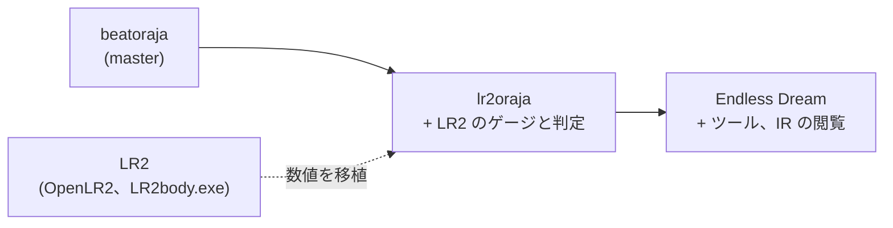

[English](./lr2oraja-courses.md)

# lr2oraja のコースと beatoraja、LR2、be-music の比較（#554）

2026-11-02 調査。lr2oraja とその派生の LR2oraja Endless Dream がコースをどう扱うかを読み、beatoraja 0.8.9、LR2、be-music の[コースの規則](../course.ja.md)との違いを挙げ、違いごとに判定を付けます。be-music はルールセットの外の挙動では LR2 に、LR2 にない機能では beatoraja に従います。lr2oraja は派生物なので、be-music がすでに使っている資料より LR2 の挙動をよく示している場合にだけ参考にします。

**結果。** 変更が必要な違いはなく、issue は立てていません。lr2oraja のコースのコードは beatoraja のコースのコードそのもので、beatoraja の `GAUGE_LR2` の段位ゲージに LR2 の補正を 2 つ（2 % の死亡ライン、32 % の被ダメージ軽減の境目）加えて動きます。be-music の `lr2` ルールセットはどちらも持っており、LR2 自身のコース用ゲージで遊ぶ点で lr2oraja より LR2 に近いです。資料の間で食い違う値が 1 つあります（LR2 の段位ゲージの GOOD の回復量、[D4](#d4-lr2oraja-が-beatoraja-から引き継いだゲージの値とランプ)）。

## 資料

リンクはすべて固定したコミットを指します。

| 資料                   | リポジトリとコミット                                                                                                                                                                                                                                                                                                                            |
| ---------------------- | ----------------------------------------------------------------------------------------------------------------------------------------------------------------------------------------------------------------------------------------------------------------------------------------------------------------------------------------------- |
| lr2oraja               | [`wcko87/lr2oraja`](https://github.com/wcko87/lr2oraja) の `lr2oraja` ブランチ、[`3db78ad`](https://github.com/wcko87/lr2oraja/tree/3db78adff969b854fb3bcc68966449bd36cf7a5b)（2024-10-31）。変更点の一覧は `readme` ブランチ [`c40f03c`](https://github.com/wcko87/lr2oraja/blob/c40f03cc0ad3e9cf2065e99abdd791197c39096d/README.md) の README |
| LR2oraja Endless Dream | [`seraxis/lr2oraja-endlessdream`](https://github.com/seraxis/lr2oraja-endlessdream) の [`d499515`](https://github.com/seraxis/lr2oraja-endlessdream/tree/d4995153b0a759859ebc8f859dd868abae39db5a)                                                                                                                                              |
| beatoraja 0.8.9        | [`exch-bms2/beatoraja`](https://github.com/exch-bms2/beatoraja) の [`8357404`](https://github.com/exch-bms2/beatoraja/tree/83574048ba489082eb46df7fe9806b464bf1f526)。be-music の他の文書が引くコミット                                                                                                                                         |
| LR2                    | [OpenLR2](https://github.com/GOMazk/OpenLR2) の [`583a385`](https://github.com/GOMazk/OpenLR2/tree/583a38503555e59c4bafa49d60b9d0714c9007c2)、および [course.ja.md](../course.ja.md) が引く `LR2body.exe`                                                                                                                                       |
| be-music               | [course.ja.md](../course.ja.md)、`packages/player-engine/src/course/`、`packages/player-engine/src/ruleset/course.ts`                                                                                                                                                                                                                           |

lr2oraja は beatoraja の `master` を追い、定期的に取り込みます（最後の取り込みは 2024-10-31 で、0.8.9 より前）。独自のコミットは `lr2oraja` ブランチの `wcko87` によるもので、コースの選択、コースの結果、IR に触れるものはありません。コースのプレイを変えるのは [`2e4dc9a`](https://github.com/wcko87/lr2oraja/commit/2e4dc9a0ec)（全モードで LR2 のゲージと判定を既定にする）と [`3d64953`](https://github.com/wcko87/lr2oraja/commit/3d64953581)（LR2 のゲージは 2 % 未満で死亡、被ダメージ軽減は 32 % 未満）です。基にした beatoraja が古いことだけによる違い（リファクタリング、ログ）は除きました。Endless Dream は同じ LR2 の規則の上に作られ（`BMSPlayerRule` は lr2oraja のもの）、その周りにツールと IR の閲覧機能を足しています。

## 一覧

| #                                                                | 項目                                | lr2oraja / Endless Dream                         | beatoraja 0.8.9               | LR2                               | be-music                                           | 判定                       |
| ---------------------------------------------------------------- | ----------------------------------- | ------------------------------------------------ | ----------------------------- | --------------------------------- | -------------------------------------------------- | -------------------------- |
| [D1](#d1-ゲージ制約のないコースの既定のゲージ表)                 | `gauge_*` がないときのゲージ表      | 全モードで `LR2` の段位ゲージ                    | プレイモードで選ぶ            | LR2 自身のコース用ゲージ          | `lr2`: LR2 のもの、`beatoraja`: プレイモードで選ぶ | 変更なし                   |
| [D2](#d2-lr2-の判定で明示されたゲージ制約)                       | 明示された `gauge_5k` … `gauge_24k` | LR2 の判定幅のまま従う                           | 従う                          | その制約はない                    | `lr2` は無視する                                   | 変更なし                   |
| [D3](#d3-lr2-の段位ゲージの死亡ラインと被ダメージ軽減)           | 死亡ライン、被ダメージ軽減          | 2 未満で死亡、32 未満で × 0.6                    | 0 で死亡、30 未満で × 0.6     | 2 未満で死亡、32 未満で × 0.6     | `lr2` は LR2、`beatoraja` は beatoraja どおり      | 変更なし                   |
| [D4](#d4-lr2oraja-が-beatoraja-から引き継いだゲージの値とランプ) | ゲージの値、HARD / DEATH、ランプ    | beatoraja の `*CLASS_LR2` の値とランプ           | 同じ                          | GRADE / GRADE-HARD / GRADE-DEATH  | `lr2` は LR2 どおり                                | 変更なし。1 つの値は不明確 |
| [D5](#d5-段位コースのオプションの制限)                           | オプションの制限                    | beatoraja のもの                                 | `CLASS` / `MIRROR` / `RANDOM` | GRADE ではより広く戻す            | beatoraja のもの、LR2 の GRADE には LR2 の戻し     | 変更なし                   |
| [D6](#d6-ステージの失敗と中断)                                   | ステージの失敗、ESC                 | beatoraja のもの（ESC でコース失敗）             | 同じ                          | HP が 2 以上なら ESC でも次へ進む | ESC でコース失敗（意図的）                         | 変更なし                   |
| [D7](#d7-コースの結果と記録)                                     | コースの結果、記録                  | beatoraja のもの、ルールは `LR2`                 | 同じ、ルールはモードで選ぶ    | `CheckCourseClear`                | ルールセットごと                                   | 変更なし                   |
| [D8](#d8-ir)                                                     | IR                                  | beatoraja のもの。Endless Dream は送信条件を追加 | `release` とスコアの更新      | LR2IR                             | Leaderboard                                        | 変更なし                   |
| [D9](#d9-endless-dream-は-constant-をアシストとして扱う)         | CONSTANT                            | Endless Dream: アシスト扱いで ASSIST EASY        | アシストにしない              | その設定はない                    | アシストにしない                                   | 変更なし                   |
| [D10](#d10-endless-dream-のコースまわりのツール)                 | ダウンローダー、トレーナー          | Endless Dream のみ                               | なし                          | なし                              | なし                                               | 対象外                     |

## 違い

### D1. ゲージ制約のないコースの既定のゲージ表

- **lr2oraja。** `BMSPlayerRule.getBMSPlayerRule` は `BMSPlayerRuleSet.LR2` をたどります。その唯一のルール `LR2` はモードを指定しないので、どのモードでも `LR2`（`GaugeProperty.LR2`、`JudgeProperty.LR2`）を返します（[BMSPlayerRule.java L43-L55](https://github.com/wcko87/lr2oraja/blob/3db78adff969b854fb3bcc68966449bd36cf7a5b/src/bms/player/beatoraja/play/BMSPlayerRule.java#L43-L55)）。`GrooveGauge.create` はコースが何も指定しないときこのルールのゲージを使うので（[GrooveGauge.java L160-L178](https://github.com/wcko87/lr2oraja/blob/3db78adff969b854fb3bcc68966449bd36cf7a5b/src/bms/player/beatoraja/play/GrooveGauge.java#L160-L178)）、制約のないコースはすべて `CLASS_LR2` / `EXCLASS_LR2` / `EXHARDCLASS_LR2` で遊びます。Endless Dream も同じです（[BMSPlayerRule.java L43-L55](https://github.com/seraxis/lr2oraja-endlessdream/blob/d4995153b0a759859ebc8f859dd868abae39db5a/core/src/bms/player/beatoraja/play/BMSPlayerRule.java#L43-L55)）。
- **beatoraja。** 同じ処理が `BMSPlayerRuleSet.Beatoraja` をたどり、モードで表を選びます。5 / 10 鍵は `FIVEKEYS`、7 / 14 鍵は `SEVENKEYS`、PMS は `PMS`、24 鍵は `KEYBOARD` です（[BMSPlayerRule.java L13-L21、L43-L55](https://github.com/exch-bms2/beatoraja/blob/83574048ba489082eb46df7fe9806b464bf1f526/src/bms/player/beatoraja/play/BMSPlayerRule.java#L13-L55)）。
- **LR2。** 制約はなく、ゲージはコースの種類とプレイヤーの選択で決まります（[LR2f.cpp L27707-L27790](https://github.com/GOMazk/OpenLR2/blob/583a38503555e59c4bafa49d60b9d0714c9007c2/LR2f.cpp#L27707-L27790)）。
- **be-music。** `lr2` ルールセットはコースの指定にかかわらず LR2 自身のコース用ゲージで遊び、`beatoraja` ルールセットはプレイモードで表を選びます（`resolveDefaultCourseGaugeSet`）（[course.ja.md、コース用のゲージ](../course.ja.md#コース用のゲージ)）。

**判定: 変更なし。** be-music は `lr2` ルールセットですでにどのコースも LR2 自身のゲージで遊んでおり、lr2oraja の beatoraja 段位ゲージより LR2 に近いです。`beatoraja` ルールセットは beatoraja のモードごとの選び方を保つ必要があります。

### D2. LR2 の判定で明示されたゲージ制約

- **lr2oraja。** `GrooveGauge.create` は `GAUGE_5KEYS` … `GAUGE_24KEYS` に従い続けるので（[GrooveGauge.java L123-L158](https://github.com/wcko87/lr2oraja/blob/3db78adff969b854fb3bcc68966449bd36cf7a5b/src/bms/player/beatoraja/play/GrooveGauge.java#L123-L158)）、`gauge_7k` 付きの難易度表のコースは beatoraja の `SEVENKEYS` の段位ゲージを LR2 の判定幅で遊びます。
- **beatoraja。** 同じ処理を beatoraja の判定幅で行います。
- **LR2。** その制約はありません。
- **be-music。** `lr2` ルールセットは `gaugeSet` を無視し（「LR2 は無視する」、`RulesetCourseOptions.gaugeSet`）、`beatoraja` ルールセットは従います。

**判定: 変更なし。** be-music ではゲージはルールセットに属します。beatoraja のゲージと LR2 の判定幅の組み合わせは、lr2oraja が既定のルールだけを差し替えた結果で、LR2 の挙動ではありません。

### D3. LR2 の段位ゲージの死亡ラインと被ダメージ軽減

- **lr2oraja。** コミット [`3d64953`](https://github.com/wcko87/lr2oraja/commit/3d64953581) が `death` を加え、`CLASS_LR2`、`EXCLASS_LR2`、`EXHARDCLASS_LR2` を `death = 2` にし、前の 2 つの被ダメージ軽減（× 0.6）を 30 未満から 32 未満に変えました（[GaugeProperty.java L123-L125](https://github.com/wcko87/lr2oraja/blob/3db78adff969b854fb3bcc68966449bd36cf7a5b/src/bms/player/beatoraja/play/GaugeProperty.java#L123-L125)）。`Gauge.setValue` は値が `death` を下回ると 0 に固定し（[GrooveGauge.java L218-L225](https://github.com/wcko87/lr2oraja/blob/3db78adff969b854fb3bcc68966449bd36cf7a5b/src/bms/player/beatoraja/play/GrooveGauge.java#L218-L225)）、プレイのループはそれをステージの失敗と読みます。Endless Dream も同じです（[GaugeProperty.java L123-L125](https://github.com/seraxis/lr2oraja-endlessdream/blob/d4995153b0a759859ebc8f859dd868abae39db5a/core/src/bms/player/beatoraja/play/GaugeProperty.java#L123-L125)）。
- **beatoraja。** 軽減は 30 未満で、死亡ラインはなく、段位ゲージは 0 で失敗します（[GaugeProperty.java L123-L125](https://github.com/exch-bms2/beatoraja/blob/83574048ba489082eb46df7fe9806b464bf1f526/src/bms/player/beatoraja/play/GaugeProperty.java#L123-L125)、[GrooveGauge.java L218-L222](https://github.com/exch-bms2/beatoraja/blob/83574048ba489082eb46df7fe9806b464bf1f526/src/bms/player/beatoraja/play/GrooveGauge.java#L218-L222)）。
- **LR2。** どのコース用ゲージでも `floor(HP / 2) × 2 ≤ 30`（HP が 32 未満）の間は被ダメージが × 0.6 で、HP が一度 2 を下回ると 0 に固定されます（[LR2f.cpp L1954-L1975](https://github.com/GOMazk/OpenLR2/blob/583a38503555e59c4bafa49d60b9d0714c9007c2/LR2f.cpp#L1954-L1975)）。
- **be-music。** `lr2`: `LR2_COURSE_GUTS`（32、× 0.6）と `death: 2`、`isCourseStageFailed` は 2 未満でステージを失敗にします。`gauge_lr2` の `beatoraja`: `CLASS_LR2_GUTS`（30）で 0 で失敗し、beatoraja 0.8.9 と同じです。

**判定: 変更なし。** ここでは lr2oraja は LR2 と一致し、be-music の `lr2` ルールセットも一致しています。`beatoraja` ルールセットは beatoraja の数値を保ちます。

### D4. lr2oraja が beatoraja から引き継いだゲージの値とランプ

lr2oraja が beatoraja の LR2 段位ゲージで変えたのは死亡ラインと軽減の境目だけです（[GaugeProperty.java L123-L125](https://github.com/wcko87/lr2oraja/blob/3db78adff969b854fb3bcc68966449bd36cf7a5b/src/bms/player/beatoraja/play/GaugeProperty.java#L123-L125)）。ほかは beatoraja のままで、LR2 と違います。

| 選択            | lr2oraja（beatoraja）                                                                     | LR2 の段位コース（[LR2f.cpp L27707-L27732](https://github.com/GOMazk/OpenLR2/blob/583a38503555e59c4bafa49d60b9d0714c9007c2/LR2f.cpp#L27707-L27732)） |
| --------------- | ----------------------------------------------------------------------------------------- | ---------------------------------------------------------------------------------------------------------------------------------------------------- |
| NORMAL 以下     | `CLASS_LR2`: +0.10 / +0.10 / +0.05、−2 / −3 / −2                                          | GRADE: +0.1 / +0.1 / **+0.04**、−2 / −3 / −2                                                                                                         |
| HARD            | `EXCLASS_LR2`: +0.10 / +0.10 / +0.05、−6 / −10 / −2、TOTAL とノーツ数による補正は**なし** | GRADE-HARD: +0.1 / +0.1 / +0.04、−6 / −10 / −2 **× HARD の被ダメージ倍率**                                                                           |
| EX-HARD、HAZARD | `EXHARDCLASS_LR2`: +0.10 / +0.10 / +0.05、−12 / −20 / −2                                  | EX-HARD はない。DEATH は GRADE-DEATH: 0 / 0 / 0、−100 / −100 / 0                                                                                     |

- **ランプ。** コースのランプは段位ゲージで決まり、`CLASS` は NORMAL、`EXCLASS` は HARD、`EXHARDCLASS` は EX-HARD です（[ClearType.java L15-L17](https://github.com/wcko87/lr2oraja/blob/3db78adff969b854fb3bcc68966449bd36cf7a5b/src/bms/player/beatoraja/ClearType.java#L15-L17)、[MusicResult.java L403-L428](https://github.com/wcko87/lr2oraja/blob/3db78adff969b854fb3bcc68966449bd36cf7a5b/src/bms/player/beatoraja/result/MusicResult.java#L403-L428)）。アシストのオプションを使うと（LIGHT）ASSIST EASY になります。LR2 は選択でランプを決め、EX-HARD とアシストのランプはなく、DEATH のクリアは NORMAL です（[LR2f.cpp L2588-L2600](https://github.com/GOMazk/OpenLR2/blob/583a38503555e59c4bafa49d60b9d0714c9007c2/LR2f.cpp#L2588-L2600)、[course.ja.md、コースの結果](../course.ja.md#コースの結果)）。
- **be-music。** `lr2` ルールセットは GRADE、GRADE-HARD（× HARD の被ダメージ倍率）、GRADE-DEATH で遊び、LR2 のランプを付けます（`resolveLR2CourseGauge`、`resolveCourseClearLamp`）。

**判定: 変更なし。** be-music の `lr2` ルールセットはどの行も LR2 に従っており、LR2 から外れているのは lr2oraja のほうです。

**不明確: 段位ゲージの GOOD の回復量。** OpenLR2 は GRADE と GRADE-HARD で +0.04（EXPERT の HARD ゲージは +0.05）、beatoraja の `CLASS_LR2` と `EXCLASS_LR2` は +0.05 で、lr2oraja は説明なしに後者を保っています。OpenLR2 は再構成したコードで、この調査では `LR2body.exe` の値を確かめていないため、どちらも裏付けはありません。be-music は OpenLR2 の +0.04 を保ちます。lr2oraja はどちらの根拠にもなりません。

### D5. 段位コースのオプションの制限

- **lr2oraja と Endless Dream。** `MusicSelector._readCourse` は beatoraja のものです。`CLASS` は両サイドのレーンオプションと DP のオプションを OFF にし、`MIRROR` は 1P の MIRROR を残して（2P を MIRROR、FLIP を ON にし）それ以外は OFF にし、`RANDOM` は番号 5 を超えるレーンオプションを外し、`LN` / `CN` / `HCN` はプレイヤーの LN モードを設定します（[lr2oraja L476-L520](https://github.com/wcko87/lr2oraja/blob/3db78adff969b854fb3bcc68966449bd36cf7a5b/src/bms/player/beatoraja/select/MusicSelector.java#L476-L520)、[Endless Dream L480-L524](https://github.com/seraxis/lr2oraja-endlessdream/blob/d4995153b0a759859ebc8f859dd868abae39db5a/core/src/bms/player/beatoraja/select/MusicSelector.java#L480-L524)、[beatoraja L470-L505](https://github.com/exch-bms2/beatoraja/blob/83574048ba489082eb46df7fe9806b464bf1f526/src/bms/player/beatoraja/select/MusicSelector.java#L470-L505)）。`NO_SPEED` は beatoraja と同じくプレイ中に読みます。
- **LR2。** GRADE コースでは、EASY と G-ATTACK の選択を GROOVE に変え、HIDDEN / SUDDEN、アシスト、BATTLE、DP FLIP、ピッチ、拡張モディファイアも OFF にします（[Main.cpp L1124-L1170](https://github.com/GOMazk/OpenLR2/blob/583a38503555e59c4bafa49d60b9d0714c9007c2/Main.cpp#L1124-L1170)）。lr2oraja はこれを再現していません。
- **be-music。** どのコースにも `resolveCourseLaneOptions`（beatoraja の制限）を、`.lr2crs` から読んだかコースメーカーで作った GRADE コースにはさらに LR2 の戻し（`resolveLR2GradeCoursePlaySettings`）を適用します。LN モードをプレイヤーの設定に書き込む beatoraja と違い、be-music はロングノートの制約をステージの譜面だけに適用します。

**判定: 変更なし。** lr2oraja に独自のコースの制限はありません。

### D6. ステージの失敗と中断

- **lr2oraja と Endless Dream。** beatoraja のプレイのループのままです。ゲージが 0 になると `STATE_FAILED` に移り（[lr2oraja BMSPlayer.java L626-L650](https://github.com/wcko87/lr2oraja/blob/3db78adff969b854fb3bcc68966449bd36cf7a5b/src/bms/player/beatoraja/play/BMSPlayer.java#L626-L650)）、死亡ライン（D3）があるのでこれは 2 未満で起こります。プレイ中の ESC も `STATE_FAILED` に移り（[L891-L922](https://github.com/wcko87/lr2oraja/blob/3db78adff969b854fb3bcc68966449bd36cf7a5b/src/bms/player/beatoraja/play/BMSPlayer.java#L891-L922)）、結果の処理がコースを失敗にし、到達しなかったステージのノーツを BP に加えます（[MusicResult.java L429-L440](https://github.com/wcko87/lr2oraja/blob/3db78adff969b854fb3bcc68966449bd36cf7a5b/src/bms/player/beatoraja/result/MusicResult.java#L429-L440)）。Endless Dream は判定が 1 つもないうちに中断したプレイを捨てる `STATE_ABORTED` を加えましたが、コースの外だけです（[BMSPlayer.java L1122-L1132](https://github.com/seraxis/lr2oraja-endlessdream/blob/d4995153b0a759859ebc8f859dd868abae39db5a/core/src/bms/player/beatoraja/play/BMSPlayer.java#L1122-L1132)）。
- **beatoraja。** 同じです（[BMSPlayer.java L641-L667、L944-L977](https://github.com/exch-bms2/beatoraja/blob/83574048ba489082eb46df7fe9806b464bf1f526/src/bms/player/beatoraja/play/BMSPlayer.java#L641-L977)）。
- **LR2。** 中断したステージは FAILED と表示され、HP が 2 以上なら次のステージへ進みます（`LR2body.exe`、[course.ja.md、ゲージが尽きたら終わる](../course.ja.md#ゲージが尽きたら終わる)）。
- **be-music。** ESC はコースを諦める操作で、意図的です（[course.ja.md、ゲージが尽きたら終わる](../course.ja.md#ゲージが尽きたら終わる)）。

**判定: 変更なし。** lr2oraja は beatoraja の扱いを保っており、それは be-music がすでに LR2 より優先して選んだものです。

### D7. コースの結果と記録

- **lr2oraja と Endless Dream。** `MusicResult` の集計は beatoraja のものです。判定数を合計し、Σ ノーツ数がコースの最大コンボに等しければ FULL COMBO、GOOD と GREAT の数で PERFECT / MAX、そうでなければ段位ゲージのランプを付け、到達しなかったノーツを BP に加えます（[lr2oraja L367-L441](https://github.com/wcko87/lr2oraja/blob/3db78adff969b854fb3bcc68966449bd36cf7a5b/src/bms/player/beatoraja/result/MusicResult.java#L367-L441)、[Endless Dream L379-L453](https://github.com/seraxis/lr2oraja-endlessdream/blob/d4995153b0a759859ebc8f859dd868abae39db5a/core/src/bms/player/beatoraja/result/MusicResult.java#L379-L453)、[beatoraja L367-L443](https://github.com/exch-bms2/beatoraja/blob/83574048ba489082eb46df7fe9806b464bf1f526/src/bms/player/beatoraja/result/MusicResult.java#L367-L443)）。D1 のため、コースのスコアを含むすべてのスコアにルール `LR2` が付きます（[JudgeManager.java L158](https://github.com/wcko87/lr2oraja/blob/3db78adff969b854fb3bcc68966449bd36cf7a5b/src/bms/player/beatoraja/play/JudgeManager.java#L158)）。
- **be-music。** 合計、BP、FULL COMBO の規則は同じで、ランプはルールセットごと（D4）、記録は判定のルールセットごとに保ちます（`resolveCoursePlayedRuleset`）。ルール `LR2` の付与はこれに当たります。

**判定: 変更なし。**

### D8. IR

- **lr2oraja。** beatoraja のコースの IR の経路は変わっていません。コースのスコアは更新の可能性があり、コースが `release` なら送信します（[CourseResult.java L96](https://github.com/wcko87/lr2oraja/blob/3db78adff969b854fb3bcc68966449bd36cf7a5b/src/bms/player/beatoraja/result/CourseResult.java#L96)）。README は IR での利用を想定していないと書いています（[README.md](https://github.com/wcko87/lr2oraja/blob/c40f03cc0ad3e9cf2065e99abdd791197c39096d/README.md)）。
- **Endless Dream。** コースの送信に `!isForceNoIRSend()` を加えましたが（[CourseResult.java L98](https://github.com/seraxis/lr2oraja-endlessdream/blob/d4995153b0a759859ebc8f859dd868abae39db5a/core/src/bms/player/beatoraja/result/CourseResult.java#L98)）、このフラグを立てるのは FREQ トレーナーだけで、トレーナーはコースでは無効です（[BMSPlayer.java L249-L267](https://github.com/seraxis/lr2oraja-endlessdream/blob/d4995153b0a759859ebc8f859dd868abae39db5a/core/src/bms/player/beatoraja/play/BMSPlayer.java#L249-L267)）。そのためコースの送信は beatoraja と同じに振る舞います。LR2IR の閲覧は読み取り専用で譜面の MD5 ごとであり、コースのランキングはありません（[LR2IRAccessor.java L100-L111](https://github.com/seraxis/lr2oraja-endlessdream/blob/d4995153b0a759859ebc8f859dd868abae39db5a/core/src/bms/player/beatoraja/ir/LR2IRAccessor.java#L100-L111)）。
- **be-music。** Leaderboard は完全な AUTO とリプレイ再生を除くすべての挑戦を受け取り、独自の規則で順位を付け、`release: false` のコースはランキングに載せず、別のテンポでの挑戦は記録にしません（`courseRunKeepsRecord`）。

**判定: 変更なし。**

### D9. Endless Dream は CONSTANT をアシストとして扱う

- **Endless Dream。** beatoraja 0.8.8 の表示の CONSTANT でアシストのレベルを 2 にするので（[BMSPlayer.java L298-L302](https://github.com/seraxis/lr2oraja-endlessdream/blob/d4995153b0a759859ebc8f859dd868abae39db5a/core/src/bms/player/beatoraja/play/BMSPlayer.java#L298-L302)、[issue #42](https://github.com/seraxis/lr2oraja-endlessdream/issues/42)）、これを使ってクリアしたコースは ASSIST EASY になります（[MusicResult.java L415-L417](https://github.com/seraxis/lr2oraja-endlessdream/blob/d4995153b0a759859ebc8f859dd868abae39db5a/core/src/bms/player/beatoraja/result/MusicResult.java#L415-L417)）。プロジェクト自身の記述は食い違っており、`CHANGELOG.md` の 0.4.0 は CONSTANT のコースがアシストクリアに「ならなくなった」と書き（PR [#86](https://github.com/seraxis/lr2oraja-endlessdream/pull/86)）、`doc/WHATSNEW.md` は ASSIST CLEAR になったと書いています。本書は固定したコミットのコードを読み、それは ASSIST EASY を付けます。
- **beatoraja 0.8.9。** CONSTANT をアシストにしません。**LR2** にその設定はありません。
- **be-music。** 表示の CONSTANT は描画の設定でアシストにせず、何を順位に入れるかは Leaderboard が決めます（[play-options.ja.md、表示用 CONSTANT](../play-options.ja.md#表示用-constant)）。

**判定: 変更なし。** 1 つの派生物のコミュニティのスコア方針で、LR2 や beatoraja の挙動ではありません。

### D10. Endless Dream のコースまわりのツール

Endless Dream はコースの足りない譜面を MD5 でダウンロードし（[MusicSelectCommand.java L139-L151](https://github.com/seraxis/lr2oraja-endlessdream/blob/d4995153b0a759859ebc8f859dd868abae39db5a/core/src/bms/player/beatoraja/select/MusicSelectCommand.java#L139-L151)）、ランダムを許すコースのステージにも Random Trainer のレーン順を適用し（[BMSPlayer.java L414-L418](https://github.com/seraxis/lr2oraja-endlessdream/blob/d4995153b0a759859ebc8f859dd868abae39db5a/core/src/bms/player/beatoraja/play/BMSPlayer.java#L414-L418)）、Judge Trainer にコースでも判定ランクを上書きさせ、判定幅を広げたらアシストにします（[L284-L296](https://github.com/seraxis/lr2oraja-endlessdream/blob/d4995153b0a759859ebc8f859dd868abae39db5a/core/src/bms/player/beatoraja/play/BMSPlayer.java#L284-L296)）。

**判定: 対象外。** 1 つのクライアントのツールで、LR2 や beatoraja のコースの規則ではありません。

## コースに固有でないもの

lr2oraja のほかの LR2 対応（LR2 のランクの間を補間した判定幅、VERY EASY を NORMAL として扱う、LN の離しの規則、LR2 の既定の TOTAL）は、ほかのプレイと同じくコースのステージにも適用されます。そのうちコース用ゲージに関わる 2 つは、be-music の `lr2` ルールセットがすでに一致しています。HARD の被ダメージ倍率（`resolveLR2HardDamageMultiplier` は lr2oraja の `MODIFY_DAMAGE` で、OpenLR2 の `dmg`、[LR2f.cpp L27629-L27653](https://github.com/GOMazk/OpenLR2/blob/583a38503555e59c4bafa49d60b9d0714c9007c2/LR2f.cpp#L27629-L27653) と等しい）と既定の TOTAL（`resolveLR2DefaultTotal` は lr2oraja の `160 + (N + clamp(N − 400, 0, 200)) × 0.16` と等しい）です。

lr2oraja が LR2 のコースから欠いているもの（`.lr2crs` の読み込み、NONSTOP、5 ステージの上限、選曲画面のコースメーカー、RANDOM MIX）は beatoraja が欠いているためで、be-music はそこで LR2 に従います（[course.ja.md](../course.ja.md)）。
