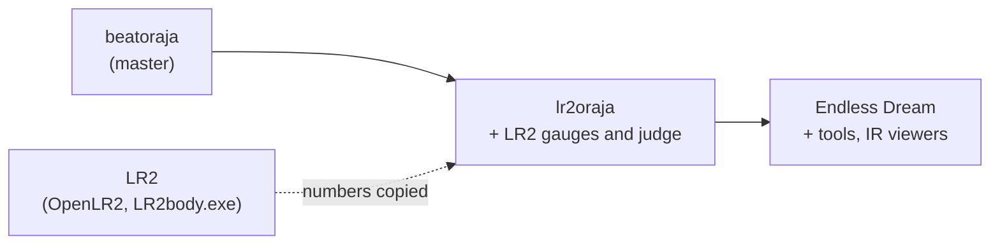

[日本語](./lr2oraja-courses.ja.md)

# lr2oraja courses compared with beatoraja, LR2 and be-music (#554)

Investigated on 2026-11-02. This note reads how lr2oraja and its fork LR2oraja Endless Dream handle courses, lists where they differ from beatoraja 0.8.9, from LR2 and from be-music's [course rules](../course.md), and gives a verdict for each difference. be-music follows LR2 for behavior outside the ruleset and beatoraja for features LR2 lacks; lr2oraja is a derivative, so it counts only where it documents LR2 behavior better than the sources be-music already uses.

**Result.** No difference calls for a change, so no issue was filed. lr2oraja's course code is beatoraja's course code, run on beatoraja's `GAUGE_LR2` class gauges with two LR2 corrections (the 2 % death border and the 32 % damage-reduction threshold). be-music's `lr2` ruleset already has both, and it goes further than lr2oraja by playing LR2's own course gauges. One value is ambiguous between the sources (the GOOD recovery of LR2's grade gauge, [D4](#d4-gauge-values-and-lamps-lr2oraja-keeps-from-beatoraja)).

## Sources

All links point at fixed commits.

| Source                 | Repository and commit                                                                                                                                                                                                                                                                                                                                     |
| ---------------------- | --------------------------------------------------------------------------------------------------------------------------------------------------------------------------------------------------------------------------------------------------------------------------------------------------------------------------------------------------------- |
| lr2oraja               | [`wcko87/lr2oraja`](https://github.com/wcko87/lr2oraja), branch `lr2oraja` at [`3db78ad`](https://github.com/wcko87/lr2oraja/tree/3db78adff969b854fb3bcc68966449bd36cf7a5b) (2024-10-31); its list of changes is the README on branch `readme` at [`c40f03c`](https://github.com/wcko87/lr2oraja/blob/c40f03cc0ad3e9cf2065e99abdd791197c39096d/README.md) |
| LR2oraja Endless Dream | [`seraxis/lr2oraja-endlessdream`](https://github.com/seraxis/lr2oraja-endlessdream) at [`d499515`](https://github.com/seraxis/lr2oraja-endlessdream/tree/d4995153b0a759859ebc8f859dd868abae39db5a)                                                                                                                                                        |
| beatoraja 0.8.9        | [`exch-bms2/beatoraja`](https://github.com/exch-bms2/beatoraja) at [`8357404`](https://github.com/exch-bms2/beatoraja/tree/83574048ba489082eb46df7fe9806b464bf1f526), the commit be-music's other documents cite                                                                                                                                          |
| LR2                    | [OpenLR2](https://github.com/GOMazk/OpenLR2) at [`583a385`](https://github.com/GOMazk/OpenLR2/tree/583a38503555e59c4bafa49d60b9d0714c9007c2), and `LR2body.exe` as [course.md](../course.md) cites it                                                                                                                                                     |
| be-music               | [course.md](../course.md), `packages/player-engine/src/course/` and `packages/player-engine/src/ruleset/course.ts`                                                                                                                                                                                                                                        |

lr2oraja tracks beatoraja's `master` and merges it regularly (last merge 2024-10-31, so it predates 0.8.9). Its own commits are the ones by `wcko87` on branch `lr2oraja`; none of them touches course selection, course results or IR. The ones that change course play are [`2e4dc9a`](https://github.com/wcko87/lr2oraja/commit/2e4dc9a0ec) (LR2 gauges and judge as the default for every mode) and [`3d64953`](https://github.com/wcko87/lr2oraja/commit/3d64953581) (LR2 gauges die below 2 %, damage reduction below 32 %). Differences that come only from the older beatoraja base (refactors, logging) are left out. Endless Dream is built on the same LR2 rule set (its `BMSPlayerRule` is lr2oraja's) and adds tools and IR viewers around it.

## Summary

| #                                                                     | Area                                    | lr2oraja / Endless Dream                     | beatoraja 0.8.9               | LR2                              | be-music                                     | Verdict                        |
| --------------------------------------------------------------------- | --------------------------------------- | -------------------------------------------- | ----------------------------- | -------------------------------- | -------------------------------------------- | ------------------------------ |
| [D1](#d1-default-gauge-table-for-a-course-without-a-gauge-constraint) | Gauge table without a `gauge_*`         | `LR2` class gauges for every mode            | by play mode                  | LR2's own course gauges          | `lr2`: LR2's; `beatoraja`: by play mode      | No change                      |
| [D2](#d2-an-explicit-gauge-constraint-under-lr2-judging)              | Explicit `gauge_5k` … `gauge_24k`       | honored, on LR2 judge windows                | honored                       | no such constraint               | `lr2` ignores it                             | No change                      |
| [D3](#d3-death-border-and-damage-reduction-on-the-lr2-class-gauges)   | Death border, damage reduction          | dies below 2, × 0.6 below 32                 | dies at 0, × 0.6 below 30     | dies below 2, × 0.6 below 32     | `lr2` as LR2; `beatoraja` as beatoraja       | No change                      |
| [D4](#d4-gauge-values-and-lamps-lr2oraja-keeps-from-beatoraja)        | Gauge values, HARD / DEATH picks, lamps | beatoraja's `*CLASS_LR2` values and lamps    | same                          | GRADE / GRADE-HARD / GRADE-DEATH | `lr2` as LR2                                 | No change; one value ambiguous |
| [D5](#d5-option-locks-for-grade-courses)                              | Option locks                            | beatoraja's                                  | `CLASS` / `MIRROR` / `RANDOM` | wider resets for GRADE           | beatoraja's, plus LR2's resets for LR2 GRADE | No change                      |
| [D6](#d6-stage-failure-and-giving-up)                                 | Stage failure, ESC                      | beatoraja's (ESC fails the course)           | same                          | ESC goes on while HP ≥ 2         | ESC fails the course (deliberate)            | No change                      |
| [D7](#d7-course-result-and-records)                                   | Course result, records                  | beatoraja's, rule tagged `LR2`               | same, rule by mode            | `CheckCourseClear`               | per ruleset                                  | No change                      |
| [D8](#d8-ir)                                                          | IR                                      | beatoraja's; Endless Dream adds a send guard | `release` and score update    | LR2IR                            | Leaderboard                                  | No change                      |
| [D9](#d9-endless-dream-constant-counts-as-assist)                     | CONSTANT                                | Endless Dream: assist, so ASSIST EASY        | no assist flag                | no such option                   | no assist flag                               | No change                      |
| [D10](#d10-endless-dream-tools-around-courses)                        | Downloader, trainers                    | Endless Dream only                           | none                          | none                             | none                                         | Out of scope                   |

## Differences

### D1. Default gauge table for a course without a gauge constraint

- **lr2oraja.** `BMSPlayerRule.getBMSPlayerRule` walks `BMSPlayerRuleSet.LR2`, whose only rule `LR2` names no mode, so it returns `LR2` (`GaugeProperty.LR2`, `JudgeProperty.LR2`) for every mode ([BMSPlayerRule.java L43-L55](https://github.com/wcko87/lr2oraja/blob/3db78adff969b854fb3bcc68966449bd36cf7a5b/src/bms/player/beatoraja/play/BMSPlayerRule.java#L43-L55)). `GrooveGauge.create` falls back to that rule's gauge when the course names none ([GrooveGauge.java L160-L178](https://github.com/wcko87/lr2oraja/blob/3db78adff969b854fb3bcc68966449bd36cf7a5b/src/bms/player/beatoraja/play/GrooveGauge.java#L160-L178)), so every unconstrained course plays `CLASS_LR2` / `EXCLASS_LR2` / `EXHARDCLASS_LR2`. Endless Dream is the same ([BMSPlayerRule.java L43-L55](https://github.com/seraxis/lr2oraja-endlessdream/blob/d4995153b0a759859ebc8f859dd868abae39db5a/core/src/bms/player/beatoraja/play/BMSPlayerRule.java#L43-L55)).
- **beatoraja.** The same fallback walks `BMSPlayerRuleSet.Beatoraja` and picks the table by mode: 5 / 10 keys `FIVEKEYS`, 7 / 14 keys `SEVENKEYS`, PMS `PMS`, 24 keys `KEYBOARD` ([BMSPlayerRule.java L13-L21, L43-L55](https://github.com/exch-bms2/beatoraja/blob/83574048ba489082eb46df7fe9806b464bf1f526/src/bms/player/beatoraja/play/BMSPlayerRule.java#L13-L55)).
- **LR2.** No constraints exist; the gauge comes from the course type and the player's pick ([LR2f.cpp L27707-L27790](https://github.com/GOMazk/OpenLR2/blob/583a38503555e59c4bafa49d60b9d0714c9007c2/LR2f.cpp#L27707-L27790)).
- **be-music.** The `lr2` ruleset plays LR2's own course gauges whatever the course says; the `beatoraja` ruleset picks the table by play mode (`resolveDefaultCourseGaugeSet`) ([course.md, Course gauges](../course.md#course-gauges)).

**Verdict: no change.** Under the `lr2` ruleset be-music already plays LR2's own gauges for every course, which is closer to LR2 than lr2oraja's beatoraja class gauges. The `beatoraja` ruleset has to keep beatoraja's per-mode choice.

### D2. An explicit gauge constraint under LR2 judging

- **lr2oraja.** `GrooveGauge.create` still honors `GAUGE_5KEYS` … `GAUGE_24KEYS` ([GrooveGauge.java L123-L158](https://github.com/wcko87/lr2oraja/blob/3db78adff969b854fb3bcc68966449bd36cf7a5b/src/bms/player/beatoraja/play/GrooveGauge.java#L123-L158)), so a table course marked `gauge_7k` plays beatoraja's `SEVENKEYS` class gauges with LR2's judge windows.
- **beatoraja.** The same code, with beatoraja's windows.
- **LR2.** Has no such constraint.
- **be-music.** The `lr2` ruleset ignores `gaugeSet` ("LR2 ignores it", `RulesetCourseOptions.gaugeSet`); the `beatoraja` ruleset honors it.

**Verdict: no change.** In be-music the gauge belongs to the ruleset. Pairing beatoraja's gauges with LR2's windows is a by-product of lr2oraja replacing only the default rule, not LR2 behavior.

### D3. Death border and damage reduction on the LR2 class gauges

- **lr2oraja.** Commit [`3d64953`](https://github.com/wcko87/lr2oraja/commit/3d64953581) adds a `death` field: `CLASS_LR2`, `EXCLASS_LR2` and `EXHARDCLASS_LR2` get `death = 2`, and the first two reduce damage × 0.6 below 32 instead of 30 ([GaugeProperty.java L123-L125](https://github.com/wcko87/lr2oraja/blob/3db78adff969b854fb3bcc68966449bd36cf7a5b/src/bms/player/beatoraja/play/GaugeProperty.java#L123-L125)). `Gauge.setValue` pins the value to 0 once it falls below `death` ([GrooveGauge.java L218-L225](https://github.com/wcko87/lr2oraja/blob/3db78adff969b854fb3bcc68966449bd36cf7a5b/src/bms/player/beatoraja/play/GrooveGauge.java#L218-L225)), which the play loop reads as a failed stage. Endless Dream is the same ([GaugeProperty.java L123-L125](https://github.com/seraxis/lr2oraja-endlessdream/blob/d4995153b0a759859ebc8f859dd868abae39db5a/core/src/bms/player/beatoraja/play/GaugeProperty.java#L123-L125)).
- **beatoraja.** Reduction below 30 and no death border: a class gauge fails at 0 ([GaugeProperty.java L123-L125](https://github.com/exch-bms2/beatoraja/blob/83574048ba489082eb46df7fe9806b464bf1f526/src/bms/player/beatoraja/play/GaugeProperty.java#L123-L125), [GrooveGauge.java L218-L222](https://github.com/exch-bms2/beatoraja/blob/83574048ba489082eb46df7fe9806b464bf1f526/src/bms/player/beatoraja/play/GrooveGauge.java#L218-L222)).
- **LR2.** Damage × 0.6 while `floor(HP / 2) × 2 ≤ 30` (HP < 32) on every course gauge, and HP pinned at 0 once it was below 2 ([LR2f.cpp L1954-L1975](https://github.com/GOMazk/OpenLR2/blob/583a38503555e59c4bafa49d60b9d0714c9007c2/LR2f.cpp#L1954-L1975)).
- **be-music.** `lr2`: `LR2_COURSE_GUTS` (32, × 0.6), `death: 2`, and `isCourseStageFailed` fails a stage below 2. `beatoraja` with `gauge_lr2`: `CLASS_LR2_GUTS` (30) and failure at 0, as beatoraja 0.8.9.

**Verdict: no change.** lr2oraja agrees with LR2 here, and so does be-music's `lr2` ruleset. The `beatoraja` ruleset keeps beatoraja's numbers.

### D4. Gauge values and lamps lr2oraja keeps from beatoraja

lr2oraja changed only the death border and the reduction threshold of beatoraja's LR2 class gauges ([GaugeProperty.java L123-L125](https://github.com/wcko87/lr2oraja/blob/3db78adff969b854fb3bcc68966449bd36cf7a5b/src/bms/player/beatoraja/play/GaugeProperty.java#L123-L125)). The rest stays beatoraja's and differs from LR2:

| Pick            | lr2oraja (beatoraja)                                                                   | LR2 grade course ([LR2f.cpp L27707-L27732](https://github.com/GOMazk/OpenLR2/blob/583a38503555e59c4bafa49d60b9d0714c9007c2/LR2f.cpp#L27707-L27732)) |
| --------------- | -------------------------------------------------------------------------------------- | --------------------------------------------------------------------------------------------------------------------------------------------------- |
| up to NORMAL    | `CLASS_LR2`: +0.10 / +0.10 / +0.05, −2 / −3 / −2                                       | GRADE: +0.1 / +0.1 / **+0.04**, −2 / −3 / −2                                                                                                        |
| HARD            | `EXCLASS_LR2`: +0.10 / +0.10 / +0.05, −6 / −10 / −2, **no** TOTAL / note-count scaling | GRADE-HARD: +0.1 / +0.1 / +0.04, −6 / −10 / −2 **× the HARD damage multiplier**                                                                     |
| EX-HARD, HAZARD | `EXHARDCLASS_LR2`: +0.10 / +0.10 / +0.05, −12 / −20 / −2                               | no EX-HARD; DEATH plays GRADE-DEATH: 0 / 0 / 0, −100 / −100 / 0                                                                                     |

- **Lamps.** The course lamp comes from the class gauge: `CLASS` NORMAL, `EXCLASS` HARD, `EXHARDCLASS` EX-HARD ([ClearType.java L15-L17](https://github.com/wcko87/lr2oraja/blob/3db78adff969b854fb3bcc68966449bd36cf7a5b/src/bms/player/beatoraja/ClearType.java#L15-L17), [MusicResult.java L403-L428](https://github.com/wcko87/lr2oraja/blob/3db78adff969b854fb3bcc68966449bd36cf7a5b/src/bms/player/beatoraja/result/MusicResult.java#L403-L428)), and an assist option turns it into (LIGHT) ASSIST EASY. LR2 lamps by the pick and has no EX-HARD or assist lamp; a DEATH clear is NORMAL ([LR2f.cpp L2588-L2600](https://github.com/GOMazk/OpenLR2/blob/583a38503555e59c4bafa49d60b9d0714c9007c2/LR2f.cpp#L2588-L2600), [course.md, The course result](../course.md#the-course-result)).
- **be-music.** The `lr2` ruleset plays GRADE, GRADE-HARD (× the HARD damage multiplier) and GRADE-DEATH with LR2's lamps (`resolveLR2CourseGauge`, `resolveCourseClearLamp`).

**Verdict: no change.** be-music's `lr2` ruleset follows LR2 on every row; lr2oraja is the one that departs from LR2.

**Ambiguous: GOOD recovery on the grade gauge.** OpenLR2 gives +0.04 for GRADE and GRADE-HARD (and +0.05 for the EXPERT HARD gauge); beatoraja's `CLASS_LR2` and `EXCLASS_LR2` give +0.05, and lr2oraja keeps that without comment. OpenLR2 is a reconstruction, and this review did not check the value in `LR2body.exe`, so neither source is confirmed. be-music keeps OpenLR2's +0.04. lr2oraja adds no evidence either way.

### D5. Option locks for grade courses

- **lr2oraja and Endless Dream.** `MusicSelector._readCourse` is beatoraja's: `CLASS` turns both sides' lane options and the DP option off, `MIRROR` keeps a 1P MIRROR (and sets 2P MIRROR with FLIP) and otherwise turns them off, `RANDOM` drops lane options above index 5, and `LN` / `CN` / `HCN` set the player's LN mode ([lr2oraja L476-L520](https://github.com/wcko87/lr2oraja/blob/3db78adff969b854fb3bcc68966449bd36cf7a5b/src/bms/player/beatoraja/select/MusicSelector.java#L476-L520), [Endless Dream L480-L524](https://github.com/seraxis/lr2oraja-endlessdream/blob/d4995153b0a759859ebc8f859dd868abae39db5a/core/src/bms/player/beatoraja/select/MusicSelector.java#L480-L524), [beatoraja L470-L505](https://github.com/exch-bms2/beatoraja/blob/83574048ba489082eb46df7fe9806b464bf1f526/src/bms/player/beatoraja/select/MusicSelector.java#L470-L505)). `NO_SPEED` is read during play, as in beatoraja.
- **LR2.** A GRADE course also moves an EASY or G-ATTACK pick to GROOVE and turns off HIDDEN / SUDDEN, the assists, BATTLE, DP FLIP, the pitch and the extra modifiers ([Main.cpp L1124-L1170](https://github.com/GOMazk/OpenLR2/blob/583a38503555e59c4bafa49d60b9d0714c9007c2/Main.cpp#L1124-L1170)). lr2oraja does not replicate this.
- **be-music.** `resolveCourseLaneOptions` (beatoraja's locks) for every course, plus LR2's resets (`resolveLR2GradeCoursePlaySettings`) for a GRADE course read from `.lr2crs` or made with the course maker. Unlike beatoraja, which writes the LN mode into the player's config, be-music applies the long-note constraint to the stage charts only.

**Verdict: no change.** lr2oraja has no course-lock behavior of its own.

### D6. Stage failure and giving up

- **lr2oraja and Endless Dream.** beatoraja's play loop: a gauge at 0 moves to `STATE_FAILED` ([lr2oraja BMSPlayer.java L626-L650](https://github.com/wcko87/lr2oraja/blob/3db78adff969b854fb3bcc68966449bd36cf7a5b/src/bms/player/beatoraja/play/BMSPlayer.java#L626-L650)); with the death border (D3) that happens below 2. ESC during play also moves to `STATE_FAILED` ([L891-L922](https://github.com/wcko87/lr2oraja/blob/3db78adff969b854fb3bcc68966449bd36cf7a5b/src/bms/player/beatoraja/play/BMSPlayer.java#L891-L922)), and the result then fails the course and adds the notes of the stages not reached to its BP ([MusicResult.java L429-L440](https://github.com/wcko87/lr2oraja/blob/3db78adff969b854fb3bcc68966449bd36cf7a5b/src/bms/player/beatoraja/result/MusicResult.java#L429-L440)). Endless Dream adds an `STATE_ABORTED` that drops a play given up before any judgment, but only outside courses ([BMSPlayer.java L1122-L1132](https://github.com/seraxis/lr2oraja-endlessdream/blob/d4995153b0a759859ebc8f859dd868abae39db5a/core/src/bms/player/beatoraja/play/BMSPlayer.java#L1122-L1132)).
- **beatoraja.** The same ([BMSPlayer.java L641-L667, L944-L977](https://github.com/exch-bms2/beatoraja/blob/83574048ba489082eb46df7fe9806b464bf1f526/src/bms/player/beatoraja/play/BMSPlayer.java#L641-L977)).
- **LR2.** A given-up stage shows FAILED, and the course goes on to the next stage while HP ≥ 2 (`LR2body.exe`, [course.md, Ending on failure](../course.md#ending-on-failure); compare [LR2f.cpp L2588](https://github.com/GOMazk/OpenLR2/blob/583a38503555e59c4bafa49d60b9d0714c9007c2/LR2f.cpp#L2588)).
- **be-music.** ESC gives up the course, on purpose ([course.md, Ending on failure](../course.md#ending-on-failure)).

**Verdict: no change.** lr2oraja keeps beatoraja's handling, which is what be-music already chose over LR2's.

### D7. Course result and records

- **lr2oraja and Endless Dream.** beatoraja's accumulation in `MusicResult`: judgment counts summed, a FULL COMBO when Σ notes equals the course max combo, PERFECT / MAX by GOOD and GREAT counts, the class gauge's lamp otherwise, and unreached notes added to BP ([lr2oraja L367-L441](https://github.com/wcko87/lr2oraja/blob/3db78adff969b854fb3bcc68966449bd36cf7a5b/src/bms/player/beatoraja/result/MusicResult.java#L367-L441), [Endless Dream L379-L453](https://github.com/seraxis/lr2oraja-endlessdream/blob/d4995153b0a759859ebc8f859dd868abae39db5a/core/src/bms/player/beatoraja/result/MusicResult.java#L379-L453), [beatoraja L367-L443](https://github.com/exch-bms2/beatoraja/blob/83574048ba489082eb46df7fe9806b464bf1f526/src/bms/player/beatoraja/result/MusicResult.java#L367-L443)). Because of D1 every score, course scores included, is tagged with the rule `LR2` ([JudgeManager.java L158](https://github.com/wcko87/lr2oraja/blob/3db78adff969b854fb3bcc68966449bd36cf7a5b/src/bms/player/beatoraja/play/JudgeManager.java#L158)).
- **be-music.** The same sums, BP and FULL COMBO rule, the lamp per ruleset (D4), and records kept per judge ruleset (`resolveCoursePlayedRuleset`), which is what the `LR2` rule tag amounts to.

**Verdict: no change.**

### D8. IR

- **lr2oraja.** beatoraja's course IR path is unchanged: a course score is sent when it may update and the course is `release` ([CourseResult.java L96](https://github.com/wcko87/lr2oraja/blob/3db78adff969b854fb3bcc68966449bd36cf7a5b/src/bms/player/beatoraja/result/CourseResult.java#L96)). Its README says it "is not intended to work with IRs" ([README.md](https://github.com/wcko87/lr2oraja/blob/c40f03cc0ad3e9cf2065e99abdd791197c39096d/README.md)).
- **Endless Dream.** Adds `!isForceNoIRSend()` to the course send ([CourseResult.java L98](https://github.com/seraxis/lr2oraja-endlessdream/blob/d4995153b0a759859ebc8f859dd868abae39db5a/core/src/bms/player/beatoraja/result/CourseResult.java#L98)), but only the FREQ trainer sets that flag, and the trainer is off in courses ([BMSPlayer.java L249-L267](https://github.com/seraxis/lr2oraja-endlessdream/blob/d4995153b0a759859ebc8f859dd868abae39db5a/core/src/bms/player/beatoraja/play/BMSPlayer.java#L249-L267)), so course sends behave as beatoraja's. Its LR2IR viewer is read-only and per chart MD5, with no course rankings ([LR2IRAccessor.java L100-L111](https://github.com/seraxis/lr2oraja-endlessdream/blob/d4995153b0a759859ebc8f859dd868abae39db5a/core/src/bms/player/beatoraja/ir/LR2IRAccessor.java#L100-L111)).
- **be-music.** The Leaderboard takes every run except full AUTO and replay playback, ranks by its own rules, keeps `release: false` courses off rankings, and refuses runs at another tempo for records (`courseRunKeepsRecord`).

**Verdict: no change.**

### D9. Endless Dream: CONSTANT counts as assist

- **Endless Dream.** beatoraja 0.8.8's visual CONSTANT raises the assist level to 2 ([BMSPlayer.java L298-L302](https://github.com/seraxis/lr2oraja-endlessdream/blob/d4995153b0a759859ebc8f859dd868abae39db5a/core/src/bms/player/beatoraja/play/BMSPlayer.java#L298-L302), [issue #42](https://github.com/seraxis/lr2oraja-endlessdream/issues/42)), so a course cleared with it gets ASSIST EASY ([MusicResult.java L415-L417](https://github.com/seraxis/lr2oraja-endlessdream/blob/d4995153b0a759859ebc8f859dd868abae39db5a/core/src/bms/player/beatoraja/result/MusicResult.java#L415-L417)). The project's own notes disagree on the wording: `CHANGELOG.md` 0.4.0 says courses with CONSTANT "no longer" grant an assist clear (PR [#86](https://github.com/seraxis/lr2oraja-endlessdream/pull/86)), while `doc/WHATSNEW.md` says they are now ASSIST CLEAR. This note reads the code at the pinned commit, which gives ASSIST EASY.
- **beatoraja 0.8.9.** Sets no assist flag for CONSTANT. **LR2** has no such option.
- **be-music.** Visual CONSTANT is a drawing setting with no assist flag; the Leaderboard decides what to rank ([play-options.md, Visual CONSTANT](../play-options.md#visual-constant)).

**Verdict: no change.** A community scoring policy of one derivative, not LR2 or beatoraja behavior.

### D10. Endless Dream: tools around courses

Endless Dream downloads a course's missing charts by MD5 ([MusicSelectCommand.java L139-L151](https://github.com/seraxis/lr2oraja-endlessdream/blob/d4995153b0a759859ebc8f859dd868abae39db5a/core/src/bms/player/beatoraja/select/MusicSelectCommand.java#L139-L151)), applies the Random Trainer's lane order in course stages that allow random options ([BMSPlayer.java L414-L418](https://github.com/seraxis/lr2oraja-endlessdream/blob/d4995153b0a759859ebc8f859dd868abae39db5a/core/src/bms/player/beatoraja/play/BMSPlayer.java#L414-L418)), and lets the Judge Trainer override the judge rank in courses too, marking wider windows as assist ([L284-L296](https://github.com/seraxis/lr2oraja-endlessdream/blob/d4995153b0a759859ebc8f859dd868abae39db5a/core/src/bms/player/beatoraja/play/BMSPlayer.java#L284-L296)).

**Verdict: out of scope.** These are tools of one client, not course rules of LR2 or beatoraja.

## Not course-specific

lr2oraja's other LR2 changes (judge windows interpolated between LR2's ranks, VERY EASY as NORMAL, the LN release rules, LR2's default TOTAL) apply to course stages like any play. be-music's `lr2` ruleset already matches the two that reach course gauges: the HARD damage multiplier (`resolveLR2HardDamageMultiplier` is lr2oraja's `MODIFY_DAMAGE`, equal to OpenLR2's `dmg` at [LR2f.cpp L27629-L27653](https://github.com/GOMazk/OpenLR2/blob/583a38503555e59c4bafa49d60b9d0714c9007c2/LR2f.cpp#L27629-L27653)) and the default TOTAL (`resolveLR2DefaultTotal` equals lr2oraja's `160 + (N + clamp(N − 400, 0, 200)) × 0.16`).

What lr2oraja lacks from LR2's courses (reading `.lr2crs`, NONSTOP, the five-stage limit, the course maker on the select screen, RANDOM MIX) it lacks because beatoraja does; be-music follows LR2 there ([course.md](../course.md)).
