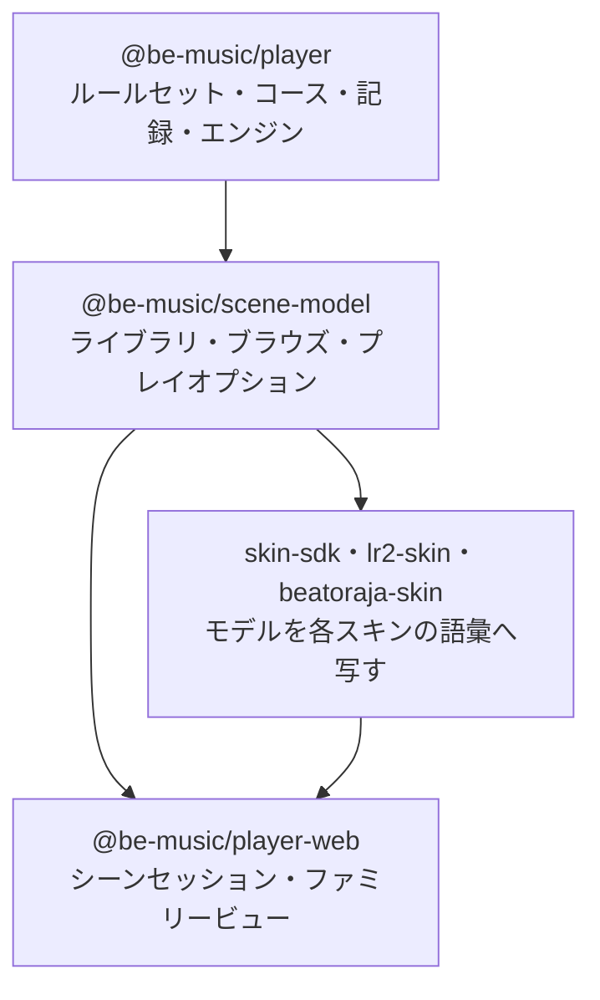
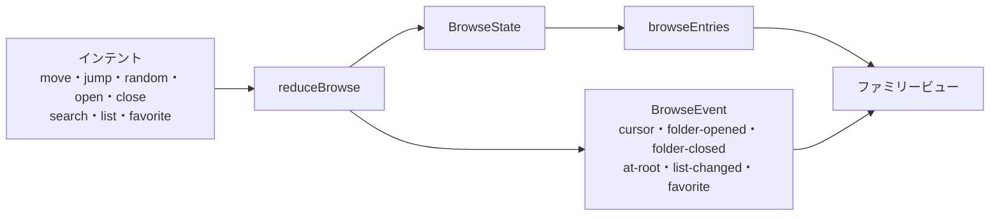

[English version](./scene-model.md)

# シーンモデル

`@be-music/scene-model` は、プレイヤーの各画面が何を表示し、どう振る舞うかを、それを描くスキンの種類に関係なく
保持します（[ADR 0002](./adr/0002-scene-model-package.ja.md)）。標準・LR2・beatoraja の各スキンの種類はこれまで
一覧のモデルを二つ、プレイ状態の記録を二通り、結果の形を二つ持っていて、そのずれがコース対応で見つかった不具合の
大半の原因でした（[ADR 0001](./adr/0001-skin-families-only-draw.ja.md)）。ここにあるモデルが、各画面のセッションが
扱う唯一の実装です。スキンの種類は描画だけを受け持ちます。

このパッケージは実行環境に依存しません。レンダラーを import せず、DOM や Node のグローバルも時計も読まず、乱数も
引きません。時刻と乱数は入力として受け取ります。`pnpm run check` が実行環境に依存しないコードの lint 規則でこれを
守らせ、テストが `@be-music/chart`・`@be-music/json`・`@be-music/player` 以外に依存していないことを確かめます。

モデルは、これまでの選曲シーンの振る舞いから導いています。標準 / LR2 のシーンと beatoraja のシーンで違っていた
ところは、互換性の方針に従って一つを選びました。LR2 の振る舞い、LR2 にない機能は beatoraja の振る舞いです。
[振る舞いの選択](#振る舞いの選択) に一つずつ挙げています。

## ライブラリ

ライブラリは選曲画面が一覧する対象です。譜面（`LibraryChart`）、それをまとめたフォルダのバー（`LibraryFolder`）、
コースフォルダとそのコース（`LibraryCourse`・`LibraryCourseStage`）、一覧の 1 本のバー（`LibraryEntry`）からなります。
`Library` は譜面とコースフォルダの組で、ブラウザプレイヤーの曲コレクションもその一つです。

- **ルートのフォルダ**。`groupChartsByFolder` は譜面をディレクトリの最初の区切りでまとめ（ディレクトリがなければ
  ソースのラベル）、フォルダを日本語を考慮したラベル順に、各フォルダの譜面をソースの順に並べます。
  `libraryRootFolders` はそのフォルダ、続いてコースフォルダを並べ、譜面の一覧ごとに結果を保持します。
- **キーモード**。`resolveLibraryChartPlayVariant` は譜面のプレイバリアントです（`@be-music/chart` のレーンモードの
  規則を譜面ごとにキャッシュ。ライブラリの読み込み側は `seedLibraryChartPlayVariant` で値を先に入れます）。
  `resolveLibraryChartKeyMode` はキーモードフィルターが譜面を並べるキーモードで、bmson の `mode_hint` が示すもの、
  なければプレイバリアントです。
- **項目のキー**。`libraryEntryKey` はライブラリを作り直してもバーを指せる名前です。譜面は id、フォルダはラベル、
  コースは id で指します（用語集のフォーカスキー）。

項目の型は、ブラウザプレイヤーがずっと使ってきたフィールド名（`song`・`songs`・種類 `'song'`）のままなので、利用側
も be-music スキンも変更なしで読めます。`@be-music/skin-sdk` はこれらを以前の名前で export します。
`BrowserSongEntry` は `LibraryChart`、`BrowserFolderNode` は `LibraryFolder`、`BrowserCourseEntry` は
`LibraryCourse`、`BrowserCourseStage` は `LibraryCourseStage`、`BrowserBrowseEntry` は `LibraryEntry`、
`BrowserSongSourceKind` は `ChartSourceKind` です。

## 一覧（ブラウズ）

一覧の状態（`BrowseState`）は、プレイヤーがライブラリのどこにいて、一覧がどんな形かを表します。開いている
フォルダ、各階層のカーソル、検索文字列、一覧のオプション（ソート、キーモードフィルター、難易度フィルター）、
お気に入りです。状態はイミュータブルで、コマンドを `reduceBrowse` に渡すと新しい状態と、画面の効果音や
アニメーションのために何が起きたかを表すイベントが返ります。表示する一覧は状態から導きます。

### 一覧

`browseEntries(library, state)` が並べるのは次のとおりです。

- ルートではフォルダのバー。譜面フォルダ、続いてコースフォルダです。
- ルートで検索中は、ライブラリのうち一致するすべての譜面を、フォルダから出して並べます。
- 譜面フォルダの中ではその譜面、コースフォルダの中ではそのコースです。
- そのうえでフィルター、どの階層でも検索、ソートを適用します。

検索は、譜面のタイトル・サブタイトル・アーティスト・ジャンル・ファイル名、フォルダのラベル、コースの名前に対して、
前後の空白を除いて小文字にした検索文字列で一致を見ます。難易度フィルターはその `#DIFFICULTY` を持つ譜面を並べます
（難易度のない譜面は `ALL` のときだけ並びます）。キーモードフィルターはそのキーモードの譜面とコースを並べます
（キーモードのないコースと NEW COURSE のバーは残ります）。フォルダのバーは除かれません。ソートは LR2 のもの
（`OFF`・`LEVEL`・`TITLE`・`CLEAR`）と beatoraja のもの（`ARTIST`・`GENRE`・`BPM`・`NOTES`・`LASTPLAY`）です。
フォルダはラベル順、コースは元の順のまま、並べ替えは安定です。記録がソートに使えるようになるまで、`CLEAR` は
タイトル順、`LASTPLAY` はライブラリの順です。

一覧は、ライブラリ・検索・一覧のオプションが変わらないあいだ開いているパスごとに保持されるので、選曲画面は毎
フレーム読んでかまいません。

### コマンド

| コマンド   | 内容                                                                                     | イベント                         |
| ---------- | ---------------------------------------------------------------------------------------- | -------------------------------- |
| `move`     | カーソルを指定のバー数だけ動かします。端を越えると反対側へ回ります                       | 求めた歩数を持つ `cursor`        |
| `jump`     | カーソルをバーに置きます。一覧の範囲に収めます（Home / End、クリック）                   | 最短の歩数を持つ `cursor`        |
| `random`   | フォーカス中以外のバーへランダムに置きます。乱数は入力です                               | `cursor`                         |
| `open`     | フォーカス中のフォルダのバーを開き、先頭のバーに置きます                                 | `folder-opened`                  |
| `close`    | 開いたときのフォルダのバーへ戻ります。ルートでは戻る先がありません                       | `folder-closed` または `at-root` |
| `search`   | 検索文字列を設定します。検索内容が変わるとカーソルは先頭へ戻ります                       | `list-changed`                   |
| `list`     | ソートやフィルターを変えます。フォーカス中のバーが残っていれば、カーソルはそこに残ります | `list-changed`                   |
| `favorite` | フォーカス中の譜面を beatoraja の曲 / 譜面のお気に入りに入れたり外したりします           | `favorite`                       |

何も変えないコマンドは同じ状態と `none` イベントを返します。`wrappedCursorDelta` はジャンプを一覧を回る最短の歩数に
直し、バーが 2〜3 本の一覧ではキーの向きを保ちます。

### スナップショット

`captureBrowse` は一覧の状態を、プレイが通るシーンやライブラリの作り直しをまたいで保持できる素のデータ
（`BrowseSnapshot`）にします。フォルダはラベル、各階層のカーソル、フォーカス中のバーのキー、検索、一覧のオプション、
お気に入りです。`restoreBrowse` はその時点のライブラリに対して戻します。

1. 検索・一覧のオプション・お気に入りを保存したとおりに戻します。
2. フォルダのパスを一致する限りラベルでたどり、各親のカーソルを開いたフォルダのバーに置きます。
3. 表示中の一覧のカーソルは、保存したバーが残っていればそこへ、なければ保存した位置を一覧の範囲に収めて置きます。
   たどる途中で止まったときは、止まった階層で保存したカーソルを範囲に収めて使います。

これでコースフォルダの復元の修正をすべて満たします。ルートでは譜面フォルダのあとにコースフォルダが並ぶので、
コースフォルダの中に残したカーソルが戻ります。保持するのはどの階層でも実際のカーソルです。コースが終わったあとは、
NONSTOP がライブラリを置き換えていても、コースのバーをキーで見つけ直します。
`browseSnapshotFromSelectNavigation` と `browseSnapshotFromBeatorajaSelect` は、現在の選曲シーンが保持する
スナップショットを読み込みます。

### 振る舞いの選択

| 振る舞い                                 | 標準 / LR2 の選曲                                                                          | beatoraja の選曲                                                                    | モデル                                                                                           |
| ---------------------------------------- | ------------------------------------------------------------------------------------------ | ----------------------------------------------------------------------------------- | ------------------------------------------------------------------------------------------------ |
| キーモードフィルター中のフォルダのバー   | すべて並ぶ                                                                                 | 絞り込んだ譜面からまとめ直し、空のものは消える                                      | すべて並ぶ（LR2）                                                                                |
| 譜面のキーモード                         | bmson の `mode_hint`、なければプレイバリアント。24 鍵は 7 / 14 に寄せる                    | プレイバリアント。24 鍵は別のモード                                                 | bmson の `mode_hint`、なければプレイバリアント。24 鍵は別のモード（LR2 に 24 鍵はない）          |
| キーモードフィルターの値                 | 全部、5・7・10・14・9 鍵                                                                   | 24 鍵と 24 鍵 DP を加える                                                           | 両方（`KEYS_24`・`KEYS_48`）                                                                     |
| 難易度フィルター                         | あり                                                                                       | なし                                                                                | あり（LR2）                                                                                      |
| 検索が見るフィールド                     | タイトル・サブタイトル・アーティスト・ジャンル・ファイル名、フォルダのラベル、コースの名前 | タイトル・サブタイトル・アーティスト・ジャンル                                      | 標準 / LR2 のもの                                                                                |
| コースフォルダの中での検索               | コースを名前で絞り込む                                                                     | 絞り込まない                                                                        | 絞り込む（LR2）                                                                                  |
| 検索文字列                               | 前後の空白を除いて小文字に                                                                 | 小文字に                                                                            | 前後の空白を除いて小文字に。表示用には入力したまま保持                                           |
| ソート                                   | オフ・レベル・タイトル・クリア                                                             | 既定・タイトル・アーティスト・ジャンル・レベル・BPM・ノーツ数・最終プレイ           | 両方                                                                                             |
| ソート中のルートのフォルダ               | ラベル順に並べる                                                                           | 並べ替えない                                                                        | ラベル順（LR2）                                                                                  |
| 文字列の順序                             | 実行環境のロケール、大文字小文字を区別しない                                               | 日本語ロケール                                                                      | 実行環境のロケール、大文字小文字を区別しない                                                     |
| レベルの順序                             | `parseFloat`、なしは最後、同じレベルはタイトル順                                           | `parseInt`、なしは最後、元の順                                                      | `parseFloat`、なしは最後、同じレベルはタイトル順                                                 |
| ソートやフィルターを変えたあとのカーソル | 先頭へ                                                                                     | フォーカス中のバーに残る。なければ範囲に収める                                      | フォーカス中のバーに残る。なければ範囲に収める（プレイヤーの位置を保つ）                         |
| 検索を変えたあとのカーソル               | 先頭へ                                                                                     | 先頭へ                                                                              | 先頭へ                                                                                           |
| 端を越える移動                           | 回り込む                                                                                   | 回り込む                                                                            | 回り込む                                                                                         |
| Home / End とクリック                    | クリックでそのバーに置く                                                                   | Home / End は範囲に収める                                                           | `jump` は範囲に収める                                                                            |
| ランダム選曲                             | なし                                                                                       | フォーカス中以外のバーをランダムに                                                  | あり（beatoraja）。乱数は入力                                                                    |
| ルートで戻る                             | 何もしない                                                                                 | キャンセル音を鳴らして画面を出る                                                    | `at-root` イベント。セッションが決める                                                           |
| お気に入り                               | なし                                                                                       | 曲と譜面の二つ。フォルダのバーではその最初の譜面に付く                              | 曲（楽曲）と譜面の二つ。フォーカス中の譜面にだけ付く                                             |
| スナップショットの内容                   | フォルダのパス、最も深い一覧のカーソル                                                     | フォルダのパス、階層ごとのカーソル、フィルター、ソート、LN モード、お気に入り、検索 | フォルダのパス、階層ごとのカーソル、フォーカス中のバーのキー、検索、一覧のオプション、お気に入り |
| 復元時の親のカーソル                     | 0（戻ると最初のフォルダのバーに着いた）                                                    | 保存したとおり                                                                      | 開いたフォルダのバー。ラベルで探す                                                               |
| フォルダがなくなっていたときの復元       | 何も戻さない                                                                               | ルートの、そこで保存したカーソル                                                    | パスが一致するところまで、そこで保存したカーソル。`restoredDepth` でセッションに伝える           |
| 譜面フォルダが一つだけの新しいライブラリ | それを開く                                                                                 | ルート                                                                              | セッションに任せる                                                                               |

beatoraja の LN モードの上書き（LNMODE ボタン）は一覧の状態には含めません。まだ何もそれでプレイしないので、モデルにも
入れていません。

## プレイオプション

`PlayOptions` はプレイ前にプレイヤーが選ぶものです。ハイスピードと HS-FIX、オートプレイ、BGA の表示と大きさ、
スコアグラフ、一覧のソートとフィルター、サイドごとの HIDDEN / SUDDEN とレーンカバーの高さ・オンオフ、オート
スクラッチ、DP FLIP、サイドごとの配置変更とゲージの種類です。`@be-music/skin-sdk` は `BeMusicPlayOptions` として
export します。

- `DEFAULT_PLAY_OPTIONS` はプレイヤーの初期値です（ハイスピード 2.0、BGA はオンで拡大、スコアグラフはオン）。
- `PLAY_OPTION_CHOICES` は列挙またはオンオフのオプションの選択肢を、LR2 のボタンの巡回順に並べます（`BGA_CYCLE`・
  `SORT_CYCLE`・`HIDDEN_SUDDEN_CYCLE` など）。`nextChoice` と `cyclePlayOptionValue` はそれを両方向にたどります。
- `resolvePlayOptionValue` は型のない入力（be-music スキン、保存した設定）から設定された値を検証します。選択肢に
  ない値は捨て、数値は範囲に収めます（`clampHiSpeed`・`clampShutter`）。`resolvePlayOptions` は保存されたオプション
  を欠けのない正しい値にします。
- `isListPlayOption` は一覧を変えるオプションを示します。
- ハイスピードの範囲（`HISPEED_MIN`〜`HISPEED_MAX`、`HISPEED_STEP`、`snapHiSpeed`）、HS-FIX 中の 1 段の変更
  （`stepPlayerHiSpeed`。プレイヤーのハイスピードはその刻みで動き、描画に使う値はそれに譜面の HS-FIX 倍率を掛けた
  もの）、なめらかなスクロールの変化（`easeHiSpeed`・`HiSpeedTransition`）。

## 選曲側のヘルパーの移動先

| ヘルパー                                                           | 移動前                              | 移動後                                                                   |
| ------------------------------------------------------------------ | ----------------------------------- | ------------------------------------------------------------------------ |
| `BrowserSongEntry`・`BrowserFolderNode`・`BrowserCourseEntry` など | `@be-music/skin-sdk`                | `LibraryChart`・`LibraryFolder`・`LibraryCourse` など（skin-sdk に別名） |
| `BeMusicPlayOptions` とその値の型                                  | `@be-music/skin-sdk`                | `PlayOptions` など（skin-sdk に別名）                                    |
| `groupSongsByFolder`・`resolveChartPlayVariant`                    | `player-web` の collection          | `groupChartsByFolder`・`resolveLibraryChartPlayVariant`（再 export）     |
| `matchesSearchQuery`・`wrappedCursorDelta`                         | `player-web` のコアの選曲           | 同じ名前（再 export）                                                    |
| コアの選曲のソートと難易度フィルター                               | `player-web` のコアの選曲（非公開） | `sortLibraryEntries`・`chartMatchesDifficultyFilter`                     |
| `resolveSelectNavigation`                                          | `player-web` のコアの選曲           | そのまま。`restoreBrowse` の上に実装                                     |
| `DEFAULT_PLAY_OPTIONS`、オプションの巡回順                         | `player-web` のコアの選曲           | 同じ名前（再 export）                                                    |
| `resolveSkinPlayOptionValue`・`cycleSkinPlayOptionValue`           | `player-web` のコアの選曲           | `resolvePlayOptionValue`・`cyclePlayOptionValue`（旧名で再 export）      |
| ハイスピードの範囲と刻み                                           | `player-web` の `scene/hi-speed.ts` | 同じ名前（再 export）                                                    |

各シーンはまだ自分の一覧の状態を持っています。Web ランタイムのシーンセッションがこれらのモデルへ移ります。
