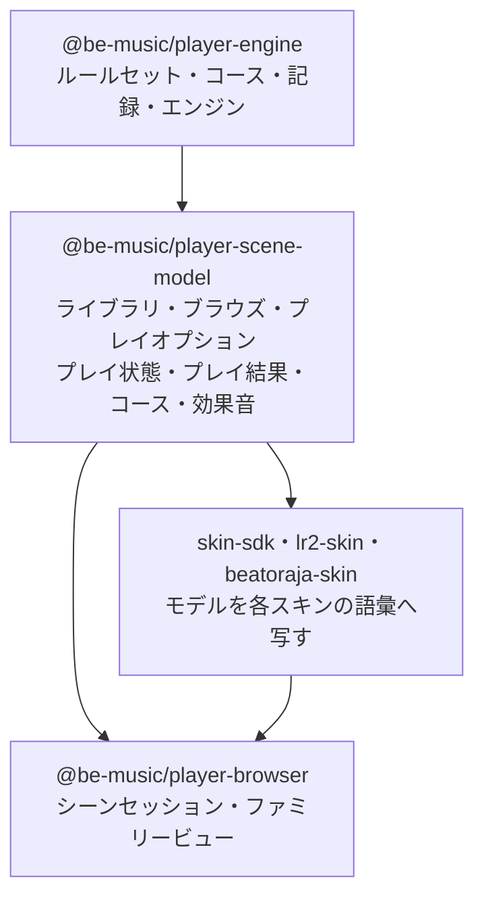
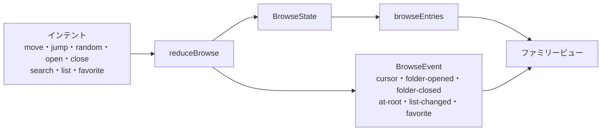
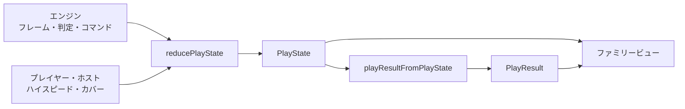

[English version](./scene-model.md)

# シーンモデル

`@be-music/player-scene-model` は、プレイヤーの各画面が何を表示し、どう振る舞うかを、それを描くスキンの種類に関係なく
保持します（[ADR 0002](./adr/0002-scene-model-package.ja.md)）。標準・LR2・beatoraja の各スキンの種類はこれまで
一覧のモデルを二つ、プレイ状態の記録を二通り、結果の形を二つ持っていて、そのずれがコース対応で見つかった不具合の
大半の原因でした（[ADR 0001](./adr/0001-skin-families-only-draw.ja.md)）。ここにあるモデルが、各画面のセッションが
扱う唯一の実装です。スキンの種類は描画だけを受け持ちます。

このパッケージは実行環境に依存しません。レンダラーを import せず、DOM や Node のグローバルも時計も読まず、乱数も
引きません。時刻と乱数は入力として受け取ります。`pnpm run check` が実行環境に依存しないコードの lint 規則で Node の
組み込みモジュールと DOM や Node のグローバルを、決定的な判定の lint 規則で時計、タイマー、`Math.random` を禁じ、
テストが `@be-music/chart-model`・`@be-music/chart-source`・`@be-music/player-engine` 以外に依存していないことを確かめます。

モデルは、これまでの各シーンの振る舞いから導いています。標準 / LR2 のシーンと beatoraja のシーンで違っていた
ところは、互換性の方針に従って一つを選びました。LR2 の振る舞い、LR2 にない機能は beatoraja の振る舞いです。
[一覧の振る舞いの選択](#振る舞いの選択) と [プレイ状態の振る舞いの選択](#振る舞いの選択-1) に一つずつ挙げています。

## ライブラリ

ライブラリは選曲画面が一覧する対象です。譜面（`LibraryChart`）、それをまとめたフォルダのバー（`LibraryFolder`）、
コースフォルダとそのコース（`LibraryCourse`・`LibraryCourseStage`）、一覧の 1 本のバー（`LibraryEntry`）からなります。
`Library` は譜面とコースフォルダの組で、ブラウザプレイヤーの譜面コレクションもその一つです。

- **ルートのフォルダ**。`groupChartsByFolder` は譜面をディレクトリの最初の区切りでまとめ（ディレクトリがなければ
  ソースのラベル）、フォルダを日本語を考慮したラベル順に、各フォルダの譜面をソースの順に並べます。
  `libraryRootFolders` はそのフォルダ、続いてコースフォルダを並べ、譜面の一覧ごとに結果を保持します。
- **キーモード**。`resolveLibraryChartPlayVariant` は譜面のプレイバリアントです（`@be-music/chart-model` のレーンモードの
  規則を譜面ごとにキャッシュ。ライブラリの読み込み側は `seedLibraryChartPlayVariant` で値を先に入れます）。
  `resolveLibraryChartKeyMode` はキーモードフィルターが譜面を並べるキーモードで、bmson の `mode_hint` が示すもの、
  なければプレイバリアントです。
- **項目のキー**。`libraryEntryKey` はライブラリを作り直してもバーを指せる名前です。譜面は id、フォルダはラベル、
  コースは id で指します（用語集のフォーカスキー）。

項目は用語集の「譜面」の語に従います。譜面のバーは `{ kind: 'chart', chart }`、フォルダは `charts` に譜面を並べ、
コースのステージは見つかった譜面を `chart` に持ち、`Library` は `charts` を持ちます。以前はブラウザプレイヤーの
`song`・`songs`・`'song'` という名前のままでした。`@be-music/player-skin-sdk` はこれらの型をこの名前で再 export し、
`Browser*` の別名は削除しました（`BrowserSongEntry` は `LibraryChart`、`BrowserFolderNode` は `LibraryFolder`、
`BrowserCourseEntry` は `LibraryCourse`、`BrowserCourseStage` は `LibraryCourseStage`、`BrowserBrowseEntry` は
`LibraryEntry`、`BrowserSongSourceKind` は `ChartSourceKind` でした）。

## 一覧（ブラウズ）

一覧の状態（`BrowseState`）は、プレイヤーがライブラリのどこにいて、一覧がどんな形かを表します。開いている
フォルダ、各階層のカーソル、検索文字列、一覧のオプション（ソート、キーモードフィルター、難易度フィルター）、
お気に入りです。状態はイミュータブルで、コマンドを `reduceBrowse` に渡すと新しい状態と、画面の効果音や
アニメーションのために何が起きたかを表すイベントが返ります。表示する一覧は状態から導きます。

### 一覧

`browseEntries(library, state)` が並べるのは次のとおりです。

- ルートではフォルダのバー。譜面フォルダ、続いてコースフォルダです。
- ルートで検索中は、ライブラリのうち一致するすべての譜面を、フォルダから出して並べます。
- 譜面フォルダの中ではその譜面、コースフォルダの中ではそのコースです。
- そのうえでフィルター、どの階層でも検索、ソートを適用します。

検索は、譜面のタイトル・サブタイトル・アーティスト・ジャンル・ファイル名、フォルダのラベル、コースの名前に対して、
前後の空白を除いて小文字にした検索文字列で一致を見ます。難易度フィルターはその `#DIFFICULTY` を持つ譜面を並べます
（難易度のない譜面は `ALL` のときだけ並びます）。キーモードフィルターはそのキーモードの譜面とコースを並べます
（キーモードのないコースと NEW COURSE のバーは残ります）。フォルダのバーは除かれません。ソートは LR2 のもの
（`OFF`・`LEVEL`・`TITLE`・`CLEAR`）と beatoraja のもの（`ARTIST`・`GENRE`・`BPM`・`NOTES`・`LASTPLAY`）です。
フォルダはラベル順、コースは元の順のまま、並べ替えは安定です。記録がソートに使えるようになるまで、`CLEAR` は
タイトル順、`LASTPLAY` はライブラリの順です。

一覧は、ライブラリ・検索・一覧のオプションが変わらないあいだ開いているパスごとに保持されるので、選曲画面は毎
フレーム読んでかまいません。

### コマンド

| コマンド   | 内容                                                                                     | イベント                         |
| ---------- | ---------------------------------------------------------------------------------------- | -------------------------------- |
| `move`     | カーソルを指定のバー数だけ動かします。端を越えると反対側へ回ります                       | 求めた歩数を持つ `cursor`        |
| `jump`     | カーソルをバーに置きます。一覧の範囲に収めます（Home / End、クリック）                   | 最短の歩数を持つ `cursor`        |
| `random`   | フォーカス中以外のバーへランダムに置きます。乱数は入力です                               | `cursor`                         |
| `open`     | フォーカス中のフォルダのバーを開き、先頭のバーに置きます                                 | `folder-opened`                  |
| `close`    | 閉じたフォルダのバーへ、リストのどこに移っていても戻ります。ルートでは戻る先がありません | `folder-closed` または `at-root` |
| `search`   | 検索文字列を設定します。検索内容が変わるとカーソルは先頭へ戻ります                       | `list-changed`                   |
| `list`     | ソートやフィルターを変えます。フォーカス中のバーが残っていれば、カーソルはそこに残ります | `list-changed`                   |
| `favorite` | フォーカス中の譜面を beatoraja の曲 / 譜面のお気に入りに入れたり外したりします           | `favorite`                       |

何も変えないコマンドは同じ状態と `none` イベントを返します。`wrappedCursorDelta` はジャンプを一覧を回る最短の歩数に
直し、バーが 2〜3 本の一覧ではキーの向きを保ちます。

### スナップショット

`captureBrowse` は一覧の状態を、プレイが通るシーンやライブラリの作り直しをまたいで保持できる素のデータ
（`BrowseSnapshot`）にします。フォルダはラベル、各階層のカーソル、フォーカス中のバーのキー、検索、一覧のオプション、
お気に入りです。`restoreBrowse` はその時点のライブラリに対して戻します。

1. 検索・一覧のオプション・お気に入りを保存したとおりに戻します。
2. フォルダのパスを一致する限りラベルでたどり、各親のカーソルを開いたフォルダのバーに置きます。
3. 表示中の一覧のカーソルは、保存したバーが残っていればそこへ、なければ保存した位置を一覧の範囲に収めて置きます。
   たどる途中で止まったときは、止まった階層で保存したカーソルを範囲に収めて使います。

これでコースフォルダの復元の修正をすべて満たします。ルートでは譜面フォルダのあとにコースフォルダが並ぶので、
コースフォルダの中に残したカーソルが戻ります。保持するのはどの階層でも実際のカーソルです。コースが終わったあとは、
NONSTOP がライブラリを置き換えていても、コースのバーをキーで見つけ直します。
どの選曲画面も、プレイをまたいで `BrowseSnapshot` を保持します。

### 振る舞いの選択

標準 / LR2 と beatoraja の列は、選曲シーンがモデルへ移る前の振る舞いです。今はどの種類の選曲画面もモデルに従います。

| 振る舞い                                 | 標準 / LR2 の選曲                                                                          | beatoraja の選曲                                                                    | モデル                                                                                           |
| ---------------------------------------- | ------------------------------------------------------------------------------------------ | ----------------------------------------------------------------------------------- | ------------------------------------------------------------------------------------------------ |
| キーモードフィルター中のフォルダのバー   | すべて並ぶ                                                                                 | 絞り込んだ譜面からまとめ直し、空のものは消える                                      | すべて並ぶ（LR2）                                                                                |
| 譜面のキーモード                         | bmson の `mode_hint`、なければプレイバリアント。24 鍵は 7 / 14 に寄せる                    | プレイバリアント。24 鍵は別のモード                                                 | bmson の `mode_hint`、なければプレイバリアント。24 鍵は別のモード（LR2 に 24 鍵はない）          |
| キーモードフィルターの値                 | 全部、5・7・10・14・9 鍵                                                                   | 24 鍵と 24 鍵 DP を加える                                                           | 両方（`KEYS_24`・`KEYS_48`）                                                                     |
| 難易度フィルター                         | あり                                                                                       | なし                                                                                | あり（LR2）                                                                                      |
| 検索が見るフィールド                     | タイトル・サブタイトル・アーティスト・ジャンル・ファイル名、フォルダのラベル、コースの名前 | タイトル・サブタイトル・アーティスト・ジャンル                                      | 標準 / LR2 のもの                                                                                |
| コースフォルダの中での検索               | コースを名前で絞り込む                                                                     | 絞り込まない                                                                        | 絞り込む（LR2）                                                                                  |
| 検索文字列                               | 前後の空白を除いて小文字に                                                                 | 小文字に                                                                            | 前後の空白を除いて小文字に。表示用には入力したまま保持                                           |
| ソート                                   | オフ・レベル・タイトル・クリア                                                             | 既定・タイトル・アーティスト・ジャンル・レベル・BPM・ノーツ数・最終プレイ           | 両方                                                                                             |
| ソート中のルートのフォルダ               | ラベル順に並べる                                                                           | 並べ替えない                                                                        | ラベル順（LR2）                                                                                  |
| 文字列の順序                             | 実行環境のロケール、大文字小文字を区別しない                                               | 日本語ロケール                                                                      | 実行環境のロケール、大文字小文字を区別しない                                                     |
| レベルの順序                             | `parseFloat`、なしは最後、同じレベルはタイトル順                                           | `parseInt`、なしは最後、元の順                                                      | `parseFloat`、なしは最後、同じレベルはタイトル順                                                 |
| ソートやフィルターを変えたあとのカーソル | 先頭へ                                                                                     | フォーカス中のバーに残る。なければ範囲に収める                                      | フォーカス中のバーに残る。なければ範囲に収める（プレイヤーの位置を保つ）                         |
| 検索を変えたあとのカーソル               | 先頭へ                                                                                     | 先頭へ                                                                              | 先頭へ                                                                                           |
| 端を越える移動                           | 回り込む                                                                                   | 回り込む                                                                            | 回り込む                                                                                         |
| Home / End とクリック                    | クリックでそのバーに置く                                                                   | Home / End は範囲に収める                                                           | `jump` は範囲に収める                                                                            |
| ランダム選曲                             | なし                                                                                       | フォーカス中以外のバーをランダムに                                                  | あり（beatoraja）。乱数は入力                                                                    |
| ルートで戻る                             | 何もしない                                                                                 | キャンセル音を鳴らして画面を出る                                                    | `at-root` イベント。セッションが決める                                                           |
| お気に入り                               | なし                                                                                       | 曲と譜面の二つ。フォルダのバーではその最初の譜面に付く                              | 曲（楽曲）と譜面の二つ。フォーカス中の譜面にだけ付く                                             |
| スナップショットの内容                   | フォルダのパス、最も深い一覧のカーソル                                                     | フォルダのパス、階層ごとのカーソル、フィルター、ソート、LN モード、お気に入り、検索 | フォルダのパス、階層ごとのカーソル、フォーカス中のバーのキー、検索、一覧のオプション、お気に入り |
| 復元時の親のカーソル                     | 0（戻ると最初のフォルダのバーに着いた）                                                    | 保存したとおり                                                                      | 開いたフォルダのバー。ラベルで探す                                                               |
| フォルダがなくなっていたときの復元       | 何も戻さない                                                                               | ルートの、そこで保存したカーソル                                                    | パスが一致するところまで、そこで保存したカーソル。どこまで戻ったかは `restoredDepth`             |
| 譜面フォルダが一つだけの新しいライブラリ | それを開く                                                                                 | ルート                                                                              | セッションに任せる                                                                               |

beatoraja の LN モードの上書き（LNMODE ボタン）は一覧の状態には含めません。まだ何もそれでプレイしないので、モデルにも
入れていません。beatoraja の選曲画面のビューが持ちます。

Web 実行層の選曲セッションは、モデルが任せる選択をファミリーの選曲ポリシー（`@be-music/player-browser` の
`session/select/select-policy.ts`）で決めます。標準と LR2 の画面では、ルートで戻っても何もせず、戻す位置がなければ
譜面フォルダが一つだけのライブラリはそれを開き、ソートとフィルターはプレイオプションのものとして復元でも保ちます。beatoraja のポリシーはルートでキャンセル音を鳴らして画面を出て、ライブラリをルートで開き、
MODE と SORT を一覧の位置に含め（復元で戻ります）、beatoraja のキー（ページのキー、Home / End、ランダムなバーへの R）を
読み、フォルダの効果音をカーソルの効果音なしで鳴らします。どのファミリーでも、復元はパスが一致するところまで戻します。

## プレイオプション

`PlayOptions` はプレイ前にプレイヤーが選ぶものです。ハイスピードと HS-FIX、オートプレイ、BGA の表示と大きさ、
スコアグラフ、一覧のソートとフィルター、サイドごとの HIDDEN / SUDDEN とレーンカバーの高さ・オンオフ、オート
スクラッチ、DP FLIP、サイドごとの配置変更とゲージの種類です。`@be-music/player-skin-sdk` は `BeMusicPlayOptions` として
export します。

- `DEFAULT_PLAY_OPTIONS` はプレイヤーの初期値です（ハイスピード 2.0、BGA はオンで拡大、スコアグラフはオン）。
- `PLAY_OPTION_CHOICES` は列挙またはオンオフのオプションの選択肢を、LR2 のボタンの巡回順に並べます（`BGA_CYCLE`・
  `SORT_CYCLE`・`HIDDEN_SUDDEN_CYCLE` など）。`nextChoice` と `cyclePlayOptionValue` はそれを両方向にたどります。
- `resolvePlayOptionValue` は型のない入力（be-music スキン、保存した設定）から設定された値を検証します。選択肢に
  ない値は捨て、数値は範囲に収めます（`clampHiSpeed`・`clampShutter`）。`resolvePlayOptions` は保存されたオプション
  を欠けのない正しい値にします。
- `isListPlayOption` は一覧を変えるオプションを示します。
- ハイスピードの範囲（`HISPEED_MIN`〜`HISPEED_MAX`、`HISPEED_STEP`、`snapHiSpeed`）、HS-FIX 中の 1 段の変更
  （`stepPlayerHiSpeed`。プレイヤーのハイスピードはその刻みで動き、描画に使う値はそれに譜面の HS-FIX 倍率を掛けた
  もの）、なめらかなスクロールの変化（`easeHiSpeed`・`HiSpeedTransition`）。

## プレイ状態

プレイ状態（`PlayState`）は、どのプレイ画面も読むプレイの状態です。進行中のゲージと EX スコアとそのグラフ、コンボと
最大コンボ（コースのステージではコース全体のコンボも）、判定タイミングつきのすべての判定と判定ごとの早い / 遅いの数、
そして見え方（ハイスピードとレーンカバー）です。状態はイミュータブルで、`reducePlayState` にイベントを渡して進めます。
エンジンのフレームと判定、`trigger-poor-bga` コマンド（空 POOR。`playEventFromUICommand` で変換）、最後の集計、
プレイヤーとホストによるハイスピードとカバーの変更です。時計は読みません。譜面上の時刻とプレイの時計の時刻はイベントと
一緒に渡します。

- **グラフ**。プレイ開始時のゲージ（`createPlayState` で渡したもの、なければ最初のフレーム）から始まり、判定と空 POOR
  のたびに、その譜面上の時刻の割合でゲージ（最大値に対する百分率）と EX スコアを記録します。結果はプレイが終わった
  位置に最後の点を足します。
- **コンボ**。エンジンが知らせるコンボで、最長のものを最大コンボとして保ちます。最後の集計がフルコンボ（すべてのノーツが
  GOOD 以上で、BAD も POOR もない）なら、コンボは途切れていないので最大コンボはノーツ数です。コースのステージは、
  引き継いだコースのコンボを進めます（`reduceCourseCombo`）。
- **判定タイミング**。タイミングのある PERFECT〜POOR の判定を、プレイの時計の時刻とレーンとともに記録します。
  `recentJudgeTimings` は実時間のメーター用の直近 64 件です（判定の一覧ごとに同じ配列を返します）。判定ごとの
  早い / 遅いの数（beatoraja のもの）も数えます。
- **ハイスピード**（`HiSpeedState`）。プレイヤー自身の尺度でのハイスピードと、ノーツの流れに使う描画用の値です。描画用は
  プレイヤーの値に譜面の HS-FIX 倍率を掛けたものです（`resolveHSFixMultiplier`。MAXBPM・MINBPM・AVERAGE はその BPM で
  プレイヤーのハイスピードになるように保ち、CONSTANT は当面 AVERAGE と同じ）。プレイヤーのキーはプレイヤーの値を動かし、
  リプレイが記録した見え方の描画用の値（`hi-speed-drawn`）はそのまま受け取ります。コースの `no_speed` はプレイヤーの
  変更を止めますが、ホストの設定と、リプレイが記録したハイスピードは、リプレイが記録したカバーと同じく効きます。
  beatoraja の `no_speed` はハイスピードとカバーをいっしょに固定する（`LaneRenderer`）ので、リプレイはどちらも
  プレイしたときのとおりに見せます。
- **レーンカバー**（サイドごとの `LaneCoverState`）。SUDDEN+・HIDDEN+・LIFT で、それぞれオフの間も高さを保ちます。
  プレイは選曲画面のオプションから始まります（`laneCoversFromPlayOptions`。サイドごとの HIDDEN / SUDDEN、共通の
  レーンカバーの高さ、LANE COVER のオンオフ）。プレイ中は、上げる（オンになる）、下げる（なくなるとオフ）、切り替える、
  そのまま設定する（リプレイ）ができ、片方のサイドにもすべてのサイドにも効きます。ハイスピードと同じく `no_speed` はプレイヤーの変更を止めますが、
  そのまま設定するカバー（`cover-set`。リプレイが記録したカバーやホストの設定）は効きます。
  `resolveLaneCover` は描かれるカバーをレーンに対する割合で返し、HIDDEN+ は LIFT より上の部分に対する割合にします。
- **見え方の設定**。`captureReplayView` はリプレイの単位での見え方です。シーンのハイスピードの尺度での描画用の
  ハイスピード、HS-FIX、サイドごとのカバー、メイン BPM での表示時間（`resolveWhiteNumber`。指定した拍数の長さの
  レーンに対する白数字で、beatoraja は 4 拍。beatoraja と同じく LIFT は差し引きません）です。
  `resolveHiSpeedForWhiteNumber` はその逆で、記録された表示時間になるハイスピードを返します。ハイスピードの尺度が
  違うリプレイに使います。`ReplayViewCursor` はリプレイするログの見え方を再生位置に沿ってたどります。

### 振る舞いの選択

| 振る舞い                           | 標準 / LR2 のプレイ                         | beatoraja のプレイ                                            | モデル                                                         |
| ---------------------------------- | ------------------------------------------- | ------------------------------------------------------------- | -------------------------------------------------------------- |
| グラフの始まり                     | 0 の位置に開始時のゲージ                    | なし                                                          | 0 の位置に開始時のゲージ                                       |
| グラフの点                         | 判定ごと、空 POOR ごと                      | 判定ごと                                                      | 判定ごと、空 POOR ごと                                         |
| グラフのゲージの値                 | ゲージの値のまま                            | 最大値に対する百分率                                          | 最大値に対する百分率（最大 100 のゲージでは同じ）              |
| グラフの終わり                     | プレイが終わった位置に最後の点              | なし                                                          | プレイが終わった位置に最後の点                                 |
| フルコンボの最大コンボ             | AUTO のときだけノーツ数                     | 知らされたコンボ                                              | どのプレイでもノーツ数                                         |
| 記録する判定                       | PERFECT〜POOR、時刻とレーンつき。直近 64 件 | どの種類も、ずれと種類だけ。直近 50 件                        | PERFECT〜POOR、時刻とレーンつき。既定で直近 64 件              |
| 判定ごとの早い / 遅い              | なし                                        | 数える                                                        | 数える（beatoraja。LR2 にはない）                              |
| HS-FIX                             | 適用する                                    | 適用しない                                                    | 適用する（beatoraja のハイスピード固定。LR2 にはない）         |
| ハイスピードのロック（`no_speed`） | キーは無視、リプレイとホストの設定は効く    | キーは無視、エンジンの変更は戻す、ホストの設定は効く          | プレイヤーにはロック。リプレイやホストの設定は効く             |
| 開始時のカバー                     | プレイオプションから                        | オフ                                                          | プレイオプションから（LR2）                                    |
| プレイ中のカバー                   | 固定                                        | レーンカバー・LIFT・HIDDEN のキー、ホイール、ボタン。全サイド | beatoraja の調整（LR2 にはない）。片方のサイドかすべてのサイド |
| HIDDEN+ を 0 まで下げたとき        | —                                           | キーではオンのまま、ボタンではオフ                            | オフ                                                           |
| `no_speed` 中のカバー              | —                                           | ロック                                                        | プレイヤーにはロック。リプレイやホストの設定は効く             |
| リプレイの表示時間                 | レーンの高さから SUDDEN+ と LIFT を引く     | beatoraja の白数字（LIFT は見ない）                           | 白数字（LIFT は見ない）                                        |
| リプレイの HS-FIX                  | 記録する                                    | 記録しない                                                    | 設定されていれば記録する                                       |

## プレイ結果

`PlayResult` は、どの結果画面も読む唯一の結果の形です。単独のプレイ、コースのステージ、EXPERT / GRADE のコース全体、
NONSTOP のプレイ（`run`：`single`・`stage`・`course`・`nonstop`）のいずれも表します。スコアとゲージの判定、唯一の
クリアランプの規則によるランプ、グラフ、判定タイミングと早い / 遅いの数、リプレイ、ステージやコースが属するコース
（`course`、コースの表示用モデル）を持ちます。`@be-music/player-skin-sdk` はこれを `BeMusicResultData` として export します。

- `playResultFromPlayState` はプレイの結果を最後のプレイ状態から読みます。
- `playResultFromCourseRun` はコースの実行（`ReplayCourseResult`）を 1 回のプレイとして読みます。合計したスコア、
  LR2 ではコースのノーツに対する LR2 の点数、最初のステージの譜面の下のコース名、到達したステージ数とトロフィー
  （`courseRun`）です。グラフは渡された記録で、LR2 のコースの結果と同じく最後のステージのもの、または beatoraja と
  同じく全ステージをつないだもの（`joinCourseStageHistories`）です。`courseRun.stageHistories` に全ステージのグラフを
  残します。
- `resolveResultPresentation` は結果の見せ方を LR2 と同じく決めます。コース全体はコース結果のスキンでコース用の
  ジングル、クイックリトライなし。NONSTOP は単独のプレイとして見せます。

コース全体の判定（COURSE CLEAR / COURSE FAILED）は `run: 'course'` から読み、これが `courseResult` フラグに代わります。

## コースの表示用モデル

`CourseView` は画面が見せるコースです。カーソルの下のバー、実行中のコースとそのステージ、結果のコースのいずれにも
使い、種類、名前、ステージ（タイトル・サブタイトル・レベル・難易度）、プレイ中のステージ、NONSTOP のつなぎ方を
持ちます（`resolveCourseView`）。`CourseComboState` はコースのステージのコース全体のコンボで、引き継いだ値から
ステージのコンボとともに進み、最初に途切れたらステージのコンボに戻ります（`createCourseCombo`・`reduceCourseCombo`）。

## 効果音セット

テーマの音は `SystemSoundSet` で、スロットごとに 1 つの `SystemSound`（バイト列、テーマのファイル内のパス、または両方）
を持ちます。選曲の効果音（`cursor`・`decide`・`cancel`・`folderOpen`・`folderClose`・`optionOpen`・`optionClose`・
`optionChange`）、選曲の BGM と決定のジングル、結果のジングル（`clear`・`fail`・`result`・`courseClear`・`courseFail`）
です。

- LR2 テーマの音はテーマの読み込みで得たバイト列で、鳴らすスロットはホストが埋めます（Web のデモは LR2 テーマの
  サービスが選曲のスロットを埋めます）。`LR2_SOUND_SET_SLOTS` は LR2 のサウンドセットの各コマンドをスロットに
  対応させます（`SCRATCH` はカーソル、`PANEL_*` はオプションパネル）。
- `systemSoundSetFromBeatoraja` は beatoraja テーマの効果音のパスと選曲 BGM のパス（テーマの音声で鳴らす）、
  ジングル（バイト列）を読みます。beatoraja にはオプションパネルの効果音がなく、LR2 にはキャンセルの効果音がありません。
- `resolveResultJingles` は、ジングルを持つ最初のセット（結果スキンを見せているテーマ、次にほかのテーマ）から結果の
  ジングルをまとめて選びます。コース全体の結果はコース用のジングルを鳴らし、なければクリア / 失敗のものにします。
  `resolveResultJingle` は判定で 1 つ選び、なければ汎用のものにします。
- `browseSystemSound` は一覧のコマンドの結果に合わせた効果音です。カーソル、フォルダ、ルートで戻ったときのキャンセル、
  ソートやフィルターで一覧が変わったときのオプション変更の音です。`startSystemSound` は譜面、遊べるコース、NEW COURSE の
  バーには決定、ステージが欠けたコースにはキャンセルの音で、フォルダには鳴らしません。

## ヘルパーの移動先

| ヘルパー                                                                          | 移動前                                       | 移動後                                                                             |
| --------------------------------------------------------------------------------- | -------------------------------------------- | ---------------------------------------------------------------------------------- |
| `BrowserSongEntry`・`BrowserFolderNode`・`BrowserCourseEntry` など                | `@be-music/player-skin-sdk`                  | `LibraryChart`・`LibraryFolder`・`LibraryCourse` など（旧名は削除）                |
| `BeMusicPlayOptions` とその値の型                                                 | `@be-music/player-skin-sdk`                  | `PlayOptions` など（skin-sdk に別名）                                              |
| `BeMusicResultData`・`GaugeHistorySample`・`ScoreHistorySample`                   | `@be-music/player-skin-sdk`                  | `PlayResult` など（skin-sdk に別名）                                               |
| `BeMusicJudgmentKind`・`BeMusicSide`・`BeMusicJudgmentTiming`・`BeMusicLaneCover` | `@be-music/player-skin-sdk`                  | `JudgmentKind`・`PlaySide`・`JudgmentTiming`・`LaneCover`（skin-sdk に別名）       |
| `groupSongsByFolder`・`resolveChartPlayVariant`                                   | `player-web` の collection                   | `groupChartsByFolder`・`resolveLibraryChartPlayVariant`（player-web の旧名は削除） |
| `matchesSearchQuery`・`wrappedCursorDelta`                                        | `player-web` のコアの選曲                    | 同じ名前（再 export は削除）                                                       |
| コアの選曲のソートと難易度フィルター                                              | `player-web` のコアの選曲（非公開）          | `sortLibraryEntries`・`chartMatchesDifficultyFilter`                               |
| `resolveSelectNavigation`                                                         | `player-web` のコアの選曲                    | 削除。選曲セッションは `BrowseSnapshot` を `restoreBrowse` で戻す                  |
| `DEFAULT_PLAY_OPTIONS`、オプションの巡回順                                        | `player-web` のコアの選曲                    | 同じ名前（`DEFAULT_PLAY_OPTIONS` の再 export は削除）                              |
| `resolveSkinPlayOptionValue`・`cycleSkinPlayOptionValue`                          | `player-web` のコアの選曲                    | `resolvePlayOptionValue`・`cyclePlayOptionValue`                                   |
| ハイスピードの範囲と刻み                                                          | `player-web` の `scene/hi-speed.ts`          | 同じ名前（再 export は削除）                                                       |
| `SceneCourseInfo`・`resolveSceneCourseInfo`                                       | `player-web` の `scene/course-info.ts`       | `CourseView`・`resolveCourseView`（旧名は削除）                                    |
| `PixiPlayOptions` などの `Pixi*` のプレイオプションの型・`PixiGameplayResultData` | `player-web` の scene                        | `PlayOptions` など・`PlayResult`（旧名は削除）                                     |
| `CourseComboState`・`createCourseCombo`・`advanceCourseCombo`                     | `player-web` の `scene/core/course-combo.ts` | 同じ名前。ただし `advanceCourseCombo` は純粋な `reduceCourseCombo` に置き換え      |
| `ReplayViewCursor`・`resolveBeatorajaReplayView`                                  | `player-web` の `scene/replay-view.ts`       | `ReplayViewCursor`。どのプレイのビューも `captureReplayView` で見え方を求める      |
| `buildCourseResultData`・`joinCourseStageHistories`・`resolveResultPresentation`  | `app-play` の `course-result.ts`             | `playResultFromCourseRun` など（旧名で再 export）                                  |
| `resolveResultViewJingles`                                                        | `app-play` の `result-jingles.ts`            | そのまま。`resolveResultJingles` の上に実装                                        |

どの種類の選曲画面もこれらのモデル（`reduceBrowse`・`browseEntries`・`captureBrowse` / `restoreBrowse`・
`browseSystemSound`）で一覧をたどります。どのプレイ画面も `PlayState` を一つ持ち、リザルトをそこから読みます
（`playResultFromPlayState`）。そのため上のプレイ状態の選択に従います。フルコンボの最大コンボはどのプレイでもノーツ数になり、
リザルトは判定ごとの早い / 遅いの数を持ち、リプレイの表示時間は白数字（`captureReplayView`）です。Web 実行層の画面は、どれもこれらのモデルの上のシーンセッションです。スキンのパッケージはモデルを各スキンの
語彙に写します。beatoraja の番号へは `@be-music/skin-beatoraja/scene` が写します（[beatoraja-skin.ja.md](./beatoraja-skin.ja.md#scene-mapping)）。
