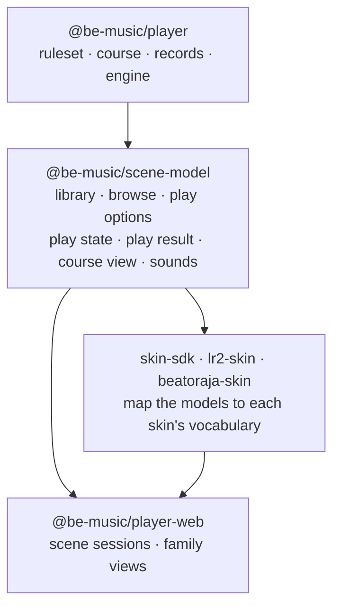
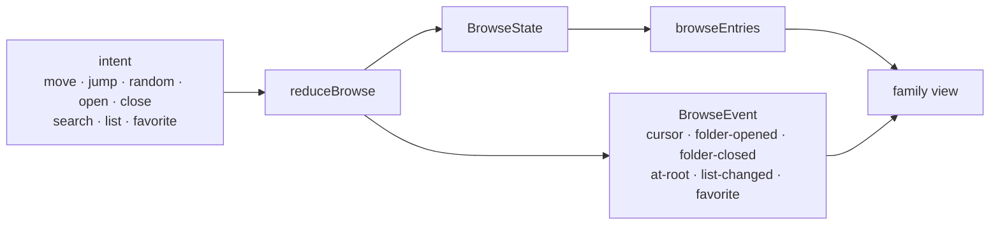
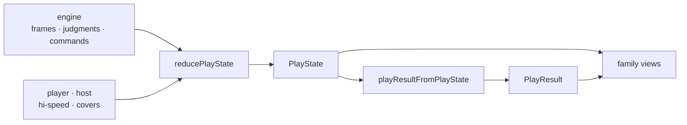

[Japanese version](./scene-model.ja.md)

# Scene models

`@be-music/scene-model` holds what every screen of the player shows and how it behaves, independent of the skin family
that draws it ([ADR 0002](./adr/0002-scene-model-package.md)). The built-in, LR2 and beatoraja families used to keep
two browse models, two sets of play-state bookkeeping and two result shapes, and their drift caused most of the bugs
the course work found ([ADR 0001](./adr/0001-skin-families-only-draw.md)). The models here are the one implementation
each screen's session will work on; the families only draw them.

The package is runtime-neutral: it imports no renderer, reads no DOM or Node global and no clock, and draws no random
number. Time and randomness come in as inputs. `pnpm run check` holds it to that with the runtime-neutral lint rules,
and a test checks that it builds on `@be-music/chart`, `@be-music/json` and `@be-music/player` only.

The models are derived from what the scenes did before them. Where the built-in / LR2 scenes and the beatoraja
scenes differed, the model picks one behaviour, following the compatibility policy: what LR2 does, and beatoraja's
behaviour for what LR2 does not have. The behaviour choices of the [browse model](#behaviour-choices) and the [play
state](#behaviour-choices-1) list each one.

## Library

The library is what a select screen browses: its charts (`LibraryChart`), the folder bars they are grouped in
(`LibraryFolder`), the course folders and their courses (`LibraryCourse`, `LibraryCourseStage`), and one bar of the
list (`LibraryEntry`). A `Library` is the charts plus the course folders; the browser player's song collection is one.

- **Root folders.** `groupChartsByFolder` groups the charts by the first segment of their directory (their source label
  when they have none), folders in Japanese-aware label order, each folder's charts in their source order.
  `libraryRootFolders` lists those folders, then the course folders, and keeps the result per chart list.
- **Key mode.** `resolveLibraryChartPlayVariant` is the chart's play variant (the lane-mode rule of `@be-music/chart`,
  cached per chart; a library loader seeds it with `seedLibraryChartPlayVariant`). `resolveLibraryChartKeyMode` is the
  key mode a key-mode filter lists it under: the one a bmson `mode_hint` names, else the play variant.
- **Entry key.** `libraryEntryKey` names a bar across library rebuilds: a chart by id, a folder by label, a course by id
  (the glossary's focus key).

The entry types keep the field names the browser player has always used (`song`, `songs` and the `'song'` kind), so
every consumer and every be-music skin reads them unchanged. `@be-music/skin-sdk` exports them under their earlier
names: `BrowserSongEntry` is `LibraryChart`, `BrowserFolderNode` is `LibraryFolder`, `BrowserCourseEntry` is
`LibraryCourse`, `BrowserCourseStage` is `LibraryCourseStage`, `BrowserBrowseEntry` is `LibraryEntry` and
`BrowserSongSourceKind` is `ChartSourceKind`.

## Browse

The browse state (`BrowseState`) is where the player is in the library and how the list is shaped: the open folders,
the cursor at each depth, the search text, the list options (sort, key-mode filter, difficulty filter) and the
favourites. It is immutable. A command changes it through `reduceBrowse`, which returns the new state and an event
saying what happened, for the screen's sounds and animations; the list shown is derived from the state.

### The list

`browseEntries(library, state)` lists:

- at the root, the folder bars: chart folders, then course folders;
- while searching at the root, every chart of the library that matches, flattened out of the folders;
- inside a chart folder its charts, inside a course folder its courses;
- then the filters, the search at every depth, and the sort.

The search matches a chart's title, subtitle, artist, genre or file label, a folder's label and a course's name, by the
search text trimmed and lower-cased. The difficulty filter lists the charts that name that `#DIFFICULTY` (a chart that
names none is listed only under `ALL`); the key-mode filter lists the charts of that key mode and the courses of that
key mode (a course that names none, and a NEW COURSE bar, stay listed). Folder bars are never filtered out. The sorts
are LR2's (`OFF`, `LEVEL`, `TITLE`, `CLEAR`) and beatoraja's (`ARTIST`, `GENRE`, `BPM`, `NOTES`, `LASTPLAY`); folders
sort by label, courses keep their order, and the sort is stable. `CLEAR` sorts by title and `LASTPLAY` keeps the
library's order until records feed the sort.

The list is kept per open path while the library, the search and the list options stay the same, so a select screen
can read it every frame.

### Commands

| Command    | What it does                                                                                          | Event                            |
| ---------- | ----------------------------------------------------------------------------------------------------- | -------------------------------- |
| `move`     | Moves the cursor by a number of bars, wrapping past either end                                        | `cursor` with the step asked for |
| `jump`     | Puts the cursor on a bar, clamped (Home / End, a click)                                               | `cursor` with the shortest step  |
| `random`   | Puts the cursor on a random bar other than the focused one; the random draw is an input               | `cursor`                         |
| `open`     | Opens the focused folder bar at its first bar                                                         | `folder-opened`                  |
| `close`    | Backs out onto the folder bar the folder was opened from; at the root there is nothing to back out of | `folder-closed`, or `at-root`    |
| `search`   | Sets the search text; the cursor goes to the top when the query changes                               | `list-changed`                   |
| `list`     | Changes the sort or a filter; the cursor stays on the focused bar while it is still listed            | `list-changed`                   |
| `favorite` | Marks or unmarks the focused chart in beatoraja's song or chart favourites                            | `favorite`                       |

A command that changes nothing returns the same state and the `none` event. `wrappedCursorDelta` maps a jump to the
shortest step around the list, keeping the key's direction on lists of two or three bars.

### Snapshot

`captureBrowse` turns a browse state into plain data (`BrowseSnapshot`) to keep across the scenes a play goes through
and across library rebuilds: the folders by label, the cursor at every depth, the focused bar's key, the search, the
list options and the favourites. `restoreBrowse` takes it back over the library as it is then:

1. the search, list options and favourites as saved;
2. the folder path walked by label as far as it matches, each parent cursor put on the bar of the folder opened from it;
3. the cursor in the list shown on the saved bar when it is still listed, else on the saved index clamped to the list;
   when the walk stopped early, the cursor saved for the depth it stopped at, clamped.

This covers the course-folder restore fixes: the root lists the course folders after the chart folders, so a cursor
left in a course folder comes back; the cursor kept is the live one at every depth; and a course bar is found by its
key after a course run, even when a NONSTOP run replaced the library. `browseSnapshotFromSelectNavigation` and
`browseSnapshotFromBeatorajaSelect` read the snapshots today's select scenes keep.

### Behaviour choices

| Behaviour                            | Built-in / LR2 select                                                 | beatoraja select                                                         | The model                                                                                |
| ------------------------------------ | --------------------------------------------------------------------- | ------------------------------------------------------------------------ | ---------------------------------------------------------------------------------------- |
| Folder bars under a key-mode filter  | All listed                                                            | Regrouped from the filtered charts; empty ones vanish                    | All listed (LR2)                                                                         |
| A chart's key mode                   | bmson `mode_hint`, else the play variant, 24-key folded onto 7 / 14   | The play variant, 24-key modes apart                                     | bmson `mode_hint`, else the play variant, 24-key modes apart (LR2 has no 24-key mode)    |
| Key-mode filter values               | All, 5, 7, 10, 14, 9 keys                                             | Adds 24 keys and 24 keys double                                          | Both (`KEYS_24`, `KEYS_48`)                                                              |
| Difficulty filter                    | Yes                                                                   | None                                                                     | Yes (LR2)                                                                                |
| Fields the search matches            | Title, subtitle, artist, genre, file label; folder label; course name | Title, subtitle, artist, genre                                           | The built-in / LR2 set                                                                   |
| Search inside a course folder        | Filters the courses by name                                           | Not filtered                                                             | Filters (LR2)                                                                            |
| Search text                          | Trimmed and lower-cased                                               | Lower-cased                                                              | Trimmed and lower-cased; the text is kept as typed for display                           |
| Sorts                                | Off, level, title, clear                                              | Default, title, artist, genre, level, BPM, notes, last play              | Both                                                                                     |
| Root folders under a sort            | Sorted by label                                                       | Not sorted                                                               | Sorted by label (LR2)                                                                    |
| Text order                           | Runtime locale, case-insensitive                                      | Japanese locale                                                          | Runtime locale, case-insensitive                                                         |
| Level order                          | `parseFloat`, missing last, equal levels by title                     | `parseInt`, missing last, stable                                         | `parseFloat`, missing last, equal levels by title                                        |
| Cursor after a sort or filter change | Back to the top                                                       | Stays on the focused bar, else clamped                                   | Stays on the focused bar, else clamped: keeps the player's place                         |
| Cursor after a search change         | Back to the top                                                       | Back to the top                                                          | Back to the top                                                                          |
| Moves past either end                | Wrap                                                                  | Wrap                                                                     | Wrap                                                                                     |
| Home / End and clicks                | A click puts the cursor on the bar                                    | Home / End clamp                                                         | `jump` clamps                                                                            |
| Random select                        | None                                                                  | A random bar other than the focused one                                  | Yes (beatoraja), the draw an input                                                       |
| Back out at the root                 | Nothing happens                                                       | Cancel sound, leaves the screen                                          | `at-root` event: the session decides                                                     |
| Favourites                           | None                                                                  | Song and chart lists; a folder bar marks its first chart                 | Song (music) and chart lists, for a focused chart only                                   |
| Snapshot contents                    | Folder path, cursor in the deepest list                               | Folder path, cursor per depth, filter, sort, LN mode, favourites, search | Folder path, cursor per depth, focused bar's key, search, list options, favourites       |
| Parent cursors on restore            | 0 (backing out landed on the first folder bar)                        | As saved                                                                 | The opened folder's bar, found by label                                                  |
| Restore when a folder is gone        | Nothing restored                                                      | Root, at the cursor saved there                                          | As far as the path matches, at the cursor saved there; `restoredDepth` tells the session |
| A new library with one chart folder  | Opens it                                                              | Root                                                                     | Left to the session                                                                      |

beatoraja's LN mode override (the LNMODE button) is not part of browsing; nothing plays it yet, so it is not in the
models.

## Play options

`PlayOptions` is what the player picks before a play: hi-speed and HS-FIX, autoplay, BGA mode and size, the score
graph, the list's sort and filters, HIDDEN / SUDDEN per side with the lane cover height and switch, auto scratch, DP
FLIP, note arrangement and gauge type per side. `@be-music/skin-sdk` exports it as `BeMusicPlayOptions`.

- `DEFAULT_PLAY_OPTIONS` are the values a player starts with (hi-speed 2.0, BGA on and extended, the score graph on).
- `PLAY_OPTION_CHOICES` lists each enum or on-off option's choices in its LR2 button cycle order (`BGA_CYCLE`,
  `SORT_CYCLE`, `HIDDEN_SUDDEN_CYCLE`, …); `nextChoice` and `cyclePlayOptionValue` step through them either way.
- `resolvePlayOptionValue` validates a value set from untyped input (a be-music skin, stored settings): a value outside
  the option's choices is dropped, a number is clamped (`clampHiSpeed`, `clampShutter`). `resolvePlayOptions` makes
  stored options whole and valid.
- `isListPlayOption` names the options that change the bar list.
- The hi-speed range (`HISPEED_MIN` … `HISPEED_MAX`, `HISPEED_STEP`, `snapHiSpeed`), a step under HS-FIX
  (`stepPlayerHiSpeed`: the player's hi-speed moves on its own grid, the drawn one is that times the chart's HS-FIX
  multiplier) and the eased scroll (`easeHiSpeed`, `HiSpeedTransition`).

## Play state

The play state (`PlayState`) is what every gameplay screen reads of a play: the running gauge and EX score with their
graphs, the combo and max combo (and a course stage's course-wide combo), every timed judgment with the early / late
count of each judgment, and the view — the hi-speed and the lane covers. It is immutable and fed by events through
`reducePlayState`: the engine's frames and judgments, its `trigger-poor-bga` command (an empty POOR, through
`playEventFromUiCommand`), the final summary, and the player's and the host's hi-speed and cover changes. No clock is
read: chart time and play-clock time come in with the events.

- **Graphs.** They start at the gauge the play starts with (from `createPlayState`, else the first frame) and take a
  sample of the gauge (in percent of its maximum) and the EX score at each judgment and each empty POOR, at the
  judgment's chart-time fraction. The result adds a last sample where the play ended.
- **Combo.** The combo the engine publishes, the longest kept as the max combo; a final summary that is a full combo
  (every note GOOD or better, none BAD or POOR) makes the max combo every note, as the combo never broke. A course stage
  runs the course combo on from the one carried in (`reduceCourseCombo`).
- **Judge timings.** Each PERFECT … POOR judgment with a timing, with its play-clock time and lane;
  `recentJudgeTimings` is the latest 64 for a live meter (one array per judgment list). Each judgment's early and late
  count (beatoraja's) comes with them.
- **Hi-speed** (`HiSpeedState`). The player's hi-speed, on their own scale, and the drawn one the notes scroll with: the
  player's times the chart's HS-FIX multiplier (`resolveHsFixMultiplier`: MAXBPM, MINBPM and AVERAGE keep that BPM at
  the player's hi-speed, CONSTANT scrolls as AVERAGE for now). The player's keys step the player's value; a drawn value
  reported by the engine or a replay is taken as it is. A course's `no_speed` locks the player's changes; the host's
  setting still applies.
- **Lane covers** (`LaneCoverState` per side). SUDDEN+, HIDDEN+ and LIFT, each with a height kept while it is off. A
  play starts with the select screen's options (`laneCoversFromPlayOptions`: the HIDDEN / SUDDEN mode per side, the one
  lane cover height and the LANE COVER switch); during the play a cover is raised (coming on), lowered (going off at
  nothing), switched or set outright (a replay), on one side or every side, and locked with the hi-speed.
  `resolveLaneCover` gives the covers as drawn, as fractions of the lane, HIDDEN+ scaled to the lane above the LIFT.
- **View settings.** `resolvePlaylogView` is the view in the play log's units: the drawn hi-speed on the scene's
  hi-speed scale, the HS-FIX, each side's covers and the visible time at the main BPM (`resolveWhiteNumber`, the white
  number for a lane of a given length in beats: four for beatoraja's). `PlaylogViewCursor` walks a replayed log's view
  along the playhead.

### Behaviour choices

| Behaviour                    | Built-in / LR2 gameplay                           | beatoraja gameplay                                              | The model                                                         |
| ---------------------------- | ------------------------------------------------- | --------------------------------------------------------------- | ----------------------------------------------------------------- |
| Graph start                  | The starting gauge at 0                           | None                                                            | The starting gauge at 0                                           |
| Graph samples                | Each judgment and each empty POOR                 | Each judgment                                                   | Each judgment and each empty POOR                                 |
| Graph gauge value            | The gauge as it is                                | Percent of its maximum                                          | Percent of its maximum (the same on a gauge out of 100)           |
| Graph end                    | A last sample where the play ended                | None                                                            | A last sample where the play ended                                |
| Max combo of a full combo    | Every note, for AUTO only                         | The published combo                                             | Every note, for any play                                          |
| Timed judgments              | PERFECT … POOR, with time and lane; the latest 64 | Any kind, offset and kind only; the latest 50                   | PERFECT … POOR, with time and lane; the latest 64 by default      |
| Early / late per judgment    | None                                              | Counted                                                         | Counted (beatoraja; LR2 has none)                                 |
| HS-FIX                       | Applied                                           | Not applied                                                     | Applied (beatoraja's fixed hi-speed modes; LR2 has none)          |
| Hi-speed lock (`no_speed`)   | Keys ignored, host taken                          | Keys ignored, engine change reverted, host taken                | Player and engine changes ignored, host taken                     |
| Covers at the start          | From the play options                             | Off                                                             | From the play options (LR2)                                       |
| Covers during the play       | Fixed                                             | Lane cover, LIFT and HIDDEN keys, wheel and buttons; every side | beatoraja's adjustments (LR2 has none), on one side or every side |
| HIDDEN+ lowered to nothing   | —                                                 | Keys keep it on, the button turns it off                        | Off                                                               |
| Covers under `no_speed`      | —                                                 | Locked                                                          | Locked                                                            |
| Visible time in the play log | Lane height less SUDDEN+ and LIFT                 | beatoraja's white number (LIFT ignored)                         | The white number (LIFT ignored)                                   |
| HS-FIX in the play log       | Recorded                                          | Not recorded                                                    | Recorded when set                                                 |

## Play result

`PlayResult` is the one payload every result screen reads, for a single play, a course stage, a whole EXPERT / GRADE
course run and a NONSTOP run (`run`: `single`, `stage`, `course`, `nonstop`): the score and the gauge's verdict, the
clear lamp by the one clear-lamp rule, the graphs, the timed judgments and their early / late counts, the play log, and
the course a stage or a run belongs to (`course`, a course view). `@be-music/skin-sdk` exports it as
`BeMusicResultData`.

- `playResultFromPlayState` reads a play's result off its final play state.
- `playResultFromBeatoraja` reads the beatoraja gameplay scene's `onComplete(summary, maxCombo, history)`; its graphs
  get the start and end samples the other scenes take, and its timing samples, which have no time, read `atMs` 0.
  `beatorajaCompletionFromPlayResult` goes back to that shape for a beatoraja result skin.
- `playResultFromCourseRun` reads a course run (`PlaylogCourseResult`) as one play: the summed score, LR2's money score
  over the course's notes under LR2, the course under its first stage's chart, the stages reached and the trophy
  (`courseRun`). Its graphs are the last stage's, as LR2 draws a course result; `courseRun.stageHistories` keeps every
  stage's for beatoraja's joined graph (`joinCourseStageHistories`).
- `resolveResultPresentation` says how a run is shown, as LR2 does: a course run on the course-result skin with the
  course jingles and no quick retry; a NONSTOP run as a single play.

A course run's verdict reads COURSE CLEAR / COURSE FAILED from `run: 'course'`, which replaces the `courseResult` flag.

## Course view

`CourseView` is the course a screen shows — the bar under the cursor, the running course and its stage, the course of a
result: its kind, title, stages (title, subtitle, level, difficulty), the stage being played, and a NONSTOP course's
connections (`resolveCourseView`). `CourseComboState` is a course stage's course-wide combo: carried in, running on with
the stage combo until the first break, then the stage combo (`createCourseCombo`, `reduceCourseCombo`).

## System sounds

A theme's sounds are a `SystemSoundSet`: one `SystemSound` (bytes, a path in the theme's files, or both) per slot —
the select cues (`cursor`, `decide`, `cancel`, `folderOpen`, `folderClose`, `optionOpen`, `optionClose`,
`optionChange`), the select BGM and the decide jingle, and the result jingles (`clear`, `fail`, `result`,
`courseClear`, `courseFail`).

- `systemSoundSetFromLr2Theme` reads an LR2 theme load's audio (by bytes); `LR2_SOUND_SET_SLOTS` maps each command of an
  LR2 sound set to its slot (`SCRATCH` is the cursor cue, `PANEL_*` the option panel ones).
- `systemSoundSetFromBeatoraja` reads a beatoraja theme's cue paths and select BGM path (played through the theme's
  audio) and its jingles (by bytes). beatoraja has no option panel cues; LR2 has no cancel cue.
- `resolveResultJingles` picks a result's jingles from the first set with any (the theme whose result skin is shown,
  then the others), kept whole; a course run's plays the course jingles, falling back to clear / fail.
  `resolveResultJingle` picks one by the verdict, falling back to the generic one.
- `browseSystemSound` is the cue for what a browse command did: the cursor cue, the folder cues, the cancel cue on
  backing out at the root, the option-change cue when the sort or a filter changed the list. `startSystemSound` is the
  decide cue for a chart or a playable course and the cancel cue for a course with a stage missing.

## Where the helpers moved

| Helper                                                                           | Was in                                    | Now                                                                                |
| -------------------------------------------------------------------------------- | ----------------------------------------- | ---------------------------------------------------------------------------------- |
| `BrowserSongEntry`, `BrowserFolderNode`, `BrowserCourseEntry`, …                 | `@be-music/skin-sdk`                      | `LibraryChart`, `LibraryFolder`, `LibraryCourse`, … (aliased in skin-sdk)          |
| `BeMusicPlayOptions` and its value types                                         | `@be-music/skin-sdk`                      | `PlayOptions`, … (aliased in skin-sdk)                                             |
| `BeMusicResultData`, `GaugeHistorySample`, `ScoreHistorySample`                  | `@be-music/skin-sdk`                      | `PlayResult`, … (aliased in skin-sdk)                                              |
| `BeMusicJudge`, `BeMusicSide`, `BeMusicJudgeTiming`, `BeMusicLaneCover`          | `@be-music/skin-sdk`                      | `Judge`, `PlaySide`, `JudgeTiming`, `LaneCover` (aliased in skin-sdk)              |
| `groupSongsByFolder`, `resolveChartPlayVariant`                                  | `player-web` collection                   | `groupChartsByFolder`, `resolveLibraryChartPlayVariant` (re-exported)              |
| `matchesSearchQuery`, `wrappedCursorDelta`                                       | `player-web` core select                  | Same names (re-exported)                                                           |
| The core select's sort and difficulty filter                                     | `player-web` core select (private)        | `sortLibraryEntries`, `chartMatchesDifficultyFilter`                               |
| `resolveSelectNavigation`                                                        | `player-web` core select                  | Moved to `session/select/select-session.ts` (re-exported), over `restoreBrowse`    |
| `DEFAULT_PLAY_OPTIONS`, the option cycles                                        | `player-web` core select                  | Same names (re-exported)                                                           |
| `resolveSkinPlayOptionValue`, `cycleSkinPlayOptionValue`                         | `player-web` core select                  | `resolvePlayOptionValue`, `cyclePlayOptionValue` (re-exported under the old names) |
| The hi-speed range and steps                                                     | `player-web` `scene/hi-speed.ts`          | Same names (re-exported)                                                           |
| `SceneCourseInfo`, `resolveSceneCourseInfo`                                      | `player-web` `scene/course-info.ts`       | `CourseView`, `resolveCourseView` (re-exported under the old names)                |
| `CourseComboState`, `createCourseCombo`, `advanceCourseCombo`                    | `player-web` `scene/core/course-combo.ts` | Same names, with `reduceCourseCombo`                                               |
| `PlaylogViewCursor`, `resolveBeatorajaPlaylogView`                               | `player-web` `scene/playlog-view.ts`      | Same names (re-exported), over `resolvePlaylogView`                                |
| `buildCourseResultData`, `joinCourseStageHistories`, `resolveResultPresentation` | `player-web-demo` `course-result.ts`      | `playResultFromCourseRun`, … (re-exported under the old names)                     |
| `resolveResultViewJingles`                                                       | `player-web-demo` `result-jingles.ts`     | Stays, over `resolveResultJingles`                                                 |

The built-in and LR2 play screens keep one `PlayState` and read their result off it (`playResultFromPlayState`), so
they follow the model's play-state choices above: a full combo's max combo is every note for any play, and the result
carries each judgment's early / late count. The other scenes still keep their own browse and play state (the beatoraja
runtime adapter its histories and covers); the scene sessions of the web runtime move onto these models. The skin
packages map the models to each skin's vocabulary: `@be-music/beatoraja-skin/scene` to beatoraja's ids (see
[beatoraja-skin.md](./beatoraja-skin.md#scene-mapping)).
