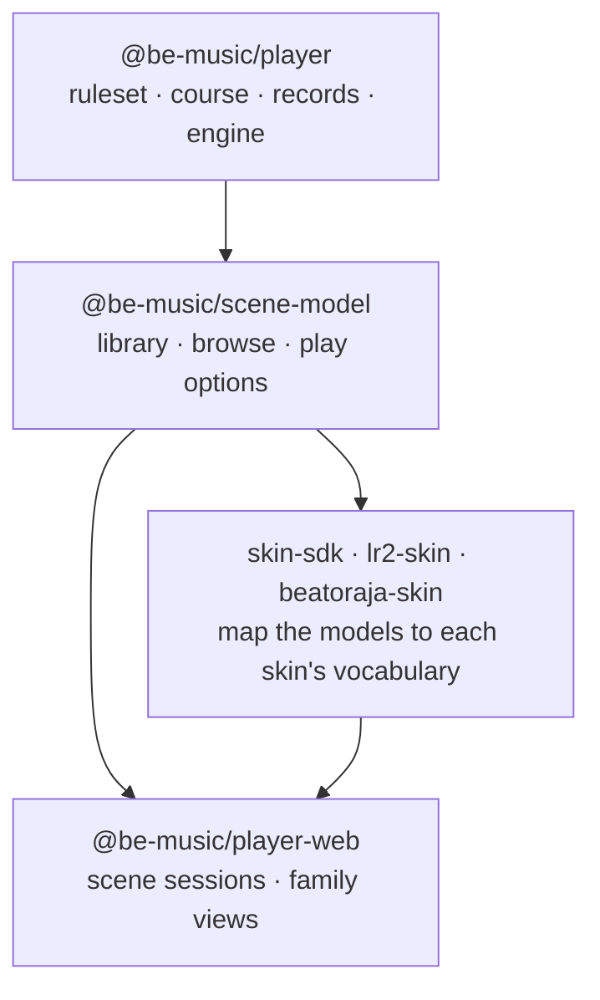
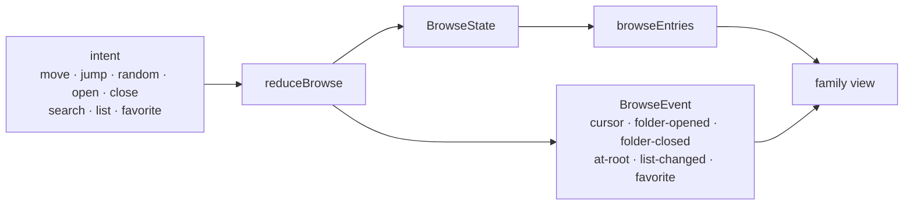

[Japanese version](./scene-model.ja.md)

# Scene models

`@be-music/scene-model` holds what every screen of the player shows and how it behaves, independent of the skin family
that draws it ([ADR 0002](./adr/0002-scene-model-package.md)). The built-in, LR2 and beatoraja families used to keep
two browse models, two sets of play-state bookkeeping and two result shapes, and their drift caused most of the bugs
the course work found ([ADR 0001](./adr/0001-skin-families-only-draw.md)). The models here are the one implementation
each screen's session will work on; the families only draw them.

The package is runtime-neutral: it imports no renderer, reads no DOM or Node global and no clock, and draws no random
number. Time and randomness come in as inputs. `pnpm run check` holds it to that with the runtime-neutral lint rules,
and a test checks that it builds on `@be-music/chart`, `@be-music/json` and `@be-music/player` only.

The models are derived from what the select scenes did before them. Where the built-in / LR2 scene and the beatoraja
scene differed, the model picks one behaviour, following the compatibility policy: what LR2 does, and beatoraja's
behaviour for what LR2 does not have. [Behaviour choices](#behaviour-choices) lists each one.

## Library

The library is what a select screen browses: its charts (`LibraryChart`), the folder bars they are grouped in
(`LibraryFolder`), the course folders and their courses (`LibraryCourse`, `LibraryCourseStage`), and one bar of the
list (`LibraryEntry`). A `Library` is the charts plus the course folders; the browser player's song collection is one.

- **Root folders.** `groupChartsByFolder` groups the charts by the first segment of their directory (their source label
  when they have none), folders in Japanese-aware label order, each folder's charts in their source order.
  `libraryRootFolders` lists those folders, then the course folders, and keeps the result per chart list.
- **Key mode.** `resolveLibraryChartPlayVariant` is the chart's play variant (the lane-mode rule of `@be-music/chart`,
  cached per chart; a library loader seeds it with `seedLibraryChartPlayVariant`). `resolveLibraryChartKeyMode` is the
  key mode a key-mode filter lists it under: the one a bmson `mode_hint` names, else the play variant.
- **Entry key.** `libraryEntryKey` names a bar across library rebuilds: a chart by id, a folder by label, a course by id
  (the glossary's focus key).

The entry types keep the field names the browser player has always used (`song`, `songs` and the `'song'` kind), so
every consumer and every be-music skin reads them unchanged. `@be-music/skin-sdk` exports them under their earlier
names: `BrowserSongEntry` is `LibraryChart`, `BrowserFolderNode` is `LibraryFolder`, `BrowserCourseEntry` is
`LibraryCourse`, `BrowserCourseStage` is `LibraryCourseStage`, `BrowserBrowseEntry` is `LibraryEntry` and
`BrowserSongSourceKind` is `ChartSourceKind`.

## Browse

The browse state (`BrowseState`) is where the player is in the library and how the list is shaped: the open folders,
the cursor at each depth, the search text, the list options (sort, key-mode filter, difficulty filter) and the
favourites. It is immutable. A command changes it through `reduceBrowse`, which returns the new state and an event
saying what happened, for the screen's sounds and animations; the list shown is derived from the state.

### The list

`browseEntries(library, state)` lists:

- at the root, the folder bars: chart folders, then course folders;
- while searching at the root, every chart of the library that matches, flattened out of the folders;
- inside a chart folder its charts, inside a course folder its courses;
- then the filters, the search at every depth, and the sort.

The search matches a chart's title, subtitle, artist, genre or file label, a folder's label and a course's name, by the
search text trimmed and lower-cased. The difficulty filter lists the charts that name that `#DIFFICULTY` (a chart that
names none is listed only under `ALL`); the key-mode filter lists the charts of that key mode and the courses of that
key mode (a course that names none, and a NEW COURSE bar, stay listed). Folder bars are never filtered out. The sorts
are LR2's (`OFF`, `LEVEL`, `TITLE`, `CLEAR`) and beatoraja's (`ARTIST`, `GENRE`, `BPM`, `NOTES`, `LASTPLAY`); folders
sort by label, courses keep their order, and the sort is stable. `CLEAR` sorts by title and `LASTPLAY` keeps the
library's order until records feed the sort.

The list is kept per open path while the library, the search and the list options stay the same, so a select screen
can read it every frame.

### Commands

| Command    | What it does                                                                                          | Event                            |
| ---------- | ----------------------------------------------------------------------------------------------------- | -------------------------------- |
| `move`     | Moves the cursor by a number of bars, wrapping past either end                                        | `cursor` with the step asked for |
| `jump`     | Puts the cursor on a bar, clamped (Home / End, a click)                                               | `cursor` with the shortest step  |
| `random`   | Puts the cursor on a random bar other than the focused one; the random draw is an input               | `cursor`                         |
| `open`     | Opens the focused folder bar at its first bar                                                         | `folder-opened`                  |
| `close`    | Backs out onto the folder bar the folder was opened from; at the root there is nothing to back out of | `folder-closed`, or `at-root`    |
| `search`   | Sets the search text; the cursor goes to the top when the query changes                               | `list-changed`                   |
| `list`     | Changes the sort or a filter; the cursor stays on the focused bar while it is still listed            | `list-changed`                   |
| `favorite` | Marks or unmarks the focused chart in beatoraja's song or chart favourites                            | `favorite`                       |

A command that changes nothing returns the same state and the `none` event. `wrappedCursorDelta` maps a jump to the
shortest step around the list, keeping the key's direction on lists of two or three bars.

### Snapshot

`captureBrowse` turns a browse state into plain data (`BrowseSnapshot`) to keep across the scenes a play goes through
and across library rebuilds: the folders by label, the cursor at every depth, the focused bar's key, the search, the
list options and the favourites. `restoreBrowse` takes it back over the library as it is then:

1. the search, list options and favourites as saved;
2. the folder path walked by label as far as it matches, each parent cursor put on the bar of the folder opened from it;
3. the cursor in the list shown on the saved bar when it is still listed, else on the saved index clamped to the list;
   when the walk stopped early, the cursor saved for the depth it stopped at, clamped.

This covers the course-folder restore fixes: the root lists the course folders after the chart folders, so a cursor
left in a course folder comes back; the cursor kept is the live one at every depth; and a course bar is found by its
key after a course run, even when a NONSTOP run replaced the library. `browseSnapshotFromSelectNavigation` and
`browseSnapshotFromBeatorajaSelect` read the snapshots today's select scenes keep.

### Behaviour choices

| Behaviour                            | Built-in / LR2 select                                                 | beatoraja select                                                         | The model                                                                                |
| ------------------------------------ | --------------------------------------------------------------------- | ------------------------------------------------------------------------ | ---------------------------------------------------------------------------------------- |
| Folder bars under a key-mode filter  | All listed                                                            | Regrouped from the filtered charts; empty ones vanish                    | All listed (LR2)                                                                         |
| A chart's key mode                   | bmson `mode_hint`, else the play variant, 24-key folded onto 7 / 14   | The play variant, 24-key modes apart                                     | bmson `mode_hint`, else the play variant, 24-key modes apart (LR2 has no 24-key mode)    |
| Key-mode filter values               | All, 5, 7, 10, 14, 9 keys                                             | Adds 24 keys and 24 keys double                                          | Both (`KEYS_24`, `KEYS_48`)                                                              |
| Difficulty filter                    | Yes                                                                   | None                                                                     | Yes (LR2)                                                                                |
| Fields the search matches            | Title, subtitle, artist, genre, file label; folder label; course name | Title, subtitle, artist, genre                                           | The built-in / LR2 set                                                                   |
| Search inside a course folder        | Filters the courses by name                                           | Not filtered                                                             | Filters (LR2)                                                                            |
| Search text                          | Trimmed and lower-cased                                               | Lower-cased                                                              | Trimmed and lower-cased; the text is kept as typed for display                           |
| Sorts                                | Off, level, title, clear                                              | Default, title, artist, genre, level, BPM, notes, last play              | Both                                                                                     |
| Root folders under a sort            | Sorted by label                                                       | Not sorted                                                               | Sorted by label (LR2)                                                                    |
| Text order                           | Runtime locale, case-insensitive                                      | Japanese locale                                                          | Runtime locale, case-insensitive                                                         |
| Level order                          | `parseFloat`, missing last, equal levels by title                     | `parseInt`, missing last, stable                                         | `parseFloat`, missing last, equal levels by title                                        |
| Cursor after a sort or filter change | Back to the top                                                       | Stays on the focused bar, else clamped                                   | Stays on the focused bar, else clamped: keeps the player's place                         |
| Cursor after a search change         | Back to the top                                                       | Back to the top                                                          | Back to the top                                                                          |
| Moves past either end                | Wrap                                                                  | Wrap                                                                     | Wrap                                                                                     |
| Home / End and clicks                | A click puts the cursor on the bar                                    | Home / End clamp                                                         | `jump` clamps                                                                            |
| Random select                        | None                                                                  | A random bar other than the focused one                                  | Yes (beatoraja), the draw an input                                                       |
| Back out at the root                 | Nothing happens                                                       | Cancel sound, leaves the screen                                          | `at-root` event: the session decides                                                     |
| Favourites                           | None                                                                  | Song and chart lists; a folder bar marks its first chart                 | Song (music) and chart lists, for a focused chart only                                   |
| Snapshot contents                    | Folder path, cursor in the deepest list                               | Folder path, cursor per depth, filter, sort, LN mode, favourites, search | Folder path, cursor per depth, focused bar's key, search, list options, favourites       |
| Parent cursors on restore            | 0 (backing out landed on the first folder bar)                        | As saved                                                                 | The opened folder's bar, found by label                                                  |
| Restore when a folder is gone        | Nothing restored                                                      | Root, at the cursor saved there                                          | As far as the path matches, at the cursor saved there; `restoredDepth` tells the session |
| A new library with one chart folder  | Opens it                                                              | Root                                                                     | Left to the session                                                                      |

beatoraja's LN mode override (the LNMODE button) is not part of browsing; nothing plays it yet, so it is not in the
models.

## Play options

`PlayOptions` is what the player picks before a play: hi-speed and HS-FIX, autoplay, BGA mode and size, the score
graph, the list's sort and filters, HIDDEN / SUDDEN per side with the lane cover height and switch, auto scratch, DP
FLIP, note arrangement and gauge type per side. `@be-music/skin-sdk` exports it as `BeMusicPlayOptions`.

- `DEFAULT_PLAY_OPTIONS` are the values a player starts with (hi-speed 2.0, BGA on and extended, the score graph on).
- `PLAY_OPTION_CHOICES` lists each enum or on-off option's choices in its LR2 button cycle order (`BGA_CYCLE`,
  `SORT_CYCLE`, `HIDDEN_SUDDEN_CYCLE`, …); `nextChoice` and `cyclePlayOptionValue` step through them either way.
- `resolvePlayOptionValue` validates a value set from untyped input (a be-music skin, stored settings): a value outside
  the option's choices is dropped, a number is clamped (`clampHiSpeed`, `clampShutter`). `resolvePlayOptions` makes
  stored options whole and valid.
- `isListPlayOption` names the options that change the bar list.
- The hi-speed range (`HISPEED_MIN` … `HISPEED_MAX`, `HISPEED_STEP`, `snapHiSpeed`), a step under HS-FIX
  (`stepPlayerHiSpeed`: the player's hi-speed moves on its own grid, the drawn one is that times the chart's HS-FIX
  multiplier) and the eased scroll (`easeHiSpeed`, `HiSpeedTransition`).

## Where the select-side helpers moved

| Helper                                                           | Was in                             | Now                                                                                |
| ---------------------------------------------------------------- | ---------------------------------- | ---------------------------------------------------------------------------------- |
| `BrowserSongEntry`, `BrowserFolderNode`, `BrowserCourseEntry`, … | `@be-music/skin-sdk`               | `LibraryChart`, `LibraryFolder`, `LibraryCourse`, … (aliased in skin-sdk)          |
| `BeMusicPlayOptions` and its value types                         | `@be-music/skin-sdk`               | `PlayOptions`, … (aliased in skin-sdk)                                             |
| `groupSongsByFolder`, `resolveChartPlayVariant`                  | `player-web` collection            | `groupChartsByFolder`, `resolveLibraryChartPlayVariant` (re-exported)              |
| `matchesSearchQuery`, `wrappedCursorDelta`                       | `player-web` core select           | Same names (re-exported)                                                           |
| The core select's sort and difficulty filter                     | `player-web` core select (private) | `sortLibraryEntries`, `chartMatchesDifficultyFilter`                               |
| `resolveSelectNavigation`                                        | `player-web` core select           | Stays, over `restoreBrowse`                                                        |
| `DEFAULT_PLAY_OPTIONS`, the option cycles                        | `player-web` core select           | Same names (re-exported)                                                           |
| `resolveSkinPlayOptionValue`, `cycleSkinPlayOptionValue`         | `player-web` core select           | `resolvePlayOptionValue`, `cyclePlayOptionValue` (re-exported under the old names) |
| The hi-speed range and steps                                     | `player-web` `scene/hi-speed.ts`   | Same names (re-exported)                                                           |

The scenes still keep their own browse state; the scene sessions of the web runtime move onto these models.
