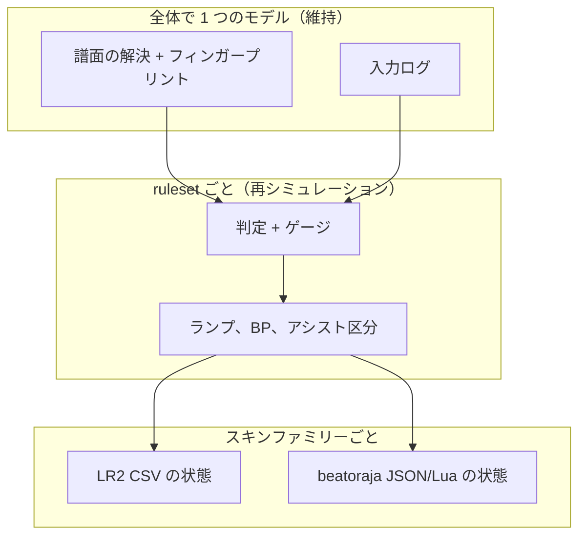

[English version](./semantics-lr2-beatoraja.md)

# LR2 と beatoraja のセマンティクス

LR2 と beatoraja は、同じ譜面、オプション、スキンの番号を違う意味に読むことがよくあります。be-music は判定 ruleset の外では LR2 を優先し、LR2 にない機能は beatoraja に従います。この調査は、2 つのエンジンで意味が異なる箇所、be-music の現状、そして LR2 優先のモデルが beatoraja スキン、beatoraja 由来のデータ、スコア、ランプに対して抱えるリスクを一覧にしたものです。譜面フォーマットの違いは [BMS / bmson 互換性ノート](./format-compat.ja.md) で扱っており、この文書はフォーマットより上の層を見ます。

調査日は 2026-10-19 で、`devel` の `4f09cb5c` 時点の内容です。[#559](https://github.com/nulltask/be-music/issues/559)〜[#566](https://github.com/nulltask/be-music/issues/566) で修正済みの項目は本文で修正済みと明記し、[devel で修正済み](#devel-で修正済み) に一覧にしています。

参照したソース（コミット固定）：

- beatoraja `exch-bms2/beatoraja` @ `8320241d`（リンクは `…/beatoraja/blob/8320241d…/src/bms/player/beatoraja/<path>` の形）
- OpenLR2 `GOMazk/OpenLR2` @ `583a3850`（LR2 の逆コンパイル。`LR2f.cpp` / `Main.cpp` / `structure.h`）
- jbms-parser @ `8108cd54`
- lr2oraja-endlessdream @ `2394f658`
- `LR2body.exe`（LR2beta3）。バイナリは静的に調べただけで、アドレスは VA です。

以前の issue（[#133](https://github.com/nulltask/be-music/issues/133)、[#135](https://github.com/nulltask/be-music/issues/135)、[#139](https://github.com/nulltask/be-music/issues/139)、[#142](https://github.com/nulltask/be-music/issues/142)、[#403](https://github.com/nulltask/be-music/issues/403)〜[#410](https://github.com/nulltask/be-music/issues/410)、[#417](https://github.com/nulltask/be-music/issues/417)、[#418](https://github.com/nulltask/be-music/issues/418)）で扱った点は参照するだけで、繰り返しません。

ソースで確かめられなかった主張には **(unverified)** を付けています。

影響の分類：

- **A** — LR2 に合わせると beatoraja スキンや beatoraja 由来のデータが壊れる。
- **B** — ruleset によってスコア、ランプ、判定が変わる。
- **C** — UX の期待だけの問題。

## 要約

**ほとんどのセマンティクスの違いは、すでにアーキテクチャが吸収しています。** be-music は LR2 と beatoraja を 3 つの継ぎ目で分けており、その分け方は正しいものです：

- **譜面の解決：1 つのモデルで、フィンガープリントを取る。** 制御構文、負の BPM、タイミング、描画はそれぞれ 1 つのモデルです。
- **判定 ruleset：ruleset ごとに、入力から再シミュレーションする。** 判定幅、ノートの選択、LN の方式、地雷の発動、ゲージ、マネースコアを含みます。
- **スキンの状態：スキンファミリーごと。** LR2 CSV スキンには LR2 の語彙を、beatoraja JSON/Lua スキンにはファミリー非依存の `scene-model` から作った beatoraja の語彙を渡します。

つまり be-music は、beatoraja スキンに LR2 のセマンティクスを一律に流し込んではおらず、beatoraja のプレイを LR2 のルールで判定してもいません。

**本当のリスクは判定の周りの層にあります。** そこではまだ 1 つのモデルがすべてに適用されています：

- **記録とランプ。** ランプ、アシストの扱い、BP、記録のキーは 1 つのモデルです。このモデルは beatoraja のデータを失い、場所によってはどちらのエンジンとも一致しません。
- **判定前の選択が十分に記録されていない。** レーンオプション、LN モード、物理キーの識別などです。
- **beatoraja スキン側の配線漏れ。** beatoraja スキンの状態の一部は LR2 の形をしているか、まったく駆動されていません。

これに加えて、各 ruleset に再現度のバグがいくつかあります。

主なリスク（深刻な順）：

1. **アシストとオプションがランプ、記録、対象可否に影響しない。** LR2 はアシスト付きのプレイをまったく保存しないか、ランプを EASY までに抑えてランプだけを更新します。beatoraja は (LIGHT) ASSIST を付けてランプだけをマージします。be-music はオートスクラッチ、SCATTER、HS-FIX CONSTANT のプレイを、ランプ、EX、BP そのままでマージします。ローカルのベストが水増しされ、Leaderboard では SCATTER と CONSTANT のプレイがアシストなしのボードに混ざります。(B)
2. **シングルプレイの BP に未判定ノートが入らない。** どちらのエンジンも加えます。`endOnFailure` が既定で有効なので、BP 最少のベストと Leaderboard の BP では早く落ちたほうが得をします。これとは別に、失敗したランを別の ruleset で再シミュレーションすると、プレイヤーがたどり着けなかったノートまで採点されます。(B、全 ruleset)
3. **ランプの語彙に LIGHT ASSIST EASY がない。** beatoraja の ASSIST-EASY ゲージは LightAssistEasy（id 3、op 1101）でクリアします。be-music は ASSIST_EASY を記録して op 1100 を表示し、beatoraja の `score.db` のランプを往復できません。修正は Leaderboard の `clearLampRank` の保存に及びます。(A+B)
4. **beatoraja ruleset の再現度のバグ。**
   - TOTAL を基本ノート数で割っているが、beatoraja は CN/HCN の終端も数えるので、回復が最大 2 倍速すぎる。
   - judgerank > 100 で BAD の判定幅がスケール前の値に抑えられる。
   - どのモードでも 7K のゲージ表を使う。
   - フルコンボが 5K/PMS の空 POOR によるコンボ切れを無視する。
   - ゲージの計算が float ではなく double。

   (B)

5. **LR2 ruleset の再現度のバグ。**
   - multi-BAD が lr2oraja のコレクターに従っているが、バイナリは同じ押下で次のノートを再判定する。
   - 地雷が遅い側も含む PGREAT の押下幅を使っている。LR2 は手前側だけの GREAT 幅で、当たると POOR として数え、BP に加わる。
   - LR2 はゲージを調べる前に FULL COMBO を与える。

   (B)

6. **プレイヤーの LN モード（LN/CN/HCN）がなく、どの記録キーにも入っていない。** beatoraja はスコアを `(sha256, lnmode)` で区別します。取り込んだ CN/HCN のスコアには行き場がなく、後からオプションを足すと 3 つのモードの記録が混ざります。(A+B)
7. **beatoraja の TIMER_PLAY がロード完了時に始まり、その後に固定の 1.5 秒の助走がある。** be-music は `skin.playstart` を無視するので、TIMER_PLAY を基準にする beatoraja の要素はどれもノートより早く動きます。(A)
8. **beatoraja スキンの状態が配線されていないか、LR2 の形をしている。**
   - Lua の `event_index` と `set_timer` が配線されていない。
   - リザルトのタイマー 150-152、スコアのタイマー 348-352、HCN、PM キャラ、カスタムタイマーが設定されない。
   - GAUGE_MAX が切れない。
   - MISS（420）が POOR を表示し、空 POOR が抜け落ちる。
   - op 42 が常に点灯し、43 / 1046 は点灯しない。

   (A)

9. **レーンオプションがどちらのエンジンとも一致しない。**
   - S-RANDOM が、LN を押しているレーンにノートを落とすことがある。
   - SCATTER は単なる RANDOM なのに `SCATTER` として記録される。
   - MIRROR と RANDOM が譜面で使われているレーンだけを入れ替える。
   - オプション番号の意味がスキンファミリーで違う：LR2 の 3 = S-RANDOM、beatoraja の 3 = R-RANDOM。

   (B, A)

10. **リプレイに物理キーの識別が残らない。** スクラッチの向きがないと、beatoraja の逆回転による BSS 終了は判定も再シミュレーションもできません。後からフィールドを足すと古いログがあいまいになるので、早めに足してください。(B、データ形式)

ほかに目立つ点：

- beatoraja 時代の LR2 CSV スキンにある `#RESOLUTION,N` を幅 / 高さとして読んでいる。そうしたスキンはすべてキャンバスが壊れる。(A)
- LR2 CSV の方言の衝突：バーのランプ番号 5 は LR2 では FC、beatoraja では EX HARD。22 列目以降のオフセットは無視される。(A)
- HS-FIX が譜面基準になっている。LR2 は BPM 150 に正規化し、beatoraja は表示時間（緑数字）を保つ。(C)

**意図して 1 つのモデルにしており、今後もそうすべきもの：**

- すべての ruleset での負の BPM による逆スクロール。
- `#RANDOM`/`#SWITCH` の上位互換の評価器。
- LR2 方式のノート描画。
- イベントのタイムスタンプによる入力。
- 正確な STOP の長さ。

これらは譜面の同一性（フィンガープリント）か入力ログに属します。ruleset ごとに分けると「1 つの譜面、1 つの入力列、3 つの再シミュレーション」（[リプレイ](./replay.ja.md)、[Leaderboard](./leaderboard.ja.md)）が崩れます。`beatoraja` での既知の非再現として文書に書いてください。

以下の修正の多くは、ルールを正しい箱に移すものです。アシスト区分と LR2 の地雷の加算は「ruleset ごと」に、LN モードとスクラッチの向きは入力ログに、タイマーと Lua は「スキンファミリーごと」に属します。

## 一覧表

| #   | 違い                                                    | 分類           | be-music の現状                                    | 推奨                                                                                  |
| --- | ------------------------------------------------------- | -------------- | -------------------------------------------------- | ------------------------------------------------------------------------------------- |
| 1   | アシストとオプションのランプと記録への影響              | B              | 無視。すべてマージ                                 | ログのフィールドから ruleset ごとにアシスト区分を決める。ランプだけマージ             |
| 2   | BP に未判定ノートを含める（シングルプレイ）             | B              | コースだけ                                         | 全 ruleset で修正 + Leaderboard のマイグレーション                                    |
| 3   | 失敗したランを別 ruleset で再シミュレーション           | B              | 3 つすべてでランキング                             | 失敗したサバイバルのランはプレイした ruleset でだけランキングする（または印を付ける） |
| 4   | LIGHT ASSIST EASY ランプ                                | A, B           | なし。ASSIST-EASY ゲージ → ASSIST_EASY             | ランプを追加。追加のみの rank かマイグレーション                                      |
| 5   | LR2 はゲージ判定より先に FC                             | B              | FAILED が先（beatoraja 方式）                      | ruleset ごと                                                                          |
| 6   | FC と空 POOR のコンボ切れ（bea 5K/PMS）                 | B              | 無視                                               | ruleset ごと                                                                          |
| 7   | beatoraja の TOTAL のノート数（CN/HCN の終端）          | B              | 基本ノート数                                       | ruleset ごと（バグ修正）                                                              |
| 8   | judgerank > 100 での beatoraja の BAD のスケーリング    | B              | スケール前の BAD に抑える                          | ruleset ごと（バグ修正）                                                              |
| 9   | beatoraja のモード別ゲージ表                            | B, A           | どこでも 7K の表                                   | `beatoraja` の中でモードごと                                                          |
| 10  | ゲージの float と double                                | B              | double                                             | `beatoraja` で `Math.fround`                                                          |
| 11  | `#DEFEXRANK` の int 切り捨て（bea）                     | B              | 四捨五入                                           | `beatoraja` で `Math.trunc`                                                           |
| 12  | LR2 の multi-BAD の連鎖                                 | B              | lr2oraja のコレクター                              | `lr2` をバイナリの連鎖に切り替える                                                    |
| 13  | LR2 の地雷の判定幅、遅い側、POOR の加算                 | B              | 両側 PGREAT、カウンターなし                        | `lr2` をバイナリに合わせる                                                            |
| 14  | PMS の MissCondition.ONE / judgeVanish                  | B              | 未実装（既知の差として記載、judgeVanish は未記載） | PMS が重要になったら ruleset ごと                                                     |
| 15  | プレイヤーの LN モード + 記録キー                       | A, B           | 譜面の `#LNMODE` だけ。キーに LN モードなし        | `beatoraja` でオプション化してログに残す。記録 / ランキングのキーに LN モード         |
| 16  | ゲージの種類（EX-HARD、ASSIST、P/G.ATTACK）             | A, B           | LR2 系の 4 つの名前を対応付け                      | オプションに ruleset ごとのゲージ id                                                  |
| 17  | ゲージオートシフト（GAS）                               | C, B           | 未実装                                             | 維持。追加するならモードをログに残す                                                  |
| 18  | bmson `judge_rank` の単位                               | B              | ruleset ごと                                       | 維持。ruleset 間で比較できないことを記載                                              |
| 19  | 負の BPM / ゼロの BPM                                   | B, C           | すべてで LR2 の逆スクロール                        | 維持。記載                                                                            |
| 20  | STOP の丸め、SCROLL/SPEED                               | B（ごく小）, C | 正確。beatoraja の描画                             | 維持                                                                                  |
| 21  | 入力時刻の取り方                                        | C              | イベントのタイムスタンプ                           | 維持                                                                                  |
| 22  | 判定タイミング（表示）オフセット                        | C, A           | 音声 / 判定オフセットだけ。スキンの数値は 0        | 表示だけのオフセットを追加。スキンの数値に渡す                                        |
| 23  | `#RANDOM` の入れ子のモデル                              | B（まれ）      | 上位互換のスタックモデル                           | 維持。記載。doc コメントを修正                                                        |
| 24  | シードと解決済みパターン。同じパターンで再挑戦          | C, A           | 解決済みのチャンネルを記録。シードなし             | 維持。「再挑戦でパターンを保つ」オプションを追加                                      |
| 25  | オプションの語彙 / 番号の順序                           | A, C           | LR2 の順序。CONVERGE / beatoraja のセットなし      | オプションは名前で持ち、ファミリーごとの番号表                                        |
| 26  | S-RANDOM / SCATTER / CONVERGE / H-RANDOM のアルゴリズム | B              | どちらのエンジンとも違う。バグあり                 | LR2 の S-RAN/SCATTER と beatoraja の S-RANDOM を純粋なヘルパーとして実装              |
| 27  | MIRROR / RANDOM の対象レーン                            | B              | 使われているレーンだけ                             | 鍵盤レーン全体                                                                        |
| 28  | DP FLIP / BATTLE / オプションの詰め方                   | C, A           | dpFlip だけ                                        | 維持。取り込み時に復号                                                                |
| 29  | ハイスピードの尺度と範囲                                | C              | 0.1-6.0、2 つの尺度                                | ファミリーごとに上限を上げる                                                          |
| 30  | HS-FIX の意味（150 BPM 正規化と表示時間）               | C, B           | 譜面基準                                           | スキンファミリーごと。CONSTANT はアシスト扱いか削除                                   |
| 31  | LR2 スキンの数値でのレーンカバー / LIFT の単位          | C              | LR2 の 12/14/15 が 0                               | シャッターの % とオフセットを渡す                                                     |
| 32  | BGA のレイヤー / NO MISS モード                         | C              | 上位互換。NO MISS なし                             | NO_MISS を追加                                                                        |
| 33  | 空押しのキー音                                          | C              | 早い側の判定幅で進む                               | ruleset ごとに選択可能に                                                              |
| 34  | LN の終端音（beatoraja）                                | C              | なし                                               | `beatoraja` で別の終端 id を鳴らす                                                    |
| 35  | 物理キーの識別（BSS の逆回転）                          | B              | 記録しない                                         | 入力に省略可能な `source` を今すぐ追加                                                |
| 36  | お気に入り / 非表示フラグ                               | C              | beatoraja 方式、非表示なし                         | フラグを追加。取り込み時に LR2 を対応付け                                             |
| 37  | ソート / フィルタの語彙と LR2 スキンのボタン            | C              | optionstr.csv と違う                               | 調べて揃える                                                                          |
| 38  | 難易度表のレベルフォルダ                                | C              | コースだけ                                         | レベルフォルダを追加                                                                  |
| 39  | コース記録の同一性（md5 と sha256、LN モード）          | A, B           | 1 つのコースに 2 つのキー                          | コースのフィンガープリントをキーにする                                                |
| 40  | ベスト記録のマージ内容                                  | B, A           | アシストの関門、スナップショット、クリア回数なし   | 追加。ログから再構築できる                                                            |
| 41  | リプレイの形式（.brd）                                  | A              | 取り込みなし                                       | laneShufflePattern + キー割り当てで変換                                               |
| 42  | `#RESOLUTION,N`                                         | A              | w,h として読む（バグ）                             | 番号の形を受け付ける                                                                  |
| 43  | DST の 21 列目以降のオフセット                          | A              | LR2 の op4 だけ                                    | 3/4/5/10 を受け付ける                                                                 |
| 44  | beatoraja の CSV 方言のコマンド                         | A              | 読まない                                           | 方言を任意で対応                                                                      |
| 45  | `#SRC_BAR_LAMP` の番号の意味                            | A              | LR2                                                | beatoraja の方言を検出したら切り替える                                                |
| 46  | TIMER_PLAY / `skin.playstart`                           | A              | ロード完了 + 1.5 秒                                | 譜面の開始時刻を刻む                                                                  |
| 47  | GAUGE_MAX タイマーの切り替え                            | A, C           | 止まらない（バグ）                                 | 開始 / 停止                                                                           |
| 48  | beatoraja だけのタイマー                                | A              | 駆動しない                                         | 対応表に追加                                                                          |
| 49  | Lua の `event_index` / `set_timer`                      | A              | nil                                                | 配線する                                                                              |
| 50  | MISS と POOR の数値                                     | A, C           | 420 = POOR（バグ）                                 | emptyPoor を使う                                                                      |
| 51  | ゲージの op 42/43/1046                                  | A, C           | 常に 42（バグ）                                    | ゲージ種別から導く                                                                    |
| 52  | 曲リストのランプ画像（JSON）                            | A, C           | 描かない                                           | 0-10 の id で描く                                                                     |
| 53  | 「該当なし」の数値を隠すか 0 か                         | C              | 0                                                  | undefined を返す                                                                      |
| 54  | 補間 / ループ / ブレンドの細部                          | C              | ファミリーごと                                     | 維持                                                                                  |
| 55  | `#INFORMATION` の type 16-18 の衝突                     | C              | ファミリーごと (unverified)                        | ガードを入れる                                                                        |

## 時間モデルとタイミング

### 入力時刻の取り方：ポーリング時刻とイベントのタイムスタンプ

- **LR2:**
  - `ProcGame` が入力をポーリングし、1 回のポーリング時刻ですべてのレーンを整数 ms で判定します（[LR2f.cpp#L12610-L12634](https://github.com/GOMazk/OpenLR2/blob/583a38503555e59c4bafa49d60b9d0714c9007c2/LR2f.cpp#L12610-L12634)）。
  - ループはフレームごと、またはビジーループのスレッドで回ります（[#L13137-L13143](https://github.com/GOMazk/OpenLR2/blob/583a38503555e59c4bafa49d60b9d0714c9007c2/LR2f.cpp#L13137-L13143)）。
- **beatoraja:** 入力スレッドがキーの変化ごとに µs の時刻を刻みます（[input/BMSPlayerInputProcessor.java#L326-L335](https://github.com/exch-bms2/beatoraja/blob/8320241d8481e0826c703878c3eba01cd81ca3e4/src/bms/player/beatoraja/input/BMSPlayerInputProcessor.java#L326-L335)）。通過と見逃しはフレームごとに掃き出します。
- **種類:** セマンティクス。数値上の差は小さい。
- **be-music の現状:** イベントのタイムスタンプ（[`packages/player-browser/src/runtime/web-input-runtime.ts`](../packages/player-browser/src/runtime/web-input-runtime.ts)）で、µs で判定します。すべての ruleset で beatoraja 方式です。
- **影響:** C。フレーム未満の水準でだけ B。
- **推奨:** 維持。LR2 のポーリングを真似ると、再シミュレーションがフレームレートに依存します。

### LR2 の整数ミリ秒比較

- **LR2:** `abs(timing - (int)note.realTiming)` を整数の判定幅と `<=` で比べます（[#L7472-L7509](https://github.com/GOMazk/OpenLR2/blob/583a38503555e59c4bafa49d60b9d0714c9007c2/LR2f.cpp#L7472-L7509)）。判定幅の表は ms 単位です（[#L27586-L27610](https://github.com/GOMazk/OpenLR2/blob/583a38503555e59c4bafa49d60b9d0714c9007c2/LR2f.cpp#L27586-L27610)）。
- **beatoraja:** µs の `long` で比べます。
- **種類:** パラメータ。
- **be-music の現状:** どこでも µs（[`packages/player-engine/src/ruleset/definitions.ts`](../packages/player-engine/src/ruleset/definitions.ts)）。
- **影響:** B。ms 未満の境界でだけ。
- **推奨:** 維持し、許容する差として記載する。

### 判定タイミングのオフセットが動かすもの

- **LR2:** `judgetiming`（-99..99）は描画の時計だけをずらし（[#L2185](https://github.com/GOMazk/OpenLR2/blob/583a38503555e59c4bafa49d60b9d0714c9007c2/LR2f.cpp#L2185)）、AUTO-ADJUST がそれを少しずつ動かします（[#L12643-L12644](https://github.com/GOMazk/OpenLR2/blob/583a38503555e59c4bafa49d60b9d0714c9007c2/LR2f.cpp#L12643-L12644)）。
- **beatoraja:** 同じく表示だけの意味（[play/LaneRenderer.java#L301](https://github.com/exch-bms2/beatoraja/blob/8320241d8481e0826c703878c3eba01cd81ca3e4/src/bms/player/beatoraja/play/LaneRenderer.java#L301)）で、自動調整は `JudgeManager` にあります。
- **種類:** セマンティクス。
- **be-music の現状:** どちらのエンジンのモデルでもありません。
  - `audioOffsetMs` は判定の時計を動かします（[`packages/player-engine/src/core/engine-types.ts`](../packages/player-engine/src/core/engine-types.ts)、[`play-loop.ts`](../packages/player-engine/src/core/play-loop.ts)）。表示だけのオフセットはありません。
  - beatoraja の `NUMBER_JUDGETIMING` は 0 を返し（[`packages/skin-beatoraja/src/scene/play-numbers.ts`](../packages/skin-beatoraja/src/scene/play-numbers.ts)）、LR2 の数値 12 も同じです（[`packages/skin-lr2/src/state/options.ts`](../packages/skin-lr2/src/state/options.ts)）。
- **影響:** C。軽い A（スキンの数値とその +/- ボタンが何もしない）。
- **推奨:** 表示だけのオフセットを、両ファミリー共通のプレイヤーオプションとして追加し、両方のスキンの数値に出す。表示だけなので、リプレイへのリスクはありません。

### 負の BPM とゼロの BPM

- **LR2:** 負の `#BPMxx` はスクロールと判定の時計を反転させます（[#L12620-L12625](https://github.com/GOMazk/OpenLR2/blob/583a38503555e59c4bafa49d60b9d0714c9007c2/LR2f.cpp#L12620-L12625)）。
- **beatoraja:** BPM ≤ 0 を無視します（[互換性ノート §2.8](./format-compat.ja.md#28-bpm)）。
- **種類:** セマンティクス（譜面のタイミング）。
- **be-music の現状:** すべての ruleset で LR2 の逆スクロール。`chart.reversalTimeUs` をログに残します（[Player 実装仕様 — 負の BPM](./player-spec.ja.md#負の-bpm--lr2-逆スクロール)）。
- **影響:** B。そうした譜面の `beatoraja` プレイは LR2 の時計で判定されます。
- **推奨:** 1 つのモデルを維持する。ログとフィンガープリントが固定する解決済み譜面の一部だからです。逆スクロールの譜面での `beatoraja` の結果は beatoraja に忠実ではないと記載する。

### STOP、小節長、SCROLL/SPEED

- **LR2:**
  - STOP の値は整数です。
  - SCROLL/SPEED はありません。
- **beatoraja:**
  - STOP ごとに µs に切り捨てるので、STOP の多い譜面では最大数 ms ずれます。
  - SCROLL/SPEED に対応しています（[互換性ノート §2.9〜§2.11](./format-compat.ja.md#29-stop-と-stp)）。
- **種類:** パラメータ（STOP）。見た目（SCROLL/SPEED）。
- **be-music の現状:** すべての ruleset で STOP の長さは正確で、SCROLL/SPEED は beatoraja の描画です。すでに記載済みです。
- **影響:** ごく小さい B。C。
- **推奨:** 維持。ノートの時刻は保存される解決済み譜面にあります。

## 判定

すでに ruleset ごとに実装済みで（[`packages/player-engine/src/ruleset/definitions.ts`](../packages/player-engine/src/ruleset/definitions.ts)、[`core/judge-window.ts`](../packages/player-engine/src/core/judge-window.ts)）、対応不要のもの：

- 判定幅とランクの表。LR2 の `#RANK 4` = NORMAL と beatoraja の 125、LR2 NONSTOP のランク表を含む
- ノートの選択（`lowest` と、beatoraja の `combo`/`duration`/`lowest`/`score`）
- LN だけか、ノートごとの LN/CN/HCN か
- LR2 の LN 始点の遅い BAD の規則と、LN の早離し
- LN 中の押下と、beatoraja PMS の離しの猶予
- 空 POOR の判定幅と、beatoraja 5K/PMS で空 POOR がコンボを切ること
- 地雷の発動モデル（ただし下記を参照）
- スクラッチの判定幅と BSS の再押下の規則

### judgerank > 100 での beatoraja の BAD のスケーリング（バグ）

- **LR2:** 固定の表。BAD は 200 ms 固定で、スケールした判定幅がそれを超えることはありません（[#L27586-L27610](https://github.com/GOMazk/OpenLR2/blob/583a38503555e59c4bafa49d60b9d0714c9007c2/LR2f.cpp#L27586-L27610)）。
- **beatoraja:** `JudgeWindowRule.NORMAL` は PG/GR/GD **と BAD** を judgerank でスケールし、内側の判定幅を**スケール後の** BAD に抑えます（[play/JudgeProperty.java#L210-L273](https://github.com/exch-bms2/beatoraja/blob/8320241d8481e0826c703878c3eba01cd81ca3e4/src/bms/player/beatoraja/play/JudgeProperty.java#L210-L273)）。そのため 7K の `#RANK 4` では BAD が -350/+275 ms になります。
- **種類:** パラメータ（モデル化のバグ）。
- **be-music の現状:** `scaleBeatorajaWindows`（[`definitions.ts`](../packages/player-engine/src/ruleset/definitions.ts) ~L310-L343）がどの側も**スケール前の** BAD に抑えるので、`beatoraja` の BAD は -280/+220 のままです。これが正しいのは BAD が固定の PMS だけです。
- **影響:** B。VERY EASY の譜面、`#DEFEXRANK` > 133、bmson の `judge_rank` > 100 に効きます。
- **推奨:** ruleset が BAD を固定していない限り、スケール後の BAD に抑える。再シミュレーションで `beatoraja/0` の結果が更新されます。

### `#DEFEXRANK` の整数切り捨て（beatoraja）

- **LR2:** `#DEFEXRANK` はありません。be-music の拡張です。
- **beatoraja:** `int` で `judgerank * 75 / 100`（[play/BMSPlayerRule.java#L63](https://github.com/exch-bms2/beatoraja/blob/8320241d8481e0826c703878c3eba01cd81ca3e4/src/bms/player/beatoraja/play/BMSPlayerRule.java#L63)）、その後 `long` でスケールします（JudgeProperty L232-L235）。
- **種類:** パラメータ。
- **be-music の現状:** 小数の値のまま、各側ごとに `Math.round`。
- **影響:** B。判定幅の 1 % 以下。
- **推奨:** `beatoraja` では両方の段階を `Math.trunc` にする。

### bmson `judge_rank` の単位

- **LR2:** bmson はありません。be-music は lr2oraja に従い、100 = NORMAL です。
- **beatoraja:** 値を judgerank のパーセントとして使うので、100 = BMS の `#RANK 3` EASY です（[BMSPlayerRule.java#L64](https://github.com/exch-bms2/beatoraja/blob/8320241d8481e0826c703878c3eba01cd81ca3e4/src/bms/player/beatoraja/play/BMSPlayerRule.java#L64)）。
- **種類:** セマンティクス（単位）。すでに ruleset ごとに分かれています。
- **影響:** B。同じ bmson 譜面が `beatoraja` では 1 段階易しくなるので、bmson では ruleset をまたいだランクを比べられません。
- **推奨:** 維持し、[Leaderboard](./leaderboard.ja.md) と [互換性ノート](./format-compat.ja.md#36-judge_rank) のページに記載する。

### LR2 の multi-BAD は BAD の回収ではなく再判定の連鎖

- **LR2:** BAD の後、同じ押下を、そのレーンの次のノートが BAD の判定幅にあればそのノートに渡します。そのノートは自分のずれで判定され、PGREAT/GREAT/GOOD になることもあります。連鎖は前にしか進まず、通常ノートだけに適用され、各段階が BAD である間だけ続きます。ソース：[#L7509-L7521](https://github.com/GOMazk/OpenLR2/blob/583a38503555e59c4bafa49d60b9d0714c9007c2/LR2f.cpp#L7509-L7521)、バイナリの VA 0x418d3b-0x418d55（`cmpl 0x97a30` = `judgetime[2]`、`calll 0x418850`）。
- **beatoraja:** multi-BAD はありません。
- **種類:** セマンティクス。
- **be-music の現状:** lr2oraja の `MultiBadCollector` に従っています（[`core/judge-core-press.ts`](../packages/player-engine/src/core/judge-core-press.ts) の `applyMultiBadCollector`、[`ruleset/long-note.ts`](../packages/player-engine/src/ruleset/long-note.ts)、[`replay/simulate.ts`](../packages/player-engine/src/replay/simulate.ts) にも同じもの）。
- **影響:** B。`lr2` で縦連と同時押しの EX とコンボが変わります。
- **推奨:** LR2 優先ではバイナリが基準なので、`lr2` を連鎖に切り替える。`lr2/0` の再シミュレーション結果が変わりますが、ログの形式は変わりません。

### 地雷：LR2 の窓、遅い側、POOR の加算

- **LR2:**
  - 押下は、そのレーンの地雷が **GREAT** の判定幅より手前にあるときに起爆します（[#L7437-L7445](https://github.com/GOMazk/OpenLR2/blob/583a38503555e59c4bafa49d60b9d0714c9007c2/LR2f.cpp#L7437-L7445)。バイナリ 0x4188ad-0x4188d2 が `judgetime[4]` を読む）。
  - 判定ラインを過ぎた地雷は最初のポーリングで片付けられ、キーが押されたままなら起爆します（[#L7446-L7458](https://github.com/GOMazk/OpenLR2/blob/583a38503555e59c4bafa49d60b9d0714c9007c2/LR2f.cpp#L7446-L7458)）。
  - 当たると POOR が 1 回増えます（バイナリ 0x40659c-0x4065bd。OpenLR2 の L2052 にある 2 回目の加算は書き写しの誤り）。そのため BP には加わりますが、コンボには影響しません。
  - コース中でも 2 % の下限がかかるかは **(unverified in binary)** です。
- **beatoraja:** 地雷が通過するときに押されているキーだけが起爆させます。ゲージが減るだけで、どのカウンターにも触れません（[play/JudgeManager.java#L244-L248](https://github.com/exch-bms2/beatoraja/blob/8320241d8481e0826c703878c3eba01cd81ca3e4/src/bms/player/beatoraja/play/JudgeManager.java#L244-L248)）。
- **種類:** セマンティクス（カウンター）+ パラメータ（判定幅）。
- **be-music の現状:** `press-or-hold` は LR2 の history.txt 080114 に基づき両側に PGREAT の判定幅を使い、カウンターには触れません（[`core/judge-core-advance.ts`](../packages/player-engine/src/core/judge-core-advance.ts)）。
- **影響:** B。地雷のある譜面での `lr2` の BP と POOR、Leaderboard の BP。
- **推奨:** `lr2` をバイナリに合わせる。入力はすでにログにあります。

### PMS：ノートごとに空 POOR 1 回、消えない BAD

- **beatoraja:** PMS は `MissCondition.ONE` と、BAD に対する `judgeVanish = false` を使うので、BAD の後もノートを叩けます（[play/JudgeProperty.java#L34-L44](https://github.com/exch-bms2/beatoraja/blob/8320241d8481e0826c703878c3eba01cd81ca3e4/src/bms/player/beatoraja/play/JudgeProperty.java#L34-L44)）。LR2 に PMS はありません。
- **種類:** セマンティクス。
- **be-music の現状:** 未実装。`MissCondition.ONE` は [リプレイ — 再現度に関する注意](./replay.ja.md#再現度に関する注意) に載っていますが、`judgeVanish` は載っていません。
- **影響:** B。`beatoraja` での 9 鍵の譜面。
- **推奨:** `judgeVanish` を再現度に関する注意に加え、PMS が重要になったら両方を実装する。

### 未定義のロングノートに対するプレイヤーの LN モード（LN/CN/HCN）

- **LR2:** ロングノートはすべて LN で、`#LNMODE` は無視します。
- **beatoraja:**
  - `#LNMODE` のないノートは `TYPE_UNDEFINED` で、プレイヤーの `lnmode` で遊びます：0 LN（既定）、1 CN、2 HCN。
  - 譜面に未定義の LN があるとき、スコアとリプレイは `(sha256, lnmode)` で区別します（[PlayDataAccessor.java#L196-L210](https://github.com/exch-bms2/beatoraja/blob/8320241d8481e0826c703878c3eba01cd81ca3e4/src/bms/player/beatoraja/PlayDataAccessor.java#L196-L210)）。
  - ノート数、TOTAL、既定の TOTAL はすべて選んだモードに従います。
- **種類:** セマンティクス。
- **be-music の現状:**
  - `per-note` は譜面に従い、`#LNMODE` がなければ LN として遊びます（[`packages/chart-model/src/note-rules.ts`](../packages/chart-model/src/note-rules.ts)、[`ruleset/long-note.ts`](../packages/player-engine/src/ruleset/long-note.ts)）。
  - プレイヤーオプションはありません。
  - 記録のキーは `ruleset:sha256` です（[`packages/app-play/src/chart-best-records.ts`](../packages/app-play/src/chart-best-records.ts)）。
  - フィンガープリントの LN モードは `#LNMODE`、なければ 1 です（[フィンガープリント仕様 §3.4](./fingerprint-spec.ja.md#34-イベント)）。
  - スキンの LN モードのボタンは何もしません。
- **影響:** A（beatoraja の `score.db` を取り込むと CN/HCN の行がつぶれる）。B（CN/HCN のプレイヤーのスコアを再現できない）。
- **推奨:**
  - `beatoraja` にプレイヤーオプションを足し、`judgeAlgorithm` と同じように ruleset の入力としてリプレイに記録する。再シミュレーションはログから読むこと。
  - オプションを出す**前に**、実際の LN モードを記録のキーと Leaderboard のランキングのキー（またはフィルタ）に入れる。

### スクラッチ、BSS、オートスクラッチ

すでに ruleset ごとです：判定幅、逆回転での LR2 の再判定または空 POOR、beatoraja が再押下を無視すること。残る差は beatoraja の「逆方向で BSS が終わる」ことで、[物理キーの識別とスクラッチの向き](#物理キーの識別とスクラッチの向き) を参照してください。記録でのオートスクラッチについては [アシストとオプションの扱い](#アシストとオプションの扱い) を参照してください。

## スコア、ランプ、記録

### アシストとオプションの扱い

- **LR2:**
  - `CheckScoreSaveConditon` は次のプレイを、**ランプを EASY までに抑え**、ランプと各カウントだけを更新する分岐に送ります：バトル（G-BATTLE を除く）、HS-FIX CONSTANT、`random >= 4`（SCATTER/CONVERGE）、オートキー、アシスト。EX、BP、コンボは保存しません（[#L68-L79](https://github.com/GOMazk/OpenLR2/blob/583a38503555e59c4bafa49d60b9d0714c9007c2/LR2f.cpp#L68-L79)、[#L9334-L9364](https://github.com/GOMazk/OpenLR2/blob/583a38503555e59c4bafa49d60b9d0714c9007c2/LR2f.cpp#L9334-L9364)）。
  - `isForceEasy` は、BPM が変わる譜面での CONSTANT、SCATTER、EASY ゲージ、オートスクラッチで立ちます（[#L27074-L27092](https://github.com/GOMazk/OpenLR2/blob/583a38503555e59c4bafa49d60b9d0714c9007c2/LR2f.cpp#L27074-L27092)）。
  - ゴーストでないバトル、テンポを下げたプレイ、`+note` のオプションは保存しません。
- **beatoraja:** BPM ガイド、BATTLE、オートスクラッチ、H-RANDOM、ALL-SCR、EX 系のランダム、LN と地雷の変更は assist 1（LIGHT ASSIST）にします。100 % を超えるカスタム判定は assist 2（ASSIST）にします。どちらも `updateScore = false` なので、ランプだけがマージされます（[play/BMSPlayer.java#L199-L255](https://github.com/exch-bms2/beatoraja/blob/8320241d8481e0826c703878c3eba01cd81ca3e4/src/bms/player/beatoraja/play/BMSPlayer.java#L199-L255)、[#L862-L868](https://github.com/exch-bms2/beatoraja/blob/8320241d8481e0826c703878c3eba01cd81ca3e4/src/bms/player/beatoraja/play/BMSPlayer.java#L862-L868)）。
- **種類:** セマンティクス。ランプはゲージだけでなくオプションの関数です。
- **be-music の現状:** どちらのモデルでもありません。
  - `resolveClearLamp`（[`ruleset/clear-lamp.ts`](../packages/player-engine/src/ruleset/clear-lamp.ts)）はオプションを無視します。
  - `checkReplayEligibility`（[`replay/eligibility.ts`](../packages/player-engine/src/replay/eligibility.ts)）が印を付けるのはオートスクラッチと判定幅の上書きだけです。
  - ローカルのベスト（[`records/best-record.ts`](../packages/player-engine/src/records/best-record.ts)、[`app-play/src/app/routes/result.ts`](../packages/app-play/src/app/routes/result.ts)、[`chart-best-records.ts`](../packages/app-play/src/chart-best-records.ts) の `playKeepsRecord`）は、オートスクラッチ、SCATTER、CONSTANT のプレイでもランプ、EX、BP をそのまま残します。
- **影響:** B。ベストとランプがどちらのエンジンよりも高くなり、SCATTER/CONSTANT のプレイがアシストなしのボードに載ります。
- **推奨:**
  - ログにある `play` のフィールド（レーンオプション、HS-FIX、オートスクラッチ、判定の上書き、バトル）から ruleset ごとに「アシスト区分」を決める純粋なリゾルバーを足す：
    - `lr2`：ランプを EASY までに抑え、ランプだけを更新する。
    - `beatoraja`：LIGHT ASSIST / ASSIST のランプで、ランプだけを更新する。
  - ログのフィールドだけを読むので、Leaderboard の再シミュレーションは決定的なままです。
  - プレイを拒否するのではなく、区分をフラグとして保存する。

### 途中で終わったプレイの BP

- **LR2:** `SaveResult` は、シングルプレイと段位で未判定ノートを BP に加えます（[#L9105-L9113](https://github.com/GOMazk/OpenLR2/blob/583a38503555e59c4bafa49d60b9d0714c9007c2/LR2f.cpp#L9105-L9113)）。BP = BAD + POOR で、POOR には空 POOR と地雷の被弾が含まれます（[#L1945-L1951](https://github.com/GOMazk/OpenLR2/blob/583a38503555e59c4bafa49d60b9d0714c9007c2/LR2f.cpp#L1945-L1951)）。
- **beatoraja:** `minbp = BD + PR + MS + (notes − pastNotes)`（[BMSPlayer.java#L909](https://github.com/exch-bms2/beatoraja/blob/8320241d8481e0826c703878c3eba01cd81ca3e4/src/bms/player/beatoraja/play/BMSPlayer.java#L909)）。
- **種類:** 両エンジンは一致しており、be-music だけが違います。
- **be-music の現状:** コースのステージは未判定ノートを加えます（[`records/best-record.ts`](../packages/player-engine/src/records/best-record.ts)）。シングルプレイ（`recordPlayFromResult`）と Leaderboard（[`packages/app-leaderboard/src/scores/submit.ts`](../packages/app-leaderboard/src/scores/submit.ts)）は加えません。`endOnFailure` が既定で有効なので、早く落ちたプレイの BP はごく小さくなります。
- **影響:** B、全 ruleset。
- **推奨:** シングルプレイの BP = `resolveMissCount(judge, noteCount − judged)`。`0012` と同じく Leaderboard のマイグレーションが必要です。

### 失敗したランを別の ruleset で再シミュレーションする

- **LR2:** ゲージが 2 % を下回るとランが終わります（[#139](https://github.com/nulltask/be-music/issues/139)）。
- **beatoraja:** 0 で終わります。
- **種類:** データの水準でのセマンティクス。
- **be-music の現状:** ライブのプレイ、つまり入力ログは、プレイした ruleset の失敗地点で止まります。しかし `simulateReplayRulesets` と Leaderboard は 3 つの ruleset すべてでランキングします。生き残っていたはずの ruleset では、残りのノートがすべて見逃しになります。
- **影響:** B。失敗したランの別 ruleset での EX、BP、ランプは、プレイヤーが止められた地点で決まる人工物です。
- **推奨:** 失敗したサバイバルゲージのランはプレイした ruleset でだけランキングするか、印を付け、そのことを [Leaderboard 設計](./leaderboard.ja.md) に書く。プレイされなかった入力を合成してはいけません。

### クリアランプの語彙：LIGHT ASSIST EASY

- **LR2:** 0 NOPLAY、1 FAILED、2 EASY、3 NORMAL、4 HARD、5 FULLCOMBO。
- **beatoraja:**
  - id 0-10：NoPlay、Failed、AssistEasy、**LightAssistEasy**、Easy、Normal、Hard、ExHard、FullCombo、Perfect、Max（[ClearType.java#L10-L20](https://github.com/exch-bms2/beatoraja/blob/8320241d8481e0826c703878c3eba01cd81ca3e4/src/bms/player/beatoraja/ClearType.java#L10-L20)）。
  - ASSIST EASY **ゲージ**は LightAssistEasy でクリアします。AssistEasy は assist レベル 2 からしか付きません（[play/GrooveGauge.java#L111-L113](https://github.com/exch-bms2/beatoraja/blob/8320241d8481e0826c703878c3eba01cd81ca3e4/src/bms/player/beatoraja/play/GrooveGauge.java#L111-L113)）。
  - op は 1100 ASSIST、1101 LIGHT ASSIST、1102 EXHARD、1103 PERFECT、1104 MAX です（[skin/SkinProperty.java#L706-L714](https://github.com/exch-bms2/beatoraja/blob/8320241d8481e0826c703878c3eba01cd81ca3e4/src/bms/player/beatoraja/skin/SkinProperty.java#L706-L714)）。
- **種類:** セマンティクス（語彙）。
- **be-music の現状:**
  - `CLEAR_LAMPS` に LIGHT_ASSIST_EASY はなく、`ASSIST-EASY` ゲージは `ASSIST_EASY` に対応します（[`ruleset/clear-lamp.ts`](../packages/player-engine/src/ruleset/clear-lamp.ts)、~L58）。
  - そのため beatoraja スキンは op 1100 を点灯します（[`packages/skin-beatoraja/src/scene/clear-lamp.ts`](../packages/skin-beatoraja/src/scene/clear-lamp.ts)）。`CLEAR_LAMP_LIGHT_ASSIST_EASY: 1101` は定義されていますが、何も対応していません。
  - Leaderboard はランプの rank 1-9 を保存します（[Leaderboard §6](./leaderboard.ja.md#6-スコアのルール)）。
- **影響:** A（beatoraja スキンが違うランプを表示する。beatoraja の id 2 と 3 を往復できない）。B（`beatoraja` でのランプ名）。
- **推奨:**
  - LIGHT_ASSIST_EASY を追加する。
  - `beatoraja` では ASSIST-EASY ゲージをそれに対応させ、assist レベル 1 と 2 を LIGHT と ASSIST に対応させる。
  - LR2 スキンでは引き続き両方を EASY にまとめる。
  - ランプを挿入すると `clearLampRank` がずれるので、rank の表を追加のみにするか、（`0012` と同じく）マイグレーションする。ランプは導出値なので、再シミュレーションには影響しません。

### LR2 はゲージ判定より先に FULL COMBO を与える

- **LR2:** `CheckClear` は、ゲージを調べる前に `totalnotes == max_combo` なら FC を返します（[#L1834-L1840](https://github.com/GOMazk/OpenLR2/blob/583a38503555e59c4bafa49d60b9d0714c9007c2/LR2f.cpp#L1834-L1840)。バイナリ 0x405da4-0x405dc9）。
- **beatoraja:** プレイが失敗しておらず、ゲージが条件を満たすときだけ FC です（[BMSPlayer.java#L864-L868](https://github.com/exch-bms2/beatoraja/blob/8320241d8481e0826c703878c3eba01cd81ca3e4/src/bms/player/beatoraja/play/BMSPlayer.java#L864-L868)）。
- **種類:** セマンティクス。
- **be-music の現状:** すべての ruleset で FAILED が先です（[`ruleset/clear-lamp.ts`](../packages/player-engine/src/ruleset/clear-lamp.ts) の `finishClearLamp`）。
- **影響:** B。まれな `lr2` のランプ。たとえば空 POOR のせいで 80 % 未満で終わった GROOVE のフルコンボ。
- **推奨:** ruleset ごと。ランプは保存済みの結果の純粋な関数なので、導き直すだけで足ります。

### フルコンボと空 POOR のコンボ切れ（beatoraja 5K/PMS）

- **LR2:** FC = `totalnotes == max_combo`（[#L1838](https://github.com/GOMazk/OpenLR2/blob/583a38503555e59c4bafa49d60b9d0714c9007c2/LR2f.cpp#L1838)）。空 POOR がコンボを切ることはありません。
- **beatoraja:** FC = `pastNotes == combo`（L868）。5K/PMS では空 POOR がコンボをリセットします。
- **種類:** セマンティクス。
- **be-music の現状:** `isFullCombo` は PG+GR+GD ≥ 総数を数え、`comboBreaksOnEmptyPoor` を無視します。
- **影響:** B。
- **推奨:** ruleset ごと：`comboBreaksOnEmptyPoor` が立っているときは、FC に最大コンボ = ノート数も必要にする。

### EX スコア、マネースコア、DJ レベル

EX = 2PG + GR はどちらのエンジンでも同じです。マネースコアは LR2 にだけあります（[#L1991](https://github.com/GOMazk/OpenLR2/blob/583a38503555e59c4bafa49d60b9d0714c9007c2/LR2f.cpp#L1991)）。DJ レベルはどちらも 9 分割です。これはすでに ruleset ごとです（`moneyScore`）。分母が違うので EX は ruleset 間で比べられないことに注意してください：LN は 1、CN は 2 と数えます。**維持。**

### ベスト記録のマージ

- **LR2:**
  - ランプは最大値でマージします。
  - EX が厳密に上がったときに、判定のスナップショット、`rseed`、`op_best`、ゴーストを置き換えます。
  - `maxcombo`（最大）と `minbp`（最小）はそれぞれ独立にマージします。
  - プレイ回数、クリア回数、失敗回数と、`op_history` のビットも持ちます（[#L9055-L9125](https://github.com/GOMazk/OpenLR2/blob/583a38503555e59c4bafa49d60b9d0714c9007c2/LR2f.cpp#L9055-L9125)）。
- **beatoraja:**
  - `ScoreData.update` はランプを常にマージします。
  - EX、avgjudge、minbp、コンボはそれぞれ独立に、`updateScore` が立っているときだけマージします。
  - 更新のたびにそのオプションとシードを保存します。
  - ゴースト、トロフィー、クリア回数とプレイ回数、更新ごとの `scorelog` の行も持ちます（[ScoreData.java#L541-L590](https://github.com/exch-bms2/beatoraja/blob/8320241d8481e0826c703878c3eba01cd81ca3e4/src/bms/player/beatoraja/ScoreData.java#L541-L590)）。
- **種類:** セマンティクス：アシストの関門と、各ベストと一緒に保存するもの。
- **be-music の現状:** `mergeBestRecord` はランプ、EX、コンボ、BP を独立にマージし、プレイ回数を持ちます。アシストの関門、クリア回数、判定のスナップショット、日付はなく、ベストのリプレイへのリンクもありません。
- **影響:** B。取り込み時に A。
- **推奨:**
  - アシストの関門を足す。
  - `clearCount`、ベスト EX の判定スナップショット、ベストのリプレイへのポインタを足す。ポインタは [#418](https://github.com/nulltask/be-music/issues/418) の MY BEST ゴーストに必要です。
  - どれもログから導けるので、記録は再構築できます。

### リプレイと取り込みの形式

- **LR2:**
  - 譜面ごとにリプレイ 1 つで、`#REPLAYSAVE` で制御します（[#L32376-L32392](https://github.com/GOMazk/OpenLR2/blob/583a38503555e59c4bafa49d60b9d0714c9007c2/LR2f.cpp#L32376-L32392)）。
  - ゴーストはノートごとの判定の列です（[#418](https://github.com/nulltask/be-music/issues/418)）。
  - `score.db` のキーは MD5 です。コースのキーはコースのヘッダーとステージの MD5 で、ヘッダーの 28-31 文字目はプレイヤーのパスワードの MD5 から取ります（[#L19217](https://github.com/GOMazk/OpenLR2/blob/583a38503555e59c4bafa49d60b9d0714c9007c2/LR2f.cpp#L19217)）。
- **beatoraja:**
  - `.brd` は gzip した JSON です。物理キーのログ（keycode±、µs）、`rand`、オプションとシード、`laneShufflePattern`、ゲージ、`PlayConfig` を持ちます（[ReplayData.java#L26-L106](https://github.com/exch-bms2/beatoraja/blob/8320241d8481e0826c703878c3eba01cd81ca3e4/src/bms/player/beatoraja/ReplayData.java#L26-L106)）。
  - スロットは 4 つで、アシスト付きのプレイは何も保存しません。
  - ゴーストは `score.db` に gzip+base64 で入っています。
- **種類:** セマンティクス。beatoraja のリプレイは、現在のエンジンで判定し直す物理キーのログです。
- **be-music の現状:** すべてのプレイを `be-music-replay`（解決済みのノート + チャンネルの入力 + 抽選結果）として自動保存し、ruleset ごとに再シミュレーションします。`score.db` や `.brd` の読み込みはありません。
- **影響:** どの取り込みでも A。
- **推奨:**
  - `.brd` の取り込みでは、`laneShufflePattern` + `rand` を解決済みのノートに、keycode をチャンネル + `source` に変換する。
  - 取り込んだログと記録は、フィンガープリントと再シミュレーションで確かめられない限りランキングに載せない。
  - 取り込んだランプを別の ruleset の記録にマージしてはいけない。
  - LR2 の `op_best` と beatoraja の `option` は出どころごとに復号する。

## ゲージ

すでに ruleset ごと：LR2 の DEATH の境界とガッツ、LR2 の DEATH の表（**[#559](https://github.com/nulltask/be-music/issues/559) で修正済み**）、コースのゲージ（[#408](https://github.com/nulltask/be-music/issues/408)）、LR2 の DEATH のクリア = NORMAL。

### beatoraja の TOTAL のノート数には CN/HCN の終端が入る（バグ）

- **LR2:** LN は 1 ノートです。
- **beatoraja:** TOTAL の補正は `f * total / getTotalNotes()` で（[play/GrooveGauge.java#L260](https://github.com/exch-bms2/beatoraja/blob/8320241d8481e0826c703878c3eba01cd81ca3e4/src/bms/player/beatoraja/play/GrooveGauge.java#L260)）、`getTotalNotes` は CN/HCN の終端を数えます（[jbms-parser TimeLine.java#L139-L156](https://github.com/exch-bms2/jbms-parser/blob/8108cd54a19275810e1f5d2c9586f008eb6db95e/src/bms/model/TimeLine.java#L139-L156)）。同じ数が既定の TOTAL と `LIMIT_INCREMENT` にも使われます。
- **種類:** パラメータ（モデル化のバグ）。
- **be-music の現状:** `beatoraja` は `baseNotes` を使います（[`definitions.ts`](../packages/player-engine/src/ruleset/definitions.ts) ~L811-L833、[`facts.ts`](../packages/player-engine/src/ruleset/facts.ts) `countBaseNotes`）。
- **影響:** B。CN/HCN の譜面で回復が最大 2 倍速すぎ、ランプが変わります。
- **推奨:** `beatoraja` では ruleset の判定数を渡す。

### beatoraja のモード別ゲージ表

- **LR2:** 表は 1 組です。
- **beatoraja:** FIVEKEYS、SEVENKEYS、PMS、KEYBOARD で別の表があります。例：5K の境界は 75/50、HARD_5 は回復なし、PMS は最大 120・初期値 30・境界 85（[play/GaugeProperty.java#L77-L105](https://github.com/exch-bms2/beatoraja/blob/8320241d8481e0826c703878c3eba01cd81ca3e4/src/bms/player/beatoraja/play/GaugeProperty.java#L77-L105)）。24K の既定の TOTAL も違います。
- **種類:** パラメータ。
- **be-music の現状:** すべてのモードで 7K の表です（[リプレイ — 再現度に関する注意](./replay.ja.md#再現度に関する注意) に記載）。コースの段位ゲージはすでにモードごとに切り替わります。
- **影響:** B。PMS のゲージ最大 120 はスキンでのゲージの描き方を変えるので A も。
- **推奨:** `beatoraja` の中でモードごとに表を選ぶ。

### ゲージの計算精度

- **LR2:** double で、2 % 刻みで表示します（[#L1954-L1975](https://github.com/GOMazk/OpenLR2/blob/583a38503555e59c4bafa49d60b9d0714c9007c2/LR2f.cpp#L1954-L1975)）。
- **beatoraja:** `float`（[GrooveGauge.java#L218-L240](https://github.com/exch-bms2/beatoraja/blob/8320241d8481e0826c703878c3eba01cd81ca3e4/src/bms/player/beatoraja/play/GrooveGauge.java#L218-L240)）。
- **be-music の現状:** どこでも double。
- **影響:** B。80 % での境界の反転。
- **推奨:** `beatoraja` では `Math.fround`。

### LR2 の TOTAL とガッツの細部

- **LR2:**
  - TOTAL は整数です。
  - ガッツ（×0.6）は判定 ≤ 2 にだけかかります（[#L1954-L1958](https://github.com/GOMazk/OpenLR2/blob/583a38503555e59c4bafa49d60b9d0714c9007c2/LR2f.cpp#L1954-L1958)）。
- **be-music の現状:**
  - `lr2` は小数の TOTAL を保ちます。
  - ガッツはあらゆる負の増減にかかります。P.ATTACK / G.ATTACK が入るまでは無害です（[#142](https://github.com/nulltask/be-music/issues/142)）。
- **影響:** ごく小さい B。
- **推奨:** `lr2` では TOTAL を `Math.trunc` し、[#142](https://github.com/nulltask/be-music/issues/142) と一緒にガッツの判定マスクを足す。

### ゲージの種類とオートシフト

- **LR2:** GROOVE、SURVIVAL、DEATH、EASY、P.ATTACK、G.ATTACK。
- **beatoraja:** ASSIST EASY、EASY、NORMAL、HARD、EX-HARD、HAZARD と段位ゲージ。すべてのゲージが並行して動き、GAUGEAUTOSHIFT（CONTINUE / SURVIVAL_TO_GROOVE / BESTCLEAR / SELECT_TO_UNDER）がゲージとランプを変えることがあります。`score.gauge = -1` はシフトしたランの印です（BMSPlayer L881）。
- **種類:** セマンティクス（オプションの語彙と並行ゲージ）。
- **be-music の現状:**
  - `GaugeType` は GROOVE/HARD/DEATH/EASY です（[`ruleset/gauge-type.ts`](../packages/player-engine/src/ruleset/gauge-type.ts)）。`beatoraja` では DEATH が HAZARD に対応します。
  - ASSIST EASY と EX-HARD は、強制の `gauge` オプションからしか選べません。P/G.ATTACK はありません（[#142](https://github.com/nulltask/be-music/issues/142)）。
  - GAS はありません。`endOnFailure` は GAS の NONE と CONTINUE に相当します（[#139](https://github.com/nulltask/be-music/issues/139)）。
- **影響:** A（beatoraja スキンの 6 択のゲージオプションとランプ画像）。B（EX-HARD のランプに届かない）。C（GAS）。
- **推奨:**
  - オプションに ruleset ごとのゲージ id を持たせ、そのままログに残す（`options.gauge` はすでに対応しています）。
  - LR2 系の対応付けは ruleset をまたぐ再シミュレーションのためだけに残す。
  - GAS を足すなら、そのモードをログに残す。

## 制御構文、シード、レーンオプション

### `#RANDOM`/`#IF` の入れ子のモデル

- **LR2:** 状態は平たく、`randomVal` 1 つと `ifOn` フラグ 1 つです。
  - `#RANDOM` は `ifOn = 0` にするので、`#RANDOM` と最初の `#IF` の間の行は捨てられます。
  - `#ENDIF` は `ifOn = 1` にするので、内側の `#ENDIF` が外側の偽のブロックを開き直します。
  - スキップ中のブロックにある `#RANDOM` も抽選し直します。
  - `#ELSE` と `#SWITCH` はありません（[LR2f.cpp#L25952-L25966](https://github.com/GOMazk/OpenLR2/blob/583a38503555e59c4bafa49d60b9d0714c9007c2/LR2f.cpp#L25952-L25966)）。
- **beatoraja（jbms-parser）:** いちばん内側の `#IF` だけが効くので、偽の外側の `#IF` の中にある真の内側の `#IF` は読まれます（[BMSDecoder.java#L197-L233](https://github.com/exch-bms2/jbms-parser/blob/8108cd54a19275810e1f5d2c9586f008eb6db95e/src/bms/model/BMSDecoder.java#L197-L233)）。
- **種類:** セマンティクス。
- **be-music の現状:** 上位互換のスタック（[`packages/chart-model/src/control-flow.ts`](../packages/chart-model/src/control-flow.ts)）。すべてのフレームが有効なときだけ行が有効で、`#ELSE`、`#SWITCH`、`#SETRANDOM` に対応しています。入れ子の崩れた譜面ではどちらのエンジンとも一致しません。doc コメントの「LR2 / beatoraja compatible」は言い過ぎです。
- **影響:** B。まれな譜面で。フィンガープリントは be-music のモデルを焼き込んでいます。
- **推奨:**
  - 1 つのモデルを維持する：これは判定ではなく譜面の同一性です。
  - 2 つの食い違いを [互換性ノート §2.14](./format-compat.ja.md#214-制御構文) に書き、コメントを直す。
  - `play.randomDraws` が結果を固定するので、決定性のリスクはありません。

### シード 1 つかシード別々か、同じパターンでの再挑戦

- **LR2:** 1 つのシードが `#RANDOM` とすべてのレーンオプションに使われます。シードはリプレイと `score.rseed` に書き込まれ、**クイックリトライでも保たれます**（[LR2f.cpp#L25756-L25766](https://github.com/GOMazk/OpenLR2/blob/583a38503555e59c4bafa49d60b9d0714c9007c2/LR2f.cpp#L25756-L25766)、[Main.cpp#L1100](https://github.com/GOMazk/OpenLR2/blob/583a38503555e59c4bafa49d60b9d0714c9007c2/Main.cpp#L1100)）。
- **beatoraja:** `#RANDOM` の結果は `rand` として保存し、各サイドのレーンオプションはそれぞれ自分のシードを持ちます。リザルト画面には REPLAY_SAME と REPLAY_DIFFERENT があります（[ReplayData.java#L53-L82](https://github.com/exch-bms2/beatoraja/blob/8320241d8481e0826c703878c3eba01cd81ca3e4/src/bms/player/beatoraja/ReplayData.java#L53-L82)、[result/MusicResult.java#L221-L244](https://github.com/exch-bms2/beatoraja/blob/8320241d8481e0826c703878c3eba01cd81ca3e4/src/bms/player/beatoraja/result/MusicResult.java#L221-L244)）。
- **種類:** セマンティクス：何を何から再現できるか。
- **be-music の現状:** 抽選結果を記録し、解決済みのレーン配置をログに残します（[`packages/player-browser/src/chart/replay-arrangement.ts`](../packages/player-browser/src/chart/replay-arrangement.ts)）。レーンのシャッフルはシードなしの `Math.random` を使い、F5 で配置を引き直します。
- **影響:** C（「同じパターンで再挑戦」がない）。取り込みでは A。PRNG とアルゴリズムが違うので、外部のシードからパターンを再生成できません。
- **推奨:**
  - 解決済みの配置をログに残し続ける。再シミュレーションにはこのほうが厳密に優れています。
  - プレイヤーオプション「再挑戦でパターンを保つ」（LR2 では既定で有効）と、「このログのパターンで遊ぶ」操作を足す。
  - 取り込んだシードは中身を解釈しないメタデータとして扱う。

### オプションの語彙と番号の順序

- **LR2:** OFF、MIRROR、RANDOM、S-RANDOM、SCATTER、CONVERGE（0-5）と、`randFix`、`randSC`（`LR2files/Config/optionstr.csv`、[#L7093-L7100](https://github.com/GOMazk/OpenLR2/blob/583a38503555e59c4bafa49d60b9d0714c9007c2/LR2f.cpp#L7093-L7100)）。
- **beatoraja:** IDENTITY、MIRROR、RANDOM、ROTATE（R-RANDOM）、S_RANDOM、SPIRAL、H_RANDOM、ALL_SCR、RANDOM_EX、S_RANDOM_EX。PMS ではさらに増えます（[pattern/Random.java#L5-L56](https://github.com/exch-bms2/beatoraja/blob/8320241d8481e0826c703878c3eba01cd81ca3e4/src/bms/player/beatoraja/pattern/Random.java#L5-L56)）。
- **種類:** セマンティクス。同じ番号が違う意味になります：LR2 の 3 = S-RANDOM、beatoraja の 3 = R-RANDOM。
- **be-music の現状:** `RANDOM_CYCLE` = OFF、MIRROR、RANDOM、S-RANDOM、SCATTER（[`packages/player-scene-model/src/play-options/choices.ts`](../packages/player-scene-model/src/play-options/choices.ts)）。CONVERGE と beatoraja のセットはありません。ログは名前を保存します。
- **影響:** A（beatoraja スキンのオプション画像の番号）。C。
- **推奨:** オプションは名前で持ち、スキンファミリーごとに番号へ対応付ける。CONVERGE を足し、LR2 にないセットとして beatoraja のオプションを足す。

### S-RANDOM、SCATTER、CONVERGE、H-RANDOM のアルゴリズム（バグ）

- **LR2:**
  - **S-RAN:** レーンが空いていて、**押されている LN の中でもない**まで、ランダムなレーンを引き直します。縦連の閾値はありません（[#L27323-L27402](https://github.com/GOMazk/OpenLR2/blob/583a38503555e59c4bafa49d60b9d0714c9007c2/LR2f.cpp#L27323-L27402)）。
  - **SCATTER:** 直前の行のレーンも避ける S-RAN で、EASY を強制します。
  - **CONVERGE:** 最初に `randFix` を試す S-RAN です（[#L27268-L27310](https://github.com/GOMazk/OpenLR2/blob/583a38503555e59c4bafa49d60b9d0714c9007c2/LR2f.cpp#L27268-L27310)）。
- **beatoraja:**
  - **S-RANDOM:** 無理押し（押せない配置）を避ける 40 ms の閾値。
  - **H-RANDOM:** BPM から決まる閾値（既定 100 ms）で、LIGHT ASSIST。
  - ソース：[pattern/Randomizer.java#L140-L250](https://github.com/exch-bms2/beatoraja/blob/8320241d8481e0826c703878c3eba01cd81ca3e4/src/bms/player/beatoraja/pattern/Randomizer.java#L140-L250)。
- **種類:** セマンティクス。
- **be-music の現状**（[`packages/player-browser/src/session/play/play-chart.ts`](../packages/player-browser/src/session/play/play-chart.ts) の `applyRandomMode`）：
  - S-RANDOM は和音ごとに使われているレーンの新しい順列を引き、LN の占有を確かめないので、押されている LN の中にノートが落ちることがあります。
  - SCATTER は RANDOM の別名なのに `'SCATTER'` として記録されます。
  - MIRROR と RANDOM は `usedLanes` だけを入れ替えるので、レーン 1 のない 7K の譜面は 2↔7 でミラーされます。どちらのエンジンも鍵盤レーン全体を入れ替えます（[#L27099-L27236](https://github.com/GOMazk/OpenLR2/blob/583a38503555e59c4bafa49d60b9d0714c9007c2/LR2f.cpp#L27099-L27236)、[pattern/PatternModifier.java#L104-L123](https://github.com/exch-bms2/beatoraja/blob/8320241d8481e0826c703878c3eba01cd81ca3e4/src/bms/player/beatoraja/pattern/PatternModifier.java#L104-L123)）。
- **影響:** B。LR2 の名前で出しているパターンがどちらのエンジンとも一致しません。
- **推奨:**
  - ランダマイザーを `@be-music/player-engine` に移し、RNG を注入する純粋なヘルパーにしてテストを足す。
  - LR2 ファミリー向けに LR2 の S-RAN と SCATTER を、別のオプションとして beatoraja の S-RANDOM を実装する。
  - SCATTER は本物になるまで隠す。
  - ログは解決済みのチャンネルを保存するので、再シミュレーションのリスクはありません。

### DP FLIP、BATTLE、オプションの詰め方

- **LR2:**
  - BATTLE 系：OFF、BATTLE、D-BATTLE、SP-TO-DP、G-BATTLE、…
  - `op_best = gauge + r1*10 + r2*100 + flip*1000`（[#L9093-L9098](https://github.com/GOMazk/OpenLR2/blob/583a38503555e59c4bafa49d60b9d0714c9007c2/LR2f.cpp#L9093-L9098)）。
- **beatoraja:**
  - `doubleoption`：OFF、FLIP、BATTLE、BATTLE AS。
  - `option = r1 + r2*10 + double*100`（[BMSPlayer.java#L870-L873](https://github.com/exch-bms2/beatoraja/blob/8320241d8481e0826c703878c3eba01cd81ca3e4/src/bms/player/beatoraja/play/BMSPlayer.java#L870-L873)）。
- **be-music の現状:** `dpFlip` と左右独立。BATTLE なし。
- **影響:** C。取り込み時に A。
- **推奨:** 維持し、取り込み時にオプションの整数を出どころごとに復号する。

## ハイスピード、HS-FIX、レーンカバー

### ハイスピードの単位と範囲

- **LR2:** 0.10 から 9.00 までの整数 ×100 と `basespeed`。ノートの y はスキンのピクセルに依存するので、表示時間はスキンのレーンの長さに依存します（[#L2241-L2242](https://github.com/GOMazk/OpenLR2/blob/583a38503555e59c4bafa49d60b9d0714c9007c2/LR2f.cpp#L2241-L2242)、[#L16051-L16053](https://github.com/GOMazk/OpenLR2/blob/583a38503555e59c4bafa49d60b9d0714c9007c2/LR2f.cpp#L16051-L16053)）。
- **beatoraja:** 0.01 から 20 までの float。HS 1 でレーンが 4 拍で、スキンの大きさに依存しません（[PlayConfig.java#L18-L54](https://github.com/exch-bms2/beatoraja/blob/8320241d8481e0826c703878c3eba01cd81ca3e4/src/bms/player/beatoraja/PlayConfig.java#L18-L54)）。
- **be-music の現状:** 0.1-6.0 で、2 つの尺度を `ReplayViewState` に記録し、リプレイでは白数字を合わせます（[`packages/player-scene-model/src/play-options/hi-speed.ts`](../packages/player-scene-model/src/play-options/hi-speed.ts)、[`play-state/view.ts`](../packages/player-scene-model/src/play-state/view.ts)）。
- **影響:** C。
- **推奨:** ファミリーごとの尺度を維持し、上限を上げる：LR2 は 9、beatoraja のシーンは 20。表示は判定の外です。

### HS-FIX の意味

- **LR2:**
  - MAX/MIN/AVERAGE は譜面によらず **BPM 150** に正規化します。AVERAGE はノート数で重み付けします。
  - CONSTANT は実時間でスクロールし、アシスト扱いです（[#L27067-L27071](https://github.com/GOMazk/OpenLR2/blob/583a38503555e59c4bafa49d60b9d0714c9007c2/LR2f.cpp#L27067-L27071)、[#L26529-L26537](https://github.com/GOMazk/OpenLR2/blob/583a38503555e59c4bafa49d60b9d0714c9007c2/LR2f.cpp#L26529-L26537)）。
- **beatoraja:**
  - モード：STARTBPM、MAXBPM、MAINBPM（既定）、MINBPM。
  - 保存する量は **`duration`**（表示時間 ms、緑数字）です。HS はそこから導き、カバーが動くと導き直します（[play/LaneRenderer.java#L145-L151](https://github.com/exch-bms2/beatoraja/blob/8320241d8481e0826c703878c3eba01cd81ca3e4/src/bms/player/beatoraja/play/LaneRenderer.java#L145-L151)、[#L206-L210](https://github.com/exch-bms2/beatoraja/blob/8320241d8481e0826c703878c3eba01cd81ca3e4/src/bms/player/beatoraja/play/LaneRenderer.java#L206-L210)）。
- **種類:** セマンティクス：プレイヤーの数値が何を意味するか。
- **be-music の現状:**
  - `resolveHSFixMultiplier`（[`packages/player-scene-model/src/play-state/hi-speed.ts`](../packages/player-scene-model/src/play-state/hi-speed.ts)）は譜面基準で、`#BASEBPM` か開始 BPM を使います。
  - AVERAGE と CONSTANT はどちらもメイン BPM を使います。
  - 表示時間を保つモードはなく、CONSTANT はアシストではありません。
- **影響:** C。CONSTANT がアシストでない点で B。
- **推奨:**
  - スキンファミリーごと：LR2 のシーンは 150 BPM 正規化を、beatoraja のシーンは表示時間のモデルを使う。
  - CONSTANT を実時間スクロールにしてアシストとして扱うか、削除する。

### レーンカバー、LIFT、スキンの数値

- **LR2:** カバーは 0-100 %（[#L460-L471](https://github.com/GOMazk/OpenLR2/blob/583a38503555e59c4bafa49d60b9d0714c9007c2/LR2f.cpp#L460-L471)）で、数値 14/15 に表示します。
- **beatoraja:** 0..1 で、千分率で表示し、LIFT より上の領域を基準にします（[#417](https://github.com/nulltask/be-music/issues/417)）。
- **be-music の現状:** beatoraja の数値 14/314 は千分率になりました（**[#563](https://github.com/nulltask/be-music/issues/563) で修正済み**）。LR2 の数値 12、14、15 はまだ 0 を返します（[`packages/skin-lr2/src/state/options.ts`](../packages/skin-lr2/src/state/options.ts) の `resolveLR2OptionNumber`）。
- **影響:** C。
- **推奨:** LR2 の数値 14/15 に `round(shutter × 100)` を、12 にオフセットを渡す。LIFT の基準は [#417](https://github.com/nulltask/be-music/issues/417) で扱います。

## BGA、キー音、オーディオ

### BGA のレイヤーとモード

- **LR2:** ベースの上にキー抜きのレイヤー。POOR は両方を置き換えます。`#BGADRAW` は OFF、ON、AUTOPLAY、NO MISS（[Main.cpp#L1570-L1584](https://github.com/GOMazk/OpenLR2/blob/583a38503555e59c4bafa49d60b9d0714c9007c2/Main.cpp#L1570-L1584)）。
- **beatoraja:** `layer.frag` でレイヤーを重ね（黒が透明になる）、`0A` は無視します（[play/bga/BGAProcessor.java#L333-L371](https://github.com/exch-bms2/beatoraja/blob/8320241d8481e0826c703878c3eba01cd81ca3e4/src/bms/player/beatoraja/play/bga/BGAProcessor.java#L333-L371)）。
- **be-music の現状:**
  - 上位互換：`04` < `07` < `0A`、黒をキー抜き。
  - `#POORBGA 0` は BMP00 を保ちます（**[#561](https://github.com/nulltask/be-music/issues/561) で修正済み**）。
  - beatoraja のミスレイヤーは時間で切り替わり、ベースの上に描かれます（**[#562](https://github.com/nulltask/be-music/issues/562) で修正済み**）。
  - `BGA_CYCLE` に NO MISS がありません。
- **影響:** C。
- **推奨:** 上位互換を維持し、NO_MISS を足す（LR2 スキンのボタンのセル 3）。

### 同じ WAV の再発音

どちらのエンジンも、WAV を鳴らし直す前に前回の再生を止めます（[LR2f.cpp#L28931-L28965](https://github.com/GOMazk/OpenLR2/blob/583a38503555e59c4bafa49d60b9d0714c9007c2/LR2f.cpp#L28931-L28965)、[audio/AbstractAudioDriver.java#L507-L541](https://github.com/exch-bms2/beatoraja/blob/8320241d8481e0826c703878c3eba01cd81ca3e4/src/bms/player/beatoraja/audio/AbstractAudioDriver.java#L507-L541)）。be-music はスロットごとにモノフォニックです。**違いなし。**

### 空押しのキー音

- **LR2:** そのレーンで最後に判定されたか通過したノート（[#L7465-L7480](https://github.com/GOMazk/OpenLR2/blob/583a38503555e59c4bafa49d60b9d0714c9007c2/LR2f.cpp#L7465-L7480)）。
- **beatoraja:** 押下より前の最新のノート、なければそのレーンの最初のノート（[JudgeManager.java#L460-L486](https://github.com/exch-bms2/beatoraja/blob/8320241d8481e0826c703878c3eba01cd81ca3e4/src/bms/player/beatoraja/play/JudgeManager.java#L460-L486)）。
- **be-music の現状:** 早い側の判定幅が開いた最後のノート（[`packages/player-engine/src/judging.ts`](../packages/player-engine/src/judging.ts) の `findLaneSoundCandidate`）。どちらのエンジンよりも早く進み、最初のノートより前には音が鳴りません。
- **影響:** C。
- **推奨:** ruleset ごとに切り替えられるようにしてもよい。音だけの話です。

### LN を離したときの音

- **LR2:** 早離しで始点の音を止めます。終端の音はありません（[#L7612-L7616](https://github.com/GOMazk/OpenLR2/blob/583a38503555e59c4bafa49d60b9d0714c9007c2/LR2f.cpp#L7612-L7616)）。
- **beatoraja:**
  - 早離しで始点の音を消し、終端ノートの wav を鳴らします。
  - 始点と id の違う `5x`/`6x` の終端は自分の音を持ちます。`#LNOBJ` の終端は持ちません。
  - HCN は音を消したり戻したりします（[JudgeManager.java#L560-L590](https://github.com/exch-bms2/beatoraja/blob/8320241d8481e0826c703878c3eba01cd81ca3e4/src/bms/player/beatoraja/play/JudgeManager.java#L560-L590)）。
- **be-music の現状:** LR2 寄りで、終端の音はありません。bmson の `up` を鳴らすかは **(unverified)** です。
- **影響:** C。
- **推奨:** `beatoraja` では別の終端 id（と bmson の `up`）を鳴らす。

### `#VOLWAV`、`#PREVIEW`、`#BGA`、地雷の音

これらはすでに互換性ノートの [§2.6](./format-compat.ja.md#26-地雷) と [§2.15](./format-compat.ja.md#215-音声系コマンドとキー音)〜[§2.17](./format-compat.ja.md#217-bga) に記載しています：

- `#VOLWAV` は beatoraja に従います（0 < n < 200）。
- `#BGA`、`#SWBGA`、`#ARGB` は be-music の上位互換です。
- 地雷の音は LR2 に従います（`#WAV00`、なければシステムの音）。

**維持。**

## 入力

### 物理キーの識別とスクラッチの向き

- **LR2:** 2 つのスクラッチ入力が 1 つのレーンに対応し、どの押下も新しい押下です。
- **beatoraja:** BSS をどちらのスクラッチキーで始めたかを覚えているので、**逆方向を押すと BSS が終わります**（`LONGSCRATCH_END` で判定）。アナログスクラッチにも対応しています（[JudgeManager.java#L350-L371](https://github.com/exch-bms2/beatoraja/blob/8320241d8481e0826c703878c3eba01cd81ca3e4/src/bms/player/beatoraja/play/JudgeManager.java#L350-L371)、[#L498-L532](https://github.com/exch-bms2/beatoraja/blob/8320241d8481e0826c703878c3eba01cd81ca3e4/src/bms/player/beatoraja/play/JudgeManager.java#L498-L532)）。
- **種類:** セマンティクス。
- **be-music の現状:** リプレイの入力は `channels` だけを持ちます。`tokens` は診断用で、シミュレーターは無視します（[`packages/player-engine/src/replay/format.ts`](../packages/player-engine/src/replay/format.ts)）。ゲームパッドやアナログの入力はありません。
- **影響:** B。beatoraja の逆回転による BSS の終了は判定も再シミュレーションもできません。
- **推奨:**
  - ログがたまる前に、入力ごとの省略可能な `source`（スクラッチの向きか物理キーの番号）を**今すぐ**足す。
  - `beatoraja` はそれを使い、`lr2` は無視する。
  - 古いログは今と同じように再シミュレーションされます。

## 選曲画面、ライブラリ、コースの同一性

### お気に入りと非表示の譜面

- **LR2:** `song.favorite` 0..2（[#L10685](https://github.com/GOMazk/OpenLR2/blob/583a38503555e59c4bafa49d60b9d0714c9007c2/LR2f.cpp#L10685)）。値 2 の意味は **(unverified)** です。
- **beatoraja:** ビットフラグ FAVORITE_SONG、FAVORITE_CHART、INVISIBLE_SONG、INVISIBLE_CHART（[song/SongData.java#L38-L41](https://github.com/exch-bms2/beatoraja/blob/8320241d8481e0826c703878c3eba01cd81ca3e4/src/bms/player/beatoraja/song/SongData.java#L38-L41)）。
- **be-music の現状:** `BrowseFavorites { music, charts }` で、beatoraja 方式です。
- **影響:** C。
- **推奨:** 非表示フラグを足し、取り込み時に LR2 の値を対応付ける。

### ソートとフィルタの語彙

- **LR2:**
  - ソート：OFF、TITLE、LEVEL、FOLDER、CLEAR、RANK。ただし切り替えは 0..4 です（[#L8807](https://github.com/GOMazk/OpenLR2/blob/583a38503555e59c4bafa49d60b9d0714c9007c2/LR2f.cpp#L8807)）。
  - 鍵盤フィルタ：ALL、SINGLE、7K、5K、DOUBLE、14K、10K、9K。
- **be-music の現状:** `SORT_CYCLE` = OFF、LEVEL、TITLE、CLEAR、`KEYS_FILTER_CYCLE` = ALL、5、7、10、14、9（[`choices.ts`](../packages/player-scene-model/src/play-options/choices.ts)）。どちらも LR2 の順序だとしていますが、`optionstr.csv` とは違います。LR2 のボタンのセルが `optionstr` の順序に従うかは **(unverified)** です。
- **影響:** C。LR2 スキンのボタンのセルが違うラベルを表示するかもしれません。
- **推奨:** LR2 のソートの対応を追って、切り替えの順序を揃える。

### 難易度表

- **LR2:** 難易度表の仕組みはありません。
- **beatoraja:** 難易度表の JSON からレベルフォルダとコースを作ります。
- **be-music の現状:** 難易度表のコースだけを取り込みます（[`packages/player-engine/src/course/table-url.ts`](../packages/player-engine/src/course/table-url.ts)）。
- **影響:** C。
- **推奨:** md5/sha256 をキーにしたレベルフォルダを足す。Leaderboard はすでに両方を対応付けています。

### コースの同一性とコースのセマンティクス

- **LR2:** コースのハッシュ文字列（コースのヘッダー + ステージの MD5）。
- **beatoraja:** ステージの SHA-256 をつなげたものと、`mode = lnmode + option*10 + no_speed*100 + judge*1000 + gauge*10000`（[PlayDataAccessor.java#L343-L372](https://github.com/exch-bms2/beatoraja/blob/8320241d8481e0826c703878c3eba01cd81ca3e4/src/bms/player/beatoraja/PlayDataAccessor.java#L343-L372)）。
- **be-music の現状:**
  - デモはコースの記録を `stage.sha256 ?? stage.md5` で区別します（[`packages/app-play/src/course-result.ts`](../packages/app-play/src/course-result.ts) の `courseBestRecordKey`）。同じコースを `.lr2crs`（MD5 だけ）と beatoraja の JSON から読むと、**記録が 2 つ**になります。
  - Leaderboard は `bmcourse0` のフィンガープリントを使います。
  - コースの制約、ゲージ、ランダムコース、持ち越し、トロフィーは [#403](https://github.com/nulltask/be-music/issues/403)〜[#410](https://github.com/nulltask/be-music/issues/410) と [#408](https://github.com/nulltask/be-music/issues/408) で扱いました。そのうちランダムコースの SQL フィルタは **[#564](https://github.com/nulltask/be-music/issues/564) で修正済み**で、コースメーカーで作ったコースはランキング対象外で始まるようになりました（**[#566](https://github.com/nulltask/be-music/issues/566) で修正済み**）。
- **影響:** A/B。
- **推奨:** デモのコース記録をコースのフィンガープリントで区別し、未定義の LN を持つステージの実際の LN モードを含める。

## スキンの仕組み

全体の形：状態の対応付けは 2 つに分かれています。LR2 CSV スキンには LR2 の語彙を渡します（[`packages/skin-lr2/src/state/`](../packages/skin-lr2/src/state/)）。beatoraja JSON/Lua スキンには、ファミリー非依存の [`packages/player-scene-model`](../packages/player-scene-model) から作った beatoraja の語彙を渡します（[`packages/skin-beatoraja/src/scene/`](../packages/skin-beatoraja/src/scene/)）。リスクは beatoraja 側の配線漏れと、**beatoraja 時代の LR2 CSV スキン**にあります。後者は beatoraja の拡張 CSV 方言で書かれていますが、be-music は厳密に LR2 として読みます。

### `#RESOLUTION` の構文（バグ）

- **LR2:** このコマンドはありません。LR2body.exe に `RESOLUTION` という文字列はありません。キャンバスは 640×480 固定で、原点は左上です。
- **beatoraja:**
  - `#RESOLUTION,N` は SD/HD/FHD/UHD の番号です（[skin/lr2/LR2SkinHeaderLoader.java#L103-L106](https://github.com/exch-bms2/beatoraja/blob/8320241d8481e0826c703878c3eba01cd81ca3e4/src/bms/player/beatoraja/skin/lr2/LR2SkinHeaderLoader.java#L103-L106)、[Resolution.java#L8-L23](https://github.com/exch-bms2/beatoraja/blob/8320241d8481e0826c703878c3eba01cd81ca3e4/src/bms/player/beatoraja/Resolution.java#L8-L23)。[endless dream L107-L110](https://github.com/seraxis/lr2oraja-endlessdream/blob/2394f65825994a153b99fbefea1a51476064c283/core/src/bms/player/beatoraja/skin/lr2/LR2SkinHeaderLoader.java#L107-L110) も同じ）。
  - 座標は y を反転してスケールします（[skin/lr2/LR2SkinCSVLoader.java#L230-L234](https://github.com/exch-bms2/beatoraja/blob/8320241d8481e0826c703878c3eba01cd81ca3e4/src/bms/player/beatoraja/skin/lr2/LR2SkinCSVLoader.java#L230-L234)）。
- **種類:** パラメータ（構文）ですが、レイアウト全体が壊れます。
- **be-music の現状:** [`packages/skin-lr2/src/skin/read.ts`](../packages/skin-lr2/src/skin/read.ts) L131-L136 が `w,h` として読みます。そのため `#RESOLUTION,1` は幅 1 になり、明示した値が自動判定を止めます。
- **影響:** A。
- **推奨:** 番号の形を受け付ける。`w,h` は拡張としてだけ残す。

### `#DST_*` の 21 列目以降と beatoraja だけの CSV コマンド

- **LR2:** 21 列目はターンテーブルの印（1/2）です。
- **beatoraja:**
  - 21 列目以降は**オフセット id** の並びです：1/2 スクラッチ、3 LIFT、4 LANECOVER、5 HIDDEN、10 ALL（[LR2SkinCSVLoader.java#L816-L831](https://github.com/exch-bms2/beatoraja/blob/8320241d8481e0826c703878c3eba01cd81ca3e4/src/bms/player/beatoraja/skin/lr2/LR2SkinCSVLoader.java#L816-L831)、[SkinProperty.java#L944-L972](https://github.com/exch-bms2/beatoraja/blob/8320241d8481e0826c703878c3eba01cd81ca3e4/src/bms/player/beatoraja/skin/SkinProperty.java#L944-L972)）。
  - `SRC_LN_BODY_ACTIVE`、`SRC_HCN_*`、`SRC_LIFT`、`SRC_HIDDEN`、`SRC_PM_CHARA_*`、`SRC_GROOVEGAUGE_EX`、`IMAGESET`、… を追加しています（[skin/lr2/LR2PlaySkinLoader.java#L186-L192](https://github.com/exch-bms2/beatoraja/blob/8320241d8481e0826c703878c3eba01cd81ca3e4/src/bms/player/beatoraja/skin/lr2/LR2PlaySkinLoader.java#L186-L192)）。
  - LR2 の `SRC_AUTO_*` は読みません。
- **be-music の現状:** LR2 の方言だけです（[`packages/skin-lr2/src/skin/fields.ts`](../packages/skin-lr2/src/skin/fields.ts)）。
- **影響:** beatoraja 時代の CSV スキンで A：カバーと判定ラインが LIFT に追従せず、HCN の胴体と EX ゲージが出ません。
- **推奨:** 方言を検出したとき（たとえば `#RESOLUTION,N` があるとき）に任意で対応する。LIFT とカバーの状態はすでにあるので、オフセット 3/4/5/10 を受け付ける。

### `#SRC_BAR_LAMP` の番号の意味

- **LR2:** 0-5 で、5 = FULL COMBO（標準の `LR2files/Theme/LR2/Select/select.csv` L435-L438）。
- **beatoraja:** 同じ CSV の番号を読み替えます：5 = EX HARD、6 = FC、7 PERFECT、8 MAX、9 ASSIST、10 L-ASSIST（[skin/lr2/LR2SelectSkinLoader.java#L34-L39](https://github.com/exch-bms2/beatoraja/blob/8320241d8481e0826c703878c3eba01cd81ca3e4/src/bms/player/beatoraja/skin/lr2/LR2SelectSkinLoader.java#L34-L39)）。素の LR2 スキンを beatoraja で使うと、EX HARD に FC の画像が出ます。
- **種類:** セマンティクス：同じ番号が違う意味になる。
- **be-music の現状:** LR2 の意味。5 より大きい番号は捨てます（[`packages/skin-lr2/src/ids/bar.ts`](../packages/skin-lr2/src/ids/bar.ts)、[`state/records.ts`](../packages/skin-lr2/src/state/records.ts)）。
- **影響:** beatoraja 時代の CSV スキンで A。
- **推奨:** 既定は LR2 のままにする。スキンが 6 以上の番号を定義していたら beatoraja の対応に切り替える。

### `#INFORMATION` の type id 16-18

- **LR2:** 16 OPENING、17 MODESELECT、18 MODEDECIDE（[structure.h#L26-L48](https://github.com/GOMazk/OpenLR2/blob/583a38503555e59c4bafa49d60b9d0714c9007c2/structure.h#L26-L48)）。
- **beatoraja:** 16-18 は 24 鍵のプレイスキンです（[skin/SkinType.java#L12-L30](https://github.com/exch-bms2/beatoraja/blob/8320241d8481e0826c703878c3eba01cd81ca3e4/src/bms/player/beatoraja/skin/SkinType.java#L12-L30)）。
- **be-music の現状:** ファミリーごと。LR2 の type 16-18 が 24 鍵のプレイスキンと取り違えられることがあるかは **(unverified)** です。
- **影響:** C。
- **推奨:** ガードを入れる。

### 補間、ループ、ブレンドの細部

- **beatoraja:** オブジェクトごとに、最初の 0 でない `acc`、`blend`、`filter`、`center`、`timer`、`loop` が使われます（[skin/SkinObject.java#L218-L239](https://github.com/exch-bms2/beatoraja/blob/8320241d8481e0826c703878c3eba01cd81ca3e4/src/bms/player/beatoraja/skin/SkinObject.java#L218-L239)）。最後のキーフレームを超えたループは最初のキーフレームに戻ります（[#L356-L375](https://github.com/exch-bms2/beatoraja/blob/8320241d8481e0826c703878c3eba01cd81ca3e4/src/bms/player/beatoraja/skin/SkinObject.java#L356-L375)）。
- **LR2:** be-music の LR2 側は `acc` を区間ごとに適用します。この読み方は **(unverified against the binary)** です。OpenLR2 にはスキンの描画がありません。
- **ブレンド:** beatoraja は 3 を逆減算に、9 を反転に対応させます（[skin/Skin.java#L655-L664](https://github.com/exch-bms2/beatoraja/blob/8320241d8481e0826c703878c3eba01cd81ca3e4/src/bms/player/beatoraja/skin/Skin.java#L655-L664)）。be-music の LR2 側は 3 を通常として描きます。
- **be-music の現状:** ファミリーごとに正しい。
- **影響:** C。
- **推奨:** 維持。LR2 側で beatoraja 側の減算の対応を使い回してもよい。

### タイマーの表現

- **beatoraja:** タイマーは µs で、オフは `Long.MIN_VALUE` です（[skin/property/TimerProperty.java#L6-L25](https://github.com/exch-bms2/beatoraja/blob/8320241d8481e0826c703878c3eba01cd81ca3e4/src/bms/player/beatoraja/skin/property/TimerProperty.java#L6-L25)、[skin/lua/MainStatePropertyLuaApiExporter.java#L33-L48](https://github.com/exch-bms2/beatoraja/blob/8320241d8481e0826c703878c3eba01cd81ca3e4/src/bms/player/beatoraja/skin/lua/MainStatePropertyLuaApiExporter.java#L33-L48)）。
- **LR2:** オフの番兵値は **(unverified)** です。
- **be-music の現状:** 内部は ms で、Lua には µs に変換して渡します。beatoraja 方式で正しい。
- **推奨:** 維持。

### TIMER_PLAY と `skin.playstart`（バグ）

- **LR2:** ロード完了時にタイマー 40、プレイ開始時に 41。be-music の LR2 側も同じです（[`packages/skin-lr2/src/state/play.ts`](../packages/skin-lr2/src/state/play.ts)）。
- **beatoraja:** STARTINPUT、次に `loadstart + loadend` の後に READY、そして **READY が `skin.playstart` だけ動いた後にはじめて PLAY**。PLAY はその後、再生速度に合わせて進みます（[play/BMSPlayer.java#L499-L516](https://github.com/exch-bms2/beatoraja/blob/8320241d8481e0826c703878c3eba01cd81ca3e4/src/bms/player/beatoraja/play/BMSPlayer.java#L499-L516)、[#L604-L625](https://github.com/exch-bms2/beatoraja/blob/8320241d8481e0826c703878c3eba01cd81ca3e4/src/bms/player/beatoraja/play/BMSPlayer.java#L604-L625)）。
- **種類:** セマンティクス：TIMER_PLAY は譜面の時計の始まり。
- **be-music の現状:**
  - STARTINPUT、READY、PLAY がロード完了時に一緒に始まります（[`packages/player-browser/src/view/beatoraja/play-bridge.ts`](../packages/player-browser/src/view/beatoraja/play-bridge.ts)）。
  - 譜面は固定の `BEATORAJA_PLAY_LEAD_IN_MS = 1500` の後に始まります（[`play-view.ts`](../packages/player-browser/src/view/beatoraja/play-view.ts)）。
  - `skin.playstart` は読み込むが使っていません。
  - [#560](https://github.com/nulltask/be-music/issues/560) が直したのはプレイ終了のタイマー（TIMER_FAILED とスキンの `close`）だけで、開始は直していません。
- **影響:** A。TIMER_PLAY を基準にする要素（ModernChic では 48 個）がノートより約 1.5 秒早く動きます。
- **推奨:** TIMER_PLAY を譜面の開始時に刻み、スキンの `playstart`、`loadstart + loadend`、`input` を使う。表示のタイミングだけの話で、エンジンの開始オフセットは引き続き記録されます。

### GAUGE_MAX タイマー（バグ）

- **beatoraja:** `switchTimer(TIMER_GAUGE_MAX_1P, gauge.isMax())` を毎フレーム実行します（[BMSPlayer.java#L636](https://github.com/exch-bms2/beatoraja/blob/8320241d8481e0826c703878c3eba01cd81ca3e4/src/bms/player/beatoraja/play/BMSPlayer.java#L636)）。
- **be-music の現状:** 止まらない `startOnce`（[`packages/skin-beatoraja/src/scene/play-timers.ts`](../packages/skin-beatoraja/src/scene/play-timers.ts) ~L248）。LR2 側は止めています。
- **影響:** A/C。ゲージが下がった後もゲージ最大の演出が残ります。
- **推奨:** 最大に達したら開始し、離れたら止める。

### 駆動されない beatoraja だけのタイマー

- **beatoraja:**
  - スコアのタイマー 348-352（[SkinProperty.java#L49-L53](https://github.com/exch-bms2/beatoraja/blob/8320241d8481e0826c703878c3eba01cd81ca3e4/src/bms/player/beatoraja/skin/SkinProperty.java#L49-L53)、[BMSPlayer.java#L1033-L1037](https://github.com/exch-bms2/beatoraja/blob/8320241d8481e0826c703878c3eba01cd81ca3e4/src/bms/player/beatoraja/play/BMSPlayer.java#L1033-L1037)）。
  - HCN の active/damage タイマー 250-289 と 1800-2110。
  - PM キャラ 900-909 と MUSIC_END 908。
  - リザルトのタイマー 150/151/152（[result/MusicResult.java#L160-L167](https://github.com/exch-bms2/beatoraja/blob/8320241d8481e0826c703878c3eba01cd81ca3e4/src/bms/player/beatoraja/result/MusicResult.java#L160-L167)）。
  - カスタムタイマー 10000-19999。
- **be-music の現状:** 値を作るところがありません。リザルトのタイマーは 0/1/2/40/41 だけです（[`packages/player-browser/src/view/beatoraja/scene-frame.ts`](../packages/player-browser/src/view/beatoraja/scene-frame.ts)）。
- **影響:** A。これらのタイマーを条件にする要素は描かれません。
- **推奨:** beatoraja の対応表にデータとして足す。どれも決定的です。

### Lua の `main_state` の対応範囲

- **beatoraja:** `option`、`number`、`text`、`offset`、`timer`、`set_timer`、`event_exec`、`event_index`、`_best`/`_rival` 付きの `rate`/`exscore`、ゲージ、…（[MainStatePropertyLuaApiExporter.java#L33-L67](https://github.com/exch-bms2/beatoraja/blob/8320241d8481e0826c703878c3eba01cd81ca3e4/src/bms/player/beatoraja/skin/lua/MainStatePropertyLuaApiExporter.java#L33-L67)、[#L257-L267](https://github.com/exch-bms2/beatoraja/blob/8320241d8481e0826c703878c3eba01cd81ca3e4/src/bms/player/beatoraja/skin/lua/MainStatePropertyLuaApiExporter.java#L257-L267)）。
- **be-music の現状:** ブリッジはすべてを宣言していますが、[`lua-context.ts`](../packages/player-browser/src/view/beatoraja/skin-view/lua-context.ts) は `eventIndex` も `setTimer` も配線しておらず、`_best`/`_rival` の関数は nil を返します。ModernChic は `event_index` を 14 回呼ぶ（LN モード、HS-FIX、リザルトの CLEAR 一覧）ので、それらの要素は隠れたままです。
- **影響:** A。
- **推奨:** `eventIndex` を選曲シーンがすでに計算しているボタン / ref の値に、`setTimer` をタイマーの表（10000-19999）に配線する。

### MISS と POOR（バグ）

- **LR2:** 空 POOR を含む 1 つの POOR の数（`lr2` での `emptyPoorCountsInPoorDisplay`）。
- **beatoraja:**
  - POOR = 見逃したノート、MISS = 空 POOR（[JudgeManager.java#L400-L404](https://github.com/exch-bms2/beatoraja/blob/8320241d8481e0826c703878c3eba01cd81ca3e4/src/bms/player/beatoraja/play/JudgeManager.java#L400-L404)）。
  - 数値 420 は MISS、426 は POOR+MISS、427 は BAD+POOR+MISS です（[skin/property/IntegerPropertyFactory.java#L461-L467](https://github.com/exch-bms2/beatoraja/blob/8320241d8481e0826c703878c3eba01cd81ca3e4/src/bms/player/beatoraja/skin/property/IntegerPropertyFactory.java#L461-L467)）。
- **be-music の現状:** [`packages/skin-beatoraja/src/scene/score.ts`](../packages/skin-beatoraja/src/scene/score.ts) は 420 = POOR、426 = POOR、427 = BAD+POOR として読みますが、エンジンは `summary.emptyPoor` を数えています。[beatoraja skin 実装メモ](./beatoraja-skin.ja.md) にある、エンジンに MISS の判定がないという注記は古くなっています。
- **影響:** A/C。
- **推奨:** 数値を `emptyPoor` から読み、scene-model のスコアまで通す。表示だけの話です。

### ゲージ種別の op 42/43/1046（バグ）

- **beatoraja:** 42 = ゲージが NORMAL 以下、43 = HARD 以上、1046 = EX 系のゲージ（[skin/property/BooleanPropertyFactory.java#L394-L416](https://github.com/exch-bms2/beatoraja/blob/8320241d8481e0826c703878c3eba01cd81ca3e4/src/bms/player/beatoraja/skin/property/BooleanPropertyFactory.java#L394-L416)）。
- **be-music の現状:** 42 が常に点灯し、43 と 1046 は点灯しません（[`packages/skin-beatoraja/src/scene/play-ops.ts`](../packages/skin-beatoraja/src/scene/play-ops.ts)）。
- **影響:** A/C。HARD のプレイで GROOVE の枠が出ます。
- **推奨:** プレイとリザルトの両方で、ゲージ種別から op を導く。

### 曲リストのランプ（JSON/Lua）と該当なしの数値

- **beatoraja:**
  - `songlist.lamp[i]` は ClearType 0-10 で添字を取ります（[skin/json/JSONSelectSkinObjectLoader.java#L83-L92](https://github.com/exch-bms2/beatoraja/blob/8320241d8481e0826c703878c3eba01cd81ca3e4/src/bms/player/beatoraja/skin/json/JSONSelectSkinObjectLoader.java#L83-L92)）。
  - 当てはまらないプロパティは `Integer.MIN_VALUE` を返し、数値を隠します（[skin/SkinNumber.java#L138-L143](https://github.com/exch-bms2/beatoraja/blob/8320241d8481e0826c703878c3eba01cd81ca3e4/src/bms/player/beatoraja/skin/SkinNumber.java#L138-L143)）。
- **be-music の現状:** フォーカス中のバーのランプだけ。ref 370 は 0。該当なしの数値の多くが 0 を返します。
- **影響:** A/C。
- **推奨:** LIGHT_ASSIST ができたら行ごとのランプを描き、beatoraja が MIN_VALUE を返すところでは `undefined`（非表示）を返す。

### 意味を変えた LR2 の id、シーン、フォント

これらはすでにファミリーごとで、記載済みです（[LR2 skin 実装メモ](./lr2-skin.ja.md)、[beatoraja skin 実装メモ](./beatoraja-skin.ja.md)）：

- 数値 92、op 400、ハイスピードの数値 10/310/311
- beatoraja だけの KEY_CONFIG / SKIN_SELECT シーン。対象外です
- `.lr2font` と `.fnt`/TTF
- HCN のノート画像

**維持。** HCN のタイマーは抜けがあり、上で扱っています。

## devel で修正済み

どれも `devel` にマージ済みで、`4f09cb5c` に含まれています：

| Issue                                                   | PR                                                    | 修正                                                                                                                                        |
| ------------------------------------------------------- | ----------------------------------------------------- | ------------------------------------------------------------------------------------------------------------------------------------------- |
| [#559](https://github.com/nulltask/be-music/issues/559) | [#570](https://github.com/nulltask/be-music/pull/570) | `lr2` で LR2 独自の DEATH ゲージの表                                                                                                        |
| [#561](https://github.com/nulltask/be-music/issues/561) | [#568](https://github.com/nulltask/be-music/pull/568) | `#POORBGA`：`#POORBGA 2` でない限り `#BMP00` の POOR 画像を保つ                                                                             |
| [#562](https://github.com/nulltask/be-music/issues/562) | [#572](https://github.com/nulltask/be-music/pull/572) | beatoraja のミスレイヤーを時間で切り替え、ベースの上に描く                                                                                  |
| [#563](https://github.com/nulltask/be-music/issues/563) | [#573](https://github.com/nulltask/be-music/pull/573) | beatoraja のプレイの数値 14 / 314 を千分率で読む                                                                                            |
| [#560](https://github.com/nulltask/be-music/issues/560) | [#576](https://github.com/nulltask/be-music/pull/576) | 失敗したプレイはすぐ止まる。LR2 のタイマー 3 / beatoraja の TIMER_FAILED とスキンの `close` を守る。TIMER_PLAY の開始は**対象外**。上を参照 |
| [#565](https://github.com/nulltask/be-music/issues/565) | [#574](https://github.com/nulltask/be-music/pull/574) | beatoraja の密度の数値 360-365 を `SongInformation` と同じく計算する                                                                        |
| [#564](https://github.com/nulltask/be-music/issues/564) | [#575](https://github.com/nulltask/be-music/pull/575) | ランダムコースの SQL フィルタ：あいまいな列を拒否し、ORDER BY / LIMIT を受け付ける                                                          |
| [#566](https://github.com/nulltask/be-music/issues/566) | [#571](https://github.com/nulltask/be-music/pull/571) | コースメーカーで作ったコースはランキング対象外で始まる                                                                                      |

## 決定性と Leaderboard についての注記

- **ruleset ごとのルール修正にログの変更は要りません。** 項目 2、5-13 とランプの規則は、ログにある入力の純粋な関数です。再シミュレーションした `*/0` の結果は変わりますが、開発用のリビジョンはまさにそのためにあります。ランプの rank と BP の変更には、`0012` と同じく Leaderboard のマイグレーションが必要です。
- **まだログにない入力**は、効いてくる前にログに残す必要があります：LN モード（15）、スクラッチの向きの `source`（35）、GAS のモード（17）、表示オフセット（表示だけなので不要）。再シミュレーションはこれらを現在の設定からではなく、必ずログから読むこと。
- **譜面の水準で 1 つにしているモデルは、フィンガープリントとログが固定します：** 負の BPM、制御構文、解決済みのチャンネルを通したランダマイザー、STOP の精度。これらを変えると譜面の同一性や配置が変わりますが、再シミュレーションは変わりません。
- **失敗したランの ruleset をまたいだランキング**（項目 3）は、「1 つの入力列を 3 回再シミュレーションする」設計が、構造上誤解を招く数字を出す唯一の場所です。
