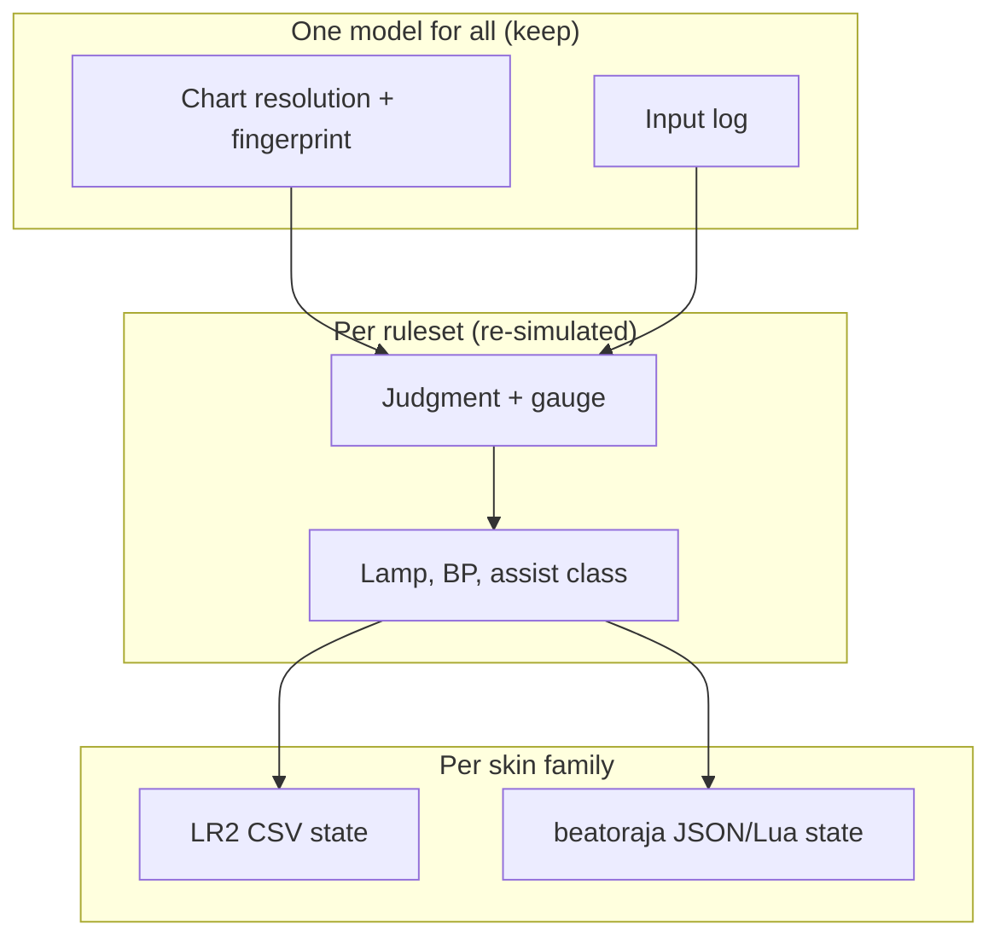

[Japanese version](./semantics-lr2-beatoraja.ja.md)

# LR2 and beatoraja semantics

LR2 and beatoraja often read the same chart, option or skin id in different ways. be-music follows LR2 first outside its judge rulesets, and beatoraja where LR2 has no such feature. This survey lists where the two engines mean different things, what be-music does today, and what an LR2-first model risks for beatoraja skins, beatoraja-origin data, scores and lamps. Chart-format differences are covered in [BMS / bmson compatibility notes](./format-compat.md); this document looks at the layers above the format.

The survey is dated 2026-10-19 and reflects `devel` at `4f09cb5c`. Items already fixed by [#559](https://github.com/nulltask/be-music/issues/559)–[#566](https://github.com/nulltask/be-music/issues/566) are marked fixed in the text, and [Fixed on devel](#fixed-on-devel) lists them.

Pinned sources:

- beatoraja `exch-bms2/beatoraja` @ `8320241d` (links use `…/beatoraja/blob/8320241d…/src/bms/player/beatoraja/<path>`)
- OpenLR2 `GOMazk/OpenLR2` @ `583a3850` (the decompiled LR2, `LR2f.cpp` / `Main.cpp` / `structure.h`)
- jbms-parser @ `8108cd54`
- lr2oraja-endlessdream @ `2394f658`
- `LR2body.exe` (LR2beta3). The binary was inspected statically only, and its addresses are VAs.

Points already covered by earlier issues ([#133](https://github.com/nulltask/be-music/issues/133), [#135](https://github.com/nulltask/be-music/issues/135), [#139](https://github.com/nulltask/be-music/issues/139), [#142](https://github.com/nulltask/be-music/issues/142), [#403](https://github.com/nulltask/be-music/issues/403)–[#410](https://github.com/nulltask/be-music/issues/410), [#417](https://github.com/nulltask/be-music/issues/417), [#418](https://github.com/nulltask/be-music/issues/418)) are referenced, not repeated.

Claims that could not be confirmed in the sources are marked **(unverified)**.

Impact classes:

- **A** — breaks beatoraja skins or beatoraja-origin data if forced to LR2.
- **B** — changes scores, lamps or judgments between rulesets.
- **C** — UX expectation only.

## Executive summary

**The architecture already absorbs most semantic differences.** be-music splits LR2 and beatoraja along three seams, and the split is the right one:

- **Chart resolution: one model, fingerprinted.** Control flow, negative BPM, timing and drawing each have one model.
- **The judge ruleset: per ruleset, re-simulated from inputs.** It covers windows, note selection, LN style, the mine trigger, gauges and money score.
- **Skin state: per skin family.** LR2 CSV skins get LR2 vocabulary; beatoraja JSON/Lua skins get beatoraja vocabulary from the family-neutral `scene-model`.

So be-music does **not** blanket-feed beatoraja skins LR2 semantics, and it does not judge beatoraja plays with LR2 rules.

**The real risks sit in the layers around the judge**, where one model still applies to everything:

- **Records and lamps.** Lamps, assist handling, BP and record keys use one model. That model loses beatoraja data, and in places it matches neither engine.
- **Pre-judge choices that are not recorded richly enough.** Lane options, LN mode and physical key identity are examples.
- **Wiring gaps on the beatoraja skin path.** Some beatoraja skin state is LR2-shaped or never driven.

On top of these, each ruleset has a few fidelity bugs.

Top risks, most serious first:

1. **Assists and options don't affect lamps, records or eligibility.** LR2 does not save an assisted play at all, or caps its lamp at EASY and updates the lamp only. beatoraja gives (LIGHT) ASSIST and merges only the lamp. be-music merges auto-scratch, SCATTER and HS-FIX CONSTANT plays with full lamp, EX and BP. Local bests are inflated, and the Leaderboard mixes SCATTER and CONSTANT plays into the unassisted boards. (B)
2. **Single-play BP leaves out unjudged notes.** Both engines add them. With `endOnFailure` on by default, fewest-BP bests and the Leaderboard BP reward dying early. Separately, re-simulating a failed run under another ruleset scores notes the player never got to play. (B, all rulesets)
3. **The lamp vocabulary has no LIGHT ASSIST EASY.** beatoraja's ASSIST-EASY gauge clears as LightAssistEasy (id 3, op 1101). be-music records ASSIST_EASY, shows op 1100, and cannot round-trip beatoraja `score.db` lamps. The fix touches the Leaderboard `clearLampRank` storage. (A+B)
4. **beatoraja-ruleset fidelity bugs.**
   - TOTAL divides by base notes, but beatoraja counts CN/HCN tails, so recovery is up to 2× too fast.
   - For judgerank > 100 the BAD window is clamped to the unscaled leg.
   - Every mode uses the 7K gauge table.
   - A full combo ignores empty-POOR combo breaks on 5K/PMS.
   - Gauge arithmetic is double, not float.

   (B)

5. **LR2-ruleset fidelity bugs.**
   - Multi-BAD follows lr2oraja's collector, where the binary re-judges the next note with the same press.
   - Mines use a PGREAT press window with a late leg. LR2 uses a GREAT window ahead only, and a hit counts as a POOR, which adds to BP.
   - LR2 awards FULL COMBO before it checks the gauge.

   (B)

6. **The player LN mode (LN/CN/HCN) is missing and is not part of any record key.** beatoraja keys scores by `(sha256, lnmode)`. Imported CN/HCN scores have nowhere to go, and adding the option later would merge the three modes' records. (A+B)
7. **beatoraja TIMER_PLAY starts at load end, followed by a fixed 1.5 s lead-in.** be-music ignores `skin.playstart`, so every TIMER_PLAY-keyed beatoraja element runs early relative to the notes. (A)
8. **beatoraja skin state is unwired or LR2-shaped.**
   - Lua `event_index` and `set_timer` are not wired.
   - Result timers 150-152, score timers 348-352, HCN, PM-chara and custom timers are never set.
   - GAUGE_MAX never switches off.
   - MISS (420) shows POOR, and empty POOR is dropped.
   - Op 42 is always lit, and 43 / 1046 never light.

   (A)

9. **Lane options match neither engine.**
   - S-RANDOM can drop a note into a lane that is holding an LN.
   - SCATTER is plain RANDOM but is logged as `SCATTER`.
   - MIRROR and RANDOM permute only the lanes the chart uses.
   - Option index meanings differ between the skin families: LR2 3 = S-RANDOM, beatoraja 3 = R-RANDOM.

   (B, A)

10. **Replays drop physical key identity.** Without the scratch direction, beatoraja's BSS-by-reversal can never be judged or re-simulated. A field added later leaves older logs ambiguous, so add it soon. (B, data format)

Also notable:

- `#RESOLUTION,N` in beatoraja-era LR2 CSV skins is parsed as width/height. Every such skin's canvas breaks. (A)
- LR2-CSV dialect clashes: the bar-lamp index 5 is FC in LR2 and EX HARD in beatoraja, and 22nd-column offsets are ignored. (A)
- HS-FIX is chart-relative. LR2 normalises to BPM 150, and beatoraja keeps a visible duration (the green number). (C)

**Deliberately single-model, and should stay so:**

- Negative-BPM reverse scroll under every ruleset.
- The superset `#RANDOM`/`#SWITCH` evaluator.
- LR2-style note drawing.
- Event-timestamp input.
- Exact STOP lengths.

These belong to chart identity (fingerprint) or to the input log. Splitting them per ruleset would break "one chart, one input stream, three re-simulations" ([replay](./replay.md), [Leaderboard](./leaderboard.md)). Document them as known non-fidelity under `beatoraja`.

Most fixes below move a rule into the right box. The assist class and LR2 mine counting belong in "per ruleset". LN mode and the scratch direction belong in the input log. Timers and Lua belong in "per skin family".

## Summary table

| #   | Difference                                          | Class       | be-music today                                          | Recommendation                                                         |
| --- | --------------------------------------------------- | ----------- | ------------------------------------------------------- | ---------------------------------------------------------------------- |
| 1   | Assist/option effect on lamp and record             | B           | Ignored; full merge                                     | Per-ruleset assist-class resolver from logged fields; lamp-only merge  |
| 2   | BP includes unjudged notes (single play)            | B           | Course only                                             | Fix for all rulesets + Leaderboard migration                           |
| 3   | Failed run re-simulated under other rulesets        | B           | Ranked under all three                                  | Rank failed survival runs only under the played ruleset (or mark them) |
| 4   | LIGHT ASSIST EASY lamp                              | A, B        | Missing; ASSIST-EASY gauge → ASSIST_EASY                | Add lamp; append-only rank or migration                                |
| 5   | LR2 FC before gauge check                           | B           | FAILED first (beatoraja-style)                          | Per ruleset                                                            |
| 6   | FC vs empty-POOR combo break (bea 5K/PMS)           | B           | Ignored                                                 | Per ruleset                                                            |
| 7   | beatoraja TOTAL note count (CN/HCN tails)           | B           | Base notes                                              | Per ruleset (bug fix)                                                  |
| 8   | beatoraja BAD scaling for judgerank > 100           | B           | Clamped to unscaled BAD                                 | Per ruleset (bug fix)                                                  |
| 9   | beatoraja per-mode gauge tables                     | B, A        | 7K table everywhere                                     | Per mode inside `beatoraja`                                            |
| 10  | Gauge float vs double                               | B           | double                                                  | `Math.fround` under `beatoraja`                                        |
| 11  | `#DEFEXRANK` int truncation (bea)                   | B           | Rounded                                                 | `Math.trunc` under `beatoraja`                                         |
| 12  | LR2 multi-BAD chain                                 | B           | lr2oraja collector                                      | Switch `lr2` to the binary's chain                                     |
| 13  | LR2 mine window, late leg, POOR count               | B           | PGREAT both sides, no counter                           | Switch `lr2` to the binary                                             |
| 14  | PMS MissCondition.ONE / judgeVanish                 | B           | Not modelled (documented gap, judgeVanish undocumented) | Per ruleset when PMS matters                                           |
| 15  | Player LN mode + record key                         | A, B        | Chart `#LNMODE` only; key without LN mode               | Option under `beatoraja`, logged; LN mode in record / ranking key      |
| 16  | Gauge line-up (EX-HARD, ASSIST, P/G.ATTACK)         | A, B        | 4 LR2-family names mapped                               | Ruleset-scoped gauge ids in the option                                 |
| 17  | Gauge auto shift (GAS)                              | C, B        | Not modelled                                            | Keep; log the mode if added                                            |
| 18  | bmson `judge_rank` unit                             | B           | Per ruleset                                             | Keep; document cross-ruleset incomparability                           |
| 19  | Negative / zero BPM                                 | B, C        | LR2 reversal for all                                    | Keep; document                                                         |
| 20  | STOP rounding, SCROLL/SPEED                         | B (tiny), C | Exact; beatoraja drawing                                | Keep                                                                   |
| 21  | Input time source                                   | C           | Event timestamps                                        | Keep                                                                   |
| 22  | Judgment-timing (display) offset                    | C, A        | Only audio/judge offset; skin numbers 0                 | Add display-only offset; feed skin numbers                             |
| 23  | `#RANDOM` nesting model                             | B (rare)    | Superset stack model                                    | Keep; document; fix doc comment                                        |
| 24  | Seeds vs resolved pattern; retry same pattern       | C, A        | Resolved channels logged; no seed                       | Keep; add "retry keeps pattern" option                                 |
| 25  | Option vocabulary / index order                     | A, C        | LR2 order, no CONVERGE / beatoraja set                  | Options by name, per-family index tables                               |
| 26  | S-RANDOM / SCATTER / CONVERGE / H-RANDOM algorithms | B           | Neither engine; bugs                                    | Implement LR2 S-RAN/SCATTER + beatoraja S-RANDOM as a pure helper      |
| 27  | MIRROR / RANDOM lane domain                         | B           | Used lanes only                                         | Full key-lane set                                                      |
| 28  | DP FLIP / BATTLE / option packing                   | C, A        | dpFlip only                                             | Keep; decode on import                                                 |
| 29  | Hi-speed scale / range                              | C           | 0.1-6.0, two scales                                     | Raise cap per family                                                   |
| 30  | HS-FIX semantics (150-BPM norm vs duration)         | C, B        | Chart-relative                                          | Per skin family; CONSTANT as assist or removed                         |
| 31  | Lane cover / LIFT units in LR2 skin numbers         | C           | LR2 12/14/15 read 0                                     | Feed shutter % and offset                                              |
| 32  | BGA layers / NO MISS mode                           | C           | Superset; no NO MISS                                    | Add NO_MISS                                                            |
| 33  | Empty-press keysound                                | C           | Advances on early window                                | Optional per ruleset                                                   |
| 34  | LN end sound (beatoraja)                            | C           | None                                                    | Play distinct end id under beatoraja                                   |
| 35  | Physical key identity (BSS reversal)                | B           | Not logged                                              | Add optional `source` to inputs now                                    |
| 36  | Favourites / invisible flags                        | C           | beatoraja-style, no invisible                           | Add flags; map LR2 on import                                           |
| 37  | Sort / filter vocab vs LR2 skin buttons             | C           | Differs from optionstr.csv                              | Trace and align                                                        |
| 38  | Difficulty-table level folders                      | C           | Courses only                                            | Add level folders                                                      |
| 39  | Course record identity (md5 vs sha256, LN mode)     | A, B        | Two keys for one course                                 | Key by course fingerprint                                              |
| 40  | Best-record merge contents                          | B, A        | No assist gate, snapshot, clear count                   | Add; rebuildable from logs                                             |
| 41  | Replay format (.brd)                                | A           | No importer                                             | Convert via laneShufflePattern + keymap                                |
| 42  | `#RESOLUTION,N`                                     | A           | Parsed as w,h (bug)                                     | Accept index form                                                      |
| 43  | DST offset columns 21+                              | A           | LR2 op4 only                                            | Accept 3/4/5/10                                                        |
| 44  | beatoraja CSV-dialect commands                      | A           | Not parsed                                              | Optional dialect support                                               |
| 45  | `#SRC_BAR_LAMP` index meaning                       | A           | LR2                                                     | Switch on detected beatoraja dialect                                   |
| 46  | TIMER_PLAY / `skin.playstart`                       | A           | Load end + 1.5 s                                        | Stamp at chart start                                                   |
| 47  | GAUGE_MAX timer switch                              | A, C        | Never stops (bug)                                       | Start/stop                                                             |
| 48  | beatoraja-only timers                               | A           | Not driven                                              | Add to mapping                                                         |
| 49  | Lua `event_index` / `set_timer`                     | A           | nil                                                     | Wire                                                                   |
| 50  | MISS vs POOR numbers                                | A, C        | 420 = POOR (bug)                                        | Use emptyPoor                                                          |
| 51  | Gauge ops 42/43/1046                                | A, C        | 42 always (bug)                                         | Derive from gauge type                                                 |
| 52  | Song-list lamp images (JSON)                        | A, C        | Not rendered                                            | Render with 0-10 ids                                                   |
| 53  | "N/A" numbers hidden vs 0                           | C           | 0                                                       | Return undefined                                                       |
| 54  | Interpolation / loop / blend details                | C           | Per family                                              | Keep                                                                   |
| 55  | `#INFORMATION` type 16-18 collision                 | C           | Per family (unverified)                                 | Guard                                                                  |

## Time model and timing

### Input time source: poll time vs event timestamp

- **LR2:**
  - `ProcGame` polls input and judges every lane at one poll instant, in integer ms ([LR2f.cpp#L12610-L12634](https://github.com/GOMazk/OpenLR2/blob/583a38503555e59c4bafa49d60b9d0714c9007c2/LR2f.cpp#L12610-L12634)).
  - The loop runs per frame or in a busy thread ([#L13137-L13143](https://github.com/GOMazk/OpenLR2/blob/583a38503555e59c4bafa49d60b9d0714c9007c2/LR2f.cpp#L13137-L13143)).
- **beatoraja:** an input thread stamps each key change in µs ([input/BMSPlayerInputProcessor.java#L326-L335](https://github.com/exch-bms2/beatoraja/blob/8320241d8481e0826c703878c3eba01cd81ca3e4/src/bms/player/beatoraja/input/BMSPlayerInputProcessor.java#L326-L335)). Passes and misses are swept per frame.
- **Kind:** semantic, numerically small.
- **be-music today:** event timestamps ([`packages/player-browser/src/runtime/web-input-runtime.ts`](../packages/player-browser/src/runtime/web-input-runtime.ts)), judged in µs. beatoraja-style for every ruleset.
- **Impact:** C; B only at sub-frame level.
- **Recommendation:** keep. Emulating LR2 polling would make re-simulation depend on frame rate.

### LR2 integer-millisecond comparison

- **LR2:** `abs(timing - (int)note.realTiming)` against integer windows with `<=` ([#L7472-L7509](https://github.com/GOMazk/OpenLR2/blob/583a38503555e59c4bafa49d60b9d0714c9007c2/LR2f.cpp#L7472-L7509)). The window table is in ms ([#L27586-L27610](https://github.com/GOMazk/OpenLR2/blob/583a38503555e59c4bafa49d60b9d0714c9007c2/LR2f.cpp#L27586-L27610)).
- **beatoraja:** µs `long` comparisons.
- **Kind:** parameter.
- **be-music today:** µs everywhere ([`packages/player-engine/src/ruleset/definitions.ts`](../packages/player-engine/src/ruleset/definitions.ts)).
- **Impact:** B, at sub-ms boundaries only.
- **Recommendation:** keep, and document it as accepted.

### Judgment-timing offset: what it moves

- **LR2:** `judgetiming` (-99..99) shifts only the drawing clock ([#L2185](https://github.com/GOMazk/OpenLR2/blob/583a38503555e59c4bafa49d60b9d0714c9007c2/LR2f.cpp#L2185)), and AUTO-ADJUST nudges it ([#L12643-L12644](https://github.com/GOMazk/OpenLR2/blob/583a38503555e59c4bafa49d60b9d0714c9007c2/LR2f.cpp#L12643-L12644)).
- **beatoraja:** the same visual-only meaning ([play/LaneRenderer.java#L301](https://github.com/exch-bms2/beatoraja/blob/8320241d8481e0826c703878c3eba01cd81ca3e4/src/bms/player/beatoraja/play/LaneRenderer.java#L301)), with auto-adjust in `JudgeManager`.
- **Kind:** semantic.
- **be-music today:** neither engine's model.
  - `audioOffsetMs` moves the judge clock ([`packages/player-engine/src/core/engine-types.ts`](../packages/player-engine/src/core/engine-types.ts), [`play-loop.ts`](../packages/player-engine/src/core/play-loop.ts)). There is no display-only offset.
  - beatoraja `NUMBER_JUDGETIMING` reads 0 ([`packages/skin-beatoraja/src/scene/play-numbers.ts`](../packages/skin-beatoraja/src/scene/play-numbers.ts)), and so does LR2 number 12 ([`packages/skin-lr2/src/state/options.ts`](../packages/skin-lr2/src/state/options.ts)).
- **Impact:** C; minor A (the skin number and its +/- buttons do nothing).
- **Recommendation:** add a display-only offset as a player option, shared by both families, and expose it in both skin numbers. It is display only, so there is no replay risk.

### Negative and zero BPM

- **LR2:** a negative `#BPMxx` mirrors the scroll and the judge clock ([#L12620-L12625](https://github.com/GOMazk/OpenLR2/blob/583a38503555e59c4bafa49d60b9d0714c9007c2/LR2f.cpp#L12620-L12625)).
- **beatoraja:** ignores BPM ≤ 0 ([format-compat §2.8](./format-compat.md#28-bpm)).
- **Kind:** semantic (chart timing).
- **be-music today:** the LR2 reversal under every ruleset; `chart.reversalTimeUs` is logged ([player spec — Negative BPM](./player-spec.md#negative-bpm--lr2-reverse-scroll)).
- **Impact:** B. A `beatoraja` play of such a chart is judged on LR2's clock.
- **Recommendation:** keep a single model. It is part of the resolved chart that the log and the fingerprint pin. Document that `beatoraja` results on reverse-scroll charts are not beatoraja-faithful.

### STOP, measure length, SCROLL/SPEED

- **LR2:**
  - STOP values are integers.
  - SCROLL/SPEED do not exist.
- **beatoraja:**
  - Each STOP is truncated to µs, which drifts by up to a few ms on stop-heavy charts.
  - SCROLL/SPEED are supported ([format-compat §2.9–§2.11](./format-compat.md#29-stop-and-stp)).
- **Kind:** parameter (STOP); visual (SCROLL/SPEED).
- **be-music today:** exact STOP lengths, and beatoraja's SCROLL/SPEED drawing under every ruleset. Already documented.
- **Impact:** tiny B; C.
- **Recommendation:** keep. Note times live in the stored resolved chart.

## Judgment

Already modelled per ruleset ([`packages/player-engine/src/ruleset/definitions.ts`](../packages/player-engine/src/ruleset/definitions.ts), [`core/judge-window.ts`](../packages/player-engine/src/core/judge-window.ts)), no action needed:

- windows and rank tables, including LR2 `#RANK 4` = NORMAL vs beatoraja 125, and the LR2 NONSTOP rank table
- note selection (`lowest` vs beatoraja's `combo`/`duration`/`lowest`/`score`)
- LN-only vs per-note LN/CN/HCN
- the LR2 LN-head late-BAD rule and LN early release
- presses during an LN, and the beatoraja PMS release margin
- empty-POOR windows, and empty POOR breaking combo on beatoraja 5K/PMS
- the mine trigger model (but see below)
- scratch windows and BSS re-press rules

### beatoraja BAD scaling for judgerank > 100 (bug)

- **LR2:** fixed table; BAD is a fixed 200 ms, and scaled windows never exceed it ([#L27586-L27610](https://github.com/GOMazk/OpenLR2/blob/583a38503555e59c4bafa49d60b9d0714c9007c2/LR2f.cpp#L27586-L27610)).
- **beatoraja:** `JudgeWindowRule.NORMAL` scales PG/GR/GD **and BAD** by judgerank, then clamps the inner windows to the **scaled** BAD ([play/JudgeProperty.java#L210-L273](https://github.com/exch-bms2/beatoraja/blob/8320241d8481e0826c703878c3eba01cd81ca3e4/src/bms/player/beatoraja/play/JudgeProperty.java#L210-L273)). So 7K `#RANK 4` gives BAD -350/+275 ms.
- **Kind:** parameter (a modelling bug).
- **be-music today:** `scaleBeatorajaWindows` ([`definitions.ts`](../packages/player-engine/src/ruleset/definitions.ts) ~L310-L343) clamps every leg to the **unscaled** BAD, so `beatoraja` BAD stays at -280/+220. This is correct only for PMS, where BAD is fixed.
- **Impact:** B. It affects VERY EASY charts, `#DEFEXRANK` > 133 and bmson `judge_rank` > 100.
- **Recommendation:** clamp to the scaled BAD unless the ruleset fixes BAD. Re-simulation updates `beatoraja/0` results.

### `#DEFEXRANK` integer truncation (beatoraja)

- **LR2:** has no `#DEFEXRANK`; it is a be-music extension.
- **beatoraja:** `judgerank * 75 / 100` in `int` ([play/BMSPlayerRule.java#L63](https://github.com/exch-bms2/beatoraja/blob/8320241d8481e0826c703878c3eba01cd81ca3e4/src/bms/player/beatoraja/play/BMSPlayerRule.java#L63)), then `long` scaling (JudgeProperty L232-L235).
- **Kind:** parameter.
- **be-music today:** fractional value, then `Math.round` per leg.
- **Impact:** B, ≤ 1 % of a window.
- **Recommendation:** `Math.trunc` both steps under `beatoraja`.

### bmson `judge_rank` unit

- **LR2:** no bmson. be-music follows lr2oraja: 100 = NORMAL.
- **beatoraja:** uses the value as the judgerank percent, so 100 = BMS `#RANK 3` EASY ([BMSPlayerRule.java#L64](https://github.com/exch-bms2/beatoraja/blob/8320241d8481e0826c703878c3eba01cd81ca3e4/src/bms/player/beatoraja/play/BMSPlayerRule.java#L64)).
- **Kind:** semantic (unit). Already split per ruleset.
- **Impact:** B. The same bmson chart is one rank easier under `beatoraja`, so cross-ruleset ranks on bmson are not comparable.
- **Recommendation:** keep, and document it on the [Leaderboard](./leaderboard.md) and [format-compat](./format-compat.md#36-judge_rank) pages.

### LR2 multi-BAD is a re-judge chain, not a BAD collector

- **LR2:** after a BAD, the same press is fed to the lane's next note if that note lies within the BAD window. The note is judged on its own gap and can come out PGREAT/GREAT/GOOD. The chain moves forward only, applies to taps only, and continues only while each step is a BAD. Sources: [#L7509-L7521](https://github.com/GOMazk/OpenLR2/blob/583a38503555e59c4bafa49d60b9d0714c9007c2/LR2f.cpp#L7509-L7521); binary VA 0x418d3b-0x418d55 (`cmpl 0x97a30` = `judgetime[2]`, `calll 0x418850`).
- **beatoraja:** no multi-BAD.
- **Kind:** semantic.
- **be-music today:** follows lr2oraja's `MultiBadCollector` ([`core/judge-core-press.ts`](../packages/player-engine/src/core/judge-core-press.ts) `applyMultiBadCollector`, [`ruleset/long-note.ts`](../packages/player-engine/src/ruleset/long-note.ts), mirrored in [`replay/simulate.ts`](../packages/player-engine/src/replay/simulate.ts)).
- **Impact:** B. EX and combo change on jacks and chords under `lr2`.
- **Recommendation:** under LR2-first, the binary is the authority, so switch `lr2` to the chain. That changes `lr2/0` re-simulations; the log format is unchanged.

### Mines: LR2 window, late side, POOR count

- **LR2:**
  - A press detonates the lane's mine when the mine is less than the **GREAT** window ahead ([#L7437-L7445](https://github.com/GOMazk/OpenLR2/blob/583a38503555e59c4bafa49d60b9d0714c9007c2/LR2f.cpp#L7437-L7445); binary 0x4188ad-0x4188d2 reads `judgetime[4]`).
  - Once past the line, the mine is retired on the first poll and detonates if the key is held ([#L7446-L7458](https://github.com/GOMazk/OpenLR2/blob/583a38503555e59c4bafa49d60b9d0714c9007c2/LR2f.cpp#L7446-L7458)).
  - A hit increments POOR once (binary 0x40659c-0x4065bd; OpenLR2's second increment at L2052 is a transcription artifact), so it adds to BP but not to combo.
  - The 2 % floor also inside courses is **(unverified in binary)**.
- **beatoraja:** only a key held down as the mine passes detonates it; it costs gauge only and touches no counter ([play/JudgeManager.java#L244-L248](https://github.com/exch-bms2/beatoraja/blob/8320241d8481e0826c703878c3eba01cd81ca3e4/src/bms/player/beatoraja/play/JudgeManager.java#L244-L248)).
- **Kind:** semantic (counter) + parameter (window).
- **be-music today:** `press-or-hold` uses the PGREAT window on both sides, from LR2 history.txt 080114, and never touches counters ([`core/judge-core-advance.ts`](../packages/player-engine/src/core/judge-core-advance.ts)).
- **Impact:** B. `lr2` BP and POOR on mine charts, and the Leaderboard BP.
- **Recommendation:** switch `lr2` to the binary. The inputs are already logged.

### PMS: one empty POOR per note, and BAD that does not vanish

- **beatoraja:** PMS uses `MissCondition.ONE` and `judgeVanish = false` for BAD, so a note stays hittable after a BAD ([play/JudgeProperty.java#L34-L44](https://github.com/exch-bms2/beatoraja/blob/8320241d8481e0826c703878c3eba01cd81ca3e4/src/bms/player/beatoraja/play/JudgeProperty.java#L34-L44)). LR2 has no PMS.
- **Kind:** semantic.
- **be-music today:** not modelled. `MissCondition.ONE` is listed in [replay — Fidelity notes](./replay.md#fidelity-notes); `judgeVanish` is not.
- **Impact:** B. 9-key charts under `beatoraja`.
- **Recommendation:** add `judgeVanish` to the fidelity notes, and model both when PMS matters.

### Player LN mode (LN/CN/HCN) for undefined long notes

- **LR2:** every long note is an LN; `#LNMODE` is ignored.
- **beatoraja:**
  - Notes without `#LNMODE` are `TYPE_UNDEFINED` and play as the player's `lnmode`: 0 LN (default), 1 CN, 2 HCN.
  - Scores and replays are keyed by `(sha256, lnmode)` when the chart has undefined LNs ([PlayDataAccessor.java#L196-L210](https://github.com/exch-bms2/beatoraja/blob/8320241d8481e0826c703878c3eba01cd81ca3e4/src/bms/player/beatoraja/PlayDataAccessor.java#L196-L210)).
  - The note count, TOTAL and the default TOTAL all follow the chosen mode.
- **Kind:** semantic.
- **be-music today:**
  - `per-note` honours the chart, and a missing `#LNMODE` plays as LN ([`packages/chart-model/src/note-rules.ts`](../packages/chart-model/src/note-rules.ts), [`ruleset/long-note.ts`](../packages/player-engine/src/ruleset/long-note.ts)).
  - There is no player option.
  - Records are keyed `ruleset:sha256` ([`packages/app-play/src/chart-best-records.ts`](../packages/app-play/src/chart-best-records.ts)).
  - The fingerprint's LN mode is `#LNMODE`, else 1 ([fingerprint spec §3.4](./fingerprint-spec.md#34-events)).
  - The skins' LN-mode button does nothing.
- **Impact:** A (beatoraja `score.db` import collapses CN/HCN rows); B (CN/HCN players' scores cannot be reproduced).
- **Recommendation:**
  - Add a player option under `beatoraja` and record it in the replay as a ruleset input, as `judgeAlgorithm` is. Re-simulation must read it from the log.
  - Put the effective LN mode in the record key and the Leaderboard ranking key (or a filter) **before** shipping the option.

### Scratch, BSS, auto scratch

Already per ruleset: the windows, LR2's re-judge or empty POOR on a reversal, and beatoraja ignoring a re-press. The remaining gap is beatoraja's "other direction ends the BSS"; see [Physical key identity](#physical-key-identity-scratch-direction-bss). For auto scratch in records, see [Assists and options](#assists-and-options-vs-lamps-records-and-eligibility).

## Scoring, lamps and records

### Assists and options vs lamps, records and eligibility

- **LR2:**
  - `CheckScoreSaveConditon` sends these plays down a branch that **caps the lamp at EASY** and updates only the lamp and the counts: battle (except G-BATTLE), HS-FIX CONSTANT, `random >= 4` (SCATTER/CONVERGE), auto-key and assist. No EX, BP or combo is saved ([#L68-L79](https://github.com/GOMazk/OpenLR2/blob/583a38503555e59c4bafa49d60b9d0714c9007c2/LR2f.cpp#L68-L79), [#L9334-L9364](https://github.com/GOMazk/OpenLR2/blob/583a38503555e59c4bafa49d60b9d0714c9007c2/LR2f.cpp#L9334-L9364)).
  - `isForceEasy` is set for CONSTANT on BPM-changing charts, for SCATTER, for the EASY gauge and for auto scratch ([#L27074-L27092](https://github.com/GOMazk/OpenLR2/blob/583a38503555e59c4bafa49d60b9d0714c9007c2/LR2f.cpp#L27074-L27092)).
  - Non-ghost battle, a slowed tempo and `+note` options are no-save.
- **beatoraja:** BPM guide, BATTLE, auto scratch, H-RANDOM, ALL-SCR, the EX randoms and the LN/mine modifiers set assist 1 (LIGHT ASSIST). A custom judge > 100 % sets assist 2 (ASSIST). Either way `updateScore = false`, so only the lamp is merged ([play/BMSPlayer.java#L199-L255](https://github.com/exch-bms2/beatoraja/blob/8320241d8481e0826c703878c3eba01cd81ca3e4/src/bms/player/beatoraja/play/BMSPlayer.java#L199-L255), [#L862-L868](https://github.com/exch-bms2/beatoraja/blob/8320241d8481e0826c703878c3eba01cd81ca3e4/src/bms/player/beatoraja/play/BMSPlayer.java#L862-L868)).
- **Kind:** semantic. The lamp is a function of the options, not only of the gauge.
- **be-music today:** neither model.
  - `resolveClearLamp` ([`ruleset/clear-lamp.ts`](../packages/player-engine/src/ruleset/clear-lamp.ts)) ignores options.
  - `checkReplayEligibility` ([`replay/eligibility.ts`](../packages/player-engine/src/replay/eligibility.ts)) flags only auto scratch and a judge-window override.
  - Local bests ([`records/best-record.ts`](../packages/player-engine/src/records/best-record.ts), [`app-play/src/app/routes/result.ts`](../packages/app-play/src/app/routes/result.ts), [`chart-best-records.ts`](../packages/app-play/src/chart-best-records.ts) `playKeepsRecord`) keep full lamp, EX and BP for auto-scratch, SCATTER and CONSTANT plays.
- **Impact:** B. Bests and lamps come out higher than either engine gives, and SCATTER/CONSTANT plays sit on unassisted boards.
- **Recommendation:**
  - Add a pure per-ruleset "assist class" resolver over logged `play` fields (lane option, HS-FIX, auto scratch, judge override, battle):
    - `lr2`: cap the lamp at EASY and update the lamp only.
    - `beatoraja`: LIGHT ASSIST / ASSIST lamp, lamp-only update.
  - It reads only logged fields, so Leaderboard re-simulation stays deterministic.
  - Store the class as a flag rather than rejecting the play.

### BP of a play that ended early

- **LR2:** `SaveResult` adds unjudged notes to BP for single plays and grades ([#L9105-L9113](https://github.com/GOMazk/OpenLR2/blob/583a38503555e59c4bafa49d60b9d0714c9007c2/LR2f.cpp#L9105-L9113)). BP = BAD + POOR, where POOR includes empty POORs and mine hits ([#L1945-L1951](https://github.com/GOMazk/OpenLR2/blob/583a38503555e59c4bafa49d60b9d0714c9007c2/LR2f.cpp#L1945-L1951)).
- **beatoraja:** `minbp = BD + PR + MS + (notes − pastNotes)` ([BMSPlayer.java#L909](https://github.com/exch-bms2/beatoraja/blob/8320241d8481e0826c703878c3eba01cd81ca3e4/src/bms/player/beatoraja/play/BMSPlayer.java#L909)).
- **Kind:** both engines agree; be-music differs.
- **be-music today:** course stages add unjudged notes ([`records/best-record.ts`](../packages/player-engine/src/records/best-record.ts)); single plays (`recordPlayFromResult`) and the Leaderboard ([`packages/app-leaderboard/src/scores/submit.ts`](../packages/app-leaderboard/src/scores/submit.ts)) do not. With `endOnFailure` on by default, a play that dies early gets a tiny BP.
- **Impact:** B, all rulesets.
- **Recommendation:** single-play BP = `resolveMissCount(judge, noteCount − judged)`. Needs a Leaderboard migration, as `0012` was.

### Re-simulating a failed run under another ruleset

- **LR2:** a run ends below 2 % ([#139](https://github.com/nulltask/be-music/issues/139)).
- **beatoraja:** ends at 0.
- **Kind:** semantic, at the data level.
- **be-music today:** the live play, and so its input log, stops at the played ruleset's failure point, but `simulateReplayRulesets` and the Leaderboard rank all three rulesets. Under a ruleset that would have survived, the remaining notes are all missed.
- **Impact:** B. Other-ruleset EX, BP and lamp of failed runs are artifacts of where the player was stopped.
- **Recommendation:** rank failed survival-gauge runs only under the played ruleset, or mark them, and say so in the [Leaderboard design](./leaderboard.md). Never synthesize the inputs that were not played.

### Clear-lamp vocabulary: LIGHT ASSIST EASY

- **LR2:** 0 NOPLAY, 1 FAILED, 2 EASY, 3 NORMAL, 4 HARD, 5 FULLCOMBO.
- **beatoraja:**
  - Ids 0-10: NoPlay, Failed, AssistEasy, **LightAssistEasy**, Easy, Normal, Hard, ExHard, FullCombo, Perfect, Max ([ClearType.java#L10-L20](https://github.com/exch-bms2/beatoraja/blob/8320241d8481e0826c703878c3eba01cd81ca3e4/src/bms/player/beatoraja/ClearType.java#L10-L20)).
  - The ASSIST EASY **gauge** clears as LightAssistEasy. AssistEasy comes only from assist level 2 ([play/GrooveGauge.java#L111-L113](https://github.com/exch-bms2/beatoraja/blob/8320241d8481e0826c703878c3eba01cd81ca3e4/src/bms/player/beatoraja/play/GrooveGauge.java#L111-L113)).
  - Ops are 1100 ASSIST, 1101 LIGHT ASSIST, 1102 EXHARD, 1103 PERFECT, 1104 MAX ([skin/SkinProperty.java#L706-L714](https://github.com/exch-bms2/beatoraja/blob/8320241d8481e0826c703878c3eba01cd81ca3e4/src/bms/player/beatoraja/skin/SkinProperty.java#L706-L714)).
- **Kind:** semantic (vocabulary).
- **be-music today:**
  - `CLEAR_LAMPS` has no LIGHT_ASSIST_EASY, and the `ASSIST-EASY` gauge maps to `ASSIST_EASY` ([`ruleset/clear-lamp.ts`](../packages/player-engine/src/ruleset/clear-lamp.ts), ~L58).
  - So the beatoraja skin lights op 1100 ([`packages/skin-beatoraja/src/scene/clear-lamp.ts`](../packages/skin-beatoraja/src/scene/clear-lamp.ts)). `CLEAR_LAMP_LIGHT_ASSIST_EASY: 1101` is defined, but nothing maps to it.
  - The Leaderboard stores lamp ranks 1-9 ([Leaderboard §6](./leaderboard.md#6-scoring-rules)).
- **Impact:** A (beatoraja skins show the wrong lamp; beatoraja ids 2 and 3 cannot round-trip); B (lamp name under `beatoraja`).
- **Recommendation:**
  - Add LIGHT_ASSIST_EASY.
  - Under `beatoraja`, map the ASSIST-EASY gauge to it, and assist levels 1 and 2 to LIGHT and ASSIST.
  - LR2 skins keep folding both into EASY.
  - Inserting a lamp shifts `clearLampRank`, so either make the rank table append-only or migrate it (as `0012` did). Re-simulation is unaffected because the lamp is derived.

### LR2 awards FULL COMBO before the gauge check

- **LR2:** `CheckClear` returns FC when `totalnotes == max_combo`, before any gauge test ([#L1834-L1840](https://github.com/GOMazk/OpenLR2/blob/583a38503555e59c4bafa49d60b9d0714c9007c2/LR2f.cpp#L1834-L1840); binary 0x405da4-0x405dc9).
- **beatoraja:** FC only when the play did not fail and the gauge qualifies ([BMSPlayer.java#L864-L868](https://github.com/exch-bms2/beatoraja/blob/8320241d8481e0826c703878c3eba01cd81ca3e4/src/bms/player/beatoraja/play/BMSPlayer.java#L864-L868)).
- **Kind:** semantic.
- **be-music today:** FAILED first for every ruleset ([`ruleset/clear-lamp.ts`](../packages/player-engine/src/ruleset/clear-lamp.ts) `finishClearLamp`).
- **Impact:** B. Rare `lr2` lamps, for example a GROOVE full combo that ends below 80 % because of empty POORs.
- **Recommendation:** per ruleset. The lamp is a pure function of stored results, so re-deriving is enough.

### Full combo vs empty-POOR combo breaks (beatoraja 5K/PMS)

- **LR2:** FC = `totalnotes == max_combo` ([#L1838](https://github.com/GOMazk/OpenLR2/blob/583a38503555e59c4bafa49d60b9d0714c9007c2/LR2f.cpp#L1838)); an empty POOR never breaks combo.
- **beatoraja:** FC = `pastNotes == combo` (L868), and on 5K/PMS an empty POOR resets combo.
- **Kind:** semantic.
- **be-music today:** `isFullCombo` counts PG+GR+GD ≥ total and ignores `comboBreaksOnEmptyPoor`.
- **Impact:** B.
- **Recommendation:** per ruleset: when `comboBreaksOnEmptyPoor` is set, FC also needs max combo = note count.

### EX score, money score, DJ level

EX = 2PG + GR in both engines. Only LR2 has the money score ([#L1991](https://github.com/GOMazk/OpenLR2/blob/583a38503555e59c4bafa49d60b9d0714c9007c2/LR2f.cpp#L1991)). DJ level uses ninths in both. This is already per ruleset (`moneyScore`). Note that EX is not comparable across rulesets because the denominators differ: an LN counts 1, a CN 2. **Keep.**

### Best-record merge

- **LR2:**
  - The lamp merges as a max.
  - A strictly higher EX replaces the judge snapshot, `rseed`, `op_best` and the ghost.
  - `maxcombo` (max) and `minbp` (min) merge independently.
  - It also keeps play, clear and fail counts and `op_history` bits ([#L9055-L9125](https://github.com/GOMazk/OpenLR2/blob/583a38503555e59c4bafa49d60b9d0714c9007c2/LR2f.cpp#L9055-L9125)).
- **beatoraja:**
  - `ScoreData.update` always merges the lamp.
  - EX, avgjudge, minbp and combo merge independently, and only when `updateScore` is set.
  - Each improvement stores its option and seed.
  - It also keeps the ghost, trophies, clear and play counts, and a `scorelog` row per improvement ([ScoreData.java#L541-L590](https://github.com/exch-bms2/beatoraja/blob/8320241d8481e0826c703878c3eba01cd81ca3e4/src/bms/player/beatoraja/ScoreData.java#L541-L590)).
- **Kind:** semantic: the assist gate, and what is stored alongside each best.
- **be-music today:** `mergeBestRecord` merges lamp, EX, combo and BP independently and keeps a play count. There is no assist gate, clear count, judge snapshot or date, and no link to the best replay.
- **Impact:** B; A on import.
- **Recommendation:**
  - Add the assist gate.
  - Add `clearCount`, the best-EX judge snapshot and a pointer to the best replay; the pointer is needed for the [#418](https://github.com/nulltask/be-music/issues/418) MY BEST ghost.
  - Everything is derivable from logs, so records can be rebuilt.

### Replay and import formats

- **LR2:**
  - One replay per chart, controlled by `#REPLAYSAVE` ([#L32376-L32392](https://github.com/GOMazk/OpenLR2/blob/583a38503555e59c4bafa49d60b9d0714c9007c2/LR2f.cpp#L32376-L32392)).
  - The ghost is a per-note judgement sequence ([#418](https://github.com/nulltask/be-music/issues/418)).
  - `score.db` is keyed by MD5. A course key is a course header plus the stage MD5s, with header chars 28-31 taken from the player's password MD5 ([#L19217](https://github.com/GOMazk/OpenLR2/blob/583a38503555e59c4bafa49d60b9d0714c9007c2/LR2f.cpp#L19217)).
- **beatoraja:**
  - `.brd` is gzipped JSON. It holds a physical-key log (keycode±, µs), `rand`, the options and seeds, `laneShufflePattern`, the gauge and `PlayConfig` ([ReplayData.java#L26-L106](https://github.com/exch-bms2/beatoraja/blob/8320241d8481e0826c703878c3eba01cd81ca3e4/src/bms/player/beatoraja/ReplayData.java#L26-L106)).
  - There are 4 slots, and nothing is saved for assisted plays.
  - The ghost lives in `score.db` as gzip+base64.
- **Kind:** semantic. beatoraja replays are physical-key logs re-judged by the current engine.
- **be-music today:** every play is auto-saved as a `be-music-replay` (resolved notes + channel inputs + draws) and re-simulated per ruleset. No `score.db` or `.brd` reader exists.
- **Impact:** A for any import.
- **Recommendation:**
  - A `.brd` import converts `laneShufflePattern` + `rand` into resolved notes, and keycodes into channels + `source`.
  - Imported logs and records are unranked unless fingerprint and re-simulation verify them.
  - Never merge an imported lamp into another ruleset's record.
  - Decode LR2 `op_best` and beatoraja `option` per source.

## Gauges

Already per ruleset: LR2 death border and guts, the LR2 DEATH table (**fixed in [#559](https://github.com/nulltask/be-music/issues/559)**), course gauges ([#408](https://github.com/nulltask/be-music/issues/408)), and LR2 DEATH clear = NORMAL.

### beatoraja TOTAL note count includes CN/HCN tails (bug)

- **LR2:** an LN is one note.
- **beatoraja:** the TOTAL modifier is `f * total / getTotalNotes()` ([play/GrooveGauge.java#L260](https://github.com/exch-bms2/beatoraja/blob/8320241d8481e0826c703878c3eba01cd81ca3e4/src/bms/player/beatoraja/play/GrooveGauge.java#L260)), and `getTotalNotes` counts CN/HCN ends ([jbms-parser TimeLine.java#L139-L156](https://github.com/exch-bms2/jbms-parser/blob/8108cd54a19275810e1f5d2c9586f008eb6db95e/src/bms/model/TimeLine.java#L139-L156)). The same count feeds the default TOTAL and `LIMIT_INCREMENT`.
- **Kind:** parameter (a modelling bug).
- **be-music today:** `beatoraja` uses `baseNotes` ([`definitions.ts`](../packages/player-engine/src/ruleset/definitions.ts) ~L811-L833, [`facts.ts`](../packages/player-engine/src/ruleset/facts.ts) `countBaseNotes`).
- **Impact:** B. CN/HCN charts recover up to 2× too fast, which changes lamps.
- **Recommendation:** pass the ruleset's judgment count under `beatoraja`.

### beatoraja per-mode gauge tables

- **LR2:** one set of tables.
- **beatoraja:** separate FIVEKEYS, SEVENKEYS, PMS and KEYBOARD tables. Examples: 5K borders 75/50; HARD_5 has no recovery; PMS max 120, initial 30, border 85 ([play/GaugeProperty.java#L77-L105](https://github.com/exch-bms2/beatoraja/blob/8320241d8481e0826c703878c3eba01cd81ca3e4/src/bms/player/beatoraja/play/GaugeProperty.java#L77-L105)). The 24K default TOTAL also differs.
- **Kind:** parameter.
- **be-music today:** the 7K table for every mode (documented in [replay — Fidelity notes](./replay.md#fidelity-notes)). Course class gauges already switch per mode.
- **Impact:** B; A, because a PMS gauge max of 120 changes how skins render the gauge.
- **Recommendation:** pick the table per mode inside `beatoraja`.

### Gauge arithmetic precision

- **LR2:** double, displayed in 2 % steps ([#L1954-L1975](https://github.com/GOMazk/OpenLR2/blob/583a38503555e59c4bafa49d60b9d0714c9007c2/LR2f.cpp#L1954-L1975)).
- **beatoraja:** `float` ([GrooveGauge.java#L218-L240](https://github.com/exch-bms2/beatoraja/blob/8320241d8481e0826c703878c3eba01cd81ca3e4/src/bms/player/beatoraja/play/GrooveGauge.java#L218-L240)).
- **be-music today:** double everywhere.
- **Impact:** B, for border flips at 80 %.
- **Recommendation:** `Math.fround` under `beatoraja`.

### LR2 TOTAL and guts details

- **LR2:**
  - TOTAL is an integer.
  - Guts (×0.6) applies only to judge ≤ 2 ([#L1954-L1958](https://github.com/GOMazk/OpenLR2/blob/583a38503555e59c4bafa49d60b9d0714c9007c2/LR2f.cpp#L1954-L1958)).
- **be-music today:**
  - `lr2` keeps a fractional TOTAL.
  - Guts applies to any negative delta. That is harmless until P.ATTACK / G.ATTACK arrive ([#142](https://github.com/nulltask/be-music/issues/142)).
- **Impact:** tiny B.
- **Recommendation:** `Math.trunc` TOTAL under `lr2`, and add the guts judge mask with [#142](https://github.com/nulltask/be-music/issues/142).

### Gauge line-up and auto shift

- **LR2:** GROOVE, SURVIVAL, DEATH, EASY, P.ATTACK, G.ATTACK.
- **beatoraja:** ASSIST EASY, EASY, NORMAL, HARD, EX-HARD, HAZARD, plus class gauges. Every gauge runs in parallel, and GAUGEAUTOSHIFT (CONTINUE / SURVIVAL_TO_GROOVE / BESTCLEAR / SELECT_TO_UNDER) can change the gauge and the lamp. `score.gauge = -1` marks a shifted run (BMSPlayer L881).
- **Kind:** semantic (the option vocabulary, plus parallel gauges).
- **be-music today:**
  - `GaugeType` has GROOVE/HARD/DEATH/EASY ([`ruleset/gauge-type.ts`](../packages/player-engine/src/ruleset/gauge-type.ts)). DEATH maps to HAZARD under `beatoraja`.
  - ASSIST EASY and EX-HARD can be chosen only through the forced `gauge` option. P/G.ATTACK are missing ([#142](https://github.com/nulltask/be-music/issues/142)).
  - There is no GAS; `endOnFailure` corresponds to GAS NONE vs CONTINUE ([#139](https://github.com/nulltask/be-music/issues/139)).
- **Impact:** A (beatoraja skins' six-way gauge option and their lamp images); B (no reachable EX-HARD lamp); C (GAS).
- **Recommendation:**
  - Let the option carry ruleset-scoped gauge ids, logged as is (`options.gauge` already supports this).
  - Keep the LR2-family mapping only for cross-ruleset re-simulation.
  - If GAS is added, log the mode.

## Control flow, seeds and lane options

### `#RANDOM`/`#IF` nesting model

- **LR2:** flat state: one `randomVal` and one `ifOn` flag.
  - `#RANDOM` sets `ifOn = 0`, so lines between `#RANDOM` and the first `#IF` are dropped.
  - `#ENDIF` sets `ifOn = 1`, so an inner `#ENDIF` re-opens an outer false block.
  - A `#RANDOM` inside a skipped block still redraws.
  - There is no `#ELSE` or `#SWITCH` ([LR2f.cpp#L25952-L25966](https://github.com/GOMazk/OpenLR2/blob/583a38503555e59c4bafa49d60b9d0714c9007c2/LR2f.cpp#L25952-L25966)).
- **beatoraja (jbms-parser):** only the innermost `#IF` counts, so a true inner `#IF` inside a false outer one is read ([BMSDecoder.java#L197-L233](https://github.com/exch-bms2/jbms-parser/blob/8108cd54a19275810e1f5d2c9586f008eb6db95e/src/bms/model/BMSDecoder.java#L197-L233)).
- **Kind:** semantic.
- **be-music today:** a superset stack ([`packages/chart-model/src/control-flow.ts`](../packages/chart-model/src/control-flow.ts)). A line is active only when every frame is active, and `#ELSE`, `#SWITCH` and `#SETRANDOM` are supported. On mis-nested charts this matches neither engine. The doc comment "LR2 / beatoraja compatible" overstates it.
- **Impact:** B, on rare charts. The fingerprint bakes in be-music's model.
- **Recommendation:**
  - Keep a single model: it is chart identity, not judging.
  - Document the two divergences in [format-compat §2.14](./format-compat.md#214-control-flow) and fix the comment.
  - `play.randomDraws` pins the outcome, so there is no determinism risk.

### One seed vs separate seeds; retrying the same pattern

- **LR2:** one seed feeds both `#RANDOM` and every lane option. It is written into the replay and into `score.rseed`, and it is **kept on quick retry** ([LR2f.cpp#L25756-L25766](https://github.com/GOMazk/OpenLR2/blob/583a38503555e59c4bafa49d60b9d0714c9007c2/LR2f.cpp#L25756-L25766), [Main.cpp#L1100](https://github.com/GOMazk/OpenLR2/blob/583a38503555e59c4bafa49d60b9d0714c9007c2/Main.cpp#L1100)).
- **beatoraja:** `#RANDOM` results are stored as `rand`, and each side's lane option has its own seed. The result screen offers REPLAY_SAME and REPLAY_DIFFERENT ([ReplayData.java#L53-L82](https://github.com/exch-bms2/beatoraja/blob/8320241d8481e0826c703878c3eba01cd81ca3e4/src/bms/player/beatoraja/ReplayData.java#L53-L82), [result/MusicResult.java#L221-L244](https://github.com/exch-bms2/beatoraja/blob/8320241d8481e0826c703878c3eba01cd81ca3e4/src/bms/player/beatoraja/result/MusicResult.java#L221-L244)).
- **Kind:** semantic: what can be reproduced, and from what.
- **be-music today:** draws are recorded, and the resolved lane arrangement is logged ([`packages/player-browser/src/chart/replay-arrangement.ts`](../packages/player-browser/src/chart/replay-arrangement.ts)). Lane shuffles use unseeded `Math.random`, and F5 re-rolls the arrangement.
- **Impact:** C (no "retry same pattern"); A for imports, because a foreign seed cannot regenerate the pattern (different PRNGs and algorithms).
- **Recommendation:**
  - Keep logging resolved arrangements; that is strictly better for re-simulation.
  - Add a player option "retry keeps pattern" (on by default for LR2) and a "play with this log's pattern" action.
  - Treat imported seeds as opaque metadata.

### Option vocabulary and index order

- **LR2:** OFF, MIRROR, RANDOM, S-RANDOM, SCATTER, CONVERGE (0-5), plus `randFix` and `randSC` (`LR2files/Config/optionstr.csv`; [#L7093-L7100](https://github.com/GOMazk/OpenLR2/blob/583a38503555e59c4bafa49d60b9d0714c9007c2/LR2f.cpp#L7093-L7100)).
- **beatoraja:** IDENTITY, MIRROR, RANDOM, ROTATE (R-RANDOM), S_RANDOM, SPIRAL, H_RANDOM, ALL_SCR, RANDOM_EX, S_RANDOM_EX. PMS adds more ([pattern/Random.java#L5-L56](https://github.com/exch-bms2/beatoraja/blob/8320241d8481e0826c703878c3eba01cd81ca3e4/src/bms/player/beatoraja/pattern/Random.java#L5-L56)).
- **Kind:** semantic. The same index means different things: LR2 3 = S-RANDOM, beatoraja 3 = R-RANDOM.
- **be-music today:** `RANDOM_CYCLE` = OFF, MIRROR, RANDOM, S-RANDOM, SCATTER ([`packages/player-scene-model/src/play-options/choices.ts`](../packages/player-scene-model/src/play-options/choices.ts)). CONVERGE and the beatoraja set are missing. Logs store names.
- **Impact:** A (a beatoraja skin's option image index); C.
- **Recommendation:** keep options by name and map them to indices per skin family. Add CONVERGE, and add the beatoraja options as the set LR2 lacks.

### S-RANDOM, SCATTER, CONVERGE, H-RANDOM algorithms (bugs)

- **LR2:**
  - **S-RAN:** retry random lanes until the lane is free **and not inside a held LN**. There is no jack threshold ([#L27323-L27402](https://github.com/GOMazk/OpenLR2/blob/583a38503555e59c4bafa49d60b9d0714c9007c2/LR2f.cpp#L27323-L27402)).
  - **SCATTER:** S-RAN that also avoids the previous row's lanes, and forces EASY.
  - **CONVERGE:** S-RAN that first tries `randFix` ([#L27268-L27310](https://github.com/GOMazk/OpenLR2/blob/583a38503555e59c4bafa49d60b9d0714c9007c2/LR2f.cpp#L27268-L27310)).
- **beatoraja:**
  - **S-RANDOM:** a 40 ms threshold that avoids murioshi (impossible-to-press placements).
  - **H-RANDOM:** threshold from BPM (100 ms default), and LIGHT ASSIST.
  - Source: [pattern/Randomizer.java#L140-L250](https://github.com/exch-bms2/beatoraja/blob/8320241d8481e0826c703878c3eba01cd81ca3e4/src/bms/player/beatoraja/pattern/Randomizer.java#L140-L250).
- **Kind:** semantic.
- **be-music today** ([`packages/player-browser/src/session/play/play-chart.ts`](../packages/player-browser/src/session/play/play-chart.ts) `applyRandomMode`):
  - S-RANDOM draws a new permutation of the used lanes for each chord, with no LN-occupancy check, so a note can land inside a held LN.
  - SCATTER is aliased to RANDOM but logged as `'SCATTER'`.
  - MIRROR and RANDOM permute only `usedLanes`, so a 7K chart without lane 1 mirrors 2↔7. Both engines permute the full key-lane set ([#L27099-L27236](https://github.com/GOMazk/OpenLR2/blob/583a38503555e59c4bafa49d60b9d0714c9007c2/LR2f.cpp#L27099-L27236), [pattern/PatternModifier.java#L104-L123](https://github.com/exch-bms2/beatoraja/blob/8320241d8481e0826c703878c3eba01cd81ca3e4/src/bms/player/beatoraja/pattern/PatternModifier.java#L104-L123)).
- **Impact:** B. Patterns sold under LR2 names match neither engine.
- **Recommendation:**
  - Move the randomizers into `@be-music/player-engine` as pure helpers with an injected RNG, and add tests.
  - Implement LR2 S-RAN and SCATTER for the LR2 family, and beatoraja's S-RANDOM as a separate option.
  - Hide SCATTER until it is real.
  - Logs store resolved channels, so there is no re-simulation risk.

### DP FLIP, BATTLE, option packing

- **LR2:**
  - BATTLE family: OFF, BATTLE, D-BATTLE, SP-TO-DP, G-BATTLE, …
  - `op_best = gauge + r1*10 + r2*100 + flip*1000` ([#L9093-L9098](https://github.com/GOMazk/OpenLR2/blob/583a38503555e59c4bafa49d60b9d0714c9007c2/LR2f.cpp#L9093-L9098)).
- **beatoraja:**
  - `doubleoption`: OFF, FLIP, BATTLE, BATTLE AS.
  - `option = r1 + r2*10 + double*100` ([BMSPlayer.java#L870-L873](https://github.com/exch-bms2/beatoraja/blob/8320241d8481e0826c703878c3eba01cd81ca3e4/src/bms/player/beatoraja/play/BMSPlayer.java#L870-L873)).
- **be-music today:** `dpFlip` and independent sides; no BATTLE.
- **Impact:** C; A on import.
- **Recommendation:** keep, and decode the option integers per source on import.

## Hi-speed, HS-FIX, lane cover

### Hi-speed unit and range

- **LR2:** an integer ×100 from 0.10 to 9.00, plus `basespeed`. Note y depends on skin pixels, so the visible time depends on the skin's lane length ([#L2241-L2242](https://github.com/GOMazk/OpenLR2/blob/583a38503555e59c4bafa49d60b9d0714c9007c2/LR2f.cpp#L2241-L2242), [#L16051-L16053](https://github.com/GOMazk/OpenLR2/blob/583a38503555e59c4bafa49d60b9d0714c9007c2/LR2f.cpp#L16051-L16053)).
- **beatoraja:** a float from 0.01 to 20; the lane is 4 beats at HS 1, independent of skin size ([PlayConfig.java#L18-L54](https://github.com/exch-bms2/beatoraja/blob/8320241d8481e0826c703878c3eba01cd81ca3e4/src/bms/player/beatoraja/PlayConfig.java#L18-L54)).
- **be-music today:** 0.1-6.0, with two scales recorded in `ReplayViewState`, and white-number matching for replays ([`packages/player-scene-model/src/play-options/hi-speed.ts`](../packages/player-scene-model/src/play-options/hi-speed.ts), [`play-state/view.ts`](../packages/player-scene-model/src/play-state/view.ts)).
- **Impact:** C.
- **Recommendation:** keep the per-family scales and raise the cap: 9 for LR2, 20 for beatoraja scenes. The view is outside judging.

### HS-FIX semantics

- **LR2:**
  - MAX/MIN/AVERAGE normalise to **BPM 150**, independent of the chart. AVERAGE is note-weighted.
  - CONSTANT scrolls in real time and is an assist ([#L27067-L27071](https://github.com/GOMazk/OpenLR2/blob/583a38503555e59c4bafa49d60b9d0714c9007c2/LR2f.cpp#L27067-L27071), [#L26529-L26537](https://github.com/GOMazk/OpenLR2/blob/583a38503555e59c4bafa49d60b9d0714c9007c2/LR2f.cpp#L26529-L26537)).
- **beatoraja:**
  - Modes: STARTBPM, MAXBPM, MAINBPM (default), MINBPM.
  - The stored quantity is **`duration`** (visible ms, the green number). HS is derived from it and re-derived when the cover moves ([play/LaneRenderer.java#L145-L151](https://github.com/exch-bms2/beatoraja/blob/8320241d8481e0826c703878c3eba01cd81ca3e4/src/bms/player/beatoraja/play/LaneRenderer.java#L145-L151), [#L206-L210](https://github.com/exch-bms2/beatoraja/blob/8320241d8481e0826c703878c3eba01cd81ca3e4/src/bms/player/beatoraja/play/LaneRenderer.java#L206-L210)).
- **Kind:** semantic: what the player's number means.
- **be-music today:**
  - `resolveHSFixMultiplier` ([`packages/player-scene-model/src/play-state/hi-speed.ts`](../packages/player-scene-model/src/play-state/hi-speed.ts)) is chart-relative: it uses `#BASEBPM` or the start BPM.
  - AVERAGE and CONSTANT both use the main BPM.
  - There is no duration-keeping mode, and CONSTANT is not an assist.
- **Impact:** C; B through the missing CONSTANT assist.
- **Recommendation:**
  - Per skin family: LR2 scenes use the 150-BPM normalisation; beatoraja scenes adopt the duration model.
  - Make CONSTANT real-time scroll and treat it as an assist, or drop it.

### Lane cover, LIFT, skin numbers

- **LR2:** cover 0-100 % ([#L460-L471](https://github.com/GOMazk/OpenLR2/blob/583a38503555e59c4bafa49d60b9d0714c9007c2/LR2f.cpp#L460-L471)), shown in numbers 14/15.
- **beatoraja:** 0..1, shown per mille, relative to the area above LIFT ([#417](https://github.com/nulltask/be-music/issues/417)).
- **be-music today:** the beatoraja numbers 14/314 are now per mille (**fixed in [#563](https://github.com/nulltask/be-music/issues/563)**). LR2 numbers 12, 14 and 15 still read 0 ([`packages/skin-lr2/src/state/options.ts`](../packages/skin-lr2/src/state/options.ts) `resolveLR2OptionNumber`).
- **Impact:** C.
- **Recommendation:** feed `round(shutter × 100)` to LR2 numbers 14/15 and the offset to 12. The LIFT basis is covered in [#417](https://github.com/nulltask/be-music/issues/417).

## BGA, keysounds and audio

### BGA layers and modes

- **LR2:** base, then the keyed layer; POOR replaces both. `#BGADRAW` OFF, ON, AUTOPLAY, NO MISS ([Main.cpp#L1570-L1584](https://github.com/GOMazk/OpenLR2/blob/583a38503555e59c4bafa49d60b9d0714c9007c2/Main.cpp#L1570-L1584)).
- **beatoraja:** layer through `layer.frag` (black becomes transparent); `0A` is ignored ([play/bga/BGAProcessor.java#L333-L371](https://github.com/exch-bms2/beatoraja/blob/8320241d8481e0826c703878c3eba01cd81ca3e4/src/bms/player/beatoraja/play/bga/BGAProcessor.java#L333-L371)).
- **be-music today:**
  - A superset: `04` < `07` < `0A`, black keyed.
  - `#POORBGA 0` keeps BMP00 (**fixed in [#561](https://github.com/nulltask/be-music/issues/561)**).
  - The beatoraja miss layer is timed and drawn over the base (**fixed in [#562](https://github.com/nulltask/be-music/issues/562)**).
  - `BGA_CYCLE` lacks NO MISS.
- **Impact:** C.
- **Recommendation:** keep the superset and add NO_MISS (LR2 skin button cell 3).

### Same-WAV re-trigger

Both engines stop the previous playback of a WAV before replaying it ([LR2f.cpp#L28931-L28965](https://github.com/GOMazk/OpenLR2/blob/583a38503555e59c4bafa49d60b9d0714c9007c2/LR2f.cpp#L28931-L28965), [audio/AbstractAudioDriver.java#L507-L541](https://github.com/exch-bms2/beatoraja/blob/8320241d8481e0826c703878c3eba01cd81ca3e4/src/bms/player/beatoraja/audio/AbstractAudioDriver.java#L507-L541)). be-music is monophonic per slot. **No difference.**

### Empty-press keysound

- **LR2:** the last note judged or passed on the lane ([#L7465-L7480](https://github.com/GOMazk/OpenLR2/blob/583a38503555e59c4bafa49d60b9d0714c9007c2/LR2f.cpp#L7465-L7480)).
- **beatoraja:** the latest note before the press, else the first note on the lane ([JudgeManager.java#L460-L486](https://github.com/exch-bms2/beatoraja/blob/8320241d8481e0826c703878c3eba01cd81ca3e4/src/bms/player/beatoraja/play/JudgeManager.java#L460-L486)).
- **be-music today:** the last note whose early window has opened ([`packages/player-engine/src/judging.ts`](../packages/player-engine/src/judging.ts) `findLaneSoundCandidate`). This advances earlier than both engines, and there is no sound before the first note.
- **Impact:** C.
- **Recommendation:** optionally switch per ruleset. It is audio only.

### LN release sound

- **LR2:** an early release stops the start sound; there is no end sound ([#L7612-L7616](https://github.com/GOMazk/OpenLR2/blob/583a38503555e59c4bafa49d60b9d0714c9007c2/LR2f.cpp#L7612-L7616)).
- **beatoraja:**
  - An early release mutes the start sound and plays the end note's wav.
  - A `5x`/`6x` end whose id differs from the start gets its own sound; an `#LNOBJ` end gets none.
  - HCN mutes and unmutes the sound ([JudgeManager.java#L560-L590](https://github.com/exch-bms2/beatoraja/blob/8320241d8481e0826c703878c3eba01cd81ca3e4/src/bms/player/beatoraja/play/JudgeManager.java#L560-L590)).
- **be-music today:** LR2-like; no end sound. Whether bmson `up` is played is **(unverified)**.
- **Impact:** C.
- **Recommendation:** under `beatoraja`, play a distinct end id (and bmson `up`).

### `#VOLWAV`, `#PREVIEW`, `#BGA`, mine sound

These are already documented in format-compat [§2.6](./format-compat.md#26-mines) and [§2.15](./format-compat.md#215-audio-commands-and-keysounds)–[§2.17](./format-compat.md#217-bga):

- `#VOLWAV` follows beatoraja (0 < n < 200).
- `#BGA`, `#SWBGA` and `#ARGB` are a be-music superset.
- The mine sound follows LR2 (`#WAV00` else the system sound).

**Keep.**

## Input

### Physical key identity (scratch direction, BSS)

- **LR2:** two scratch inputs map to one lane, and each press is a new press.
- **beatoraja:** remembers which scratch key started a BSS, so pressing the **other direction ends it** (judged with `LONGSCRATCH_END`). It also supports analog scratch ([JudgeManager.java#L350-L371](https://github.com/exch-bms2/beatoraja/blob/8320241d8481e0826c703878c3eba01cd81ca3e4/src/bms/player/beatoraja/play/JudgeManager.java#L350-L371), [#L498-L532](https://github.com/exch-bms2/beatoraja/blob/8320241d8481e0826c703878c3eba01cd81ca3e4/src/bms/player/beatoraja/play/JudgeManager.java#L498-L532)).
- **Kind:** semantic.
- **be-music today:** replay inputs carry `channels` only; `tokens` are diagnostic and simulators ignore them ([`packages/player-engine/src/replay/format.ts`](../packages/player-engine/src/replay/format.ts)). There is no gamepad or analog input.
- **Impact:** B. beatoraja's BSS end by reversal cannot be judged or re-simulated.
- **Recommendation:**
  - Add an optional per-input `source` (scratch direction or physical key index) **now**, before logs accumulate.
  - `beatoraja` uses it; `lr2` ignores it.
  - Old logs re-simulate as today.

## Select screen, library and course identity

### Favourites and hidden charts

- **LR2:** `song.favorite` 0..2 ([#L10685](https://github.com/GOMazk/OpenLR2/blob/583a38503555e59c4bafa49d60b9d0714c9007c2/LR2f.cpp#L10685)); what value 2 means is **(unverified)**.
- **beatoraja:** bit flags FAVORITE_SONG, FAVORITE_CHART, INVISIBLE_SONG, INVISIBLE_CHART ([song/SongData.java#L38-L41](https://github.com/exch-bms2/beatoraja/blob/8320241d8481e0826c703878c3eba01cd81ca3e4/src/bms/player/beatoraja/song/SongData.java#L38-L41)).
- **be-music today:** `BrowseFavorites { music, charts }`, beatoraja-style.
- **Impact:** C.
- **Recommendation:** add the invisible flags, and map LR2's value on import.

### Sort and filter vocabularies

- **LR2:**
  - Sort: OFF, TITLE, LEVEL, FOLDER, CLEAR, RANK, but the cycle is 0..4 ([#L8807](https://github.com/GOMazk/OpenLR2/blob/583a38503555e59c4bafa49d60b9d0714c9007c2/LR2f.cpp#L8807)).
  - Key filter: ALL, SINGLE, 7K, 5K, DOUBLE, 14K, 10K, 9K.
- **be-music today:** `SORT_CYCLE` = OFF, LEVEL, TITLE, CLEAR and `KEYS_FILTER_CYCLE` = ALL, 5, 7, 10, 14, 9 ([`choices.ts`](../packages/player-scene-model/src/play-options/choices.ts)). Both claim LR2 order, but they differ from `optionstr.csv`. Whether LR2's button cells follow `optionstr` order is **(unverified)**.
- **Impact:** C. LR2 skin button cells may show the wrong label.
- **Recommendation:** trace LR2's sort mapping and align the cycles.

### Difficulty tables

- **LR2:** no native tables.
- **beatoraja:** level folders and courses from table JSON.
- **be-music today:** imports only a table's courses ([`packages/player-engine/src/course/table-url.ts`](../packages/player-engine/src/course/table-url.ts)).
- **Impact:** C.
- **Recommendation:** add level folders keyed by md5/sha256. The Leaderboard already maps both.

### Course identity and course semantics

- **LR2:** a course hash string (course header + stage MD5s).
- **beatoraja:** concatenated stage SHA-256s, plus `mode = lnmode + option*10 + no_speed*100 + judge*1000 + gauge*10000` ([PlayDataAccessor.java#L343-L372](https://github.com/exch-bms2/beatoraja/blob/8320241d8481e0826c703878c3eba01cd81ca3e4/src/bms/player/beatoraja/PlayDataAccessor.java#L343-L372)).
- **be-music today:**
  - The demo keys course records by `stage.sha256 ?? stage.md5` ([`packages/app-play/src/course-result.ts`](../packages/app-play/src/course-result.ts) `courseBestRecordKey`). The same course loaded from `.lr2crs` (MD5 only) and from beatoraja JSON gets **two records**.
  - The Leaderboard uses the `bmcourse0` fingerprint.
  - Course constraints, gauges, random courses, carry-in and trophies were covered in [#403](https://github.com/nulltask/be-music/issues/403)–[#410](https://github.com/nulltask/be-music/issues/410) and [#408](https://github.com/nulltask/be-music/issues/408). Of those, the random-course SQL filters are **fixed in [#564](https://github.com/nulltask/be-music/issues/564)**, and courses made in the course maker now start unranked (**fixed in [#566](https://github.com/nulltask/be-music/issues/566)**).
- **Impact:** A/B.
- **Recommendation:** key demo course records by the course fingerprint, and include the effective LN mode of stages with undefined LNs.

## Skin systems

Overall shape: two separate state mappings. LR2 CSV skins get LR2 vocabulary ([`packages/skin-lr2/src/state/`](../packages/skin-lr2/src/state/)). beatoraja JSON/Lua skins get beatoraja vocabulary ([`packages/skin-beatoraja/src/scene/`](../packages/skin-beatoraja/src/scene/)), built from the family-neutral [`packages/player-scene-model`](../packages/player-scene-model). The risks are beatoraja-path wiring gaps and **beatoraja-era LR2 CSV skins**, which are written in beatoraja's extended CSV dialect but which be-music reads strictly as LR2.

### `#RESOLUTION` syntax (bug)

- **LR2:** no such command; LR2body.exe contains no `RESOLUTION` string. The canvas is a fixed 640×480, origin top-left.
- **beatoraja:**
  - `#RESOLUTION,N` is an index into SD/HD/FHD/UHD ([skin/lr2/LR2SkinHeaderLoader.java#L103-L106](https://github.com/exch-bms2/beatoraja/blob/8320241d8481e0826c703878c3eba01cd81ca3e4/src/bms/player/beatoraja/skin/lr2/LR2SkinHeaderLoader.java#L103-L106), [Resolution.java#L8-L23](https://github.com/exch-bms2/beatoraja/blob/8320241d8481e0826c703878c3eba01cd81ca3e4/src/bms/player/beatoraja/Resolution.java#L8-L23); the same in [endless dream L107-L110](https://github.com/seraxis/lr2oraja-endlessdream/blob/2394f65825994a153b99fbefea1a51476064c283/core/src/bms/player/beatoraja/skin/lr2/LR2SkinHeaderLoader.java#L107-L110)).
  - Coordinates are y-flipped and scaled ([skin/lr2/LR2SkinCSVLoader.java#L230-L234](https://github.com/exch-bms2/beatoraja/blob/8320241d8481e0826c703878c3eba01cd81ca3e4/src/bms/player/beatoraja/skin/lr2/LR2SkinCSVLoader.java#L230-L234)).
- **Kind:** parameter (syntax), but it breaks the whole layout.
- **be-music today:** [`packages/skin-lr2/src/skin/read.ts`](../packages/skin-lr2/src/skin/read.ts) L131-L136 reads it as `w,h`. `#RESOLUTION,1` therefore gives width 1, and the explicit value disables auto-detection.
- **Impact:** A.
- **Recommendation:** accept the index form. Keep `w,h` only as an extension.

### `#DST_*` columns 21+ and beatoraja-only CSV commands

- **LR2:** column 21 is a turntable marker (1/2).
- **beatoraja:**
  - Columns 21 and on are a list of **offset ids**: 1/2 scratch, 3 LIFT, 4 LANECOVER, 5 HIDDEN, 10 ALL ([LR2SkinCSVLoader.java#L816-L831](https://github.com/exch-bms2/beatoraja/blob/8320241d8481e0826c703878c3eba01cd81ca3e4/src/bms/player/beatoraja/skin/lr2/LR2SkinCSVLoader.java#L816-L831), [SkinProperty.java#L944-L972](https://github.com/exch-bms2/beatoraja/blob/8320241d8481e0826c703878c3eba01cd81ca3e4/src/bms/player/beatoraja/skin/SkinProperty.java#L944-L972)).
  - It adds `SRC_LN_BODY_ACTIVE`, `SRC_HCN_*`, `SRC_LIFT`, `SRC_HIDDEN`, `SRC_PM_CHARA_*`, `SRC_GROOVEGAUGE_EX`, `IMAGESET`, … ([skin/lr2/LR2PlaySkinLoader.java#L186-L192](https://github.com/exch-bms2/beatoraja/blob/8320241d8481e0826c703878c3eba01cd81ca3e4/src/bms/player/beatoraja/skin/lr2/LR2PlaySkinLoader.java#L186-L192)).
  - It does not parse LR2's `SRC_AUTO_*`.
- **be-music today:** LR2 dialect only ([`packages/skin-lr2/src/skin/fields.ts`](../packages/skin-lr2/src/skin/fields.ts)).
- **Impact:** A for beatoraja-era CSV skins: covers and judge lines don't follow LIFT, and HCN bodies and the EX gauge are missing.
- **Recommendation:** add optional dialect support when it is detected (for example, `#RESOLUTION,N` present). Accept offsets 3/4/5/10, since LIFT and cover state already exist.

### `#SRC_BAR_LAMP` index meaning

- **LR2:** 0-5, where 5 = FULL COMBO (stock `LR2files/Theme/LR2/Select/select.csv` L435-L438).
- **beatoraja:** reinterprets the same CSV indices: 5 = EX HARD, 6 = FC, 7 PERFECT, 8 MAX, 9 ASSIST, 10 L-ASSIST ([skin/lr2/LR2SelectSkinLoader.java#L34-L39](https://github.com/exch-bms2/beatoraja/blob/8320241d8481e0826c703878c3eba01cd81ca3e4/src/bms/player/beatoraja/skin/lr2/LR2SelectSkinLoader.java#L34-L39)). A vanilla LR2 skin under beatoraja shows its FC image for EX HARD.
- **Kind:** semantic: the same index means different things.
- **be-music today:** LR2 meaning; indices > 5 are dropped ([`packages/skin-lr2/src/ids/bar.ts`](../packages/skin-lr2/src/ids/bar.ts), [`state/records.ts`](../packages/skin-lr2/src/state/records.ts)).
- **Impact:** A for beatoraja-era CSV skins.
- **Recommendation:** keep LR2 by default. Switch to beatoraja's mapping when the skin defines an index ≥ 6.

### `#INFORMATION` type ids 16-18

- **LR2:** 16 OPENING, 17 MODESELECT, 18 MODEDECIDE ([structure.h#L26-L48](https://github.com/GOMazk/OpenLR2/blob/583a38503555e59c4bafa49d60b9d0714c9007c2/structure.h#L26-L48)).
- **beatoraja:** 16-18 are 24-key play skins ([skin/SkinType.java#L12-L30](https://github.com/exch-bms2/beatoraja/blob/8320241d8481e0826c703878c3eba01cd81ca3e4/src/bms/player/beatoraja/skin/SkinType.java#L12-L30)).
- **be-music today:** per family. Whether LR2 types 16-18 can be mistaken for 24-key play skins is **(unverified)**.
- **Impact:** C.
- **Recommendation:** add a guard.

### Interpolation, loop and blend details

- **beatoraja:** the first non-zero `acc`, `blend`, `filter`, `center`, `timer` and `loop` per object wins ([skin/SkinObject.java#L218-L239](https://github.com/exch-bms2/beatoraja/blob/8320241d8481e0826c703878c3eba01cd81ca3e4/src/bms/player/beatoraja/skin/SkinObject.java#L218-L239)). A loop beyond the last keyframe falls back to the first keyframe ([#L356-L375](https://github.com/exch-bms2/beatoraja/blob/8320241d8481e0826c703878c3eba01cd81ca3e4/src/bms/player/beatoraja/skin/SkinObject.java#L356-L375)).
- **LR2:** be-music's LR2 path applies `acc` per segment. That reading is **(unverified against the binary)**; OpenLR2 has no skin renderer.
- **Blend:** beatoraja maps 3 to reverse-subtract and 9 to invert ([skin/Skin.java#L655-L664](https://github.com/exch-bms2/beatoraja/blob/8320241d8481e0826c703878c3eba01cd81ca3e4/src/bms/player/beatoraja/skin/Skin.java#L655-L664)). be-music's LR2 path draws 3 as normal.
- **be-music today:** correct per family.
- **Impact:** C.
- **Recommendation:** keep. The LR2 path may reuse the beatoraja path's subtract mapping.

### Timer representation

- **beatoraja:** timers are in µs, and off = `Long.MIN_VALUE` ([skin/property/TimerProperty.java#L6-L25](https://github.com/exch-bms2/beatoraja/blob/8320241d8481e0826c703878c3eba01cd81ca3e4/src/bms/player/beatoraja/skin/property/TimerProperty.java#L6-L25), [skin/lua/MainStatePropertyLuaApiExporter.java#L33-L48](https://github.com/exch-bms2/beatoraja/blob/8320241d8481e0826c703878c3eba01cd81ca3e4/src/bms/player/beatoraja/skin/lua/MainStatePropertyLuaApiExporter.java#L33-L48)).
- **LR2:** the off sentinel is **(unverified)**.
- **be-music today:** ms internally, converted to µs for Lua. beatoraja-style and correct.
- **Recommendation:** keep.

### TIMER_PLAY and `skin.playstart` (bug)

- **LR2:** timer 40 at load end and 41 when play starts; be-music's LR2 path does the same ([`packages/skin-lr2/src/state/play.ts`](../packages/skin-lr2/src/state/play.ts)).
- **beatoraja:** STARTINPUT, then READY after `loadstart + loadend`, then **PLAY only after READY has run for `skin.playstart`**. PLAY then advances with play speed ([play/BMSPlayer.java#L499-L516](https://github.com/exch-bms2/beatoraja/blob/8320241d8481e0826c703878c3eba01cd81ca3e4/src/bms/player/beatoraja/play/BMSPlayer.java#L499-L516), [#L604-L625](https://github.com/exch-bms2/beatoraja/blob/8320241d8481e0826c703878c3eba01cd81ca3e4/src/bms/player/beatoraja/play/BMSPlayer.java#L604-L625)).
- **Kind:** semantic: TIMER_PLAY is the start of the chart clock.
- **be-music today:**
  - STARTINPUT, READY and PLAY start together at load end ([`packages/player-browser/src/view/beatoraja/play-bridge.ts`](../packages/player-browser/src/view/beatoraja/play-bridge.ts)).
  - The chart starts after a fixed `BEATORAJA_PLAY_LEAD_IN_MS = 1500` ([`play-view.ts`](../packages/player-browser/src/view/beatoraja/play-view.ts)).
  - `skin.playstart` is parsed but not used.
  - [#560](https://github.com/nulltask/be-music/issues/560) fixed only the play-ending timers (TIMER_FAILED and the skin's `close`), not the start.
- **Impact:** A. TIMER_PLAY-keyed elements (48 in ModernChic) run about 1.5 s early relative to the notes.
- **Recommendation:** stamp TIMER_PLAY at chart start and use the skin's `playstart`, `loadstart + loadend` and `input`. This is view timing only; the engine's start offset stays recorded.

### GAUGE_MAX timer (bug)

- **beatoraja:** `switchTimer(TIMER_GAUGE_MAX_1P, gauge.isMax())` runs every frame ([BMSPlayer.java#L636](https://github.com/exch-bms2/beatoraja/blob/8320241d8481e0826c703878c3eba01cd81ca3e4/src/bms/player/beatoraja/play/BMSPlayer.java#L636)).
- **be-music today:** `startOnce` that never stops ([`packages/skin-beatoraja/src/scene/play-timers.ts`](../packages/skin-beatoraja/src/scene/play-timers.ts) ~L248). The LR2 path does stop it.
- **Impact:** A/C. Gauge-max effects stay on after the gauge drops.
- **Recommendation:** start the timer on reaching max and stop it on leaving.

### beatoraja-only timers never driven

- **beatoraja:**
  - Score timers 348-352 ([SkinProperty.java#L49-L53](https://github.com/exch-bms2/beatoraja/blob/8320241d8481e0826c703878c3eba01cd81ca3e4/src/bms/player/beatoraja/skin/SkinProperty.java#L49-L53), [BMSPlayer.java#L1033-L1037](https://github.com/exch-bms2/beatoraja/blob/8320241d8481e0826c703878c3eba01cd81ca3e4/src/bms/player/beatoraja/play/BMSPlayer.java#L1033-L1037)).
  - HCN active/damage timers 250-289 and 1800-2110.
  - PM chara 900-909, and MUSIC_END 908.
  - Result timers 150/151/152 ([result/MusicResult.java#L160-L167](https://github.com/exch-bms2/beatoraja/blob/8320241d8481e0826c703878c3eba01cd81ca3e4/src/bms/player/beatoraja/result/MusicResult.java#L160-L167)).
  - Custom timers 10000-19999.
- **be-music today:** no producers. Result timers are only 0/1/2/40/41 ([`packages/player-browser/src/view/beatoraja/scene-frame.ts`](../packages/player-browser/src/view/beatoraja/scene-frame.ts)).
- **Impact:** A. Elements gated on these timers never draw.
- **Recommendation:** add them to the beatoraja mapping as data. They are deterministic.

### Lua `main_state` coverage

- **beatoraja:** `option`, `number`, `text`, `offset`, `timer`, `set_timer`, `event_exec`, `event_index`, `rate`/`exscore` with `_best`/`_rival`, gauge, … ([MainStatePropertyLuaApiExporter.java#L33-L67](https://github.com/exch-bms2/beatoraja/blob/8320241d8481e0826c703878c3eba01cd81ca3e4/src/bms/player/beatoraja/skin/lua/MainStatePropertyLuaApiExporter.java#L33-L67), [#L257-L267](https://github.com/exch-bms2/beatoraja/blob/8320241d8481e0826c703878c3eba01cd81ca3e4/src/bms/player/beatoraja/skin/lua/MainStatePropertyLuaApiExporter.java#L257-L267)).
- **be-music today:** the bridge declares all of them, but [`lua-context.ts`](../packages/player-browser/src/view/beatoraja/skin-view/lua-context.ts) wires no `eventIndex` or `setTimer`, and the `_best`/`_rival` functions return nil. ModernChic calls `event_index` 14 times (LN mode, HS-FIX, the result CLEAR list), so those elements stay hidden.
- **Impact:** A.
- **Recommendation:** wire `eventIndex` to the button/ref values the select scene already computes, and `setTimer` to the timer map (10000-19999).

### MISS vs POOR (bug)

- **LR2:** one POOR count that includes empty POORs (`emptyPoorCountsInPoorDisplay` under `lr2`).
- **beatoraja:**
  - POOR = a missed note, MISS = an empty POOR ([JudgeManager.java#L400-L404](https://github.com/exch-bms2/beatoraja/blob/8320241d8481e0826c703878c3eba01cd81ca3e4/src/bms/player/beatoraja/play/JudgeManager.java#L400-L404)).
  - Number 420 is MISS, 426 is POOR+MISS, 427 is BAD+POOR+MISS ([skin/property/IntegerPropertyFactory.java#L461-L467](https://github.com/exch-bms2/beatoraja/blob/8320241d8481e0826c703878c3eba01cd81ca3e4/src/bms/player/beatoraja/skin/property/IntegerPropertyFactory.java#L461-L467)).
- **be-music today:** [`packages/skin-beatoraja/src/scene/score.ts`](../packages/skin-beatoraja/src/scene/score.ts) reads 420 = POOR, 426 = POOR, 427 = BAD+POOR, although the engine counts `summary.emptyPoor`. The note in the [beatoraja skin notes](./beatoraja-skin.md) that the engine has no MISS judgment is stale.
- **Impact:** A/C.
- **Recommendation:** read the numbers from `emptyPoor` and plumb it through the scene-model score. Display only.

### Gauge-type ops 42/43/1046 (bug)

- **beatoraja:** 42 = gauge ≤ NORMAL, 43 = HARD and above, 1046 = the EX gauges ([skin/property/BooleanPropertyFactory.java#L394-L416](https://github.com/exch-bms2/beatoraja/blob/8320241d8481e0826c703878c3eba01cd81ca3e4/src/bms/player/beatoraja/skin/property/BooleanPropertyFactory.java#L394-L416)).
- **be-music today:** 42 is always lit; 43 and 1046 never are ([`packages/skin-beatoraja/src/scene/play-ops.ts`](../packages/skin-beatoraja/src/scene/play-ops.ts)).
- **Impact:** A/C. HARD plays show the groove frame.
- **Recommendation:** derive the ops from the gauge type, in play and on the result screen.

### Song-list lamps (JSON/Lua) and N/A numbers

- **beatoraja:**
  - `songlist.lamp[i]` is indexed by ClearType 0-10 ([skin/json/JSONSelectSkinObjectLoader.java#L83-L92](https://github.com/exch-bms2/beatoraja/blob/8320241d8481e0826c703878c3eba01cd81ca3e4/src/bms/player/beatoraja/skin/json/JSONSelectSkinObjectLoader.java#L83-L92)).
  - Properties that do not apply return `Integer.MIN_VALUE`, which hides the number ([skin/SkinNumber.java#L138-L143](https://github.com/exch-bms2/beatoraja/blob/8320241d8481e0826c703878c3eba01cd81ca3e4/src/bms/player/beatoraja/skin/SkinNumber.java#L138-L143)).
- **be-music today:** only the focused bar's lamp; ref 370 reads 0; many N/A numbers read 0.
- **Impact:** A/C.
- **Recommendation:** render per-row lamps once LIGHT_ASSIST exists, and return `undefined` (hidden) where beatoraja returns MIN_VALUE.

### Re-meant LR2 ids, scenes, fonts

These are already per family and documented ([LR2 skin notes](./lr2-skin.md), [beatoraja skin notes](./beatoraja-skin.md)):

- number 92, op 400, the hi-speed numbers 10/310/311
- beatoraja-only KEY_CONFIG / SKIN_SELECT scenes, which are out of scope
- `.lr2font` vs `.fnt`/TTF
- HCN note images

**Keep.** The HCN timers are a gap, covered above.

## Fixed on devel

All of these are merged into `devel` and present at `4f09cb5c`:

| Issue                                                   | PR                                                    | Fix                                                                                                                                                 |
| ------------------------------------------------------- | ----------------------------------------------------- | --------------------------------------------------------------------------------------------------------------------------------------------------- |
| [#559](https://github.com/nulltask/be-music/issues/559) | [#570](https://github.com/nulltask/be-music/pull/570) | LR2's own DEATH gauge table under `lr2`                                                                                                             |
| [#561](https://github.com/nulltask/be-music/issues/561) | [#568](https://github.com/nulltask/be-music/pull/568) | `#POORBGA`: keep the `#BMP00` POOR image unless `#POORBGA 2`                                                                                        |
| [#562](https://github.com/nulltask/be-music/issues/562) | [#572](https://github.com/nulltask/be-music/pull/572) | beatoraja miss layer timed, and the layer drawn over the base                                                                                       |
| [#563](https://github.com/nulltask/be-music/issues/563) | [#573](https://github.com/nulltask/be-music/pull/573) | beatoraja play numbers 14 / 314 read in per mille                                                                                                   |
| [#560](https://github.com/nulltask/be-music/issues/560) | [#576](https://github.com/nulltask/be-music/pull/576) | A failed play stops at once; LR2 timer 3 / beatoraja TIMER_FAILED and the skin `close` are honoured. TIMER_PLAY start is **not** covered; see above |
| [#565](https://github.com/nulltask/be-music/issues/565) | [#574](https://github.com/nulltask/be-music/pull/574) | beatoraja density numbers 360-365 computed as `SongInformation` does                                                                                |
| [#564](https://github.com/nulltask/be-music/issues/564) | [#575](https://github.com/nulltask/be-music/pull/575) | Random-course SQL filters: ambiguous columns refused, ORDER BY / LIMIT accepted                                                                     |
| [#566](https://github.com/nulltask/be-music/issues/566) | [#571](https://github.com/nulltask/be-music/pull/571) | Courses made in the course maker start unranked                                                                                                     |

## Determinism and Leaderboard notes

- **Per-ruleset rule fixes need no log changes.** Items 2, 5-13 and the lamp rules are pure functions of logged inputs. They change `*/0` re-simulated results, and the development revision exists for exactly this. Lamp-rank and BP changes need Leaderboard migrations, as `0012` was.
- **Inputs that are not logged yet** must be logged before they matter: LN mode (15), the scratch-direction `source` (35), the GAS mode (17) and the display offset (display only, so not needed). Re-simulation must read these from the log, never from current settings.
- **Chart-level single models are pinned by the fingerprint and the log:** negative BPM, control flow, randomizers via resolved channels, and STOP precision. Changing them changes chart identity or arrangements, not re-simulation.
- **Cross-ruleset ranking of failed runs** (item 3) is the one place where the "three re-simulations of one input stream" design produces misleading numbers by construction.
