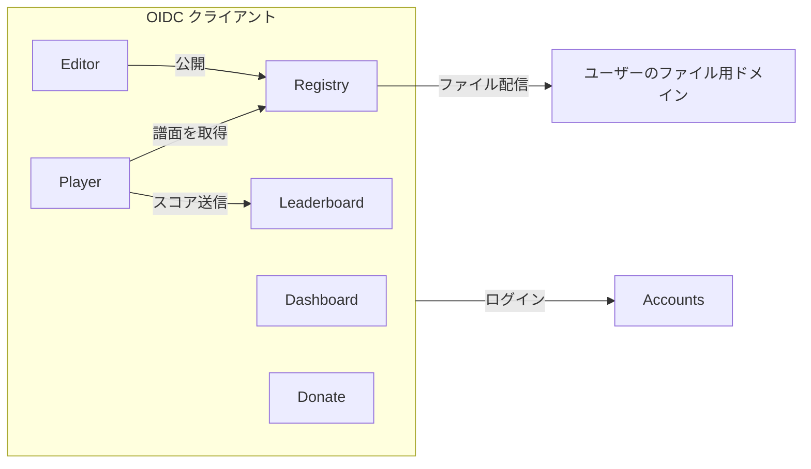
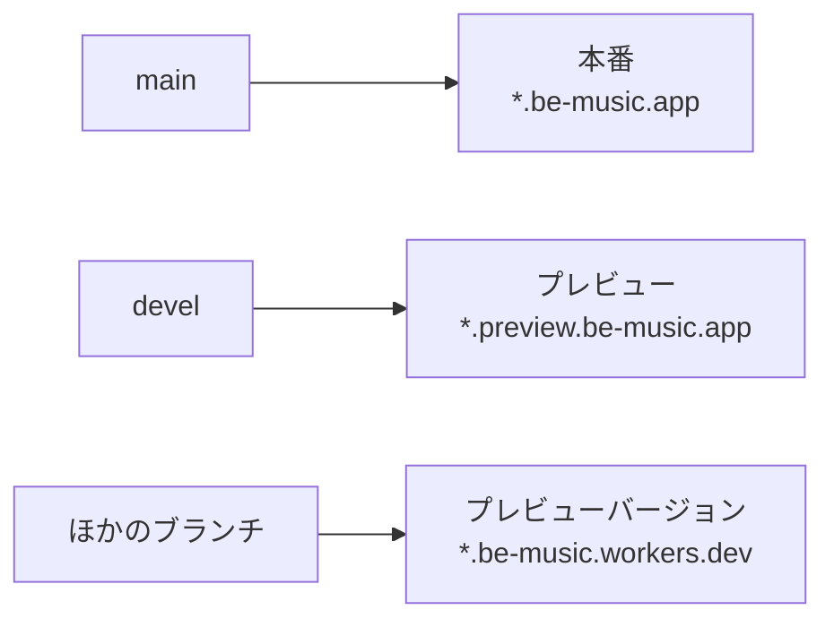
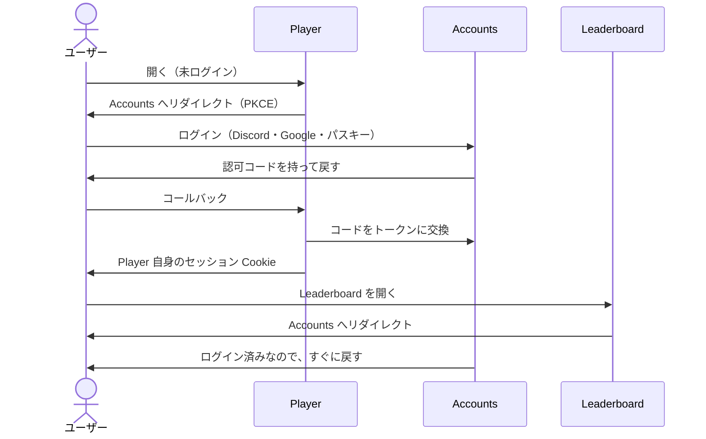

[English version](./services.md)

# サービスと環境

> ステータス: 一部実装済み。Dashboard、Accounts、Player、Leaderboard は、両方の環境でそれぞれのサブドメインに置き、
> ログインは当面 Cookie を共有する方式です（3.1 節）。Accounts の OIDC プロバイダー化、Registry、Editor は計画中です。
> 今あるものは 6 章にあります。

## 1. サービス

be-music は、サービスごとに 1 つの Worker に分け、それぞれ専用のサブドメインに置きます。どのサービスも、同じ
be-music のアカウントでログインします。

| サービス    | 本番のホスト               | 役割                                                                                                                 |
| ----------- | -------------------------- | -------------------------------------------------------------------------------------------------------------------- |
| Dashboard   | `be-music.app`             | ログインしたユーザーのホーム。各サービスへ移動できる                                                                 |
| Accounts    | `accounts.be-music.app`    | ログイン、アカウント、パスキー。ほかのすべてのサービスが使う OIDC プロバイダー                                       |
| Player      | `play.be-music.app`        | ブラウザで動くプレイヤー（今は `be-music.app`）                                                                      |
| Leaderboard | `leaderboard.be-music.app` | ランキング（今は `be-music.app/leaderboard`）                                                                        |
| Registry    | `registry.be-music.app`    | ユーザーが譜面・楽曲・コース・段位認定を登録する。それぞれ公開・非公開・限定公開（リンクを知っている人だけ）を選べる |
| Editor      | `edit.be-music.app`        | BMS / bmson のエディタ。Registry で公開したり、BMS / bmson としてローカルに書き出したりできる                        |
| Donate      | `donate.be-music.app`      | サーバー代とインフラ費用のための寄付                                                                                 |

- Editor は、ローカルへの書き出しならログインなしで使えます。Registry での公開にはアカウントが要ります。
- コースと段位認定は、譜面を [Be-Music Fingerprint](./fingerprint-spec.ja.md) で参照します。Leaderboard と同じキーです。
- 寄付で機能は解放しません。支援者は、本人が同意した場合だけ、感謝として名前を載せます。

## 2. 環境

どのサービスにも、本番とプレビューの 2 つの環境があります。Worker、データベース、バケット、secret、アカウントの
どれも共有しません。

| サービス    | 本番                       | プレビュー                         | Worker（本番 / プレビュー）           |
| ----------- | -------------------------- | ---------------------------------- | ------------------------------------- |
| Dashboard   | `be-music.app`             | `preview.be-music.app`             | `dashboard` / `dashboard-preview`     |
| Accounts    | `accounts.be-music.app`    | `accounts.preview.be-music.app`    | `accounts` / `accounts-preview`       |
| Player      | `play.be-music.app`        | `play.preview.be-music.app`        | `play` / `play-preview`               |
| Leaderboard | `leaderboard.be-music.app` | `leaderboard.preview.be-music.app` | `leaderboard` / `leaderboard-preview` |
| Registry    | `registry.be-music.app`    | `registry.preview.be-music.app`    | `registry` / `registry-preview`       |
| Editor      | `edit.be-music.app`        | `edit.preview.be-music.app`        | `edit` / `edit-preview`               |
| Donate      | `donate.be-music.app`      | `donate.preview.be-music.app`      | `donate` / `donate-preview`           |

- **Worker の名前**は `<service>` と `<service>-preview` の形にします。ストレージ（D1、R2、KV）は、名前を変えられない
  ものは今の名前のままで構いません。
- **ブランチ**: どのサービスも、Workers Builds で `main` を本番に、`devel` をプレビューにデプロイします。

- **ブランチごとのプレビュー URL**: Workers Builds は、ほかのブランチも `-preview` の Worker のプレビューバージョンと
  してアップロードし、`be-music.workers.dev` にプレビュー URL を作ります。これらのバージョンはプレビュー環境につながり、
  本番にはつながりません。
- **外部サービス**は、プレビュー用の認証情報を別に持ちます。Discord と Google の OAuth アプリはプレビュー用を作り、
  リダイレクト URI を `accounts.preview.be-music.app` に向けます。`donate-preview` は Stripe のテストモードの鍵を使います。
- **公開範囲**: プレビューのホストは検索エンジンに載らないようにし、必要なら Cloudflare Access で保護します。
- **証明書**: `play.preview.be-music.app` のように `be-music.app` の 2 階層下のホストは、ゾーンのユニバーサル証明書
  （`*.be-music.app`）の対象外です。Worker のカスタムドメインはホスト名ごとに証明書を発行するので、最初のプレビューの
  ホストで確認します。

## 3. ログイン

Accounts サービスは OpenID Connect のプロバイダー（Better Auth）です。ほかのサービスはすべてそのクライアントで、それ
ぞれ自分のホストに自分のセッション Cookie を持ちます。サービス同士で Cookie を共有しないので、セルフホストのインスタンス
がサービスを互いに無関係なドメインに置いても、同じコードで動きます（5 章）。

- **シングルサインオン**: Accounts にログインしていれば、ほかのサービスは画面を出さずにログインさせます。どのサービスも
  自分たちのクライアントなので、同意画面も出しません。
- **ユーザーの識別**: 各サービスは、ユーザーを `(issuer, sub)` の組で持ちます。issuer を残しておくと、あとでほかの
  インスタンスのアカウントでログインできるようにする余地が残ります。
- **ログイン方法**は Accounts だけが持ちます。Discord、Google、パスキーに加えて、匿名セッションと、ターミナルの
  プレイヤー向けのデバイス認可フローです（[Leaderboard 設計](./leaderboard.ja.md) 3 章と同じ）。
- **パスキー**は、環境ごとに 1 つの relying party ID に結び付けます。本番は `be-music.app`、プレビューは
  `preview.be-music.app` です。パスキーは Accounts のホストでしか使わないので、ほかのサービスがどこにあっても動きます。
- **サービス同士の呼び出し**はサーバーを通します。ブラウザは自分のサービスだけと通信し、そのサービスがユーザーのアクセス
  トークンを付けて、ほかのサービスの API を呼びます。呼ばれた側は Accounts の JWKS でトークンを検証するので、サービス
  同士でデータベースを共有せず、ログインが必要な呼び出しに CORS も要りません。誰でも読める読み取り専用の API は、CORS を
  許可して構いません。
- **ログアウト**: 各サービスのセッションは短め（1 日程度）にし、Accounts を通して画面を出さずに更新します。Accounts で
  ログアウトすれば、その時間のうちに全サービスに伝わります。遅すぎる場合は、バックチャネルログアウトを足します。
- **リダイレクト URI** はクライアントごとに登録し、完全一致で照合します。プレビューの Accounts だけは、ブランチごとの
  プレビュー URL でもログインできるように、`https://*-<service>-preview.be-music.workers.dev/` の形のパターンも受け付け
  ます。`be-music.workers.dev` の下にホストを作れるのは be-music のアカウントだけです。
- **目指す形ではないもの**: 親ドメイン（`.be-music.app`）のセッション Cookie。各サービスに初めて来たときのリダイレクトを
  1 回減らせますが、無関係なドメインどうしや `workers.dev` では使えず、セッションを全サブドメインに送ってしまいます。
  下の当面の構成でだけ使います。

### 3.1 当面の構成: Better Auth は 1 つ、Cookie は共有

Accounts が OIDC プロバイダーになるまでは、Better Auth を Leaderboard の Worker の中で動かします。

- base URL は Accounts のホスト（`accounts.be-music.app`）で、その Worker が `/api/auth/*` を Service Binding で
  Leaderboard へ転送します。OAuth のコールバックもここに届きます。
- セッション Cookie は環境のドメインで共有します（`be-music.app`、またはプレビューでは `preview.be-music.app` で、
  Cookie の接頭辞を `be-music-preview` にして、本番の Cookie と混ざらないようにします）。
- Player と Dashboard は、Service Binding で Leaderboard に問い合わせてセッションを読みます。Leaderboard は直接読みます。
  パスキーは計画どおり、環境ごとの relying party ID を使います。
- ユーザー ID は、OIDC プロバイダーが `sub` として発行するものと同じです。移行で変わるのは、各サービスがセッションを
  読む方法だけです。

## 4. ユーザーのファイル

- ユーザーが Registry にアップロードしたファイル（BMS、音声、画像）は、`be-music.app` のサブドメインではなく、別の登録
  ドメインから配信します。アップロードされた内容が、サービスの Cookie やページに届かないようにするためです。
- 公開のファイルは、公開バケットから配信して構いません。非公開と限定公開のファイルは、期限の短い署名付き URL で配信
  します。
- BMS は他人の楽曲を使うことが多いので、Registry はアップロードを受け付ける前に、利用規約、削除依頼の窓口、通報の仕組み
  を用意します。

## 5. セルフホスト

ソースは公開していて、インスタンスはサービスを好きなホストで動かせます。公式のインスタンスが固定している値は、すべて
設定に出します。

| 設定                                    | 意味                                                        |
| --------------------------------------- | ----------------------------------------------------------- |
| `PUBLIC_ORIGIN`                         | そのサービス自身のオリジン。コールバック URL もここから作る |
| `AUTH_ISSUER`                           | Accounts のオリジン                                         |
| `OIDC_CLIENT_ID` / `OIDC_CLIENT_SECRET` | Accounts に登録したそのサービスのクライアント情報           |
| `PASSKEY_RP_ID`                         | Accounts のみ。既定は Accounts のホスト                     |
| `USER_CONTENT_ORIGIN`                   | Registry のみ。アップロードされたファイルの配信元           |

- Accounts は、クライアントとリダイレクト URI の一覧を設定から読みます。
- Discord と Google は任意です。パスキーと匿名セッションだけで始められます。
- D1 のデータベース ID、Worker の名前、Service Binding の接続先は、ソースではなくデプロイの設定から読みます。
- 外部サービス（BMS Search など）への問い合わせは、オフにできます。
- 寄付、寄付サイト、be-music という名前とロゴは公式のインスタンスのものです。プレイヤーからのそれらへのリンクは設定で
  変えられます。

## 6. 現状と移行

| サービス    | 今                                                                                     |
| ----------- | -------------------------------------------------------------------------------------- |
| Dashboard   | `dashboard` / `dashboard-preview`。セッションとリンクを表示する仮のページ              |
| Accounts    | `accounts` / `accounts-preview`。`/api/auth/*` を Leaderboard へ転送する（3.1 節）     |
| Player      | `play` / `play-preview`（`packages/play`。`@be-music/player-web-demo` のビルドを配信） |
| Leaderboard | `leaderboard` / `leaderboard-preview`。ページはホストのルートに置く                    |
| Donate      | `donate.be-music.app` の `donate-be-music-app`。まだログインとはつながっていない       |

どの Worker も、`cloudflare.config.ts` から `cf` でデプロイします。`.github/workflows/deploy.yml` が `main` を本番に、
`devel` をプレビューにデプロイします。どれも be-music の Cloudflare アカウントで動いていて、このアカウントの請求は
be-music の分だけです。`workers.dev` のサブドメインは `be-music.workers.dev` です。

この先:

1. Accounts を OIDC プロバイダーとして切り出し、Leaderboard を最初のクライアントにして、Cookie の共有をやめる。
2. 寄付サイトを Accounts とつなぐ。
3. Registry を作る。ユーザーのファイル用ドメイン、公開設定、利用規約を含める。
4. Editor を作る。

古い URL からの**転送は作りません**。`be-music.app/...`（以前の Player）と `be-music.app/leaderboard/...` への
リンクは、もう使えません。

## 7. 未決事項

- **寄付**: 寄付サイトが Stripe で直接支払いを受け付けるのか（ログインして単発・月額）、外部のサービスを使い続けるのか、
  両方なのか。直接受け付ける前に、Stripe の制限業種の一覧と、特定商取引法の扱いを確認する必要があります。
- **ユーザーのファイル用ドメイン**: アップロードされたファイルを配信する、別ドメインの名前。
