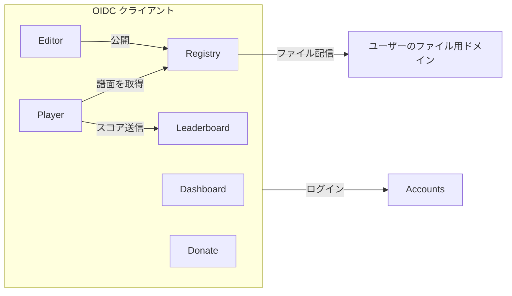
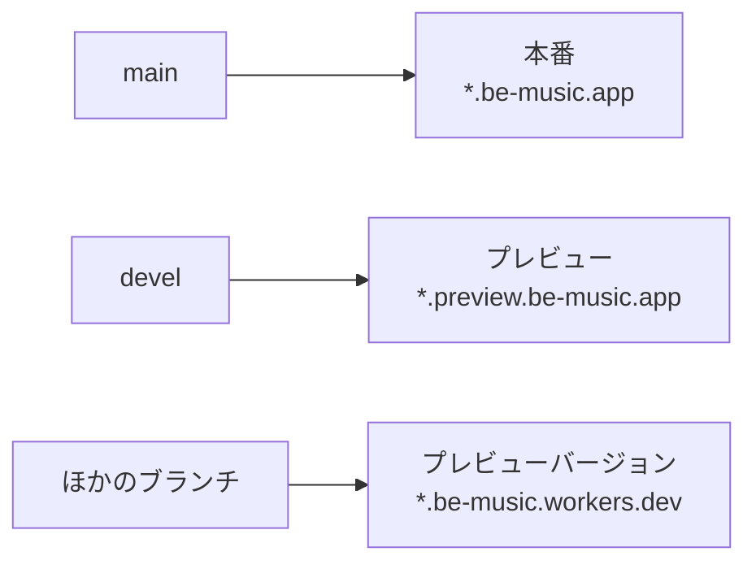
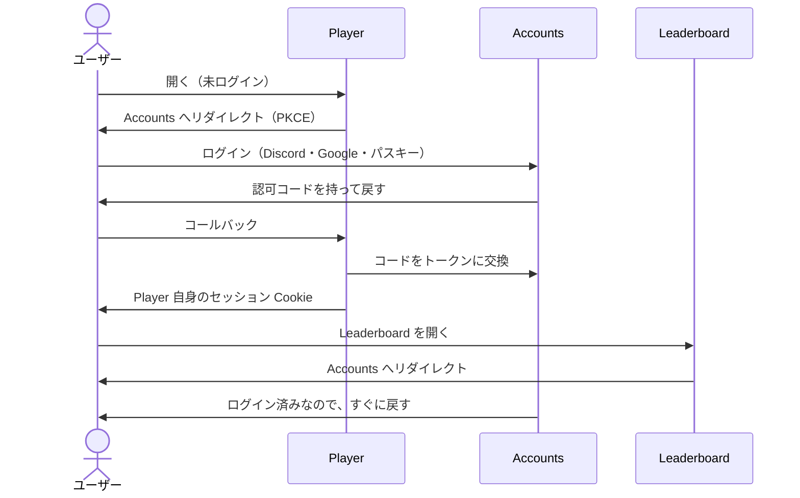

[English version](./services.md)

# サービスと環境

> ステータス: Dashboard・Accounts・Player・Leaderboard・Donate に本番とプレビューがあります。認証は Accounts が所有し、OIDC を使います。アプリの Cookie はホスト専用です。Registry と Editor は未実装です。

## 1. サービス

be-music は、サービスごとに 1 つの Worker に分け、それぞれ専用のサブドメインに置きます。どのサービスも、同じ
be-music のアカウントでログインします。

| サービス    | 本番のホスト               | 役割                                                                                                                 |
| ----------- | -------------------------- | -------------------------------------------------------------------------------------------------------------------- |
| Dashboard   | `be-music.app`             | ログインしたユーザーのホーム。各サービスへ移動できる                                                                 |
| Accounts    | `accounts.be-music.app`    | ログイン、アカウント、パスキー。ほかのすべてのサービスが使う OIDC プロバイダー                                       |
| Player      | `play.be-music.app`        | ブラウザで動くプレイヤー（今は `be-music.app`）                                                                      |
| Leaderboard | `leaderboard.be-music.app` | ランキング（今は `be-music.app/leaderboard`）                                                                        |
| Registry    | `registry.be-music.app`    | ユーザーが譜面・楽曲・コース・段位認定を登録する。それぞれ公開・非公開・限定公開（リンクを知っている人だけ）を選べる |
| Editor      | `edit.be-music.app`        | BMS / bmson のエディタ。Registry で公開したり、BMS / bmson としてローカルに書き出したりできる                        |
| Donate      | `donate.be-music.app`      | サーバー代とインフラ費用のための寄付                                                                                 |

- Editor は、ローカルへの書き出しならログインなしで使えます。Registry での公開にはアカウントが要ります。
- コースと段位認定は、譜面を [Be-Music Fingerprint](./fingerprint-spec.ja.md) で参照します。Leaderboard と同じキーです。
- 寄付で機能は解放しません。支援者は、本人が同意した場合だけ、感謝として名前を載せます。

## 2. 環境

どのサービスにも、本番とプレビューの 2 つの環境があります。Worker、データベース、バケット、secret、アカウントの
どれも共有しません。

| サービス    | 本番                       | プレビュー                         | Worker（本番 / プレビュー）           |
| ----------- | -------------------------- | ---------------------------------- | ------------------------------------- |
| Dashboard   | `be-music.app`             | `preview.be-music.app`             | `dashboard` / `dashboard-preview`     |
| Accounts    | `accounts.be-music.app`    | `accounts.preview.be-music.app`    | `accounts` / `accounts-preview`       |
| Player      | `play.be-music.app`        | `play.preview.be-music.app`        | `play` / `play-preview`               |
| Leaderboard | `leaderboard.be-music.app` | `leaderboard.preview.be-music.app` | `leaderboard` / `leaderboard-preview` |
| Registry    | `registry.be-music.app`    | `registry.preview.be-music.app`    | `registry` / `registry-preview`       |
| Editor      | `edit.be-music.app`        | `edit.preview.be-music.app`        | `edit` / `edit-preview`               |
| Donate      | `donate.be-music.app`      | `donate.preview.be-music.app`      | `donate` / `donate-preview`           |

- **Worker の名前**は `<service>` と `<service>-preview` の形にします。ストレージ（D1、R2、KV）は、名前を変えられない
  ものは今の名前のままで構いません。
- **ブランチ**: どのサービスも、GitHub Actions で `main` を本番に、`devel` をプレビューにデプロイします。

- **ブランチごとのプレビュー URL** は OIDC クライアントに登録しません。本番とプレビューの固定 URL でログインできます。追加する場合は、クライアントと戻り先を完全一致で登録します。

- **外部サービス**は、プレビュー用の認証情報を別に持ちます。Discord と Google の OAuth アプリはプレビュー用を作り、
  `donate-preview` は Stripe のテストモードの鍵を使います。Discord のリダイレクト URI は、本番が
  `https://accounts.be-music.app/api/auth/callback/discord`、プレビューが
  `https://accounts.preview.be-music.app/api/auth/callback/discord` です。Google のリダイレクト URI は、本番が
  `https://accounts.be-music.app/api/auth/callback/google`、プレビューが
  `https://accounts.preview.be-music.app/api/auth/callback/google` です。
- **公開範囲**: プレビューのホストは検索エンジンに載らないようにし、必要なら Cloudflare Access で保護します。
- **証明書**: `play.preview.be-music.app` のように `be-music.app` の 2 階層下のホストは、ゾーンのユニバーサル証明書
  （`*.be-music.app`）の対象外です。Worker のカスタムドメインはホスト名ごとに証明書を発行するので、最初のプレビューの
  ホストで確認します。

## 3. ログイン

Accounts サービスは OpenID Connect のプロバイダー（Better Auth）です。ほかのサービスはすべてそのクライアントで、それ
ぞれ自分のホストに自分のセッション Cookie を持ちます。サービス同士で Cookie を共有しないので、セルフホストのインスタンス
がサービスを互いに無関係なドメインに置いても、同じコードで動きます（5 章）。

- **シングルサインオン**: Accounts にログインしていれば、ほかのサービスは画面を出さずにログインさせます。どのサービスも
  自分たちのクライアントなので、同意画面も出しません。
- **ユーザーの識別**: 各サービスは、ユーザーを `(issuer, sub)` の組で持ちます。issuer を残しておくと、あとでほかの
  インスタンスのアカウントでログインできるようにする余地が残ります。
- **ログイン方法**は Accounts だけが持ちます。設定済みの Discord・Google、パスキー、ゲストセッションに対応します。ターミナル向けのデバイス認可フローは今後の実装です。ログイン済みのアカウントは、アカウントページからパスキー、Discord、Google を後から紐付けられます。紐付けは同じアカウントのまま行われ、プロバイダのメールが違っていても足せます。
- **パスキー**は、環境ごとに 1 つの relying party ID に結び付けます。本番は `be-music.app`、プレビューは
  `preview.be-music.app` です。パスキーは Accounts のホストでしか使わないので、ほかのサービスがどこにあっても動きます。
- **サービス同士の呼び出し**はサーバーを通します。ブラウザは自分のサービスだけと通信し、そのサービスがユーザーのアクセス
  トークンを付けて、ほかのサービスの API を呼びます。呼ばれた側は Accounts の JWKS でトークンを検証するので、サービス
  同士でデータベースを共有せず、ログインが必要な呼び出しに CORS も要りません。誰でも読める読み取り専用の API は、CORS を
  許可して構いません。
- **セッションとログアウト**: 各アプリの暗号化された `__Host-be-music.session` Cookie は最大 10 分で、トークンの期限を超えません。トークンは HttpOnly Cookie とサーバー間通信だけで扱い、ブラウザのセッション API には識別情報だけを返します。リフレッシュトークンは使いません。期限切れ後は再びログインを選ぶと、Accounts のセッションがあれば通常は資格情報の再入力なしで戻れます。アプリのログアウトはそのアプリだけに適用し、Accounts のログアウト後も各アプリのセッションは最大 10 分残ります。即時の全サービスログアウトは未実装です。
- **リダイレクト URI** は、プレビューを含めて完全一致で登録します。認可コードと S256 PKCE、`state`、`nonce`、issuer／audience の照合と ID トークンの署名検証を行います。自前の公開クライアントにはクライアントシークレットを持たせず、ほかのクライアントの登録も許可しません。API は送信先を限定した `be-music:api` スコープのアクセストークンを検証します。ID トークンは API の認証に使いません。

### 3.1 ユーザーの所有と移行

Accounts は専用の D1（`accounts`／`accounts-preview`）にユーザー、外部サービス連携、パスキー、セッション、署名鍵、OAuth クライアントの状態を持ちます。ログイン中に Leaderboard を呼びません。

Leaderboard は公開プロフィールとスコアを所有し、`oidc_identity` で `(issuer, subject)` とローカルのプレイヤー ID を対応させます。検証済みトークンから初回アクセス時に必要な行を作り、メールでは紐付けません。既存の対応付けは元のプレイヤー ID とスコアの所有者を維持します。アカウント連携時は、署名されたゲスト連携情報からプレイを冪等に移し、Accounts にスコア DB へのアクセスを与えません。

Accounts のスキーマと Leaderboard の `0013` を適用し、認証の切り替え前に `packages/app-accounts/scripts/migrate-identities.ts` を実行します。既定はドライランです。`--preview --apply` はプレビューのユーザー・外部連携・パスキーをコピーし、対応付けを登録します。本番は `--preview` を外します。古いセッションとチャレンジはコピーせず、資格情報を出力しません。元の認証テーブルはロールバック用に残します。新しい OIDC ユーザーが作られた後は再実行しません。再ログインは必要ですが、移行したパスキーの RP ID は維持します。

`legacy-auth.ts` は localhost のテスト・開発専用です。公開ホストでは OIDC 設定がなければ認証を拒否し、以前の共有 Cookie も受け付けません。

## 4. ユーザーのファイル

- ユーザーが Registry にアップロードしたファイル（BMS、音声、画像）は、`be-music.app` のサブドメインではなく、別の登録
  ドメインから配信します。アップロードされた内容が、サービスの Cookie やページに届かないようにするためです。
- 公開のファイルは、公開バケットから配信して構いません。非公開と限定公開のファイルは、期限の短い署名付き URL で配信
  します。
- BMS は他人の楽曲を使うことが多いので、Registry はアップロードを受け付ける前に、利用規約、削除依頼の窓口、通報の仕組み
  を用意します。

## 5. セルフホスト

ソースは公開していて、インスタンスはサービスを好きなホストで動かせます。公式のインスタンスが固定している値は、すべて
設定に出します。

| 設定                  | 意味                                                        |
| --------------------- | ----------------------------------------------------------- |
| `PUBLIC_ORIGIN`       | そのサービス自身のオリジン。コールバック URL もここから作る |
| `AUTH_ISSUER`         | Accounts のオリジン                                         |
| `OIDC_CLIENT_ID`      | Accounts に登録したそのサービスのクライアント情報           |
| `PASSKEY_RP_ID`       | Accounts のみ。既定は Accounts のホスト                     |
| `USER_CONTENT_ORIGIN` | Registry のみ。アップロードされたファイルの配信元           |

- Accounts は、クライアントとリダイレクト URI の一覧を設定から読みます。
- Discord と Google は任意です。パスキーと匿名セッションだけで始められます。Discord ログインは Accounts Worker の
  `DISCORD_CLIENT_ID` と `DISCORD_CLIENT_SECRET` を読みます。公式インスタンスでは `be-music` Vault の `discord`
  （本番）と `discord-preview`（プレビュー）に置きます。Google ログインは `GOOGLE_CLIENT_ID` と
  `GOOGLE_CLIENT_SECRET` を読み、同じ Vault の `google`（本番）と `google-preview`（プレビュー）に置きます。
  `pnpm --filter @be-music/app-accounts run secrets:preview` と `secrets:production` で値を表示せずに設定します。
- D1 のデータベース ID、Worker の名前、Service Binding の接続先は、ソースではなくデプロイの設定から読みます。
- 外部サービス（BMS Search など）への問い合わせは、オフにできます。
- 寄付、寄付サイト、be-music という名前とロゴは公式のインスタンスのものです。プレイヤーからのそれらへのリンクは設定で
  変えられます。

実装済みの追加設定は、`SESSION_SECRET`（アプリ・環境ごとに異なる 32 文字以上の秘密値）、`API_AUDIENCE`（API リソースの完全な URI）、`OIDC_CLIENTS`（Accounts が持つクライアント ID とオリジンの JSON 対応表）です。`AUTH_ISSUER` はオリジンだけでなく `/api/auth` を含む完全な issuer を指定します。クライアントは公開 PKCE 方式なのでシークレットは不要です。

## 6. 現状と移行

| サービス    | 今                                                                                     |
| ----------- | -------------------------------------------------------------------------------------- |
| Dashboard   | `dashboard` / `dashboard-preview`。セッションとリンクを表示する仮のページ              |
| Accounts    | `accounts` / `accounts-preview`。専用 D1 を持つ独立した OIDC プロバイダー              |
| Player      | `play` / `play-preview`（`packages/worker-play`。`@be-music/app-play` のビルドを配信） |
| Leaderboard | `leaderboard` / `leaderboard-preview`。ページはホストのルートに置く                    |
| Donate      | `donate` / `donate-preview`。OIDC ログインと公開の収支データ                           |

モノレポの Worker は `cloudflare.config.ts` から `cf` でデプロイします。Donate は非公開のコンテンツリポジトリで Wrangler を使います。`.github/workflows/deploy.yml` が `main` を本番に、
`devel` をプレビューにデプロイします。どれも be-music の Cloudflare アカウントで動いていて、このアカウントの請求は
be-music の分だけです。`workers.dev` のサブドメインは `be-music.workers.dev` です。

この先:

1. Registry を作る。ユーザーのファイル用ドメイン、公開設定、利用規約を含める。
2. Editor を作る。

古い URL からの**転送は作りません**。`be-music.app/...`（以前の Player）と `be-music.app/leaderboard/...` への
リンクは、もう使えません。

## 7. 未決事項

- **寄付**: 寄付サイトが Stripe で直接支払いを受け付けるのか（ログインして単発・月額）、外部のサービスを使い続けるのか、
  両方なのか。直接受け付ける前に、Stripe の制限業種の一覧と、特定商取引法の扱いを確認する必要があります。
- **ユーザーのファイル用ドメイン**: アップロードされたファイルを配信する、別ドメインの名前。

## データの管理先

公開プロフィールとアバターの正本は Accounts に置き、編集もそこで行います。Leaderboard はランキング用のコピー、プレイヤー ID の対応、スコアを保持します。同期と移行順は [ADR 0009](./adr/0009-accounts-profiles.ja.md) を参照してください。

| Worker                                | D1            | R2                                                  |
| ------------------------------------- | ------------- | --------------------------------------------------- |
| `accounts` / `accounts-preview`       | Worker と同名 | Worker と同名：アバター                             |
| `leaderboard` / `leaderboard-preview` | Worker と同名 | Worker と同名：リプレイ、譜面構造データ、共有カード |
| `play` / `play-preview`               | なし          | Worker と同名：FFmpeg core                          |
| `dashboard` / `dashboard-preview`     | なし          | なし                                                |
| `donate` / `donate-preview`           | なし          | なし。収支データはリポジトリで管理                  |

公開の静的アセットは `assets` バケットを `assets.be-music.app` で配信します。FFmpeg のアップロード先は既定で `play` です。`pnpm --filter @be-music/app-play run cf:r2:push:preview` で `play-preview` を別に更新します。
