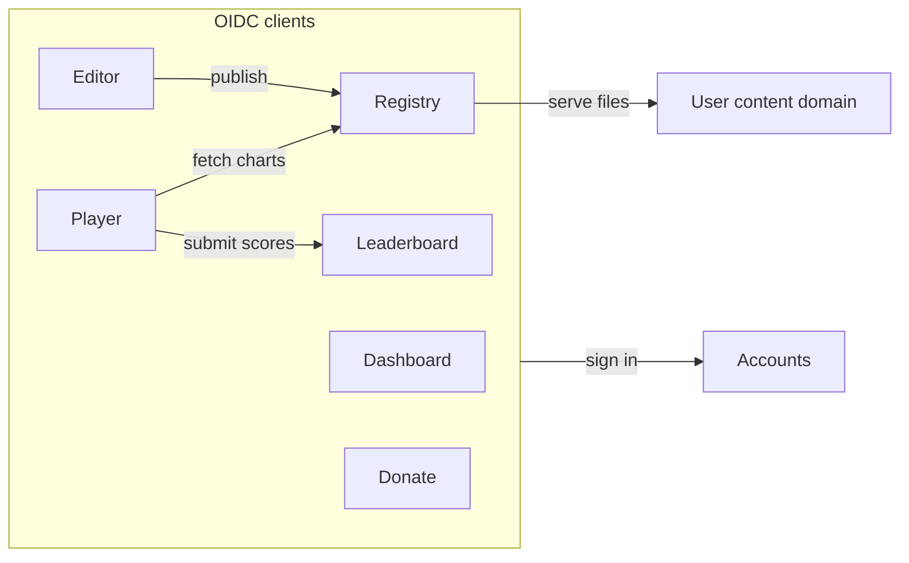
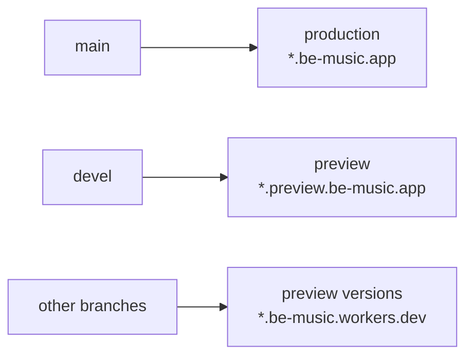
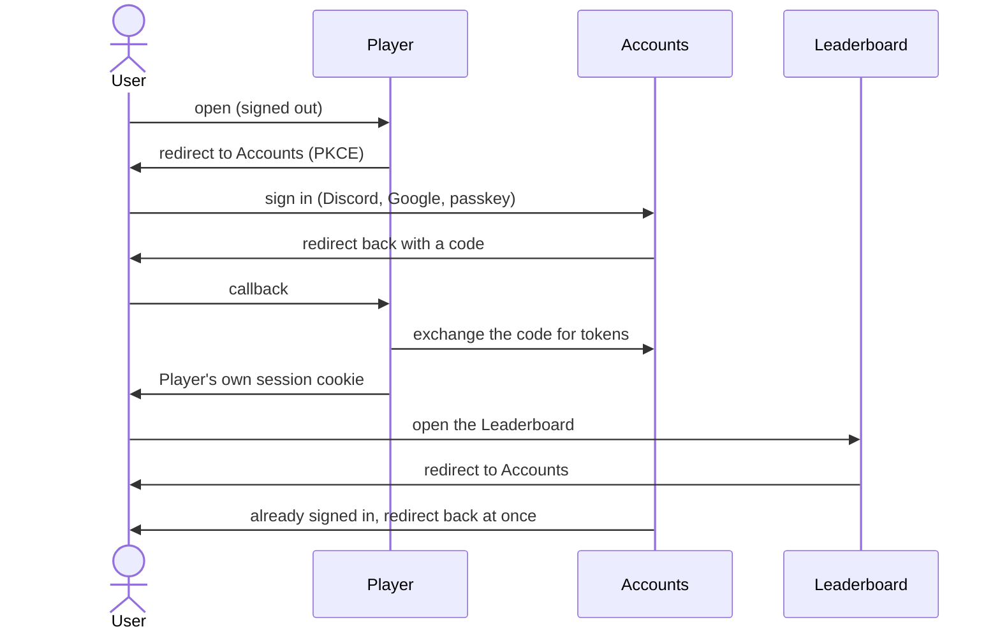

[Japanese version](./services.ja.md)

# Services and environments

> Status: partly built. The Dashboard, Accounts, Player and Leaderboard run on their own subdomains in both
> environments, with an interim shared-cookie sign-in (section 3.1). Accounts as an OIDC provider, the Registry and the
> Editor are planned. Section 6 lists what exists today.

## 1. Services

be-music is split into one Worker per service, each on its own subdomain. Every service signs in with the same
be-music account.

| Service     | Production host            | What it does                                                                                               |
| ----------- | -------------------------- | ---------------------------------------------------------------------------------------------------------- |
| Dashboard   | `be-music.app`             | The signed-in user's home, linking to every service                                                        |
| Accounts    | `accounts.be-music.app`    | Sign-in, accounts, passkeys; the OIDC provider every other service uses                                    |
| Player      | `play.be-music.app`        | The browser player (today at `be-music.app`)                                                               |
| Leaderboard | `leaderboard.be-music.app` | Rankings (today at `be-music.app/leaderboard`)                                                             |
| Registry    | `registry.be-music.app`    | Users register charts, songs, courses and dan certifications, each public, private or unlisted (link only) |
| Editor      | `edit.be-music.app`        | BMS / bmson editor; publishes to the Registry or exports BMS / bmson locally                               |
| Donate      | `donate.be-music.app`      | Donations toward server and infrastructure costs                                                           |

- The Editor works without signing in for local export; publishing to the Registry needs an account.
- Courses and dan certifications refer to charts by the [Be-Music Fingerprint](./fingerprint-spec.md), the same key the
  Leaderboard uses.
- Donations never unlock features. Supporters are listed only with their consent, as a thank-you.

## 2. Environments

Every service has a production and a preview environment. They share nothing: separate Workers, databases, buckets,
secrets and accounts.

| Service     | Production                 | Preview                            | Worker (production / preview)         |
| ----------- | -------------------------- | ---------------------------------- | ------------------------------------- |
| Dashboard   | `be-music.app`             | `preview.be-music.app`             | `dashboard` / `dashboard-preview`     |
| Accounts    | `accounts.be-music.app`    | `accounts.preview.be-music.app`    | `accounts` / `accounts-preview`       |
| Player      | `play.be-music.app`        | `play.preview.be-music.app`        | `play` / `play-preview`               |
| Leaderboard | `leaderboard.be-music.app` | `leaderboard.preview.be-music.app` | `leaderboard` / `leaderboard-preview` |
| Registry    | `registry.be-music.app`    | `registry.preview.be-music.app`    | `registry` / `registry-preview`       |
| Editor      | `edit.be-music.app`        | `edit.preview.be-music.app`        | `edit` / `edit-preview`               |
| Donate      | `donate.be-music.app`      | `donate.preview.be-music.app`      | `donate` / `donate-preview`           |

- **Worker names** follow `<service>` and `<service>-preview`. Storage resources (D1, R2, KV) may keep their current
  names where they cannot be renamed.
- **Branches**: every service deploys `main` to production and `devel` to preview, through Workers Builds.

- **Branch preview URLs**: Workers Builds also uploads every other branch as a preview version of the `-preview`
  Worker, with a Preview URL on `be-music.workers.dev`. Those versions bind the preview environment, never production.
- **Third-party services** have separate preview credentials: their own Discord and Google OAuth applications, whose
  redirect URIs point at `accounts.preview.be-music.app`, and Stripe test-mode keys for `donate-preview`.
- **Visibility**: preview hosts are kept out of search engines, and may be put behind Cloudflare Access.
- **Certificates**: hosts two levels below `be-music.app` (`play.preview.be-music.app`) are not covered by the zone's
  universal certificate (`*.be-music.app`). Worker custom domains issue one certificate per hostname; check this on the
  first preview host.

## 3. Sign-in

The Accounts service is an OpenID Connect provider (Better Auth). Every other service is a client of it, with a session
cookie of its own on its own host. Services never share a cookie, so the same code works when a self-hosted instance
puts its services on unrelated domains (section 5).

- **Single sign-on**: once signed in to Accounts, every other service signs the user in without showing a page. The
  services are first-party clients, so there is no consent screen.
- **Identity**: services store a user as `(issuer, sub)`. Keeping the issuer leaves room for signing in with another
  instance's accounts later.
- **Sign-in methods** live in Accounts only: Discord, Google and passkeys, plus anonymous sessions and the device
  authorization flow for the terminal player (as in [Leaderboard design](./leaderboard.md) section 3).
- **Passkeys** are bound to one relying party ID per environment: `be-music.app` in production and
  `preview.be-music.app` in preview. Passkeys are only used on the Accounts host, so this works wherever the other
  services live.
- **Calls between services** go through the server: the browser talks to its own service, which calls another
  service's API with the user's access token. The callee verifies the token against Accounts' JWKS, so services share
  no database and need no CORS for signed-in calls. Public read-only endpoints may allow CORS.
- **Sign-out**: each service keeps a short session (about a day) and renews it silently through Accounts, so signing
  out of Accounts reaches every service within that time. Back-channel logout can be added if that is too slow.
- **Redirect URIs** are registered per client and matched exactly. The preview Accounts alone also accepts
  `https://*-<service>-preview.be-music.workers.dev/` patterns, so branch Preview URLs can sign in. Only the be-music
  account can create hosts under `be-music.workers.dev`.
- **Not the target**: a session cookie on the parent domain (`.be-music.app`). It would save one redirect on the first
  visit to each service, but it cannot work across unrelated domains or on `workers.dev`, and it sends the session to
  every subdomain. It is used only as the interim step below.

### 3.1 Interim: one Better Auth and a shared cookie

Until Accounts becomes an OIDC provider, Better Auth runs inside the Leaderboard Worker:

- Its base URL is the Accounts host (`accounts.be-music.app`), whose Worker forwards `/api/auth/*` to the Leaderboard
  through a Service Binding. OAuth callbacks land there.
- Its session cookies are shared on the environment's domain (`be-music.app`, or `preview.be-music.app` with the
  `be-music-preview` cookie prefix, so production's cookies never collide with the preview's).
- The Player and the Dashboard read the session by asking the Leaderboard through their Service Bindings; the
  Leaderboard reads it directly. Passkeys use the environment's relying party ID, as planned.
- User IDs are the ones the OIDC provider will issue as `sub`, so the move changes only how services read the session.

## 4. User content

- Files users upload to the Registry (BMS, audio, images) are served from a separate registrable domain, never from a
  subdomain of `be-music.app`, so uploaded content cannot reach the services' cookies or pages.
- Public files may be served from a public bucket. Private and unlisted files are served through short-lived signed
  URLs.
- The Registry needs terms of use, a takedown request channel and reporting before it accepts uploads, since BMS often
  uses third-party music.

## 5. Self-hosting

The source is public, and an instance may run its services on any hosts. Everything the official instance pins is
configuration:

| Setting                                 | Meaning                                                |
| --------------------------------------- | ------------------------------------------------------ |
| `PUBLIC_ORIGIN`                         | The service's own origin; callback URLs derive from it |
| `AUTH_ISSUER`                           | The Accounts origin                                    |
| `OIDC_CLIENT_ID` / `OIDC_CLIENT_SECRET` | The service's client credentials at Accounts           |
| `PASSKEY_RP_ID`                         | Accounts only; defaults to the Accounts host           |
| `USER_CONTENT_ORIGIN`                   | Registry only; where uploaded files are served from    |

- Accounts reads its list of clients and redirect URIs from configuration.
- Discord and Google are optional: an instance can start with passkeys and anonymous sessions only.
- D1 database IDs, Worker names and Service Binding targets come from deploy configuration, not from source.
- Calls to outside services (such as BMS Search) can be turned off.
- Donations, the donation site and the be-music name and logo belong to the official instance; links to them in the
  player are configurable.

## 6. Today and migration

| Service     | Today                                                                                  |
| ----------- | -------------------------------------------------------------------------------------- |
| Dashboard   | `dashboard` / `dashboard-preview`, a temporary page showing the session and links      |
| Accounts    | `accounts` / `accounts-preview`, forwarding `/api/auth/*` to the Leaderboard (3.1)     |
| Player      | `play` / `play-preview` (`packages/play`, serving `@be-music/player-web-demo`'s build) |
| Leaderboard | `leaderboard` / `leaderboard-preview`, pages still under `/leaderboard`                |
| Donate      | `donate-be-music-app` on `donate.be-music.app`, not yet signed in                      |

Every Worker deploys with `cf` from its `cloudflare.config.ts`; `.github/workflows/deploy.yml` deploys `main` to
production and `devel` to the preview. All of them run in the be-music Cloudflare account, which bills only be-music.
Its `workers.dev` subdomain is `be-music.workers.dev`.

Next:

1. Split Accounts out as the OIDC provider, with the Leaderboard as its first client, and drop the shared cookie.
2. Connect the donation site to Accounts.
3. Build the Registry, with the user content domain, visibility settings and terms of use.
4. Build the Editor.

**No redirects** are kept from the old URLs: links to `be-music.app/...` (the old Player) and
`be-music.app/leaderboard/...` no longer work.

## 7. Open questions

- **Donations**: whether the donation site takes payments itself through Stripe (one-time and monthly, signed in), keeps
  the external platforms, or both. Stripe's restricted business list and Japan's Specified Commercial Transactions Act
  must be checked before taking payments directly.
- **User content domain**: the name of the separate domain for uploaded files.
