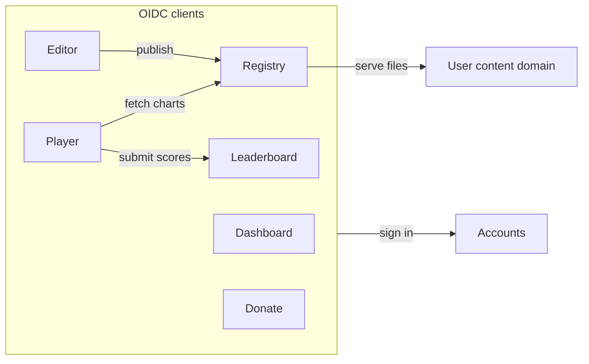
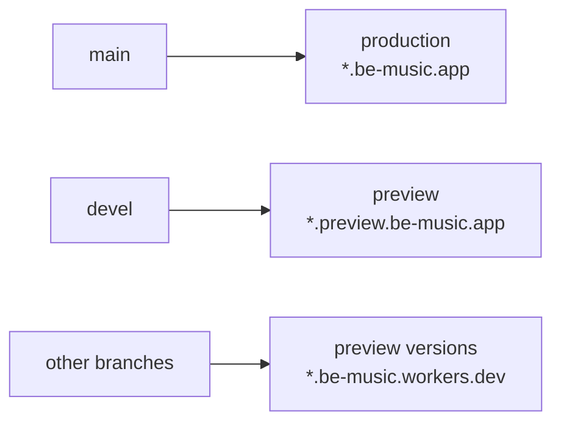
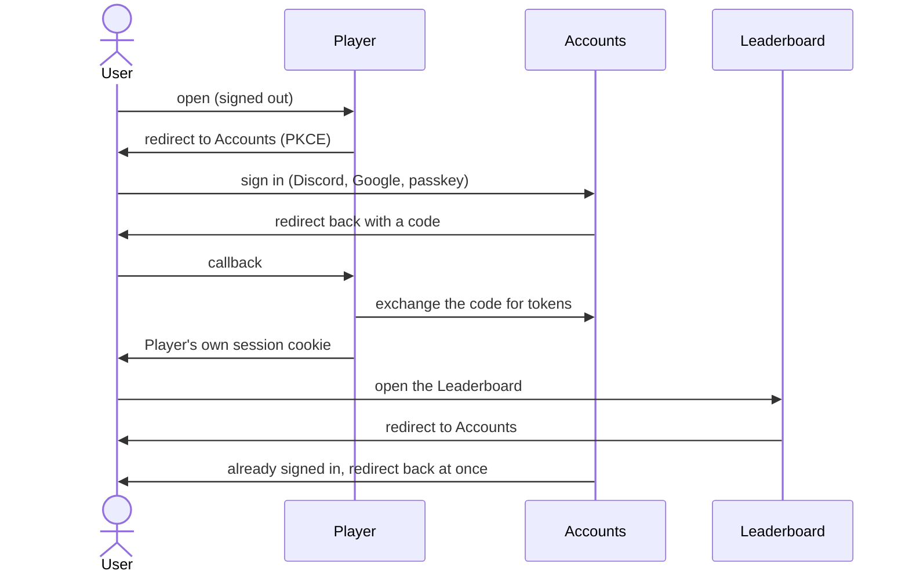

[Japanese version](./services.ja.md)

# Services and environments

> Status: Dashboard, Accounts, Player, Leaderboard and Donate have production and preview deployments. Accounts owns authentication and issues OIDC identities; app cookies are host-only. Registry and Editor remain planned.

## 1. Services

be-music is split into one Worker per service, each on its own subdomain. Every service signs in with the same
be-music account.

| Service     | Production host            | What it does                                                                                               |
| ----------- | -------------------------- | ---------------------------------------------------------------------------------------------------------- |
| Dashboard   | `be-music.app`             | The signed-in user's home, linking to every service                                                        |
| Accounts    | `accounts.be-music.app`    | Sign-in, accounts, passkeys; the OIDC provider every other service uses                                    |
| Player      | `play.be-music.app`        | The browser player                                                                                         |
| Leaderboard | `leaderboard.be-music.app` | Rankings                                                                                                   |
| Registry    | `registry.be-music.app`    | Users register charts, songs, courses and dan certifications, each public, private or unlisted (link only) |
| Editor      | `edit.be-music.app`        | BMS / bmson editor; publishes to the Registry or exports BMS / bmson locally                               |
| Donate      | `donate.be-music.app`      | Donations toward server and infrastructure costs                                                           |

- The Editor works without signing in for local export; publishing to the Registry needs an account.
- Courses and dan certifications refer to charts by the [Be-Music Fingerprint](./fingerprint-spec.md), the same key the
  Leaderboard uses.
- Donations never unlock features. Supporters are listed only with their consent, as a thank-you.

## 2. Environments

Every service has a production and a preview environment. They share nothing: separate Workers, databases, buckets,
secrets and accounts.

| Service     | Production                 | Preview                            | Worker (production / preview)         |
| ----------- | -------------------------- | ---------------------------------- | ------------------------------------- |
| Dashboard   | `be-music.app`             | `preview.be-music.app`             | `dashboard` / `dashboard-preview`     |
| Accounts    | `accounts.be-music.app`    | `accounts.preview.be-music.app`    | `accounts` / `accounts-preview`       |
| Player      | `play.be-music.app`        | `play.preview.be-music.app`        | `play` / `play-preview`               |
| Leaderboard | `leaderboard.be-music.app` | `leaderboard.preview.be-music.app` | `leaderboard` / `leaderboard-preview` |
| Registry    | `registry.be-music.app`    | `registry.preview.be-music.app`    | `registry` / `registry-preview`       |
| Editor      | `edit.be-music.app`        | `edit.preview.be-music.app`        | `edit` / `edit-preview`               |
| Donate      | `donate.be-music.app`      | `donate.preview.be-music.app`      | `donate` / `donate-preview`           |

- **Worker names** follow `<service>` and `<service>-preview`. Storage resources (D1, R2, KV) may keep their current
  names where they cannot be renamed.
- **Branches**: every service deploys `main` to production and `devel` to preview, through GitHub Actions.

- **Branch preview URLs** are not registered OIDC clients. Authentication is supported at the fixed production and preview origins; register another exact client/callback explicitly to add a deployment.
- **Third-party services** have separate preview credentials: their own Discord and Google OAuth applications, and
  Stripe test-mode keys for `donate-preview`. Discord's redirect URI is
  `https://accounts.be-music.app/api/auth/callback/discord` in production and
  `https://accounts.preview.be-music.app/api/auth/callback/discord` in preview. Google's redirect URI is
  `https://accounts.be-music.app/api/auth/callback/google` in production and
  `https://accounts.preview.be-music.app/api/auth/callback/google` in preview.
- **Visibility**: preview hosts are kept out of search engines, and may be put behind Cloudflare Access.
- **Certificates**: hosts two levels below `be-music.app` (`play.preview.be-music.app`) are not covered by the zone's
  universal certificate (`*.be-music.app`). Worker custom domains issue one certificate per hostname; check this on the
  first preview host.

## 3. Sign-in

The Accounts service is an OpenID Connect provider (Better Auth). Every other service is a client of it, with a session
cookie of its own on its own host. Services never share a cookie, so the same code works when a self-hosted instance
puts its services on unrelated domains (section 5).

- **Single sign-on**: once signed in to Accounts, every other service signs the user in without showing a page. The
  services are first-party clients, so there is no consent screen.
- **Identity**: services store a user as `(issuer, sub)`. Keeping the issuer leaves room for signing in with another
  instance's accounts later.
- **Sign-in methods** live in Accounts only: Discord, Google and passkeys, plus guest sessions. Device authorization for the terminal player remains planned.
- **Passkeys** are bound to one relying party ID per environment: `be-music.app` in production and
  `preview.be-music.app` in preview. Passkeys are only used on the Accounts host, so this works wherever the other
  services live.
- **Calls between services** go through the server: the browser talks to its own service, which calls another
  service's API with the user's access token. The callee verifies the token against Accounts' JWKS, so services share
  no database and need no CORS for signed-in calls. Public read-only endpoints may allow CORS.
- **Sessions and sign-out**: each app has a separate encrypted `__Host-be-music.session` cookie, valid for at most 10 minutes and never longer than its tokens. Tokens stay in HttpOnly cookies and server-side requests; browser session endpoints expose identity only. There are no refresh tokens. Once an app session expires, use Sign in again; Accounts normally completes the redirect without another credential prompt. App sign-out clears that app's cookie. Accounts sign-out ends SSO; existing app sessions can remain valid for up to 10 minutes. Immediate global logout is not implemented.
- **Redirect URIs** are registered per client and matched exactly, including in preview. Clients use authorization code + S256 PKCE, `state`, `nonce`, issuer/audience checks and signed ID-token verification. Public first-party clients have no client secret and cannot register other clients. APIs accept resource-bound access tokens with the `be-music:api` scope, not ID tokens.

### 3.1 Identity ownership and migration

Accounts has its own D1 (`accounts` / `accounts-preview`) for users, provider links, passkeys, sessions, signing keys and OAuth client state. It never calls the Leaderboard during login.

The Leaderboard owns public profiles and scores. `oidc_identity` maps `(issuer, subject)` to its local player ID. A verified token creates the local mirror/profile lazily; email is never a linking key. Existing mappings keep the original player IDs and score ownership. Signed guest-link claims let the Leaderboard transfer guest plays idempotently when an account is linked, without giving Accounts access to score tables.

Apply the Accounts schema and Leaderboard migration `0013`, then run `packages/app-accounts/scripts/migrate-identities.ts` before switching authentication. It defaults to a dry run; `--preview --apply` copies preview users/provider links/passkeys and seeds their local mappings; omit `--preview` for production. It does not copy old sessions or challenges and never prints credentials. The source auth tables remain for rollback. Do not rerun the copy after new OIDC players have been provisioned. Users sign in again; migrated passkeys keep their existing RP IDs.

`legacy-auth.ts` is confined to localhost tests/development. Public deployments fail closed without OIDC configuration and cannot accept the old shared session cookie.

## 4. User content

- Files users upload to the Registry (BMS, audio, images) are served from a separate registrable domain, never from a
  subdomain of `be-music.app`, so uploaded content cannot reach the services' cookies or pages.
- Public files may be served from a public bucket. Private and unlisted files are served through short-lived signed
  URLs.
- The Registry needs terms of use, a takedown request channel and reporting before it accepts uploads, since BMS often
  uses third-party music.

## 5. Self-hosting

The source is public, and an instance may run its services on any hosts. Everything the official instance pins is
configuration:

| Setting               | Meaning                                                                |
| --------------------- | ---------------------------------------------------------------------- |
| `PUBLIC_ORIGIN`       | The service's own origin; callback URLs derive from it                 |
| `AUTH_ISSUER`         | Exact issuer, e.g. `https://accounts.example/api/auth`                 |
| `OIDC_CLIENT_ID`      | Registered public PKCE client ID                                       |
| `SESSION_SECRET`      | A separate random secret of at least 32 characters per app/environment |
| `API_AUDIENCE`        | Exact protected API resource URI                                       |
| `OIDC_CLIENTS`        | Accounts JSON map of client ID to exact app origin                     |
| `PASSKEY_RP_ID`       | Accounts only; defaults to the Accounts host                           |
| `USER_CONTENT_ORIGIN` | Registry only; where uploaded files are served from                    |

- Accounts reads its list of clients and redirect URIs from configuration.
- Discord and Google are optional: an instance can start with passkeys and anonymous sessions only. Discord sign-in
  reads `DISCORD_CLIENT_ID` and `DISCORD_CLIENT_SECRET` on the Accounts Worker. The official instance stores them in
  the `be-music` vault (`discord` for production, `discord-preview` for preview). Google sign-in reads
  `GOOGLE_CLIENT_ID` and `GOOGLE_CLIENT_SECRET` from the same vault (`google` for production, `google-preview` for
  preview). `pnpm --filter @be-music/app-accounts run secrets:preview` and `secrets:production` install them without
  printing the values.
- D1 database IDs, Worker names and Service Binding targets come from deploy configuration, not from source.
- Calls to outside services (such as BMS Search) can be turned off.
- Donations, the donation site and the be-music name and logo belong to the official instance; links to them in the
  player are configurable.

## 6. Today and migration

| Service     | Today                                                                                  |
| ----------- | -------------------------------------------------------------------------------------- |
| Dashboard   | `dashboard` / `dashboard-preview`, a temporary page showing the session and links      |
| Accounts    | `accounts` / `accounts-preview`, independent OIDC provider and auth D1                 |
| Player      | `play` / `play-preview` (`packages/worker-play`, serving `@be-music/app-play`'s build) |
| Leaderboard | `leaderboard` / `leaderboard-preview`, pages at the root of its host                   |
| Donate      | `donate` / `donate-preview`, OIDC login and public financial data                      |

The monorepo Workers deploy with `cf` from `cloudflare.config.ts`; Donate uses Wrangler in its private content repository. `.github/workflows/deploy.yml` deploys `main` to
production and `devel` to the preview. All of them run in the be-music Cloudflare account, which bills only be-music.
Its `workers.dev` subdomain is `be-music.workers.dev`.

Next:

1. Build the Registry, with the user content domain, visibility settings and terms of use.
2. Build the Editor.

**No redirects** are kept from the old URLs: links to `be-music.app/...` (the old Player) and
`be-music.app/leaderboard/...` no longer work.

## 7. Open questions

- **Donations**: whether the donation site takes payments itself through Stripe (one-time and monthly, signed in), keeps
  the external platforms, or both. Stripe's restricted business list and Japan's Specified Commercial Transactions Act
  must be checked before taking payments directly.
- **User content domain**: the name of the separate domain for uploaded files.

## Storage ownership

Accounts owns public profiles and avatars; all edits take place there. Leaderboard retains only its public ranking projection, player identity mappings and score data. See [ADR 0009](./adr/0009-accounts-profiles.md) for synchronization and the migration sequence.

| Worker                                | D1             | R2                                                    |
| ------------------------------------- | -------------- | ----------------------------------------------------- |
| `accounts` / `accounts-preview`       | Same as Worker | Same as Worker: avatars                               |
| `leaderboard` / `leaderboard-preview` | Same as Worker | Same as Worker: replays, chart documents, share cards |
| `play` / `play-preview`               | None           | Same as Worker: FFmpeg core                           |
| `dashboard` / `dashboard-preview`     | None           | None                                                  |
| `donate` / `donate-preview`           | None           | None; financial data stays in its repository          |

The static public asset bucket is `assets`, served at `assets.be-music.app`. The FFmpeg upload script defaults to `play`; `pnpm --filter @be-music/app-play run cf:r2:push:preview` updates `play-preview` separately.
