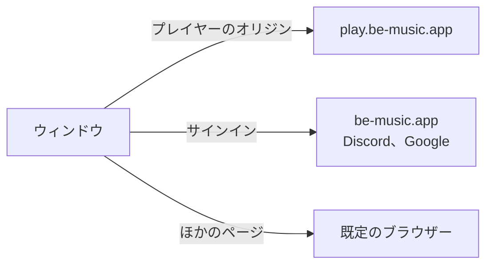

[English](./README.md)

# @be-music/app-desktop

デスクトップ版は、Web 版のプレイヤーを Electron で包んだアプリです。ウィンドウはプレイヤーをサーバー（`https://play.be-music.app/`）から開くので、プレイヤーは Chrome と同じように動きます。クロスオリジン分離、サインイン、設定の同期、URL 読み込みのプロキシは、どれもサーバーのものをそのまま使います。

いまは試作です。macOS 版はアドホック署名、Windows のインストーラーは署名なしです。署名、公証、自動更新はこの次に入れます。

## ラッパーが足すもの

- **専用のウィンドウとアイコン**: ブラウザーや、そのストレージの削除から切り離されます。ウィンドウは大きさ、位置、最大化、フルスクリーンを覚えます。いまはないディスプレイに保存された位置は使いません。
- **確認なしのフォルダーアクセス**: プレイヤーが求める権限（File System Access、MIDI、フルスクリーン）は、プレイヤーのオリジンにだけ許可し、ほかのページには許可しません。
- **バックグラウンドでの間引きなし**: ほかのウィンドウに隠れても、音の予約と描画を間引きません。
- **リンク**: プレイヤーとサインインの流れはウィンドウの中で開き、Leaderboard のランキングなどほかのページは既定のブラウザーで開きます。Discord とパスキーは、ウィンドウの中でサインインできます。Google は、ユーザーエージェントから Electron の部分を取り除いても埋め込みブラウザーからのサインインを拒むので、いまは使えません。使えるようにするには、サインインを既定のブラウザーで行う必要があります。
- **起動は 1 つだけ**: 2 回目に起動すると、開いているウィンドウを前に出します。ウィンドウを閉じるとアプリも終わります（macOS でも同じです）。



## オフライン

アプリはプレイヤーを同梱していません。一度オンラインでプレイヤーを開けば、オフラインでも動きます。プレイヤーの Service Worker が、画面の本体、フォント、FFmpeg のコアを保存していて、ネットワークがなくても返すからです。接続がないまま初めて起動したときは、再試行のページを表示します。サインイン、設定の同期、Leaderboard への送信、URL からの譜面の読み込みなど、サーバーが要る機能は、ブラウザーと同じくネットワークが必要です。

## 実行

```bash
pnpm --filter @be-music/app-desktop run dev
```

初回は Electron をダウンロードします。別のプレイヤーを開くときは `--play-url` を渡します（`BE_MUSIC_PLAY_URL` でも指定できます）。

```bash
pnpm --filter @be-music/app-desktop exec electron . --play-url=https://play.preview.be-music.app/
```

## パッケージ化

```bash
pnpm --filter @be-music/app-desktop run dist
```

electron-builder がインストーラーを `release/` に書き出します。実行したプラットフォームの分だけ作ります。Mac はアーキテクチャーごとの DMG と ZIP、Windows は NSIS のインストーラー、Linux は AppImage です。ワークフロー [`desktop.yml`](../../.github/workflows/desktop.yml) が、このパッケージが変わるたびに macOS と Windows 向けを作り、成果物として残します。

インターネットからダウンロードしたアドホック署名のアプリは、システム設定の「プライバシーとセキュリティ」で許可するまで macOS が開きません。

`build/` のアイコンは、プレイヤーのインストール用のアートワークから作ります。アートワークを変えたら、次を実行します。

```bash
pnpm --filter @be-music/app-desktop run build:icons
```
