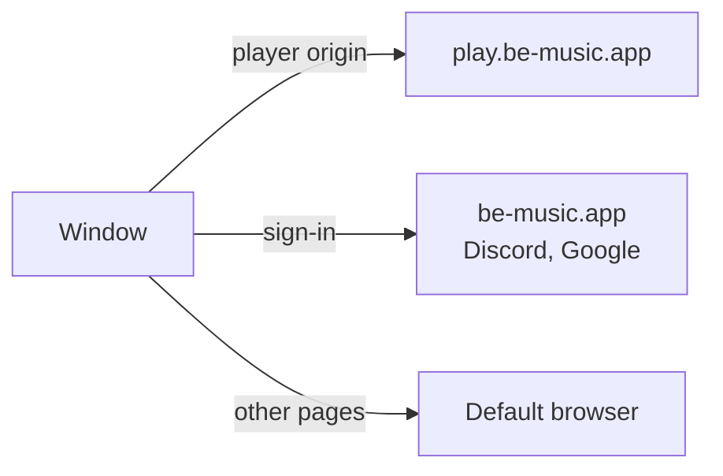

[日本語](./README.ja.md)

# @be-music/app-desktop

The desktop app wraps the web player in Electron. Its window shows the player from its server (`https://play.be-music.app/`), so the player runs as it does in Chrome: cross-origin isolation, sign-in, settings sync and the URL load proxy all come from the server unchanged.

It is a prototype. The macOS build is signed ad hoc and the Windows installer is unsigned; signing, notarization and auto-update come next.

## What the wrapper adds

- **Its own window and icon**, apart from the browser and its storage clearing. The window remembers its size, position, maximized state and full screen; a saved position on a display that is gone is dropped.
- **Folder access without prompts**: the player's permission requests (File System Access, MIDI, full screen) are granted for the player's origin and refused for any other page.
- **No background throttling**: audio scheduling and rendering keep full rate while another window covers this one.
- **Links**: the player and its sign-in flow stay in the window; other pages, such as Leaderboard rankings, open in the default browser. The app removes Electron's tokens from the user agent, because Google refuses to sign in from an embedded browser it recognizes.
- **One instance**: a second launch focuses the running window. Closing the window quits the app, on macOS too.



## Offline

The app does not bundle the player. It works offline once it has opened the player online: the player's service worker keeps its shell, fonts and FFmpeg core, and serves them with no network. On a first launch without a connection, the window shows a retry page instead. Features that need a server (sign-in, settings sync, Leaderboard submission, loading charts by URL) need the network, as in the browser.

## Running

```bash
pnpm --filter @be-music/app-desktop run dev
```

The first run downloads Electron. To open another player, pass `--play-url` (or set `BE_MUSIC_PLAY_URL`):

```bash
pnpm --filter @be-music/app-desktop exec electron . --play-url=https://play.preview.be-music.app/
```

## Packaging

```bash
pnpm --filter @be-music/app-desktop run dist
```

electron-builder writes the installers to `release/`: a DMG and a ZIP for each Mac architecture, an NSIS installer for Windows and an AppImage for Linux, each for the platform it runs on. The workflow [`desktop.yml`](../../.github/workflows/desktop.yml) packages the macOS and Windows builds when this package changes and keeps them as artifacts.

macOS opens an ad hoc signed app downloaded from the internet only after the user allows it in System Settings › Privacy & Security.

The icons in `build/` come from the player's installed-app artwork. After changing it, run:

```bash
pnpm --filter @be-music/app-desktop run build:icons
```
