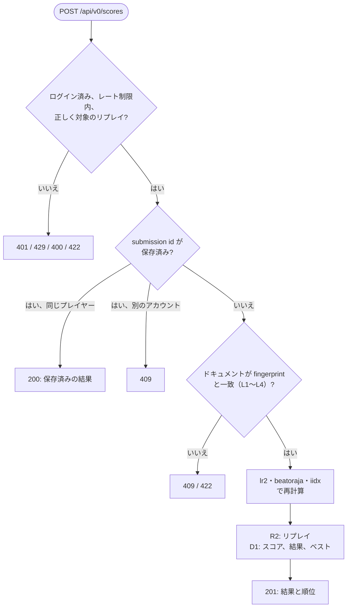
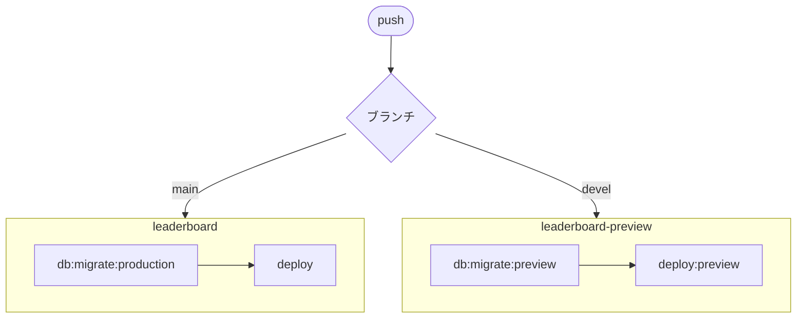

[English version](./README.md)

# @be-music/app-leaderboard

be-music の Leaderboard API です。Cloudflare Workers 上の Hono アプリで、D1 と R2 を使います。設計は
[docs/leaderboard.ja.md](../../docs/leaderboard.ja.md) にあり、この README は動かし方とデプロイ方法を扱います。

## 実装済みのもの

- 独立した Accounts に OIDC でログイン。ゲスト、パスキー、設定済みの Discord／Google に対応。
- `POST /api/v0/scores`: リプレイ（gzip）を送信します。サーバーは対象かどうかの判定と、play / chart fingerprint の
  ドキュメントの確認（検証レイヤー L1〜L3、`#RANDOM` のない譜面では L4 も）を行い、`lr2`・`beatoraja`・`iidx` で再計算し、
  ログを R2 に保存して自己ベストを更新します。再送された同じプレイはそれと分かり、別のアカウントからの同じプレイは
  拒否します。
- `GET /api/v0/charts/:chartFingerprint/leaderboard` と `.../leaderboard/me`: ランキング。アシスト付きのプレイ、匿名の
  プレイヤー、「このルールセットでプレイしたもの」のフィルタ付き。
- `GET /api/v0/scores/:id` と `.../replay`。
- コースのプレイ（docs/leaderboard.ja.md 6.1 節）: `POST /api/v0/course-scores`、最新のプレイ、1 プレイ、そのリプレイ、
  プレイの非表示、コース、そのランキングと自分の順位。コースとルールセットごとのベスト（トロフィーのベストを含む）を持ちます。
- `GET /api/v0/openapi.json`: OpenAPI 3.1 のドキュメント。ルートの valibot スキーマ（`src/api/schemas.ts`）から生成します。リファレンスページは `/api-reference` です。コピーを [`openapi.json`](./openapi.json) としてコミットしており、古くなるとテストが失敗します。API を変えたら `vp test run -u` で更新してください。

- `leaderboard.be-music.app` のルートのページ: 新着スコアとコースのプレイ（トップ）、スコア、譜面のランキング、作品、コース、
  コースのプレイ、プレイヤー。

未実装: 新しい `#RANDOM` の結果に対する L4 と L5、ライバル、OG カード。

スコアの送信を、Worker が確かめる順に示します（`src/api/v0.ts`、`src/scores/submit.ts`）。クライアントを含む全体のシーケンスは [docs/leaderboard.ja.md 5.2 節](../../docs/leaderboard.ja.md#52-シーケンス) にあります。



## 準備

Worker は Vite+ で `dist/worker.js` にバンドルします（`build:worker`、設定は `vite.worker.config.ts`）。これが
`cloudflare.config.ts` がデプロイするエントリポイントです。ワークスペースのパッケージは `source` エクスポート条件で
ソースを直接読むので、個別のビルドは要りません。`cf` は自前の esbuild でエントリポイントをバンドルしますが、この条件を
知らないので、出来上がったバンドルを読み直すだけにしています。`dev` とデプロイは先に `build:worker` を実行します。
`cf dev` の実行中に `src/` を変えたら作り直すと、`cf dev` が読み込み直します。

```bash
pnpm --filter @be-music/app-leaderboard run build:worker
```

リソースは be-music のアカウントに作成済みです（D1 と R2 を APAC に、環境ごとに 1 つずつ）。D1 の id は
`cloudflare.config.ts` とマイグレーションのスクリプトに書いてあります。新しい環境では作成して id を記録します。

```bash
pnpm exec cf d1 create --name leaderboard-preview --primary-location-hint apac
```

```bash
pnpm exec cf r2 buckets create --name leaderboard-preview --location-hint apac
```

### Secrets

本番の認証は [Accounts](../../docs/services.ja.md#3-ログイン) が所有します。この Worker に必要なのは、ホスト専用の OIDC Cookie を暗号化する `SESSION_SECRET` です。外部ログインの秘密値と署名鍵は Accounts に置き、古い Better Auth は localhost のテスト・開発だけで使います。

1Password の `my.1password.com` にある `be-music` Vault の `cloudflare-leaderboard-oidc/credential`（本番）と `cloudflare-leaderboard-preview-oidc/credential`（プレビュー）に保存します。`secrets/<環境>.env.tpl` は参照だけです。CLI にサインインした状態で `pnpm --filter @be-music/app-leaderboard run secrets:preview` を実行すると、値を表示せずに設定します。`SESSION_SECRET` の変更で切れるのは、このアプリのログインだけです。

アカウントに触る操作は、対象アカウントを明示して `cf` で行います。

`cloudflare.config.ts` で宣言した secret はデプロイのたびに必須です。新しい Worker の最初のデプロイではファイルで渡す必要があります（`cf deploy --secrets-file`）。名前付きパイプを使えば値をディスクに書かずに済みます。

```bash
d=$(mktemp -d) && mkfifo -m 600 "$d/secrets" && (op inject -i secrets/preview.env.tpl > "$d/secrets" &) && pnpm exec cf deploy --mode preview --secrets-file "$d/secrets"; rm -rf "$d"
```

以降のデプロイでは設定済みの secret が引き継がれます。

| Secret           | 用途                                                                         |
| ---------------- | ---------------------------------------------------------------------------- |
| `SESSION_SECRET` | アプリ・環境ごとに異なる 32 文字以上のランダムな値。OIDC Cookie を暗号化する |

## データベース

スキーマは `src/db/schema.ts` にあります。変更したらマイグレーションを生成してコミットします。

```bash
pnpm --filter @be-music/app-leaderboard run db:generate
```

マイグレーションはデプロイより先に実行するので、動いている旧コードと両立させます（追加 → 切り替え → 削除）。

```bash
pnpm --filter @be-music/app-leaderboard run db:migrate:preview
```

## デプロイ

環境は、どのサービスとも同じく 2 つです（docs/services.ja.md 2 章）。`main` が本番、`devel` がプレビューです。

| 環境       | Worker                | ホスト                             | D1                    | R2                    |
| ---------- | --------------------- | ---------------------------------- | --------------------- | --------------------- |
| 本番       | `leaderboard`         | `leaderboard.be-music.app`         | `leaderboard`         | `leaderboard`         |
| プレビュー | `leaderboard-preview` | `leaderboard.preview.be-music.app` | `leaderboard-preview` | `leaderboard-preview` |

`main` か `devel` に push するたびに、Deploy ワークフロー（`.github/workflows/deploy.yml`）が動きます。その環境の D1 に
マイグレーションを適用してから、ほかの Worker より先にこの Worker をデプロイします。ほかの Worker がこの Worker を
バインドしているためです。



`deploy` と `deploy:preview` は、ページのアセットを生成し、`build:worker` を実行してから `cf deploy` します。手で
デプロイするときは、このパッケージで同じコマンドを実行します。新しい Worker にはまだ secret がないので、最初の
デプロイでは `--secrets-file` で渡します（例: `cf deploy --secrets-file <(op inject -i secrets/production.env.tpl)`）。

この Worker は、自分のホストでページと API を配信し、Accounts を切り出すまでは全サービスの Better Auth も受け持ちます
（docs/services.ja.md 3 章）。Accounts、Player、Dashboard の Worker は Service Binding でこの Worker を呼び、セッション
Cookie は環境の親ドメインで共有します。

## ページ

ページは Hono JSX で、Tailwind CSS v4 と [Basecoat](https://basecoatui.com)（フレームワークの
ランタイムなしの shadcn/ui デザイン）でスタイルを付けています。`src/pages/app.css` は `src/pages/styles.generated.ts`
にコンパイルされ、`/assets/app.<hash>.css` から配信されます。

スタイルシート、アイコン、シェアカードのフォント、クライアントスクリプト（`src/pages/*.generated.ts`）は生成物で、git には入れません。
`pnpm install`、`dev`、デプロイ、テストの前に生成されます。`cf dev` の実行中にページのクラス、アイコン、`client/`
を変えたら作り直します。

```bash
pnpm --filter @be-music/app-leaderboard run generate
```

`build:css`、`build:icons`、`build:fonts`、`build:client` はそれぞれ 1 つだけ作ります。シェアカードの英数字は [Inter Tight](https://github.com/rsms/inter)（SIL Open Font License 1.1）で、`/assets/` から配信します。

### アイコン

ページのアイコンは `src/pages/icons/icon.svg` です。ブラウザのタブにはこれがそのまま表示されます。ホーム画面用（180 px）と Web アプリマニフェスト用（192 / 512 px）のアイコンはこの SVG から描画します。アイコンを変えるときは SVG を差し替えて、作り直します。

```bash
pnpm --filter @be-music/app-leaderboard run build:icons
```

アイコンは `src/pages/icons.generated.ts` にまとめられ、`/manifest.webmanifest` と並んで `/assets/<名前>.<hash>.<拡張子>` から配信されます。SVG の隣に手描きの PNG（`apple-touch-icon.png`、`icon-192.png`、`icon-512.png`）を置くと、描画したものの代わりにそちらを使います。

## テスト

`pnpm test` で、ワークスペースのほかのテストと一緒にこのパッケージのテストも実行されます。API のテストは Miniflare の
本物の D1 / R2 binding で Hono アプリを動かすので、マイグレーションも確かめます。
