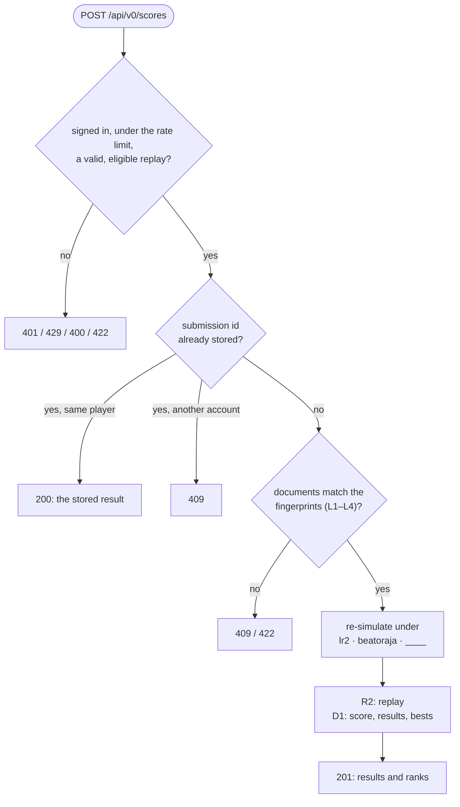
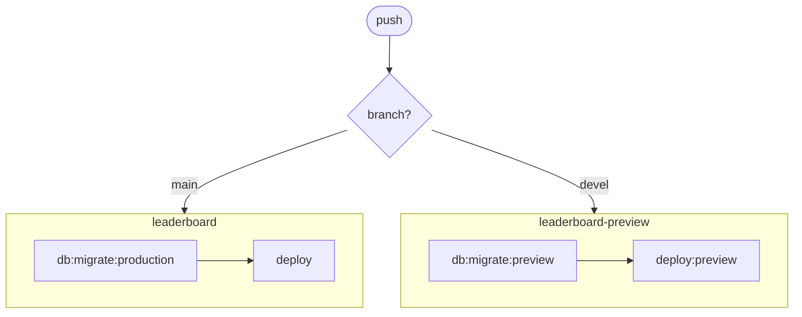

[Japanese version](./README.ja.md)

# @be-music/app-leaderboard

The be-music Leaderboard API: a Hono app on Cloudflare Workers with D1 and R2. The design is in
[docs/leaderboard.md](../../docs/leaderboard.md); this README covers running and deploying it.

## What is implemented

- OIDC sign-in through the independent Accounts service, with guest accounts, passkeys and configured Discord/Google providers.
- `POST /api/v0/scores`: submits a replay (gzip). The server checks eligibility and the play and chart fingerprint
  documents (verification layers L1–L3, and L4 for charts without `#RANDOM`), re-simulates the play under `lr2`,
  `beatoraja` and `____`, stores the log in R2 and updates personal bests. A retried play is recognised; the same play
  from a second account is refused.
- `GET /api/v0/charts/:chartFingerprint/leaderboard` and `.../leaderboard/me`: rankings, with filters for assisted
  plays, anonymous players, and "played under this ruleset".
- `GET /api/v0/scores/:id` and `.../replay`.
- Course runs (docs/leaderboard.md section 6.1): `POST /api/v0/course-scores`, the latest runs, one run, its replay,
  hiding a run, a course, its ranking and my rank on it, with bests (the trophy best included) per course and ruleset.
- `GET /api/v0/openapi.json`: the OpenAPI 3.1 document, generated from the routes' valibot schemas
  (`src/api/schemas.ts`), and its reference page at `/api-reference`. A copy is committed as
  [`openapi.json`](./openapi.json); the test fails when it is out of date, so refresh it with `vp test run -u` after
  changing the API.

- Pages at the root of `leaderboard.be-music.app`: new scores and course runs (top), a score, a chart's rankings, a chartset, a course, a
  course run, and a player.

Not implemented: L4 for new `#RANDOM` outcomes, L5 and rivals. Score share cards are generated in the browser, uploaded through `PUT /api/v0/scores/:id/card` and served by `/scores/:id/card`.

A score submission, in the order the Worker checks it (`src/api/v0.ts`, `src/scores/submit.ts`); the full sequence with the client is in [docs/leaderboard.md section 5.2](../../docs/leaderboard.md#52-sequence):



## Setup

The Worker is bundled by Vite+ into `dist/worker.js` (`build:worker`, configured in `vite.worker.config.ts`), which is
the entrypoint `cloudflare.config.ts` deploys. It reads the workspace packages' sources through their `source` export
condition, so they need no build of their own. `cf` bundles its entrypoint with its own esbuild, which knows nothing of
that condition; it only re-reads the finished bundle. `dev` and the deploys run `build:worker` first. After changing
`src/` while `cf dev` runs, rebuild and `cf dev` reloads:

```bash
pnpm --filter @be-music/app-leaderboard run build:worker
```

The resources already exist in the be-music account (D1 and R2 in APAC, one of each per environment); their D1 ids
are in `cloudflare.config.ts` and the migrate scripts. For a new environment, create them and record the new id:

```bash
pnpm exec cf d1 create --name leaderboard-preview --primary-location-hint apac
```

```bash
pnpm exec cf r2 buckets create --name leaderboard-preview --location-hint apac
```

### Secrets

Production authentication is owned by [Accounts](../../docs/services.md#3-sign-in). This Worker needs `SESSION_SECRET` for its host-only OIDC cookie; provider secrets and signing keys belong to Accounts. The old local Better Auth adapter is restricted to localhost tests/development.

Store each environment's secret in the `be-music` vault of `my.1password.com`: `cloudflare-leaderboard-oidc/credential` for production, `cloudflare-leaderboard-preview-oidc/credential` for preview. `secrets/<environment>.env.tpl` contains references only. With the 1Password CLI signed in, `pnpm --filter @be-music/app-leaderboard run secrets:preview` installs the preview secret without printing values. Rotating `SESSION_SECRET` signs users out of this app only.

Use `cf`, not Wrangler, for anything that touches an account: Wrangler keeps its own login, which may be another
Cloudflare account.

A secret declared in `cloudflare.config.ts` is required on every deploy. The first deploy of a new Worker must carry it
in a file (`cf deploy --secrets-file`); a named pipe keeps the value off the disk:

```bash
d=$(mktemp -d) && mkfifo -m 600 "$d/secrets" && (op inject -i secrets/preview.env.tpl > "$d/secrets" &) && pnpm exec cf deploy --mode preview --secrets-file "$d/secrets"; rm -rf "$d"
```

Later deploys keep the secrets already set.

| Secret           | Purpose                                                                                              |
| ---------------- | ---------------------------------------------------------------------------------------------------- |
| `SESSION_SECRET` | A separate random secret of at least 32 characters per app/environment; encrypts the OIDC app cookie |

## Database

The schema lives in `src/db/schema.ts`. After changing it, generate a migration and commit it:

```bash
pnpm --filter @be-music/app-leaderboard run db:generate
```

Migrations run before the deploy and must work with the code still running (add, switch, then remove):

```bash
pnpm --filter @be-music/app-leaderboard run db:migrate:preview
```

## Deploy

Two environments, like every service (docs/services.md section 2): `main` is production, `devel` the preview.

| Environment | Worker                | Host                               | D1                    | R2                    |
| ----------- | --------------------- | ---------------------------------- | --------------------- | --------------------- |
| production  | `leaderboard`         | `leaderboard.be-music.app`         | `leaderboard`         | `leaderboard`         |
| preview     | `leaderboard-preview` | `leaderboard.preview.be-music.app` | `leaderboard-preview` | `leaderboard-preview` |

The Deploy workflow (`.github/workflows/deploy.yml`) runs on every push to `main` or `devel`. It applies the migrations
to the environment's D1, then deploys this Worker before the others, since they bind it:



`deploy` and `deploy:preview` generate the pages' assets, run `build:worker`, then `cf deploy`. To deploy by hand, run
the same commands in this package. A new Worker has no secrets yet, so its first deploy passes them with
`--secrets-file` (for example `cf deploy --secrets-file <(op inject -i secrets/production.env.tpl)`).

The Worker serves its pages and API on its own host, and holds Better Auth for every service until Accounts is split
out (docs/services.md section 3): the Accounts, Player and Dashboard Workers reach it through Service Bindings, and its
session cookies are shared on the environment's parent domain.

## Pages

The pages are Hono JSX styled with Tailwind CSS v4 and [Basecoat](https://basecoatui.com) (the
shadcn/ui design without a framework runtime). `src/pages/app.css` compiles into `src/pages/styles.generated.ts`,
served from `/assets/app.<hash>.css`.

The stylesheet, the icons, the share card's font and the client script (`src/pages/*.generated.ts`) are generated, not kept in git.
`pnpm install`, `dev`, the deploys and the tests generate them; after changing the pages' classes, the icons or
`client/` while `cf dev` runs, regenerate them:

```bash
pnpm --filter @be-music/app-leaderboard run generate
```

`build:css`, `build:icons`, `build:fonts` and `build:client` run one step each. The share card sets Latin letters and figures in [Inter Tight](https://github.com/rsms/inter) (SIL Open Font License 1.1), served from `/assets/`.

### Icons

The pages' icon is `src/pages/icons/icon.svg`: the browser tab shows it as is. The home-screen icon (180 px) and the
web app manifest icons (192 / 512 px) are rendered from it. To change the icon, replace the SVG and rebuild:

```bash
pnpm --filter @be-music/app-leaderboard run build:icons
```

The icons are compiled into `src/pages/icons.generated.ts` and served from
`/assets/<name>.<hash>.<ext>`, next to `/manifest.webmanifest`. A hand-made PNG placed next to
the SVG (`apple-touch-icon.png`, `icon-192.png`, `icon-512.png`) is used instead of its rendered one.

## Tests

`pnpm test` runs this package's tests with the rest of the workspace. The API tests drive the Hono app with real D1
and R2 bindings from Miniflare, so they also check the migrations.
