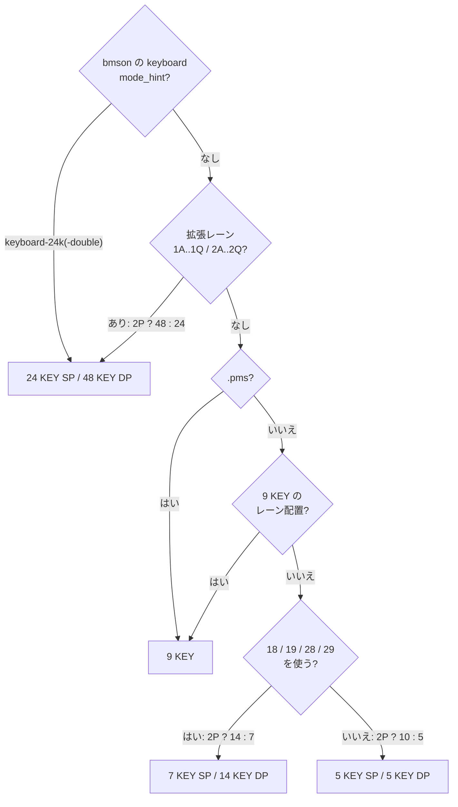

[English version](./README.md)

# @be-music/chart-model

beat 解決、イベント順序、ロングノート解決、タイミング、ノートの意味、プレイ形態、譜面フィンガープリントなどの譜面意味論 helper です。[`@be-music/chart-source`](../chart-source/README.ja.md) の pure IR を読みます。

このパッケージは実行環境に依存しません。Node の組み込みモジュールを import せず、DOM や Node 専用のグローバルも使いません。

[BMS 実装仕様](../../docs/bms-spec.ja.md)、[bmson 実装仕様](../../docs/bmson-spec.ja.md)、[譜面フィンガープリント仕様](../../docs/fingerprint-spec.ja.md) を参照してください。

## レーンモード自動判定

`resolveChartPlayVariant` は使用チャンネルから次のモードを自動判定します。

- `5 KEY SP`
- `5 KEY DP`
- `7 KEY SP`
- `14 KEY DP`
- `9 KEY`
- `24 KEY SP`
- `48 KEY DP`

拡張子で判定に関わるのは `.pms` だけです。`.pms` のファイルはレーンの規則より先に `9 KEY` になります。`.bms`、`.bme`、`.bml` は使っているレーンで決まるので、6 / 7 鍵の列がない `.bme` の譜面は `5 KEY` です。

- `11..19` をすべて使う 1P keyboard、または従来 名前を言ってはいけないあのゲーム 2P channel を含まない PMS-STD `22..25` も `9 KEY` として判定します。
- 拡張レーンチャンネル (`1A..1O` / `2A..2O`、またはホイールの `1P` / `1Q` / `2P` / `2Q`) があれば、他のどのルールよりも優先して `24 KEY SP` / `48 KEY DP` と判定します。bmson の `mode_hint` が `keyboard-24k` / `keyboard-24k-double` の場合も同じです。

判定規則は次の順に調べ、最初に当てはまったものを採ります。「9 KEY のレーン配置」は次の 3 つの内容規則のいずれかです。`17` があり `21` / `26..29` がない `#PLAYER 3`、2P のレーンがなく `11..19` をすべて使う譜面、`21` / `26..29` なしで `22..25` を使う譜面です。「2P」は `2x` のレーンを 1 つでも使うことを指します。レーンの使用は `1x` / `2x` のレーンと `5x` / `6x` のロングノートで数え、地雷と不可視オブジェクトは数えません。

ターミナルプレイヤーで各モードのチャンネルがどのキーに割り当たるかは [`@be-music/player-terminal` — レーンの入力割り当て](../player-terminal/README.ja.md#レーンの入力割り当て) を参照してください。
