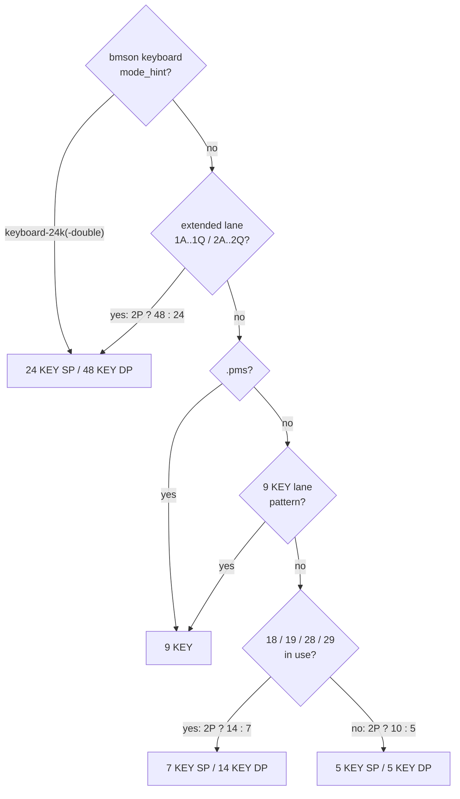

[Japanese version](./README.ja.md)

# @be-music/chart-model

Chart semantics helpers for Be-Music: beat resolution, event order, long note resolution, timing, note semantics, play variants and chart fingerprints. It reads the pure IR of [`@be-music/chart-source`](../chart-source/README.md).

The package is runtime-neutral: it imports no Node built-in and uses no DOM or Node-only globals.

See the [BMS implementation specification](../../docs/bms-spec.md), the [bmson implementation specification](../../docs/bmson-spec.md) and the [chart fingerprint specification](../../docs/fingerprint-spec.md).

## Automatic lane mode determination

`resolveChartPlayVariant` automatically determines the next mode based on the channel used.

- `5 KEY SP`
- `5 KEY DP`
- `7 KEY SP`
- `14 KEY DP`
- `9 KEY`
- `24 KEY SP`
- `48 KEY DP`

Only the `.pms` extension takes part: a `.pms` file is `9 KEY` ahead of the lane rules. `.bms`, `.bme` and `.bml` files are decided by the lanes in use, so a `.bme` chart without the 6 / 7 key columns is `5 KEY`.

- A full `11..19` one-player keyboard or PMS-STD `22..25` without traditional That-Which-Must-Not-Be-Named 2P channels also resolves to `9 KEY`.
- Any extended lane channel (`1A..1O` / `2A..2O`, or the wheel `1P` / `1Q` / `2P` / `2Q`) resolves to `24 KEY SP` / `48 KEY DP` ahead of every other rule, and so does a bmson `keyboard-24k` / `keyboard-24k-double` `mode_hint`.

The rule checks in this order, and the first match wins. The 9 KEY lane pattern is any of three content rules: `#PLAYER 3` with `17` and without `21` / `26..29`, all of `11..19` without a 2P lane, or `22..25` without `21` / `26..29`. "2P" means any `2x` lane in use; lane usage counts the `1x` / `2x` lanes and the `5x` / `6x` long notes, never mines or invisible objects.

The keys each mode's channels map to in the terminal player are listed in [`@be-music/player-terminal` — Lane input assignment](../player-terminal/README.md#lane-input-assignment).
